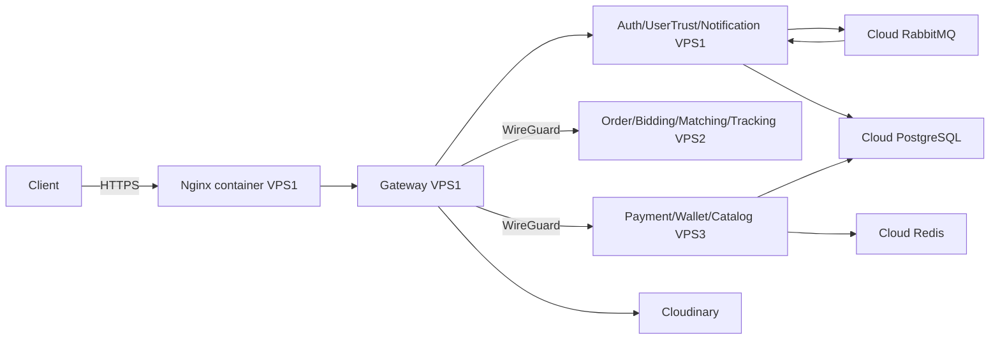

# HANDY GO — Production Backend trên 3 VPS

## 1. Phạm vi và cấu trúc repository

Git root chứa `.github/workflows/`, `backend/`, `frontend/`, `mobile/`. Backend không phải repository riêng. Dùng đường dẫn `backend/**`, không dùng `be/**` trong workflow.

Chủ dự án đã phê duyệt ngày 16/10/2026: **chạy đủ 11 ứng dụng, kể cả service chỉ có healthcheck**. Đây là phạm vi triển khai kỹ thuật, không phải chứng nhận hoàn thiện nghiệp vụ. Các service vẫn được ghi PARTIAL. Không chạy service thực sự không build được hoặc NOT_READY; build thất bại chặn phát hành thay vì tạo image giả.

Một Compose: `backend/deploy/production/compose.production.yml`. Một ENV ứng dụng: `env/production.env.example` là template; bản thật đặt trong GitHub Environment secret `BACKEND_PRODUCTION_ENV`. Cùng một nội dung được sao chép tới ba VPS. Không có ENV ứng dụng riêng cho service/migration.

## 2. Danh sách, phân bổ và tài nguyên

| VPS | WireGuard | Service | Scope hiện tại | Hard limit / V8 heap MiB |
| --- | --- | --- | --- | --- |
| 1 | 10.77.0.1 | Nginx | HTTPS reverse proxy | 32 / — |
| 1 | | api-gateway | JWT/proxy/media | 160 / 80 |
| 1 | | auth-service | Register/OTP/login/refresh/reset | 208 / 112 |
| 1 | | user-trust-service | Profile/provisioning/RPC; chưa đầy đủ KYC | 176 / 96 |
| 1 | | notification-service | **Phase 1 core APIs**, chưa delivery/consumer | 128 / 64 |
| 2 | 10.77.0.2 | order-service | **Health-only** | 128 / 64 |
| 2 | | bidding-service | **Health-only** | 112 / 56 |
| 2 | | matching-service | **Health-only** | 160 / 80 |
| 2 | | tracking-service | **Health-only**, chưa realtime | 128 / 64 |
| 3 | 10.77.0.3 | payment-service | **Health-only** | 112 / 56 |
| 3 | | wallet-service | **Health-only** | 112 / 56 |
| 3 | | catalog-service | Category/service CRUD, cache, outbox | 224 / 128 |

Notification chạy trên **VPS1 theo quyết định của chủ dự án**, giữ limit 128 MiB và heap 64 MiB. Gateway gọi bằng Docker DNS nội bộ `http://notification-service:3008`; không publish cổng 3008 lên host. VPS3 giữ nhóm Payment/Wallet/Catalog và dự kiến bổ sung Chat/AI sau này; Chat/AI chưa tồn tại trong registry/Compose và chưa được cấp ngân sách RAM.

11 ứng dụng đều PARTIAL trong registry `services.json`; Nginx là infrastructure. Tổng RAM cap container: **704 / 528 / 448 MiB**. Preflight đọc **MemTotal + SwapTotal** từ `/proc/meminfo`, yêu cầu tổng ít nhất cap + 280 MiB cho host: VPS1 **984 MiB**, VPS2 808 MiB, VPS3 728 MiB. Chỉ swap đã bật mới xuất hiện trong SwapTotal; file swap chưa `swapon` không được tính. Ví dụ VPS1 có 900 MiB RAM + 1024 MiB swap sẽ qua kiểm tra. Vẫn yêu cầu ít nhất 280 MiB RAM vật lý cho host; khi phải dựa vào swap, Docker phải báo `SwapLimit=true`. Log và kết quả prepare ghi riêng RAM, swap và ngân sách yêu cầu. Đây là kiểm tra dung lượng tổng, không phải số bộ nhớ đang rảnh hoặc bảo đảm hiệu năng.

Compose giữ nguyên RAM cap/Node heap và đặt **memswap_limit = 2 × mem_limit** cho mỗi container: ví dụ Auth 208 MiB RAM + tối đa 208 MiB swap (416 MiB tổng). Migration dùng 384 MiB RAM + tối đa 384 MiB swap. Các giới hạn swap là trần, không đặt trước dung lượng; container cùng chia swap của host. Trước deploy, dùng `free -m`, `swapon --show` và `docker info --format '{{.SwapLimit}}'` để kiểm tra; bảo đảm swap được bật lại sau reboot. Swap trên đĩa chậm hơn RAM; cần theo dõi latency và OOM khi tăng tải.

Linux/Docker/WireGuard cần phần dự phòng riêng; CPU quota không tạo thêm CPU. Buffer, Prisma/pg, TLS và native allocations nằm ngoài V8 old-space. Ảnh upload hiện được buffer trước khi kiểm tra dung lượng; Nginx giới hạn 12 MiB/request nhưng nhiều upload đồng thời vẫn gây spike. Video upload trực tiếp Cloudinary.

Định hướng tương lai (ước lượng rất thấp về độ tin cậy, không phải benchmark): nhóm VPS 1 có thể cần khoảng 0,8–1,8 GiB ứng dụng; VPS 2 khoảng 0,8–2 GiB hoặc hơn khi matching/realtime phát triển; VPS 3 khoảng 0,5–1 GiB. Cộng host reserve và spike, **không cam kết đủ 3 × 1 GB khi hoàn thiện**. Benchmark normal/burst/background/reconnect và nâng tài nguyên trước promotion. Không có AI/FastAPI service trong repository hiện tại.

## 3. Kiến trúc và dependency



Auth login/refresh dùng RPC `user.auth-status`; registration phát outbox event cho User Trust provisioning. Auth và Catalog poll outbox mỗi 3 giây. User Trust consumer prefetch 10. Các service khung chưa có business consumer. Redis Catalog hiện có fallback; mất cache làm tăng tải DB.

Docker DNS chỉ áp dụng cùng VPS. URL trong ENV example dùng local service names cho VPS1 và WireGuard IP cho VPS2/3. Không dùng `depends_on` xuyên VPS. Coordinator triển khai VPS3 → VPS2 → VPS1; trong VPS1 User Trust trước Auth, Gateway và Nginx sau.

## 4. Chuẩn bị Ubuntu và Docker

Khuyến nghị Ubuntu **24.04 LTS**, CPU **amd64/x86_64** trên cả ba máy. Workflow hiện build linux/amd64; nếu ARM phải đổi build platform, manifest và kiểm thử native dependencies đồng bộ. Cần SSH port 22, Python >= 3.10, Docker Engine chạy rootful, Compose >= 2.30, WireGuard, tar và kết nối outbound DNS/HTTPS tới GHCR/Docker Hub cùng các cloud dependencies. Dành ít nhất 20 GiB disk cho OS, image hiện tại và các release để rollback; script chặn nếu còn dưới 2 GiB trống trước pull.

Thực hiện mục 4–5 và 8 trên **cả ba VPS**, đăng nhập bằng tài khoản **azureuser có sẵn** với quyền sudo. Workflow SSH bằng azureuser trên cả ba máy. Mục 7 chỉ dành cho VPS1. Không cần clone repository, cài Node/pnpm hay build image trên VPS; Actions gửi bundle và kéo image đã build.

Cài Docker Engine và Compose plugin theo [tài liệu Docker Ubuntu](https://docs.docker.com/engine/install/ubuntu/). Với Ubuntu mới chưa cài Docker, dùng repository chính thức:

```bash
sudo apt-get update
sudo apt-get install -y ca-certificates curl wireguard python3 openssl tar iproute2 iputils-ping
sudo install -d -m 755 /etc/apt/keyrings
sudo curl -fsSL https://download.docker.com/linux/ubuntu/gpg -o /etc/apt/keyrings/docker.asc
sudo chmod a+r /etc/apt/keyrings/docker.asc
. /etc/os-release
printf 'deb [arch=amd64 signed-by=/etc/apt/keyrings/docker.asc] https://download.docker.com/linux/ubuntu %s stable\n' "$VERSION_CODENAME" |
  sudo tee /etc/apt/sources.list.d/docker.list > /dev/null
sudo apt-get update
sudo apt-get install -y docker-ce docker-ce-cli containerd.io docker-buildx-plugin docker-compose-plugin
sudo systemctl enable --now docker
sudo docker run --rm hello-world
```

Nếu máy đã có Docker/containerd hoặc ứng dụng đang chạy, kiểm tra các package xung đột theo tài liệu Docker và lên lịch bảo trì trước khi đổi runtime. Kiểm tra `uname -m` phải là x86_64. Yêu cầu Compose >= 2.30 cho [`env_file.format: raw`](https://docs.docker.com/compose/how-tos/environment-variables/set-environment-variables/).

Thêm azureuser vào group Docker và chuẩn bị thư mục ứng dụng trên cả ba máy:

```bash
sudo usermod -aG docker azureuser
sudo install -d -o azureuser -g "$(id -gn azureuser)" -m 700 /opt/handygo /opt/handygo/releases
sudo install -d -o azureuser -g "$(id -gn azureuser)" -m 700 /home/azureuser/.ssh
```

Chỉ VPS1 cần các thư mục TLS/ACME:

```bash
sudo install -d -o root -g root -m 700 /opt/handygo/letsencrypt
sudo install -d -m 755 /opt/handygo/acme
sudo install -d -o azureuser -g 101 -m 750 /opt/handygo/tls
```

Thoát SSH rồi đăng nhập lại bằng azureuser để nhận group Docker. Chạy `id` để xác nhận có group docker và `docker version` không cần sudo. Cài authorized_keys mode 600, `.ssh` mode 700; chỉ tắt password/root SSH sau khi đã thử key thành công. Giữ nguyên các public key quản trị đang dùng khi bổ sung key cho Actions.

Thư mục `tls` do azureuser sở hữu để Python preflight kiểm tra được certificate; file certificate/key vẫn là root:101 mode 640 để Nginx UID/GID 101 đọc. Không thêm azureuser vào group hệ thống có GID 101.

Tạo `/opt/handygo/host.json`, owner azureuser, mode 600 trên mỗi host. Chọn đúng cặp trong bảng:

| Máy | HOST_ROLE | HOST_WG_IP | Chuẩn bị thêm |
| --- | --- | --- | --- |
| VPS1 | vps1 | 10.77.0.1 | DNS, port 80/443, certificate, ACME renewal |
| VPS2 | vps2 | 10.77.0.2 | Bind private ports 3004/3005/3006/3010 |
| VPS3 | vps3 | 10.77.0.3 | Bind private ports 3003/3007/3009 |

Ví dụ VPS1; đổi **cả hai** giá trị khi làm VPS2/VPS3:

```bash
HOST_ROLE=vps1
HOST_WG_IP=10.77.0.1
printf '{"role":"%s","private_ip":"%s"}\n' "$HOST_ROLE" "$HOST_WG_IP" |
  sudo -u azureuser tee /opt/handygo/host.json > /dev/null
sudo chown azureuser:"$(id -gn azureuser)" /opt/handygo/host.json
sudo chmod 600 /opt/handygo/host.json
```

VPS2: `vps2` / `10.77.0.2`; VPS3: `vps3` / `10.77.0.3`. Đây là metadata host, không phải ENV ứng dụng.

## 5. WireGuard và firewall

Dùng ba template `wireguard/vps*.conf.example`. Trên từng VPS tự tạo key, không lưu private key lên Git/GitHub:

```bash
sudo sh -c 'umask 077; wg genkey > /etc/wireguard/private.key'
sudo sh -c 'wg pubkey < /etc/wireguard/private.key > /etc/wireguard/public.key'
sudo cat /etc/wireguard/public.key
```

Copy template đúng máy tới `/etc/wireguard/wg0.conf`, điền peer public keys/public IP và private key chính máy. AllowedIPs giữ /32 từng peer. Đảm bảo 10.77.0.0/24 và Docker 172.30.1.0/24 không trùng mạng đang có.

```bash
sudo chmod 600 /etc/wireguard/wg0.conf
sudo systemctl enable --now wg-quick@wg0
sudo wg show
```

Đặt Docker systemd override để wg0 có IP trước khi khởi động published ports:

```ini
[Unit]
Requires=wg-quick@wg0.service
After=wg-quick@wg0.service
```

Dùng `sudo systemctl edit docker.service`, sau đó daemon-reload; restart Docker trong maintenance window.

```bash
sudo systemctl daemon-reload
sudo systemctl restart docker
ip -4 addr show dev wg0
# Ví dụ từ VPS1; trên hai VPS còn lại thử ping cả hai peer của chúng.
ping -c 3 10.77.0.2
ping -c 3 10.77.0.3
docker run --rm alpine:3.22 ping -c 3 10.77.0.2
docker run --rm alpine:3.22 ping -c 3 10.77.0.3
```

Phép thử từ container xác nhận đường Docker → WireGuard trước khi deploy; cho phép ICMP nội bộ giữa peer khi thử. Chưa có application container ở lần đầu nên chưa thể gọi `/health` trên cổng service. Sau reboot kiểm tra lại `wg0`, Docker và hai peer; nếu NAT/FORWARD bị chặn thì sửa firewall theo topology trước khi deploy.

Provider firewall: cả ba host chỉ mở SSH từ nguồn quản trị/CI tin cậy và UDP 51820 từ hai peer. VPS1 thêm TCP 80/443. Không public 3000–3010. Compose không publish port ứng dụng trên VPS1; VPS2/3 chỉ bind WireGuard IP. Kiểm tra IPv6 và Docker forwarding/DOCKER-USER; **không chỉ dựa vào UFW** để chặn Docker published ports. GitHub-hosted runner có IP thay đổi; ưu tiên egress cố định/bastion. Nếu mở SSH rộng thì bắt buộc key-only và theo dõi brute force.

Không chạy PostgreSQL, Redis hoặc RabbitMQ container trên các VPS. Cloud dùng TLS, IP allowlist cả ba VPS, credentials tối thiểu, backup/PITR và quota phù hợp. Database adapter hiện chưa có biến cấu hình pool max riêng; không tự thêm `DB_POOL_SIZE` rồi coi như đã có tác dụng.

## 6. Một ENV chung và GitHub secret

Copy `env/production.env.example` ra vị trí an toàn ngoài Git. Điền đầy đủ giá trị thật, rồi lưu nguyên nội dung vào secret GitHub `BACKEND_PRODUCTION_ENV` ở bước 9.

Template production giữ bố cục như `backend/.env.example`: **PHẦN 1** là cấu hình dùng chung (system, proxy, database, RabbitMQ, Redis, SMTP, JWT và Cloudinary); **PHẦN 2** chia đủ 11 service theo thứ tự cổng 3000–3010, ghi rõ VPS. URL upstream nằm trong mục API Gateway; URL database Auth/User Trust và OTP nằm tại mục service tương ứng. Mỗi service có đủ PORT_* và RABBITMQ_QUEUE_* để đối chiếu với ENV hiện có; Catalog có thêm DATABASE_URL_CATALOG. Notification có DATABASE_URL_NOTIFICATION tùy chọn; khi trống sẽ dùng DATABASE_URL với schema=notification_service. Migration Notification chạy trên VPS1 trước khi service khởi động. Các service health-only có sẵn mục để bổ sung ENV sau này. Biến dùng chung chỉ khai báo một lần.

Các biến được liệt kê đầy đủ không đồng nghĩa source đã sử dụng tất cả:

| Biến | Tác dụng hiện tại |
| --- | --- |
| PORT_* | Thông tin tham chiếu; cổng thực tế là PORT do Compose đặt. Đổi cổng cần cập nhật Compose, services.json và upstream URL. |
| RABBITMQ_QUEUE_* | Thông tin tham chiếu; queue hiện được truyền trong code, source chưa đọc các biến này. Muốn cấu hình queue qua ENV cần bổ sung code đọc biến. |
| DATABASE_URL_CATALOG | Tùy chọn, chỉ để tham chiếu; runtime và migration Catalog hiện đọc DATABASE_URL ở PHẦN 1. Đổi DATABASE_URL_CATALOG riêng chưa đổi database thực tế. |
| DATABASE_URL_AUTH / DATABASE_URL_USER_TRUST | Tùy chọn; bỏ qua hoặc để rỗng để runtime, migration và deployment probe dùng DATABASE_URL chung. Có giá trị thì ưu tiên URL riêng. |

DATABASE_URL_AUTH, DATABASE_URL_USER_TRUST và DATABASE_URL_CATALOG có thể bỏ qua hoặc để rỗng trong bản production. DATABASE_URL chung vẫn bắt buộc và phải dùng URL database thật; các key khác không được để rỗng. Khi dùng chung, DATABASE_URL nên không có tham số schema để Auth và User Trust tự chọn schema mặc định auth_service và user_trust_service.

Khi thêm ENV cho service, thêm vào đúng mục ở cả hai template, triển khai code đọc/validate biến đó, rồi cập nhật secret BACKEND_PRODUCTION_ENV trước khi deploy. Nếu thêm service hoặc đổi vị trí/cổng, cập nhật thêm services.json, Compose và URL upstream trong mục Gateway cho đồng bộ. Sửa file example không tự thay đổi cấu hình đang chạy trên VPS.

**Format raw:** mỗi dòng KEY=value; không quote bao quanh, không inline comment, không `${...}`, không source bằng shell. Dấu `$` và khoảng trắng trong password được giữ nguyên; URL user/password phải percent-encode. Không khai báo trùng key, không dùng placeholder. Không thêm PORT chung: Compose đặt PORT khác nhau theo container. NODE_OPTIONS cũng do Compose đặt để giới hạn heap.

- `env_file`: đưa ENV ứng dụng vào container.
- `--env-file /dev/null`: tránh tự đọc `.env` của người vận hành khi Compose nội suy.
- Metadata như APP_IMAGE/NGINX_IMAGE/PRIVATE_IP được host executor cung cấp cho process Compose.
- `environment` chỉ override PORT/NODE_OPTIONS; ConfigModule và cách đọc biến hiện có được giữ nguyên.

Khi chuyển từ mapping Notification trên VPS3 sang VPS1, cập nhật **NOTIFICATION_SERVICE_URL=http://notification-service:3008** trong GitHub Environment secret BACKEND_PRODUCTION_ENV trước lần deploy tiếp theo; không chỉ sửa file example. Coordinator sẽ dùng ENV mới giống nhau trên cả ba host và reconcile container theo manifest.

Ba bản sao ENV dùng cùng SHA-256 trong manifest. Mỗi release giữ một **snapshot của cùng ENV chung**, `releases/<id>/shared.env`, mode 600; không có auth.env/order.env/migration.env. Snapshot cũ là cần thiết để rollback đúng cấu hình. Đây là versioning của một cấu hình ứng dụng, không phải tách ENV theo service.

Tên DB: Catalog dùng DATABASE_URL; Auth ưu tiên DATABASE_URL_AUTH; User Trust ưu tiên DATABASE_URL_USER_TRUST. DATABASE_URL_CATALOG trong template hiện chỉ là biến tham chiếu, source chưa sử dụng. Dùng cùng cloud database với schema hiện có hoặc endpoint riêng qua những tên đã được source hỗ trợ. Migration dùng đúng các URL đó: chọn direct/session endpoint hỗ trợ DDL. Với transaction pooler không hỗ trợ migration, **chưa chạy run_migrations**; cần cấu hình endpoint phù hợp hoặc quy trình migration ngoài đã review.

JWT dùng cặp RSA production thật. Trên máy quản trị an toàn:

```bash
umask 077
openssl genpkey -algorithm RSA -pkeyopt rsa_keygen_bits:3072 -out jwt-private.pem
openssl pkey -in jwt-private.pem -pubout -out jwt-public.pem
openssl base64 -A -in jwt-private.pem
openssl base64 -A -in jwt-public.pem
```

Đặt output vào `JWT_PRIVATE_KEY=base64:...`, `JWT_PUBLIC_KEY=base64:...`. Source đã hỗ trợ prefix base64. Không dùng key trong example cũ. Sinh hai giá trị khác nhau bằng `openssl rand -hex 32` cho INTERNAL_SERVICE_SECRET và OTP_SECRET. SMTP Gmail dùng App Password; Cloudinary điền account thật.

**Giới hạn bảo mật:** mọi Backend container nhận toàn bộ secrets của file chung, bao gồm RSA private key. Bị chiếm một container có thể ảnh hưởng cả hệ thống. File permission, non-root, read-only, cap_drop, không mount Docker socket và redaction chỉ giảm rủi ro, không tạo cách ly secrets giữa service. Nginx không nhận file này. Không in `docker inspect` toàn bộ, `compose config` đầy đủ hoặc ENV vào logs; dùng `config --quiet`.

## 7. Nginx container và TLS lần đầu

Domain backend của dự án là **handygo.duyaivy.id.vn**; bản ghi DNS A trỏ về public IPv4 VPS1. Chỉ thêm AAAA nếu IPv6 thực sự hoạt động. Workflow mặc định dùng domain này; Environment variable API_DOMAIN có thể override khi đổi domain.

Nginx chính được CI/CD triển khai tự động:

- Coordinator thay API_DOMAIN trong template, đóng gói nginx.conf và handygo.conf, rồi gửi tới release bundle trên VPS1.
- Compose mount hai file từ bundle và chạy Nginx container, publish 80/443. Không cần tự tạo file Nginx trên VPS1 hoặc cài Nginx bằng apt.
- Request `/api/v1/...` được chuyển nguyên đường dẫn tới Gateway; không thêm hoặc cắt prefix tại Nginx. Ví dụ: `https://handygo.duyaivy.id.vn/api/v1/categories`.
- Workflow **chưa tự cấp/gia hạn certificate HTTPS**. Trước deploy đầu, phải có certificate/key đúng domain ở `/opt/handygo/tls/fullchain.pem` và `privkey.pem`. Host preflight sẽ chặn nếu thiếu.

Release archive dùng mode 0600 cho mọi file. Trong **prepare của VPS1**, sau khi xác minh checksum, executor tự `chmod 0644` đúng `nginx/nginx.conf` và `nginx/handygo.conf` của release đang xử lý. Thao tác idempotent, không đổi mode thư mục cha hoặc shared ENV (0600); không cần SSH sửa từng release. Docker daemon rootful truy cập đường dẫn host để bind-mount hai file riêng lẻ, nên không cần mở quyền toàn bộ `/opt/handygo` cho UID 101.

Sau pull, prepare đọc Compose JSON trong bộ nhớ để kiểm tra image digest, user `101:101` và đủ bốn bind mount read-only đúng nguồn/đích. Sau đó `docker compose run --rm --no-deps -T --pull never --entrypoint /bin/sh nginx ...` kế thừa user, mounts, read-only rootfs, tmpfs và resource/security limits. Container tạm kiểm tra hai config, certificate/key đều đọc được, thư mục TLS/ACME có quyền traverse, private key không world-readable, rồi chạy `nginx -t`. Không publish cổng, không chạy dependency; upstream dùng runtime DNS nên không cần bật Gateway. Xem [hành vi Compose run](https://docs.docker.com/reference/cli/docker/compose/run/). Override tạm chỉ bỏ IP tĩnh cho container kiểm tra để không tranh `172.30.1.10` với Nginx đang chạy; vẫn dùng network production. Có thể tạo network Compose nếu chưa tồn tại. Lỗi dừng ở prepare, trước migration/apply của cả ba host; các snapshot chưa touched được restore `NOT_NEEDED` rồi unlock. VPS2/VPS3 không chạy các thao tác Nginx này.

Preflight **không tự chmod/chown TLS**. Trước khi sửa TLS hiện có, kiểm tra metadata và mapping, không in nội dung key:

```bash
docker info --format '{{json .SecurityOptions}}'
docker inspect --format '{{.Config.User}} {{json .HostConfig.UsernsMode}} {{json .Mounts}}' handygo-nginx-1
sudo namei -l /opt/handygo/tls/privkey.pem
sudo stat -Lc '%a %u:%g %n' /opt/handygo/tls /opt/handygo/tls/fullchain.pem /opt/handygo/tls/privkey.pem
```

Với Docker rootful **đã xác nhận không user namespace remapping**, UID/GID container `101:101` tương ứng host 101:101. Phương án tối thiểu khi quyền sai là cho group 101 traverse thư mục TLS và đọc key: thư mục `azureuser:101` mode 0750, key `root:101` mode 0640 như cách provision dưới đây; fullchain mode 0640 cùng group hoặc 0644 đều được. Chỉ đổi metadata đúng các đường dẫn này nếu cần, sau khi kiểm tra owner/group/ACL hiện tại; không chown/chmod đệ quy, không đổi group hệ thống 101, không thêm azureuser vào group đó. Nếu rootless/userns/ACL khác, xác định mapping thực tế trước; container preflight là phép thử quyền cuối cùng. Quyền host ancestor và quyền bên trong mount là hai việc riêng: trong container, `/etc/nginx/tls` vẫn phải traverse được.

Nếu đã có certificate hợp lệ cho domain này, cài hai file vào đúng đường dẫn/mode như dưới. Nếu chưa có, cấp một lần bằng [Certbot standalone](https://eff-certbot.readthedocs.io/en/stable/using.html#standalone), không cần Nginx bootstrap hoặc tạo config thủ công. Thực hiện trên VPS1 dưới azureuser; thay admin@example.com bằng email thật. TCP 80 phải truy cập được từ Internet và đang trống khi chạy standalone. Nếu đã có Nginx/Apache/container chiếm 80/443, xử lý trong maintenance window trước.

```bash
sudo install -d -o root -g root -m 700 /opt/handygo/letsencrypt
sudo install -d -o azureuser -g 101 -m 750 /opt/handygo/tls
sudo install -d -m 755 /opt/handygo/acme
sudo docker run --rm -p 80:80 \
  -v /opt/handygo/letsencrypt:/etc/letsencrypt \
  certbot/certbot:v4.0.0 certonly --standalone --preferred-challenges http \
  --cert-name handygo.duyaivy.id.vn -d handygo.duyaivy.id.vn \
  --email admin@example.com --agree-tos --non-interactive &&
sudo install -o root -g 101 -m 640 /opt/handygo/letsencrypt/live/handygo.duyaivy.id.vn/fullchain.pem /opt/handygo/tls/fullchain.pem &&
sudo install -o root -g 101 -m 640 /opt/handygo/letsencrypt/live/handygo.duyaivy.id.vn/privkey.pem /opt/handygo/tls/privkey.pem
```

Certbot standalone tự kết thúc và container được xóa sau khi cấp certificate, giải phóng cổng 80 cho Nginx của workflow. Kiểm tra trước khi chạy CI/CD:

```bash
test -s /opt/handygo/tls/fullchain.pem
test -s /opt/handygo/tls/privkey.pem
sudo openssl x509 -in /opt/handygo/tls/fullchain.pem -noout -checkhost handygo.duyaivy.id.vn
sudo openssl x509 -in /opt/handygo/tls/fullchain.pem -noout -checkend 0
```

Runtime Nginx được workflow resolve và lưu digest trong manifest. Nó chạy UID 101, listen 8080/8443 trong container, host publish 80/443. Nginx static IP 172.30.1.10 khớp TRUSTED_PROXY_CIDRS. Proxy upstream qua Docker resolver để không giữ IP Gateway cũ sau recreate. `/edge-health` kiểm tra process Nginx; HTTPS smoke kiểm tra đường thật qua Gateway và DB.

Sau lần deploy đầu, cài cron/systemd timer trên VPS1, chạy mỗi ngày bằng root. Dùng webroot do Nginx đang phục vụ, thay cho standalone để không cần chiếm cổng 80:

```bash
sudo docker run --rm \
  -v /opt/handygo/letsencrypt:/etc/letsencrypt \
  -v /opt/handygo/acme:/var/www/certbot \
  certbot/certbot:v4.0.0 renew --webroot -w /var/www/certbot --quiet
```

Sau renew thành công, copy certificate/key từ thư mục live/handygo.duyaivy.id.vn như trên rồi `docker kill --signal=HUP handygo-nginx-1`. Kiểm tra renewal bằng lệnh trên thêm `--dry-run` trước khi bật timer. Mount cả thư mục TLS để thay file/renew không bị bind-mount inode cũ. Không ghi private key vào repository. Theo dõi ngày hết hạn certificate.

Timer/wrapper hoặc deploy hook chạy bằng root phải cài lại **owner/group/mode ở mỗi lần copy** (`install -o root -g 101 -m 640` với mapping đã xác minh), không dùng `cp` theo umask rồi giả định mode cũ được giữ. Nên cài vào file tạm bảo mật trong cùng thư mục TLS rồi rename từng file, chạy `docker exec handygo-nginx-1 nginx -t` trước HUP; chỉ reload khi cả hai file đã cập nhật thành công. Không deploy đồng thời lúc thay cặp cert/key. Giữ bản cũ an toàn để phục hồi nếu kiểm tra thất bại. Không thay các bản copy bằng symlink `live/` trỏ ra ngoài mount TLS: container không thấy cây Let's Encrypt đó. Chạy `renew --dry-run` kiểm tra challenge và kiểm tra riêng bước copy/permissions/test/reload với production lineage; dry-run không mặc định chạy deploy hooks. Xem [Certbot renewal hooks và certificate permissions](https://eff-certbot.readthedocs.io/en/stable/using.html#renewing-certificates). Workflow không cài timer/hook lên VPS, vì cấu hình hiện tại chưa được kiểm tra từ xa.

## 8. GHCR và SSH

Trên cả ba VPS, đăng nhập GHCR bằng **azureuser**, PAT classic chỉ có `read:packages` và SSO authorization nếu cần. Chạy `whoami` phải trả về azureuser trước khi thực hiện:

```bash
read -rs GHCR_TOKEN
printf '%s' "$GHCR_TOKEN" | docker login ghcr.io -u YOUR_GITHUB_USER --password-stdin
unset GHCR_TOKEN
```

Bảo vệ Docker credential store `/home/azureuser/.docker/config.json` hoặc dùng credential helper. PAT dùng ở host không phải GITHUB_TOKEN ngắn hạn của runner.

Tạo **ba cặp SSH Ed25519 key riêng** cho Actions. Public key của VPS nào cài vào azureuser trên VPS đó. Nếu đã có ba key đang đăng nhập được bằng azureuser thì dùng lại, bỏ qua bước sinh/cài key mới. Workflow không yêu cầu secret host keys: SSH tự ghi nhận host key ở lần kết nối đầu trong job.

Trên máy quản trị, tạo key ngoài repository:

```bash
ssh-keygen -t ed25519 -N '' -C handygo-actions-vps1 -f "$HOME/.ssh/handygo_vps1"
ssh-keygen -t ed25519 -N '' -C handygo-actions-vps2 -f "$HOME/.ssh/handygo_vps2"
ssh-keygen -t ed25519 -N '' -C handygo-actions-vps3 -f "$HOME/.ssh/handygo_vps3"
cat "$HOME/.ssh/handygo_vps1.pub"
cat "$HOME/.ssh/handygo_vps2.pub"
cat "$HOME/.ssh/handygo_vps3.pub"
```

Qua session azureuser trên từng VPS, thêm **dòng public key tương ứng** vừa tạo vào `/home/azureuser/.ssh/authorized_keys` (vps1.pub → VPS1, vps2.pub → VPS2, vps3.pub → VPS3), giữ lại nội dung có sẵn, rồi:

```bash
sudo chown azureuser:"$(id -gn azureuser)" /home/azureuser/.ssh/authorized_keys
sudo chmod 600 /home/azureuser/.ssh/authorized_keys
```

Trên máy quản trị, thử SSH bằng key tương ứng (thay hostname/IP thật):

```bash
ssh -i "$HOME/.ssh/handygo_vps1" -o IdentitiesOnly=yes \
  -o StrictHostKeyChecking=accept-new -o UserKnownHostsFile="$HOME/.ssh/handygo_known_hosts" \
  azureuser@VPS1_PUBLIC_IP 'set -e; id; docker version --format "{{.Server.Version}}"; docker compose version; python3 --version; test -w /opt/handygo/releases'
```

Lặp lại SSH với VPS2/VPS3 và đổi `-i` sang `handygo_vps2`/`handygo_vps3`. Nếu đang ở root hoặc account khác, chuyển sang `sudo -iu azureuser` trước khi đăng nhập GHCR. Actions SSH bằng azureuser và Docker dùng credential store của user này; đăng nhập bằng `sudo docker login` sẽ lưu credentials cho root thay vì azureuser.

Theo [OpenSSH](https://man.openbsd.org/ssh_config#StrictHostKeyChecking), `accept-new` tự chấp nhận host mới và từ chối host có key khác với bản đã lưu. Workflow dùng file `~/.ssh/handygo_known_hosts` riêng, khởi tạo rỗng ở đầu job, giữ xuyên suốt deploy/rollback và xóa khi kết thúc. **Runner mới sẽ tin host key đầu tiên của mỗi job**, nên không phát hiện giả mạo ở lần kết nối đầu hoặc thay đổi host key giữa các lần chạy. Ba private key xác thực quyền đăng nhập, không thay thế việc xác minh danh tính VPS. Đây là đánh đổi để giảm bước cấu hình. Khi dùng CLI trên máy cá nhân, file host keys tồn tại qua các lần chạy nên VPS cài lại/đổi key có thể cần đối chiếu fingerprint qua console trước khi cập nhật bản đã lưu.

## 9. Thêm Secrets/Variables trên GitHub

Repository → Settings → Environments → New environment → **production**. Deployment branches chỉ cho `release`; thêm reviewer nếu đội cần. Settings → Actions → General phải cho phép workflow publish packages bằng GITHUB_TOKEN và package phải cho repository access.

Trong **production → Environment secrets**, tạo:

| Secret | Giá trị |
| --- | --- |
| VPS1_HOST | Public IPv4/hostname VPS1, không scheme/port |
| VPS2_HOST | Public IPv4/hostname VPS2 |
| VPS3_HOST | Public IPv4/hostname VPS3 |
| VPS1_SSH_KEY | Toàn bộ private Ed25519 key từ handygo_vps1, không passphrase; public key chỉ cài trên VPS1 |
| VPS2_SSH_KEY | Toàn bộ private Ed25519 key từ handygo_vps2, không passphrase; public key chỉ cài trên VPS2 |
| VPS3_SSH_KEY | Toàn bộ private Ed25519 key từ handygo_vps3, không passphrase; public key chỉ cài trên VPS3 |
| BACKEND_PRODUCTION_ENV | Toàn bộ nội dung ENV chung đã điền ở mục 6 |

Domain mặc định của workflow là `handygo.duyaivy.id.vn`. Có thể đặt **production → Environment variables → API_DOMAIN=handygo.duyaivy.id.vn** cho rõ cấu hình; không thêm https:// hoặc path. Nếu đang có variable API_DOMAIN với domain mẫu/cũ, phải sửa hoặc xóa vì giá trị đó sẽ override mặc định. API_DOMAIN không phải ENV ứng dụng trong BACKEND_PRODUCTION_ENV.

Workflow đặt `DEPLOY_USER=azureuser` trực tiếp cho cả ba VPS; không cần tạo secret hoặc variable DEPLOY_USER. Nếu trước đây đã tạo secret DEPLOY_USER=deploy thì workflow hiện không sử dụng nó.

Ba secret SSH phải chứa **private key nhiều dòng đầy đủ**, gồm BEGIN/END, không phải public key hoặc đường dẫn file. Workflow kiểm tra key trống/sai format/có passphrase, ghi ba file mode 600 trên runner, rồi coordinator dùng `ssh -i` chọn đúng key cho từng VPS với `IdentitiesOnly=yes`. Cleanup xóa cả ba private key kể cả khi deploy thất bại. Không cần tạo secret `SSH_KNOWN_HOSTS`; nếu đã tạo trước đó thì có thể xóa. Khi chuyển từ key chung, cài và thử cả ba key mới trước khi gỡ public key chung khỏi authorized_keys.

Không cần tạo mỗi biến ứng dụng thành một GitHub secret riêng: SMTP/DB/Redis/Rabbit/JWT/Cloudinary đều nằm trong BACKEND_PRODUCTION_ENV. Không đặt secret vào Variables. Không cần GHCR_TOKEN trên GitHub: publish dùng GITHUB_TOKEN; host dùng PAT đã login. Workflow sử dụng SSH port 22.

## 10. CI và Production workflow

Flow Git: feature → PR main → **PR CI hiện có** → merge main → đưa main vào release → Production. Không tạo CI workflow khác. Giữ nguyên các bước lint/typecheck/tests/build trong PR CI; bổ sung bước lưu bằng chứng source sau build và nhận thay đổi hai workflow vào Backend path filter.

PR CI lưu artifact `backend-ci-proof-<run_attempt>` sau khi backend checks thành công: commit/tree checkout thật, Backend tree, hai workflow blobs, repository, PR number, Run ID và Run Attempt. Artifact không chứa secrets; giữ 90 ngày. Production chỉ đối chiếu source và kết quả **đúng PR CI**: PR đã merge vào main, merge commit thuộc lịch sử release, Backend CI và CI Gate đều success ở đúng attempt, artifact còn hạn và các hashes khớp cả source chuẩn bị deploy lẫn kết quả merge vào main.

**Production không cài pnpm/Node và không chạy lại lint/typecheck/unit tests của ứng dụng.** Mặc định, nếu thiếu artifact, CI chưa thành công, Backend CI bị skip, API không xác minh được hoặc merge conflict làm thay đổi source, deployment bị chặn trước build/publish/SSH. Không có fallback tự chạy lại tests hoặc tự bypass khi thiếu bằng chứng.

**Admin deploy sau khi push thẳng main:** đưa code từ main vào release (không cần PR nếu quyền branch cho phép), rồi Actions → Backend production → Run workflow → chọn branch **release** → bật **bypass_pr_ci**. Tùy chọn này mặc định tắt và chỉ áp dụng cho deploy thủ công, không bật cho push tự động. GitHub API phải xác nhận cả người tạo run (`GITHUB_ACTOR`) và người chạy/rerun (`GITHUB_TRIGGERING_ACTOR`) hiện có quyền **admin** trên repository; quyền write/maintain không đủ. Nếu API lỗi hoặc không xác minh được quyền thì chặn. Không cần tạo secret mới; dùng GITHUB_TOKEN hiện có để đọc quyền collaborator.

Bypass chỉ bỏ yêu cầu bằng chứng PR CI: không xác nhận lint/typecheck/unit tests ứng dụng đã chạy. Build image, kiểm tra deployment automation, cấu hình ENV, rollout/healthcheck và các yêu cầu Environment production vẫn áp dụng. Actions ghi warning và Job Summary; artifact `backend-ci-evidence` cùng manifest release lưu `method=admin-manual-override`, hai actors, run/attempt, commit và source hashes. Đây là bypass của script repo, không tự vượt branch protection hoặc Environment approval của GitHub. Chạy lại một push run bị chặn không đổi thành bypass; phải tạo **Run workflow** mới với tùy chọn đã bật.

Nếu cần chạy lại CI để tái tạo bằng chứng, chọn **Re-run all jobs**: artifact và các job phải thuộc cùng Run Attempt. Không chỉ rerun một job thất bại trong khi dùng artifact của attempt cũ. Verifier duyệt tối đa 500 PR CI runs gần nhất; nếu run phù hợp quá cũ hoặc artifact đã quá 90 ngày, tái tạo bằng chứng bằng PR CI hoặc dùng admin dispatch ở trên. Thiết lập branch protection cho main/release và quyền direct push theo chính sách của nhóm; review thay đổi workflow.

Git monorepo được so theo Backend tree và hai workflow blobs: thay đổi chỉ Frontend/Mobile không làm mất hiệu lực bằng chứng Backend; thay đổi Backend hoặc workflow cần PR CI mới. Những CI run cũ chưa có artifact không thể dùng làm bằng chứng: phải cập nhật workflow qua PR và chờ CI của PR đó hoàn tất. Workflow Production vẫn validate Compose, shell, actionlint và các kiểm thử automation/rollback; đây là kiểm tra deployment, không phải chạy lại bộ unit tests ứng dụng.

Production trigger: push `release` với backend/workflow changes; hoặc workflow_dispatch trên release. Dispatch phải có workflow trên default branch. Workflow chỉ chạy trên ref release; không checkout arbitrary SHA do input từ người dùng.

Một image runtime dùng chung chứa artifact được registry cho phép; mỗi service vẫn là container/process riêng. Đây là lựa chọn tận dụng dependency/layer chung cho monorepo hiện tại. Build trên Actions; tag có SHA/run/attempt, deploy và rollback bằng digest. Nginx digest cũng được lưu. Không dùng latest để rollback.

Migration image nạp sẵn pnpm trong cache Corepack dùng chung từ lúc build; khi chạy với user node, Corepack bị tắt truy cập mạng. VPS chỉ cần pull image và kết nối DB, không cần tải pnpm từ npm registry giữa lúc migration.

## 11. Lần triển khai đầu tiên

Trước khi bấm Run workflow, hoàn tất checklist:

- [ ] Cả ba VPS: x86_64, Python >= 3.10, Docker chạy được dưới azureuser không cần sudo, Compose >= 2.30; đủ RAM + swap đang bật theo mục 2 và disk theo mục 4.
- [ ] Cả ba VPS: `/opt/handygo/releases` azureuser ghi được, `host.json` đúng role/IP; chưa có `pending.json` hoặc container handygo chưa được quản lý.
- [ ] WireGuard handshake tới cả hai peer; thử cả host và container; firewall provider/host chỉ mở đúng cổng, không public application ports.
- [ ] SSH bằng key riêng tương ứng vào azureuser thành công trên cả ba máy; đã nắm cách `accept-new` tin host ở mục 8; PAT GHCR có quyền đọc package của repository và Docker login dưới azureuser.
- [ ] Cloud DB/RabbitMQ/Redis dùng TLS, allowlist IP của cả ba VPS, đúng DB/schema/vhost; SMTP và Cloudinary là credentials thật.
- [ ] VPS1: DNS handygo.duyaivy.id.vn đúng, port 80/443 sẵn sàng, hai file TLS đúng domain tồn tại với owner/group/mode ở mục 7.
- [ ] GitHub: workflow đã có trên default branch; Environment production, bảy secrets (gồm ba VPS*_SSH_KEY riêng) và API_DOMAIN đúng; branch release chỉ nhận source đã qua PR CI main.
- [ ] Lần đầu migration được review, có backup/PITR và maintenance window; dispatch `run_migrations=true`.

1. Commit/review bộ thay đổi, chạy PR CI, merge main và đưa main vào release. Không commit ENV/key thật.
2. Chuẩn bị Docker/Python/WireGuard/host.json, firewall, GHCR login trên ba máy.
3. Chuẩn bị DNS/TLS trên VPS1; kiểm tra container trên máy khác gọi qua WireGuard được.
4. Thêm secrets/variable ở mục 9; xác minh database migrations là expand/contract và backup/PITR có thể phục hồi.
5. Actions → Backend production → Run workflow → branch release → **run_migrations=true**; rollback_release để trống.
6. Workflow build/push; tạo `prod-YYYYMMDD-<run_id>-a<attempt>`; stage cùng bundle/ENV trên ba host; snapshot stable trước khi đổi ứng dụng; pull trước rollout.
7. Khi migration chạy, nhóm container trên host sở hữu DB được dừng để CLI có RAM. VPS3 migrate Catalog; VPS1 migrate User Trust rồi Auth. Có maintenance window. Không tự rollback database.
8. Workflow kiểm tra status/digest/health, SQL, User Trust consumer, Auth→User Trust RPC, Gateway→các host, public HTTPS và Catalog DB API; lặp lại sau 20 giây trước commit stable.
9. Xem job Summary và download artifact backend-release-<run>-<attempt>: manifest.json, execution.json, summary.md, deploy.log; không chứa file ENV.
10. Tự kiểm thử business acceptance register/OTP/login/profile/refresh/logout và Catalog CRUD bằng tài khoản chuyên dụng trước khi đưa người dùng thật vào. Script không giả lập các nghiệp vụ chưa có.

Sau đó push release khi backend/config thay đổi sẽ tự deploy. Không có migration mới thì để run_migrations=false. Migration hash khác stable sẽ chặn automatic push deployment và yêu cầu dispatch với run_migrations=true sau review. Hash migration cần đồng nhất ba host.

Push release lần đầu cũng kích hoạt workflow nhưng input migration mặc định false; nếu DB chưa khởi tạo thì preflight chặn và không rollout. Sau đó dispatch với `run_migrations=true` như trên. Khi merge main vào release, giữ merge ancestry bằng fast-forward hoặc merge commit; không squash/cherry-pick riêng source sang release vì verifier yêu cầu merge commit của PR main nằm trong lịch sử release.

Nếu đã có container handygo từ bộ deploy cũ nhưng chưa có stable.json, executor **chặn adoption tự động**. Cần maintenance window, ghi lại image/config cũ, backup, dừng/xóa đúng container ứng dụng cũ rồi bootstrap; không xóa volume/cloud DB/message queues. Không chạy lệnh down -v hoặc migrate reset.

## 12. Release tracking

```text
/opt/handygo/
  host.json                       # metadata riêng host
  deploy.lock                     # flock từng lệnh
  pending.json                    # transaction owner, snapshot previous, phase
  stable.json                     # stable release của host
  tls/                            # chỉ VPS1, host-managed certificates
  releases/<release-id>/
    manifest.json
    shared.env                    # snapshot của ENV chung, mode 600
    compose.production.yml
    services.json
    host.py
    release_log.py                # redaction cho diagnostics
    nginx/
```

Manifest lưu commit/tree, Run ID/Attempt, CI evidence, digests, scope, exclusions, VPS mapping, config hash, migration hash, file checksums và verification scope. Execution journal ở artifact ghi từng host/step, snapshot previous manifest và rollback status. CI evidence ghi rõ PR, tested checkout, Run ID/Attempt và artifact đã sử dụng. Stable chỉ được commit sau các probes; commit/unlock đa host vẫn không atomic.

Pending transaction không tự hết hạn khi runner chết, timeout hoặc workflow bị cancel: đó là khóa bảo vệ tránh rollout chồng lên trạng thái chưa rõ. Không xóa pending.json chỉ để chạy lại workflow; xem mục 14 để reconcile.

## 13. Rollback tự động và thủ công

Lỗi apply/verify/smoke/commit: coordinator ngừng rollout, yêu cầu tất cả participant khôi phục release trước bằng exact digest và bundle/ENV cũ, xóa đúng service mới không có trong stable cũ; kiểm tra lại từng host và public HTTPS. Không purge queue, không xóa volume, không reset DB.

- FAILED_ROLLBACK_SUCCESS: restore và verification đủ host thành công.
- FAILED_BEFORE_ROLLOUT: lỗi tạo/gửi bundle hoặc đọc manifest trước khi bắt đầu transaction; chưa gọi begin/apply. Sửa lỗi rồi rerun với attempt mới, không cần gỡ pending của lần chạy này.
- FAILED_NEEDS_INTERVENTION: host mất liên lạc, rollback/probe lỗi hoặc lần đầu chưa có release trước.
- STABLE kèm unlock_pending: release được xác minh/commit nhưng cleanup khóa lỗi; cần reconcile trước lần tiếp theo.

Rollback không phải transaction atomic; có thời gian mixed versions và downtime. Chỉ cho phép migrations tương thích ngược. Auto rollback không undo schema/data; message từ version mới vẫn có thể nằm trong broker. Manual rollback chặn khi migration hashes khác nhau; cần review và runbook riêng thay vì tự đoán tương thích.

Manual: Actions → Backend production → branch release → rollback_release=<ID stable cũ>; run_migrations=false. Không build lại image, không chạy lại migration, không dùng ENV secret mới để ghi đè ENV cũ. Bundle cũ phải còn trên cả ba host, digests phải còn local/GHCR. Khi rollback manual thất bại, coordinator cố quay lại trạng thái trước thao tác rollback.

## 14. Reconcile khi runner/VPS mất kết nối

Đọc execution artifact và pending.json từng host qua terminal an toàn. Xác định transaction, previous.release_id, target, touched và phase. Không công bố rollback thành công nếu còn host không truy cập.

Khi các máy truy cập lại, dùng **cùng transaction ID đang giữ khóa**, gọi host executor từ target bundle:

```bash
python3 /opt/handygo/releases/TARGET_ID/host.py restore vps1 TARGET_ID TRANSACTION_ID
```

Đổi role theo host. Restore tất cả participant trước; sau đó chạy `verify ROLE PREVIOUS_ID TRANSACTION_ID` từ host.py của previous bundle cho từng máy, kiểm tra public HTTPS và business smoke. Chỉ sau khi xác minh đồng bộ mới gọi `finish ROLE TARGET_ID TRANSACTION_ID` từ target bundle trên các máy có phase RESTORED/SNAPSHOT/COMMITTED.

Bootstrap thất bại phase BOOTSTRAP_FAILED không được tự unlock: dừng các target containers, xác minh không có giao dịch đang chạy, ghi nhận incident/backup execution.json trước khi operator gỡ pending.json và bootstrap một release ID mới. Không có stable release trước để tuyên bố rollback thành công.

Khi `touched=true` và `previous=null`, `restore` gọi Compose `stop` đúng danh sách service của target, gỡ stable.json nếu nó trỏ vào target đã commit dở, ghi phase `BOOTSTRAP_FAILED` và trả `NO_PREVIOUS_RELEASE`. Không khôi phục container/image cũ, không undo migration, không xóa container hoặc dữ liệu. Coordinator coi kết quả đó là `FAILED_NEEDS_INTERVENTION` và giữ pending.json trên các participant. Container đã bị `stop` không tự hồi phục nhờ `restart: unless-stopped`; downtime tiếp tục cho tới khi operator reconcile và bootstrap lại. Khi có previous, lỗi restore, host không truy cập, verify release cũ hoặc public smoke thất bại cũng dẫn tới trạng thái này.

Trước khi chạy lại sau incident Nginx, trên **cả ba VPS**:

1. Bảo đảm Actions cũ đã kết thúc, không có operator/deploy khác đang chạy. Giữ execution.json/summary/deploy.log của run lỗi trong nơi quản trị được bảo vệ.
2. Đọc `pending.json` và `stable.json` (nếu có), xác định transaction/target/previous/touched/phase; kiểm tra trạng thái, image và mounts container đúng project bằng `docker ps -a --filter label=com.docker.compose.project=handygo` và `docker inspect` chỉ các trường cần thiết (không xuất toàn bộ ENV).
3. Nếu có previous, restore mọi participant, verify từng host và HTTPS theo hướng dẫn trên, rồi finish. Không xóa pending để bỏ qua restore lỗi. Bundle cũ chạy host.py cũ; bản sửa này không tự sửa các release đã lưu trước đó.
4. Nếu bootstrap thất bại, xác nhận mọi target container đã stop, không có stable cần cứu, migration đã chạy tới đâu và schema còn tương thích. Chỉ sau khi ghi nhận incident, operator mới gỡ pending.json của đúng transaction. `begin` còn chặn **cả container đã stop** khi không có stable: ghi lại metadata rồi xóa đúng container target thất bại bằng Compose `rm -f <service...>` hoặc container ID đã kiểm tra, không xóa volume/DB. Nếu là container ngoài transaction thì làm adoption/maintenance riêng, không xóa theo project hàng loạt.
5. Trên VPS1 xác minh TLS mapping/mode/mount và renewal; trên mọi host kiểm tra disk, WireGuard, RAM/swap, registry access. Đưa bản sửa qua PR CI vào main rồi promotion giữ ancestry sang release. Chạy **workflow mới ở commit đã có bản sửa** (không Re-run jobs của commit cũ), rollback_release để trống; bật run_migrations chỉ khi đã review migration và backup/PITR, kể cả bootstrap lại không có stable. Theo dõi prepare cả ba host thành công trước apply; kết quả cuối phải STABLE và không còn pending/unlock_pending.

Giữ image/bundle của stable hiện tại và ít nhất hai stable trước còn trong rollback window. Không `docker image prune -a` chung; cleanup theo digests được manifests tham chiếu, chỉ xóa bundle đã xác minh không còn là stable/previous/pending. Không backup ENV plaintext vào artifact/Git; nếu backup host thì mã hóa và giới hạn truy cập.

## 15. Monitoring, kiểm thử và troubleshooting

Dùng monitoring ngoài VPS hoặc agent nhẹ; không đặt nguyên Prometheus/Grafana stack lên 1 GB. Alert RAM/OOM/restarts, CPU, disk, 5xx/p95 latency, TLS expiry, DB connections, broker backlog/redelivery và SMTP delivery. Restart policy không tự restart process chỉ vì unhealthy. Release verification hiện từ chối container có RestartCount > 0; operator phải điều tra và recreate có kiểm soát trước khi nghiệm thu.

```bash
docker stats --no-stream
docker ps --format 'table {{.Names}}\t{{.Status}}'
docker system df
free -m
sudo wg show
curl -i https://handygo.duyaivy.id.vn/health
curl -i https://handygo.duyaivy.id.vn/api/v1/categories
curl -i https://handygo.duyaivy.id.vn/api/v1/users/me
```

Lệnh thứ ba HTTP không có token phải 401. Swagger công khai tại `https://handygo.duyaivy.id.vn/docs`, giống đường dẫn `/docs` ở local. Nginx chuyển tiếp nguyên URI đến Gateway, bao gồm `/docs/` (UI/assets), `/docs-json` và `/docs/specs/:serviceName`; `/dev` vẫn bị chặn. Swagger được loại khỏi global prefix `/api/v1`, vì vậy `/api/v1/docs` không phải URL tài liệu và sẽ bị Gateway trả 401 khi không có token. Các API được bảo vệ vẫn cần Bearer token khi dùng "Try it out".

Sau deploy, kiểm tra UI, JavaScript và spec đều trả 200:

```bash
curl -I https://handygo.duyaivy.id.vn/docs
curl -I https://handygo.duyaivy.id.vn/docs/swagger-ui-init.js
curl -i https://handygo.duyaivy.id.vn/docs-json
curl -i https://handygo.duyaivy.id.vn/docs/specs/auth-service
```

Spec downstream phải có các endpoint nghiệp vụ; HTTP 200 với tiêu đề `(Offline)` nghĩa là Gateway chưa lấy được `/docs-json` từ service đó. Không coi GET /health 200 là DB/consumer nghiệp vụ đạt; bảy service khung chỉ có liveness. Các probes chưa thay thế business acceptance/payment/webhook/realtime/load test.

Trong Actions → Backend production → deploy → **Coordinate production release or manual rollback**, log ghi SSH start/complete/failed cho từng VPS và stage/begin/prepare/apply/verify/commit/restore/finish. Remote stderr được truyền trực tiếp; Docker command và migration có log start/complete, exit code và 40 dòng cuối khi lỗi. Lỗi apply/verify/restore còn thu container State/health và 40 dòng log gần nhất trước khi rollback. JSON stdout dành cho coordinator, không bị trộn với log.

`release_log.py` che giá trị nhạy cảm từ shared ENV, password đã URL-decode, PEM và URL trong diagnostics. Không bật shell `set -x`, không in `env`, `compose config` đầy đủ hoặc toàn bộ docker inspect. Log/container errors có thể chứa dữ liệu nghiệp vụ ngoài danh sách secrets; chỉ cấp quyền Actions/artifact cho người vận hành, không thêm token người dùng/OTP vào application logs.

Job Summary ghi trạng thái transaction, action đã hoàn tất theo VPS, rollback và lock cần xử lý. Artifact giữ 90 ngày gồm JSON, summary và deploy.log. `execution.json` lưu lỗi coordinator cùng host/action; chi tiết remote ở deploy.log. SSH exit 255 thường cần kiểm tra kết nối/key/known_hosts; exit khác xem dòng FAILED của host và Docker diagnostics ngay phía trên. Bundle cũ trước khi có logging chỉ cung cấp thông tin mà host.py cũ xuất; rollout mới sẽ có diagnostics đầy đủ.

Nếu host gọi được nhưng container Gateway không gọi được WireGuard peer, kiểm tra Docker NAT/FORWARD và provider firewall; không mở port ứng dụng ra public để chữa tạm. Trường hợp runner/VPS chết hẳn vẫn cần SSH để reconcile theo mục 14; log CI không thay thế việc phục hồi khóa/trạng thái khi mất liên lạc.

Kiểm tra bộ cấu hình tại backend:

```bash
python3 -m venv /tmp/handygo-production-check
/tmp/handygo-production-check/bin/pip install pyyaml==6.0.3
/tmp/handygo-production-check/bin/python scripts/check-production-config.py
python3 scripts/validate-production-compose.py
python3 -m unittest discover -s deploy/production/tests -v
bash -n deploy/production/deploy.sh
pnpm test
pnpm run typecheck
pnpm run lint
docker build --target runtime -t handygo-production:verify .
```

GitHub workflow syntax nên kiểm tra bằng actionlint; Compose config --quiet cần APP_IMAGE/NGINX_IMAGE digest, APP_ENV_FILE và PRIVATE_IP đúng. Không dùng production secrets trong validation local.

## 16. Phát triển và promotion service

Registry phân biệt state và scope khỏi deploy=true. Chủ dự án hiện cho phép PARTIAL health-only; không tự đổi chúng sang READY sau startup. Khi hoàn thiện: bổ sung unit/integration/contract/load tests, readiness và business smoke; đo RAM/CPU trong nhiều kịch bản, review DB/event compatibility rồi cập nhật state/scope/budget, README và manifest release tiếp theo.

Nếu service chưa build/chạy an toàn: deploy=false trong registry và profile disabled trong Compose; validator kiểm tra đồng bộ. NOT_READY + deploy=true bị chặn. Build Dockerfile đọc registry, không cố build service đã tắt. Profiles không có ý nghĩa AND; script chỉ truyền danh sách service đã allowlist và --no-deps. Không chạy `--profile '*'` hoặc `compose up SERVICE` thủ công để vượt allowlist.

**Nợ kiến trúc source hiện hữu chưa được refactor trong đợt hạ tầng:** downstream AuthModule vẫn xác minh JWT, chưa chuyển đầy đủ sang trusted-header guard; Gateway chưa có coarse role policy; health endpoints còn tĩnh; upload buffering/cache invalidation cần benchmark. Mạng private/firewall giảm exposure nhưng không thay thế các kiểm tra ứng dụng. Không công bố hệ thống đáp ứng hoàn toàn security contract AGENTS.md hoặc đầy đủ nghiệp vụ chỉ vì rollout thành công. Xử lý các mục này trước khi mở rộng giao dịch thực tế.
