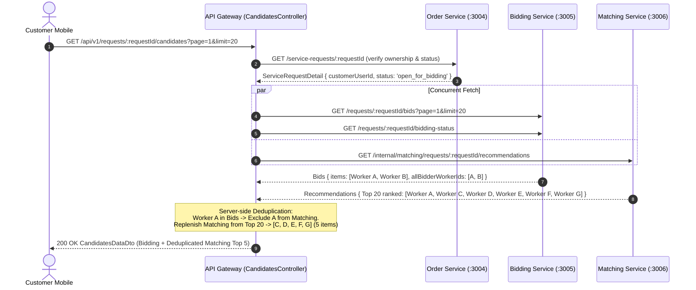
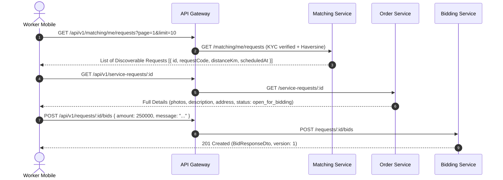
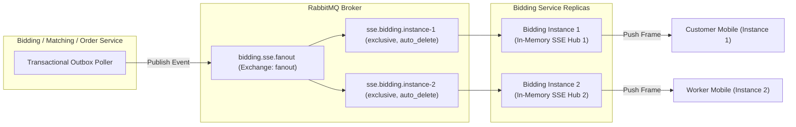
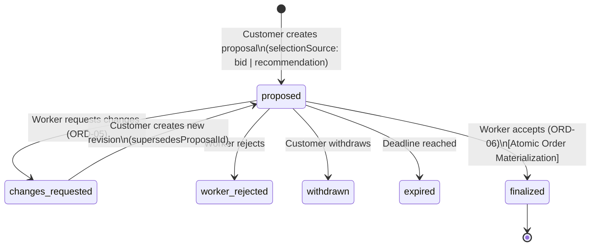

# HANDY GO — PRODUCTION ARCHITECTURE & REAL-TIME BIDDING SSE CONTRACT (v1.0)

> **Document ID:** `HGO-CTR-BIDDING-SSE-V1`  
> **Status:** APPROVED FOR PHASE 2 IMPLEMENTATION  
> **Target Release:** Monorepo v3.1 / Sprint Phase 2  
> **Author:** Lead Software Architect  
> **Scope:** Microservices (`bidding-service`, `matching-service`, `order-service`, `notification-service`, `api-gateway`) and Mobile Client (`mobile/`)  
> **Specification Version:** 1.0.0  

---

## 1. Executive Summary

This architecture contract establishes the definitive, production-ready specification for **Real-Time Bidding via Server-Sent Events (SSE)**, **API Gateway Streaming**, **BFF Candidates Aggregation**, **Worker Request Discovery via AI Matching**, and **FCM Push Notification Integration** across the HANDY GO monorepo platform.

### Core Architectural Decisions

1. **Lightweight Signal-Only SSE Model:** Real-time communication from Bidding Service to clients uses Server-Sent Events (SSE) exclusively for push signals (`ready`, `bid.changed`, `round.changed`, `matching.changed`, `:keepalive`). SSE frames **never transmit confidential bid amounts, competitor IDs, or revision contents**.
2. **Authoritative Customer Read Model:** The single source of truth for the customer candidate screen is the existing API Gateway BFF Aggregation endpoint `GET /api/v1/requests/:requestId/candidates`. Clients re-query this REST endpoint upon receiving SSE signals, ensuring that sealed-bid privacy, server-side deduplication, and Top 5 AI recommendation replenishment are strictly enforced at the gateway layer.
3. **Strict Separation of Discovery vs. Candidate Feeds:**
   - **Worker Discovery Feed:** Eligible workers discover open jobs in their area via Matching Service: `GET /api/v1/matching/me/requests`.
   - **Customer Candidate Feed:** Request owners view bids and Top 5 AI recommendations via Gateway: `GET /api/v1/requests/:requestId/candidates`.
   - **Request Details for Workers:** Workers inspect job scope and photos via Order Service: `GET /api/v1/service-requests/:id` (publicly accessible to workers for requests in `open_for_bidding` and `bidding_closed`).
4. **Decoupled Dual-Channel Delivery:** In-app foreground updates are driven by SSE streaming. Background, offline, and tray notifications are driven independently by RabbitMQ domain events routed to Notification Service and dispatched via Firebase Cloud Messaging (FCM v1). Neither delivery mechanism depends on the other.
5. **Immutable Booking Proposal Flow:** Direct acceptance of bids to create orders is strictly prohibited. Customer selection of a candidate (from either Bidding or Matching) always creates an immutable Booking Proposal via `POST /api/v1/booking-proposals`. Orders are materialized atomically only when the selected worker calls `POST /api/v1/booking-proposals/:id/accept` (ORD-06).

---

## 2. Verified System Architecture

The following diagram illustrates the verified end-to-end topology across Mobile clients, reverse proxies, API Gateway, downstream microservices, RabbitMQ message brokers, and database storage.

```mermaid
flowchart TD
    subgraph Clients["Clients Layer"]
        MC["Customer Mobile (React Native / Expo)"]
        MW["Worker Mobile (React Native / Expo)"]
    end

    subgraph Ingress["Ingress & Edge Proxy"]
        NGINX["Nginx Reverse Proxy (:80/:443)\n[buffering: off, timeout: 86400s]"]
    end

    subgraph Gateway["API Gateway (:3000)"]
        GW_AUTH["GatewayAuthMiddleware\n(RS256 JWT Verify & Header Injection)"]
        GW_BFF["CandidatesController (:requestId/candidates)\n(BFF Aggregation & Top 5 Replenishment)"]
        GW_PROXY["ProxyMiddleware (http-proxy-middleware)\n(SSE Stream Passthrough, timeout: 0)"]
    end

    subgraph Services["Core Microservices"]
        BIDDING["Bidding Service (:3005)\n• Bids & Rounds Service\n• SSE Controller & Connection Hub\n• Outbox Publisher"]
        MATCHING["Matching Service (:3006)\n• Top 20 AI Matcher & Rule Fallback\n• Worker Discovery Projection\n• Outbox Publisher"]
        ORDER["Order Service (:3004)\n• Service Requests (ORD-01..03)\n• Booking Proposals (ORD-04..05)\n• Order Finalization (ORD-06)"]
        NOTIF["Notification Service (:3008)\n• Event Consumer & Policy Router\n• FCM Push Worker (poll: 3s)"]
    end

    subgraph Broker["Message Broker & Cache"]
        RMQ["RabbitMQ (Exchange: amq.topic)\n• Topic: bidding.round.*\n• Topic: bid.*\n• Topic: matching.*\n• Topic: order.*"]
        FCM["Firebase Cloud Messaging (FCM v1)"]
    end

    subgraph Storage["Persistent Databases (PostgreSQL 16)"]
        DB_BID[("bidding_service\n(bids, rounds, outbox)")]
        DB_MATCH[("matching_service\n(runs, results, outbox)")]
        DB_ORDER[("order_service\n(requests, proposals, orders)")]
        DB_NOTIF[("notification_service\n(in-app, push_jobs)")]
    end

    MC -->|HTTPS / REST| NGINX
    MC -->|HTTPS / SSE| NGINX
    MW -->|HTTPS / REST| NGINX

    NGINX --> GW_AUTH
    GW_AUTH --> GW_BFF
    GW_AUTH --> GW_PROXY

    GW_BFF -->|REST (Internal)| ORDER
    GW_BFF -->|REST (Internal)| BIDDING
    GW_BFF -->|REST (Internal)| MATCHING

    GW_PROXY -->|SSE Stream /api/v1/bids/requests/:id/events| BIDDING
    GW_PROXY -->|REST Proxy /api/v1/bids/**| BIDDING
    GW_PROXY -->|REST Proxy /api/v1/matching/**| MATCHING
    GW_PROXY -->|REST Proxy /api/v1/service-requests/**| ORDER
    GW_PROXY -->|REST Proxy /api/v1/booking-proposals/**| ORDER

    BIDDING --> DB_BID
    MATCHING --> DB_MATCH
    ORDER --> DB_ORDER
    NOTIF --> DB_NOTIF

    BIDDING -->|Outbox Events| RMQ
    MATCHING -->|Outbox Events| RMQ
    ORDER -->|Outbox Events| RMQ

    RMQ -->|Round & Order Events| BIDDING
    RMQ -->|Published & Cancelled| MATCHING
    RMQ -->|All Notification Events| NOTIF

    NOTIF -->|Push Jobs Dispatch| FCM
    FCM -->|Push Notification| MC
    FCM -->|Push Notification| MW
```

---

## 3. Existing Matching Service APIs

All Matching Service endpoints have been verified against `backend/apps/matching-service/src/controllers/customer-matching.controller.ts` and `internal-matching.controller.ts`.

### 3.1. Customer Top 5 Recommendations [VERIFIED]
* **Endpoint:** `GET /api/v1/matching/requests/:id/recommendations`
* **Controller:** `CustomerMatchingController.getRecommendations`
* **Access Control:** Requires valid JWT (`JwtAuthGuard`). Caller must be request owner (`projection.customerUserId === user.userId`) or `Admin`.
* **Behavior:** Checks projection status. If request is not in `['open_for_bidding', 'bidding_closed']`, returns empty array. Retrieves latest completed run matching current revision. Slices results to `displayLimit: 5`.
* **Response DTO:**
```json
{
  "statusCode": 200,
  "message": "Lấy danh sách đề xuất thành công",
  "data": {
    "requestId": "f47ac10b-58cc-4372-a567-0e02b2c3d479",
    "requestRevision": 1,
    "status": "completed",
    "displayLimit": 5,
    "recommendations": [
      {
        "matchResultId": "3be57428-c254-41e9-88d3-b518be20728d",
        "workerUserId": "067399f4-197a-4d11-a32d-74f1efebd55a",
        "rank": 1,
        "matchingScore": 92.5
      }
    ],
    "generatedAt": "2026-10-28T09:35:00.000Z",
    "modelVersion": "multilingual-e5-small-v1"
  }
}
```

### 3.2. Worker Job Discovery Feed [VERIFIED]
* **Endpoint:** `GET /api/v1/matching/me/requests`
* **Controller:** `CustomerMatchingController.getDiscoverableRequests`
* **Access Control:** Requires valid JWT (`JwtAuthGuard`). Worker profile must exist and be KYC-verified (`profile.isVerified === true`).
* **Query Parameters:** `page` (default 1), `limit` (default 10, max 50).
* **Behavior:** Reads worker's registered `serviceIds` and spatial `serviceAreas` (lat, lng, radiusKm). Queries `ServiceRequestProjectionService.findMatchingRequestsForWorker` using Haversine distance calculations. Returns only requests in `open_for_bidding` within worker's active range.
* **Response DTO:**
```json
{
  "statusCode": 200,
  "message": "Lấy danh sách yêu cầu phù hợp thành công",
  "data": {
    "items": [
      {
        "id": "f47ac10b-58cc-4372-a567-0e02b2c3d479",
        "requestCode": "REQ-20261028-A1B2",
        "serviceId": "e1b2c3d4-0000-0000-0000-000000000001",
        "description": "Sửa rò rỉ van nước bồn rửa chén",
        "distanceKm": 2.4,
        "scheduledAt": "2026-10-29T08:00:00.000Z",
        "addressText": "123 Hải Phòng, Thạch Thang, Hải Châu, Đà Nẵng",
        "createdAt": "2026-10-28T07:00:00.000Z"
      }
    ],
    "total": 12,
    "page": 1,
    "limit": 10
  }
}
```

### 3.3. Internal Gateway Candidate Composition [VERIFIED]
* **Endpoint:** `GET /api/v1/internal/matching/requests/:id/recommendations`
* **Controller:** `InternalMatchingController.getInternalRecommendations`
* **Access Control:** Protected by `InternalServiceGuard` via `x-internal-secret`.
* **Behavior:** Returns up to **Top 20** ranked candidates for the active revision with 5-dimensional `scoreBreakdown` (`semanticScore`, `geoScore`, `ratingScore`, `experienceScore`, `completionScore`). Used by Gateway BFF to perform deduplication and replenish up to 5 recommendations.

### 3.4. Internal Order Proposal Eligibility Verification [VERIFIED]
* **Endpoint:** `GET /api/v1/internal/matching/results/:id/eligibility`
* **Controller:** `InternalMatchingController.checkResultEligibility`
* **Access Control:** Protected by `InternalServiceGuard` (`x-internal-secret`).
* **Query Parameters:** `serviceRequestId`, `workerUserId`.
* **Behavior:** Validates that `matchResultId` exists, belongs to specified request and worker, matches current active revision, and that request status is still `open_for_bidding` or `bidding_closed`. Fail-closed integration for `order-service`.

---

## 4. Existing Bidding Service APIs

All Bidding Service endpoints have been verified against `backend/apps/bidding-service/src/bids/bids.controller.ts`, `bids.service.ts`, `rounds/rounds.controller.ts`, and `rounds.service.ts`.

### 4.1. Submit Bid (BID-03) [VERIFIED]
* **HTTP:** `POST /api/v1/requests/:id/bids` (Alias: `POST /api/v1/bids/requests/:id`)
* **Headers:** `x-user-id`, `x-user-roles` (must include `worker`), `x-internal-secret`.
* **Validation Rules:**
  - `amount`: Number, min 1,000 VND, max 9,999,999,999 VND, max 2 decimal places.
  - `message`: Optional string, max 1,000 characters.
  - `validUntil`: Optional ISO-8601 string, must be > current timestamp.
* **Concurrency & Business Rules:**
  - Checks worker eligibility via `RequestEligibilityVerifierService` (fail-closed).
  - Round must be in `open` status and `now < round.closesAt`.
  - Enforces single active bid per worker per round (`ConflictException` on duplicate).
  - **Anti-sniping:** If bid submitted within last 30 seconds (`ANTI_SNIPING_TRIGGER_WINDOW_MS = 30000`), automatically extends round by 2 minutes (`ANTI_SNIPING_EXTENSION_MS = 120000`), up to 3 times (`MAX_ANTI_SNIPING_EXTENSIONS = 3`). Emits `bidding.round.extended`.
  - Writes outbox event `bid.submitted`.
* **Response Envelope:** `BidResponseDtoEnvelope` (`statusCode: 201`).

### 4.2. Revise Bid (BID-04) [VERIFIED]
* **HTTP:** `PATCH /api/v1/bids/:id`
* **Headers:** `x-user-id`, `x-user-roles` (`worker`), `x-internal-secret`.
* **DTO Body:**
  - `version`: Integer >= 1 (**mandatory** for optimistic concurrency lock).
  - `amount`: Optional number (1,000 to 9,999,999,999 VND).
  - `message`: Optional string (max 1,000 chars).
  - `validUntil`: Optional ISO-8601 string (> now).
* **Anti-Abuse Controls:**
  - **Max Revisions:** Maximum 5 revisions per bid per round (`MAX_BID_REVISIONS = 5`).
  - **Cooldown Interval:** Minimum 2 minutes between consecutive revisions (`MIN_REVISION_INTERVAL_MS = 120000`). Bypassed only in `NODE_ENV === 'test'`.
  - **Optimistic Locking:** Atomic CAS `UPDATE bids SET version = version + 1 WHERE id = :id AND version = :version AND status = 'active'`. Throws `409 Conflict` on mismatch.
  - Creates `bid_revisions` record with `revisionNo`, `previousAmount`, `newAmount`.
  - Emits outbox event `bid.revised`.

### 4.3. Withdraw Bid (BID-04) [VERIFIED]
* **HTTP:** `POST /api/v1/bids/:id/withdraw`
* **DTO Body:** `version`: Integer >= 1, `reason`: Optional string (max 500 chars).
* **Behavior:** Atomic CAS update sets `status: 'withdrawn'`, increments `version`. Round must be `open`. Emits outbox event `bid.withdrawn`.

### 4.4. List Bids for Request (BID-05 / Sealed-Bid) [VERIFIED]
* **HTTP:** `GET /api/v1/requests/:id/bids` (Alias: `GET /api/v1/bids/requests/:id`)
* **Query Parameters:** `page` (default 1), `limit` (default 20, max 100), `status` (default `all`).
* **Sealed-Bid Privacy Rule (F03):**
  - **Full Visibility:** Request customer owner (`round.customerId === verifiedUserId`), bid owner worker (`bid.workerId === verifiedUserId`), and `admin`/`operator` see real `amount`, `message`, and revision history (`isMasked: false`).
  - **Masked Visibility:** Competitor workers and unauthenticated callers receive `amount: 0`, `message: '[Báo giá kín - Chỉ khách hàng sở hữu yêu cầu mới có quyền xem]'`, `validUntil: null`, `isMasked: true`, `workerProfile: null`.
* **Deduplication Support:** Returns `allBidderWorkerIds: string[]` containing distinct worker IDs who bid across the entire request.

### 4.5. Worker Bid History & Details [VERIFIED]
* **HTTP:** `GET /api/v1/bids/me` — Paginated list of bids submitted by authenticated worker.
* **HTTP:** `GET /api/v1/bids/:id` — Single bid detail with revision history (masked for competitor workers).

### 4.6. Bidding Round Status [VERIFIED]
* **HTTP:** `GET /api/v1/requests/:id/bidding-status` (Alias: `GET /api/v1/bids/requests/:id/bidding-status`)
* **Behavior:** Returns `roundId`, `serviceRequestId`, `status` (`pending`, `open`, `closed`, `no_bid`, `finalized`, `cancelled`), `opensAt`, `closesAt`, `bidCount`, `activeBidCount` (valid bids not expired), `timeRemainingSeconds`, `isExpired`. On-the-fly triggers transition if deadline passed.

### 4.7. Internal Bid Eligibility Check (BID-06) [VERIFIED]
* **HTTP:** `GET /api/v1/internal/bids/:bidId/eligibility`
* **Query Parameters:** `requestId`, `workerId`.
* **Behavior:** Called by Order Service during booking proposal creation to verify bid validity. Returns `eligible: boolean`, `reason: string`, and bid snapshot.

---

## 5. Existing Candidates Aggregation API (BFF)

The API Gateway already provides a production-grade BFF Candidates Aggregation endpoint inspected in `backend/apps/api-gateway/src/candidates/`.

* **Endpoint:** `GET /api/v1/requests/:requestId/candidates`
* **Controller:** `CandidatesController.getCandidates`
* **Service:** `CandidatesAggregationService.aggregateCandidates`
* **Authentication:** Mandatory Bearer JWT. Enforced by `GatewayAuthMiddleware` and verified in controller via `x-user-id` and `x-user-roles`.
* **Access Control:** Verified against Order Service `getServiceRequest`:
  - Request Owner: `serviceRequest.customerUserId === user.userId`.
  - Admin: `roles.includes('admin')`.
  - Non-owners receive `403 Forbidden` (`ERROR_CODES.FORBIDDEN`).

### Execution Pipeline



---

## 6. Candidates Response Contract & Deduplication

### 6.1. Complete Response Schema (`CandidatesDataDto`) [VERIFIED]

The outer response conforms to the standard `@app/common` envelope:

```json
{
  "statusCode": 200,
  "message": "Lấy danh sách ứng viên thành công",
  "data": {
    "requestId": "f47ac10b-58cc-4372-a567-0e02b2c3d479",
    "requestStatus": "open_for_bidding",
    "bidding": {
      "status": "open",
      "closesAt": "2026-10-29T10:00:00.000Z",
      "total": 2,
      "page": 1,
      "limit": 20,
      "items": [
        {
          "selectionSource": "bid",
          "sourceBidId": "9b1deb4d-3b7d-4bad-9bdd-2b0d7b3dcb6d",
          "workerUserId": "c2b4d5e6-7f8a-9b0c-1d2e-3f4a5b6c7d8e",
          "id": "9b1deb4d-3b7d-4bad-9bdd-2b0d7b3dcb6d",
          "biddingRoundId": "e1b2c3d4-e5f6-7a8b-9c0d-1e2f3a4b5c6d",
          "serviceRequestId": "f47ac10b-58cc-4372-a567-0e02b2c3d479",
          "workerId": "c2b4d5e6-7f8a-9b0c-1d2e-3f4a5b6c7d8e",
          "amount": 250000,
          "message": "Tôi có thể đến sau 30 phút và hoàn thành trong 1 giờ.",
          "validUntil": "2026-10-29T10:00:00.000Z",
          "status": "active",
          "version": 1,
          "submittedAt": "2026-10-28T09:30:00.000Z",
          "revisionsCount": 0,
          "isMasked": false,
          "workerProfile": {
            "fullName": "Nguyễn Văn Thợ",
            "avatarUrl": "https://cdn.handygo.vn/avatars/worker-1.jpg",
            "averageRating": 4.85,
            "ratingCount": 42,
            "completedOrderCount": 38,
            "distanceKm": 2.5
          }
        }
      ]
    },
    "matching": {
      "status": "completed",
      "displayLimit": 5,
      "recommendations": [
        {
          "selectionSource": "recommendation",
          "sourceMatchResultId": "3be57428-c254-41e9-88d3-b518be20728d",
          "workerUserId": "067399f4-197a-4d11-a32d-74f1efebd55a",
          "rank": 2,
          "matchingScore": 91.2,
          "scoreBreakdown": {
            "semanticScore": 88.5,
            "geoScore": 95.0,
            "ratingScore": 92.0,
            "experienceScore": 80.0,
            "completionScore": 90.0
          },
          "workerProfile": null
        }
      ],
      "modelVersion": "multilingual-e5-small-v1",
      "generatedAt": "2026-10-28T09:35:00.000Z"
    },
    "partial": false
  }
}
```

### 6.2. Verified Deduplication & Replenishment Rules

1. **Precedence Rule:** If a worker submitted a Bid and also appears in AI Matching recommendations, the worker **always stays in Bidding** and is **filtered out of Matching recommendations**.
2. **Global Deduplication Across Pages (PR34-07):** Bidding Service returns `allBidderWorkerIds: string[]` covering all bids for the request, not just the current page. The Gateway constructs `biddingWorkerIds = new Set(allBidderWorkerIds)`. Deduplication remains 100% accurate even when customer paginates through bids.
3. **Top 5 Replenishment:** Matching Service returns up to Top 20 ranked candidates. When a candidate is excluded due to a duplicate bid, the loop continues down the ranked list until up to 5 recommendations are filled. Relative AI rank order is preserved.
4. **Missing Index Safeguard:** If `total > items.length` and `allBidderWorkerIds` is missing, Gateway flags `missingBidderIndex`, records a partial failure detail, and disables unsafe deduplication.
5. **Partial Failure Resilience:**
   - If Bidding Service is down: `bidding.status: 'unavailable'`, `matching` renders recommendations, `partial: true`, `partialFailures: [{ service: 'bidding', reason: '...' }]`.
   - If Matching Service is down: `matching.status: 'unavailable'`, `bidding` renders bids, `partial: true`, `partialFailures: [{ service: 'matching', reason: '...' }]`.

---

## 7. Customer Candidate Screen Data Flow

The authoritative screen for customer proposal management is backed by `GET /api/v1/requests/:requestId/candidates`.

### Screen Structure

```
+--------------------------------------------------------------+
| [<- Quay lại]      Yêu cầu: #REQ-20261028-A1B2      [Trợ giúp] |
+--------------------------------------------------------------+
| PHIÊN ĐẤU GIÁ: Đang mở • Còn lại: 23 giờ 15 phút             |
+--------------------------------------------------------------+
| SECTION A: BÁO GIÁ TỪ THỢ (Bidding) (2 báo giá)              |
| +----------------------------------------------------------+ |
| | [Avatar] Nguyễn Văn Thợ ⭐ 4.85 (42 đánh giá) • 2.5km     | |
| | Báo giá: 250.000đ • "Tôi có thể đến sau 30 phút..."        | |
| | [Gửi đề xuất nhận việc] (Tạo Booking Proposal từ Bid)    | |
| +----------------------------------------------------------+ |
| | [Avatar] Trần Văn B ⭐ 4.70 (18 đánh giá) • 1.8km         | |
| | Báo giá: 220.000đ • "Đã chuẩn bị đồ nghề sẵn..."           | |
| | [Gửi đề xuất nhận việc] (Tạo Booking Proposal từ Bid)    | |
| +----------------------------------------------------------+ |
+--------------------------------------------------------------+
| SECTION B: GỢI Ý THỢ TỐI ƯU (AI Top 5 Recommendations)       |
| +----------------------------------------------------------+ |
| | [Avatar] Lê Hoàng C ⭐ 4.90 • Độ phù hợp AI: 91.2% • 1.2km | |
| | Kỹ năng: Điện tử, sửa ống nước • Điểm địa lý: 95/100       | |
| | [Gửi đề xuất nhận việc] (Tạo Booking Proposal từ AI Rec) | |
| +----------------------------------------------------------+ |
+--------------------------------------------------------------+
```

### Action Trigger
Clicking **[Gửi đề xuất nhận việc]** opens proposal confirmation sheet:
- Source = `bid`: Calls `POST /api/v1/booking-proposals` with `{ selectionSource: 'bid', sourceBidId: candidate.sourceBidId, agreedPrice: candidate.amount, ... }`.
- Source = `recommendation`: Calls `POST /api/v1/booking-proposals` with `{ selectionSource: 'recommendation', sourceMatchResultId: candidate.sourceMatchResultId, agreedPrice: customerInputPrice, ... }`.
- **Never calls Order creation directly.**

---

## 8. Worker Eligible-Request Screen Data Flow

Worker discovers and bids on jobs through three decoupled steps:



1. **Discovery:** Worker calls `GET /api/v1/matching/me/requests`. Filtered automatically by worker's trades and geographic operating radius.
2. **Detail Inspection:** Worker taps job card to call `GET /api/v1/service-requests/:id`. Permitted because request status is `open_for_bidding`.
3. **Bid Actions:**
   - Submit: `POST /api/v1/requests/:id/bids`.
   - Revise: `PATCH /api/v1/bids/:id` (supplying current `version`).
   - Withdraw: `POST /api/v1/bids/:id/withdraw`.
   - Inspect My Bids: `GET /api/v1/bids/me`.

---

## 9. SSE Endpoint Specification

* **Path:** `GET /api/v1/bids/requests/:requestId/events`
* **Transport:** HTTP/1.1 or HTTP/2 Server-Sent Events (`text/event-stream`).
* **Authentication:** `Authorization: Bearer <JWT Access Token>`.
* **Gateway Route:** Matches prefix `/api/v1/bids`. Protected by `GatewayAuthMiddleware`. Injects trusted headers `x-user-id`, `x-user-roles`, `x-internal-secret`.
* **Authorization Policy:**
  - Customer: Must own the `serviceRequestId` (verified via cached Order Service check or round ownership).
  - Worker: Must have KYC verification and trade eligibility for the request.
  - Admin/Operator: Unrestricted access.
* **Response Headers:**
  ```http
  HTTP/1.1 200 OK
  Content-Type: text/event-stream; charset=utf-8
  Cache-Control: no-cache, no-transform
  Connection: keep-alive
  X-Accel-Buffering: no
  Access-Control-Allow-Origin: *
  ```

---

## 10. SSE Event Types & Payloads

SSE sends lightweight notifications to wake up client queries without leaking sealed-bid details.

### 10.1. Connection Initialized: `ready` [PROPOSED]
Emitted immediately upon successful connection establishment.
```
event: ready
data: {"requestId":"f47ac10b-58cc-4372-a567-0e02b2c3d479","connectedAt":"2026-10-28T23:30:00.000Z","heartbeatIntervalMs":15000}

```

### 10.2. Bid Lifecycle Change: `bid.changed` [PROPOSED]
Emitted when any worker submits, revises, or withdraws a bid.
```
event: bid.changed
data: {"eventId":"11111111-2222-3333-4444-555555555555","requestId":"f47ac10b-58cc-4372-a567-0e02b2c3d479","kind":"submitted","occurredAt":"2026-10-28T23:30:15.000Z"}

```
* Valid `kind` values: `submitted`, `revised`, `withdrawn`.
* **Zero Confidential Data:** Contains no `amount`, `workerId`, or message.

### 10.3. Round Lifecycle Change: `round.changed` [PROPOSED]
Emitted on round state transitions.
```
event: round.changed
data: {"eventId":"22222222-3333-4444-5555-666666666666","requestId":"f47ac10b-58cc-4372-a567-0e02b2c3d479","kind":"extended","occurredAt":"2026-10-28T23:31:00.000Z"}

```
* Valid `kind` values: `opened`, `closed`, `extended`, `finalized`, `cancelled`, `no_bid`.

### 10.4. Matching Computation Update: `matching.changed` [PROPOSED]
Emitted when AI Matching run completes or updates for the request revision.
```
event: matching.changed
data: {"eventId":"33333333-4444-5555-6666-777777777777","requestId":"f47ac10b-58cc-4372-a567-0e02b2c3d479","kind":"completed","occurredAt":"2026-10-28T23:30:20.000Z"}

```
* Valid `kind` values: `completed`, `failed`.

### 10.5. Keep-Alive Heartbeat [PROPOSED]
Emitted every 15 seconds to prevent gateway/proxy socket termination.
```
:keepalive 2026-10-28T23:30:30.000Z

```

---

## 11. SSE-to-Candidates Query Invalidation

Mobile integrates SSE signals directly with TanStack React Query cache.

### React Query Key Structure [PROPOSED]

```typescript
export const candidateQueryKeys = {
  all: ['candidates'] as const,
  byRequest: (requestId: string) => [...candidateQueryKeys.all, 'request', requestId] as const,
  candidatesList: (requestId: string, page = 1, limit = 20) =>
    [...candidateQueryKeys.byRequest(requestId), 'list', { page, limit }] as const,
  roundStatus: (requestId: string) =>
    [...candidateQueryKeys.byRequest(requestId), 'round-status'] as const,
};

export const workerBiddingKeys = {
  all: ['worker-bidding'] as const,
  myBids: (params?: Record<string, unknown>) => [...workerBiddingKeys.all, 'my-bids', params] as const,
  bidDetail: (bidId: string) => [...workerBiddingKeys.all, 'detail', bidId] as const,
  requestBids: (requestId: string) => [...workerBiddingKeys.all, 'request-bids', requestId] as const,
  discoverableRequests: (params?: Record<string, unknown>) =>
    [...workerBiddingKeys.all, 'discoverable', params] as const,
};
```

### Invalidation Matrix

| Received Event | Active Role | React Query Target Keys to Invalidate | Expected Client Action |
| :--- | :--- | :--- | :--- |
| `bid.changed` | **Customer** | `candidateQueryKeys.byRequest(requestId)` | Refetch Candidates Aggregation API. Bids section updates; duplicate workers in Top 5 Matching are automatically removed and replenished. |
| `bid.changed` | **Worker** | `workerBiddingKeys.requestBids(requestId)`<br>`workerBiddingKeys.myBids()` | Refetch worker's own bid and round status. Competitor prices remain masked. |
| `round.changed` | **Customer & Worker** | `candidateQueryKeys.roundStatus(requestId)`<br>`candidateQueryKeys.byRequest(requestId)` | Update round timer, banner (`open`, `closed`, `finalized`), disable/enable bid submission buttons. |
| `matching.changed` | **Customer** | `candidateQueryKeys.byRequest(requestId)` | Refetch Candidates Aggregation API to display newly generated Top 5 recommendations. |

---

## 12. Matching Update Synchronization

When Matching Service finishes asynchronously:
1. Matching Service publishes `matching.completed` to its transactional Outbox (`eventType: 'matching.completed'`).
2. RabbitMQ routes the event to `bidding-service` (via consumer `handleMatchingCompleted`).
3. `bidding-service` resolves active SSE connections for that `requestId` and pushes:
   ```
   event: matching.changed
   data: {"eventId":"...","requestId":"...","kind":"completed","occurredAt":"..."}
   ```
4. Customer app triggers refetch of `GET /api/v1/requests/:requestId/candidates`.
5. Gateway BFF queries Matching Service internal endpoint, merges with current bids, deduplicates, and serves the refreshed UI.

---

## 13. RabbitMQ Multi-Instance Event Bridge

To support multiple horizontally scaled replicas of `bidding-service`:



1. **Exchange:** `bidding.sse.fanout` (Type: `fanout`).
2. **Queues:** Each `bidding-service` container generates a random, exclusive, auto-deleting queue on startup (`exclusive: true, auto_delete: true`).
3. **Publishing:** Whenever a bid event or round event occurs on *any* instance, or an upstream event (`matching.completed`) is consumed, a message is published to `bidding.sse.fanout`.
4. **Delivery:** All instances receive the message. Each instance pushes the SSE frame to all local clients listening to that `requestId`.
5. **No Sticky Sessions Required:** Clients can connect to any gateway/bidding replica seamlessly.

---

## 14. API Gateway Streaming Configuration

### 14.1. Gateway Route Precedence & Timeout Fix [PROPOSED]

In `backend/apps/api-gateway/src/proxy/proxy.constants.ts` and `proxy.middleware.ts`:

1. **Existing candidates route conflict avoidance:**
   `CandidatesController` handles `/api/v1/requests/:requestId/candidates` natively inside the Gateway. `order-service` has `excludeMatch: (pathname) => /^\/api\/v1\/requests\/[^/?#]+\/candidates/.test(pathname)`. This configuration is **preserved unchanged**.
2. **SSE Streaming Route Isolation:**
   Route `/api/v1/bids/requests/:requestId/events` routes to `bidding-service`.
   In `proxy.middleware.ts`, `timeout` and `proxyTimeout` for SSE streaming paths must be set to `0` (disabled):
   ```typescript
   // Target SSE specific configuration in proxy.middleware.ts:
   const isSsePath = (path: string) => path.includes('/bids/requests/') && path.endsWith('/events');

   createProxyMiddleware({
     target: targetUrl,
     changeOrigin: true,
     ws: true,
     proxyTimeout: isSsePath(pathname) ? 0 : timeoutMs,
     timeout: isSsePath(pathname) ? 0 : timeoutMs,
     // ...
   });
   ```
3. **Flushing & Unbuffered Response:**
   SSE responses must flush headers immediately. Disable response chunk buffering in `http-proxy-middleware`.

---

## 15. Nginx Streaming Configuration

For production deployment behind Nginx (e.g. reverse proxy / SSL termination):

```nginx
# Targeted Nginx SSE streaming location block
location ~ ^/api/v1/bids/requests/[^/]+/events$ {
    proxy_pass http://api-gateway:3000;
    proxy_http_version 1.1;
    proxy_set_header Connection "";
    proxy_set_header Host $host;
    proxy_set_header X-Real-IP $remote_addr;
    proxy_set_header X-Forwarded-For $proxy_add_x_forwarded_for;
    proxy_set_header X-Forwarded-Proto $scheme;

    # Mandatory SSE streaming directives
    proxy_buffering off;
    proxy_cache off;
    proxy_read_timeout 86400s;
    proxy_send_timeout 86400s;
    chunked_transfer_encoding on;

    # Prevent gzip compression from buffering SSE chunks
    gzip off;
}
```

---

## 16. Notification Service & FCM Integration

### 16.1. Decoupled Delivery Architecture [VERIFIED]

| Event | Origin | SSE Push (Foreground) | In-App Storage | FCM Mobile Push (Background/Offline) |
| :--- | :--- | :--- | :--- | :--- |
| `bid.submitted` | Bidding | YES (`bid.changed`) | YES (`NotificationPrisma`) | YES (`Bạn có báo giá mới`) |
| `bid.revised` | Bidding | YES (`bid.changed`) | YES (`NotificationPrisma`) | YES (`Báo giá đã được cập nhật`) |
| `matching.eligible_workers.ready` | Matching | NO | YES (Chunked to Workers) | YES (`Có công việc mới phù hợp`) |
| `booking_proposal.created` | Order | NO | YES | YES (`Có lời đề nghị làm việc`) |

### 16.2. Production Policy Configuration Requirement [CRITICAL FINDING]

In `backend/apps/notification-service/src/events/notification-policy.ts`:
If `NOTIFICATION_EVENT_POLICIES` is not defined and `NOTIFICATION_SIMULATED_POLICIES` is `false`, `NotificationPolicy.resolve` throws `PermanentEventError('BUSINESS_POLICY_PENDING')`, **silently rejecting incoming events**.

**Mandatory Phase 2 Configuration:** Ensure `docker-compose.yml` or production environment includes:
```env
NOTIFICATION_SIMULATED_POLICIES=true
PUSH_SIMULATED_POLICIES=true
```
Or provides explicit JSON in `NOTIFICATION_EVENT_POLICIES` configuring:
- `bid.submitted`: `mode: "optional"`, `roles: ["customer"]`.
- `bid.revised`: `mode: "optional"`, `roles: ["customer"]`.
- `matching.eligible_workers.ready`: `mode: "optional"`, `roles: ["worker"]`.
- `booking_proposal.created`: `mode: "mandatory"`, `roles: ["worker"]`.

---

## 17. Booking Proposal Integration

Direct conversion of a bid into an order is forbidden. The contract enforces the existing immutable negotiation state machine:



### Exact DTO Payload (`CreateBookingProposalDto`) [VERIFIED]

```json
{
  "serviceRequestId": "f47ac10b-58cc-4372-a567-0e02b2c3d479",
  "workerUserId": "c2b4d5e6-7f8a-9b0c-1d2e-3f4a5b6c7d8e",
  "selectionSource": "bid",
  "sourceBidId": "9b1deb4d-3b7d-4bad-9bdd-2b0d7b3dcb6d",
  "agreedPrice": 250000,
  "agreedScope": "Sửa rò rỉ van nước bồn rửa chén",
  "scheduledAt": "2026-10-29T08:00:00.000Z",
  "expiresAt": "2026-10-29T10:00:00.000Z"
}
```

* Strict XOR Rule: If `selectionSource` is `bid`, `sourceBidId` is **required** and `sourceMatchResultId` must be omitted. If `recommendation`, `sourceMatchResultId` is **required** and `sourceBidId` must be omitted.
* When worker calls `POST /api/v1/booking-proposals/:id/accept`, Order Service executes single transaction (ORD-06): creates order with status `created`, payment `unpaid`, marks proposal `finalized`, marks other proposals `superseded`, sets service request `converted_to_order`, and emits outbox `order.created`.

---

## 18. Authentication & Authorization

1. **Token Transport:** Bearer JWT in HTTP `Authorization` header (`Authorization: Bearer <accessToken>`).
2. **Identity Propagation:** Gateway strips all client-supplied `x-user-*` and `x-internal-secret` headers, verifies token RS256 signature using public key, and injects trusted headers:
   - `x-user-id`: Authenticated user ID (UUID).
   - `x-user-roles`: Comma-separated roles (`Customer`, `Worker`, `Admin`).
   - `x-internal-secret`: Cryptographic inter-service shared secret.
3. **Downstream Verification:** Downstream microservices enforce `assertTrustedGateway(req.headers['x-internal-secret'], config.internalServiceSecret)`.

---

## 19. Sealed-Bid Privacy

1. **Sealed-Bid Invariant:** Competitor workers must never observe another worker's proposed price or detailed message until the round is completed and finalized.
2. **Enforcement in SSE:** SSE events contain **zero price, message, or worker identity fields**. SSE transmits only `{ eventId, requestId, kind, occurredAt }`.
3. **Enforcement in REST APIs:**
   - `GET /api/v1/requests/:id/bids`: Masks competitors (`amount: 0`, `isMasked: true`).
   - `GET /api/v1/bids/:id`: Masks competitors; reveals full history only to bid owner worker or request owner customer.
   - `GET /api/v1/requests/:requestId/candidates`: Accessible only to request owner customer and Admin.

---

## 20. Error Handling, Reconnection & Recovery

1. **Keep-Alive Comments:** SSE hub emits `:keepalive <iso-timestamp>\n\n` every 15 seconds.
2. **Client Exponential Backoff:** If SSE connection drops, client reconnects with jittered exponential backoff:
   - Attempt 1: 1s (+/- 200ms)
   - Attempt 2: 2s (+/- 400ms)
   - Attempt 3: 5s (+/- 1s)
   - Attempt 4: 10s (+/- 2s)
   - Max backoff: 30s.
3. **Reconciliation on Reconnect:** Upon re-establishing SSE (`ready` event), client triggers a background invalidation/refetch of `GET /api/v1/requests/:requestId/candidates` to ensure no events were missed during downtime.
4. **App Lifecycle Management:**
   - When app moves to `background` or screen loses focus: close SSE connection to conserve battery and connection sockets.
   - When app returns to `active` foreground and screen is focused: open SSE connection and trigger REST refetch.
5. **Token Expiration during Stream:** If the client receives `401 Unauthorized` when connecting, it invokes `refreshTokens()` via `mobile/src/services/api/api-client.ts` and retries with the fresh token.

---

## 21. Backend Implementation Tasks for Phase 2

| Task ID | Component / Service | Exact File Path to Create / Modify | Scope of Work |
| :--- | :--- | :--- | :--- |
| **BE-P2-01** | `bidding-service` | `apps/bidding-service/src/sse/sse.controller.ts`<br>`apps/bidding-service/src/sse/sse.service.ts`<br>`apps/bidding-service/src/sse/sse.module.ts` | Implement `GET /api/v1/bids/requests/:requestId/events`. Verify request ownership / worker trade eligibility. Set up heartbeat timer (15s). Register in `bidding-service.module.ts`. |
| **BE-P2-02** | `bidding-service` | `apps/bidding-service/src/events/bidding-events.consumer.ts`<br>`apps/bidding-service/src/sse/sse-event-bridge.ts` | Subscribe to RabbitMQ fanout exchange `bidding.sse.fanout`. Consume `bid.submitted`, `bid.revised`, `bid.withdrawn`, round lifecycle events, and `matching.completed`. Broadcast to active SSE clients. |
| **BE-P2-03** | `bidding-service` | `apps/bidding-service/src/bids/bids.service.ts`<br>`apps/bidding-service/src/rounds/rounds.service.ts` | Publish domain events to `bidding.sse.fanout` upon bid/round state transitions. |
| **BE-P2-04** | `api-gateway` | `apps/api-gateway/src/proxy/proxy.middleware.ts`<br>`apps/api-gateway/src/proxy/proxy.constants.ts` | Add SSE streaming route detection (`/events`). Set `timeout: 0` and `proxyTimeout: 0` for streaming connections. Ensure unbuffered pass-through. |
| **BE-P2-05** | `api-gateway` | `apps/api-gateway/src/candidates/candidates-aggregation.service.ts` | Enrich matching recommendations with worker profiles from `UserTrustClient` if needed, matching Bidding candidate richness. |
| **BE-P2-06** | `notification-service`| `apps/notification-service/src/events/notification-policy.ts`<br>`docker-compose.yml` | Enable simulated policies or inject explicit JSON in `NOTIFICATION_EVENT_POLICIES` and `PUSH_EVENT_POLICIES` for `bid.submitted`, `bid.revised`, `matching.eligible_workers.ready`, `booking_proposal.created`. |

---

## 22. Mobile Implementation Tasks for Phase 2

| Task ID | Screen / Feature | Exact File Path to Create / Modify | Scope of Work |
| :--- | :--- | :--- | :--- |
| **MB-P2-01** | `features/bidding` | `mobile/src/services/sse/bidding-sse-client.ts` | Implement resilient SSE client using `fetch` streaming or `react-native-sse` with Bearer JWT auth, keep-alive monitoring, and exponential backoff reconnect. |
| **MB-P2-02** | `features/candidates`| `mobile/src/features/candidates/api/candidates.api.ts`<br>`mobile/src/features/candidates/hooks/use-candidates.ts` | Implement React Query hook for `GET /api/v1/requests/:requestId/candidates`. Connect SSE event listener to invalidate query keys on `bid.changed`, `round.changed`, `matching.changed`. |
| **MB-P2-03** | `customer/radar` | `mobile/src/app/customer/booking/radar.tsx` | Replace hardcoded `QUOTED_WORKERS` with real candidates from `useCandidates(requestId)`. Render Section A (Bids) and Section B (AI Top 5 Recommendations). Wire "Chọn thợ" button to `OrdersApi.createProposal`. |
| **MB-P2-04** | `features/worker` | `mobile/src/features/bidding/api/worker-bidding.api.ts`<br>`mobile/src/features/bidding/hooks/use-worker-discovery.ts` | Implement hooks for `GET /api/v1/matching/me/requests`, `POST /api/v1/requests/:id/bids`, `PATCH /api/v1/bids/:id`, `POST /api/v1/bids/:id/withdraw`. |
| **MB-P2-05** | `worker/home` | `mobile/src/features/home/worker/screens/worker-home-screen.tsx` | Replace placeholder text with discoverable job feed backed by `useWorkerDiscovery()`. Allow worker to inspect job details and open bid submission modal. |
| **MB-P2-06** | `notifications` | `mobile/src/features/notifications/notification-lifecycle.tsx` | Ensure tapping push notifications for `bid.submitted` navigates customer to `/customer/booking/radar?requestId=:id`. |

---

## 23. End-to-End Acceptance Criteria

1. **[AC-01] Real-time Bidding Latency:** When Worker A submits a bid via `POST /api/v1/requests/:id/bids`, Customer Mobile receives `bid.changed` SSE signal within **< 500ms** (network latency permitting) and refetches `GET /api/v1/requests/:id/candidates`.
2. **[AC-02] Dynamic Deduplication & Replenishment:**
   - Worker B is initially in AI Matching Top 5 recommendations.
   - Worker B submits a bid.
   - Next Candidates Aggregation response shows Worker B in Bidding section and **excludes** Worker B from Matching.
   - Matching Top 5 recommendations are automatically replenished from the 6th ranked candidate, maintaining 5 recommendations.
3. **[AC-03] Sealed-Bid Privacy:** Inspecting SSE frames reveals only `{ eventId, requestId, kind, occurredAt }`. Inspecting competitor bids via worker token reveals `amount: 0` and `isMasked: true`. Real prices are exposed only to the customer owner.
4. **[AC-04] Reconnection & Resiliency:** Killing the SSE connection causes Mobile to reconnect using exponential backoff. Upon reconnecting, data is automatically reconciled with REST.
5. **[AC-05] Background Push Isolation:** When Customer Mobile is in the background or terminated, submitting a bid delivers an FCM push notification (`Bạn có báo giá mới`). Tapping notification opens the candidate screen.
6. **[AC-06] Anti-Sniping Extension:** A bid submitted in the final 30 seconds of an open round extends the deadline by 2 minutes, increments extension counter, emits `bidding.round.extended`, and pushes `round.changed` (`kind: 'extended'`) via SSE.
7. **[AC-07] Booking Proposal Integrity:** Selecting a candidate calls `POST /api/v1/booking-proposals`. An Order is created only when the worker accepts via `POST /api/v1/booking-proposals/:id/accept`.

---

## 24. Required Tests

### Backend Test Suites (`apps/bidding-service/test/`, `apps/api-gateway/test/`)
1. **Unit Test:** `SseService` client subscription, heartbeat interval, and disconnect cleanup.
2. **Unit Test:** `CandidatesAggregationService` deduplication and replenishment when candidate list has duplicates vs. when no duplicates exist.
3. **Integration Test:** `BiddingEventsConsumer` multi-instance RabbitMQ fanout delivery to active SSE connections.
4. **Integration Test:** Sealed-bid masking assertion for competitor worker roles.
5. **Gateway E2E Test:** Verify `GET /api/v1/bids/requests/:requestId/events` streams chunks without buffering or premature timeout.

### Mobile Test Suites (`mobile/src/features/**/__tests__/`)
1. **Unit Test:** `bidding-sse-client.ts` parsing of SSE frames, handling `:keepalive`, and reconnecting on socket drop.
2. **Component Test:** `CustomerBookingRadarRoute` rendering bids and AI recommendations from `CandidatesDataDto`.
3. **Integration Test:** React Query cache invalidation when `bid.changed` arrives.

---

## 25. Risks & Unverified Assumptions

1. **Proxy Timeout Variance [VERIFIED RISK]:** Default `http-proxy-middleware` has `timeout: 15000`. If Phase 2 omits setting `timeout: 0` for `/events`, all SSE connections will terminate after 15 seconds.
2. **Reverse Proxy Buffering [VERIFIED RISK]:** Production Nginx proxies buffer upstream responses by default. `proxy_buffering off;` and `X-Accel-Buffering: no` must be present.
3. **Missing Notification Policies [VERIFIED RISK]:** If `NOTIFICATION_SIMULATED_POLICIES` is false in development or staging, Notification Service throws `BUSINESS_POLICY_PENDING` and drops FCM push delivery.
4. **Mobile Battery Drain:** Long-lived SSE connections held in background deplete device battery. Mobile must strictly disconnect SSE when app transitions to `background` or screen loses focus.

---

## 26. Verified Source Code & Swagger References

* `backend/apps/api-gateway/src/candidates/candidates.controller.ts` (Lines 1–127)
* `backend/apps/api-gateway/src/candidates/candidates-aggregation.service.ts` (Lines 1–213)
* `backend/apps/api-gateway/src/candidates/dto/candidates-response.dto.ts` (Lines 1–323)
* `backend/apps/api-gateway/src/proxy/proxy.middleware.ts` (Lines 1–136)
* `backend/apps/api-gateway/src/proxy/proxy.constants.ts` (Lines 1–92)
* `backend/apps/api-gateway/src/auth/gateway-auth.middleware.ts` (Lines 1–147)
* `backend/apps/bidding-service/src/bids/bids.controller.ts` (Lines 1–327)
* `backend/apps/bidding-service/src/bids/bids.service.ts` (Lines 1–1101)
* `backend/apps/bidding-service/src/rounds/rounds.controller.ts` (Lines 1–74)
* `backend/apps/bidding-service/src/rounds/rounds.service.ts` (Lines 1–698)
* `backend/apps/matching-service/src/controllers/customer-matching.controller.ts` (Lines 1–248)
* `backend/apps/matching-service/src/controllers/internal-matching.controller.ts` (Lines 1–239)
* `backend/apps/matching-service/src/persistence/match-run.repository.ts` (Lines 180–300)
* `backend/apps/order-service/src/booking-proposals/booking-proposals.controller.ts` (Lines 1–256)
* `backend/apps/order-service/src/booking-proposals/booking-proposals.service.ts` (Lines 1–800)
* `backend/apps/order-service/src/orders/orders.service.ts` (Lines 150–250)
* `backend/apps/notification-service/src/events/event-contracts.ts` (Lines 1–273)
* `backend/apps/notification-service/src/events/notification-policy.ts` (Lines 1–140)
* `backend/apps/notification-service/src/events/notification-router.ts` (Lines 1–132)
* `mobile/src/services/api/api-client.ts` (Lines 1–276)
* `mobile/src/stores/use-auth-store.ts` (Lines 1–405)
* `mobile/src/features/notifications/notification-lifecycle.tsx` (Lines 1–138)
* `mobile/src/features/orders/api/orders.api.ts` (Lines 1–181)
* `mobile/src/features/orders/customer/screens/customer-booking-screen.tsx` (Lines 1–816)
* `mobile/src/features/orders/worker/screens/worker-jobs-screen.tsx` (Lines 1–308)
* `mobile/src/app/customer/booking/radar.tsx` (Lines 1–833)
* `backend/docker-compose.yml` (Lines 1–259)
