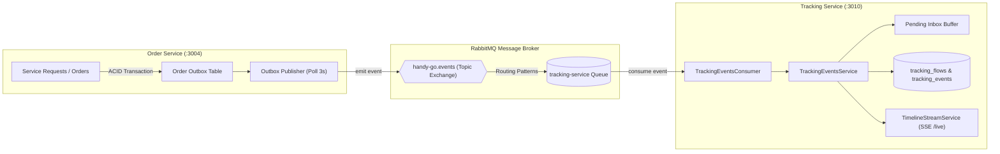

# Báo cáo Kiểm tra Hiện trạng: Tích hợp Tracking Service vào Order Service

> **Mã công việc:** HG-64  
> **Ngày thực hiện:** 06/11/2026  
> **Cập nhật lần cuối:** 11/11/2026 (đối chiếu mã nguồn và kiểm thử cục bộ)
> **Người kiểm tra:** Antigravity AI  
> **Trạng thái tổng quát:** Đã tích hợp trong mã nguồn trên nhánh HG-64; chưa đủ bằng chứng nghiệm thu production.
> - **Backend:** Order phát event qua outbox và Tracking tiêu thụ qua RabbitMQ; các test liên quan và typecheck cục bộ đã pass.
> - **Mobile:** Có `TrackingApi`, `TrackingSseClient`, `OrderTrackingTimeline` và fallback trong mã nguồn; chưa xác minh lại trên thiết bị thật ở lần rà soát này.

---

## 1. Tóm tắt kết quả kiểm tra (Executive Summary)

Dự án đặt câu hỏi: *"Tích hợp Tracking Service vào Order Service đã được tích hợp chưa?"*

Sau khi rà soát toàn bộ mã nguồn backend, lịch sử git, tài liệu kiến trúc và ứng dụng di động, kết quả như sau:

| Tầng hệ thống | Trạng thái | Chi tiết kỹ thuật |
| :--- | :---: | :--- |
| **Backend Architecture** | ✅ Hoàn thành | Thiết kế theo kiến trúc vi dịch vụ độc lập (*Database-per-service*). Hai service không gọi đồng bộ (HTTP/RPC) mà tích hợp lỏng (*loose coupling*) qua RabbitMQ Topic Exchange `handy-go.events`. |
| **Order Service (Publisher)** | ✅ Có triển khai | Transactional Outbox (`OrderOutboxRepository`, `OrderOutboxPublisherService`) phát các event vòng đời request/proposal/order. Contract ba event trọng tâm được kiểm thử cục bộ. |
| **Tracking Service (Consumer)** | ✅ Có triển khai | Subscribe event từ Order, xử lý trùng lặp và lệch thứ tự, cache Redis và SSE Stream. Chưa kiểm thử lại luồng đầy đủ với hạ tầng thật. |
| **Kiểm thử tự động (CI/Tests)** | ⚠️ Chưa đủ nghiệm thu | Các test Order/Tracking liên quan và backend typecheck pass cục bộ ngày 11/11/2026. Chưa có kết quả pipeline PR xanh hoặc suite Compose thực với PostgreSQL, RabbitMQ và Redis. |
| **Mobile App (Frontend Client)** | ✅ Có triển khai | `TrackingApi`, `TrackingSseClient`, `OrderTrackingTimeline`, hooks React Query và fallback về `statusHistory` có trong mã nguồn. Chưa kiểm tra lại trên thiết bị thật ở lần cập nhật này. |

---

## 2. Kiến trúc và Ranh giới nghiệp vụ (System Architecture)

### 2.1. Ranh giới dịch vụ
* **`order-service` (Port 3004):** Là dịch vụ có thẩm quyền tối cao (*Authoritative Source-of-Truth*) quản lý vòng đời Yêu cầu dịch vụ (Service Request), Báo giá chấp thuận (Booking Proposal) và Đơn hàng (Order). Nắm giữ State Machine và bảng lịch sử giao dịch trạng thái `order_status_history`.
* **`tracking-service` (Port 3010):** Là dịch vụ báo cáo và tổng hợp dòng thời gian (*Read-model / Append-only Event Sourcing*). Thu thập chuỗi sự kiện lịch sử từ nhiều service (Order, Matching, Bidding, Payment) thành một luồng duy nhất cho khách hàng, thợ và quản trị viên theo dõi.

### 2.2. Sơ đồ tương tác dữ liệu



---

## 3. Phân tích chi tiết tầng Backend

### 3.1. Phía Order Service (Publisher)
Tại [`backend/apps/order-service`](../../backend/apps/order-service), toàn bộ biến động trạng thái đều được ghi nhận vào Outbox trong cùng một Transaction nghiệp vụ:
1. **Tạo yêu cầu:** Khi tạo bản nháp yêu cầu ([`service-requests.service.ts`](../../backend/apps/order-service/src/service-requests/service-requests.service.ts#L70-L92)), outbox phát `service_request.created` kèm `serviceRequestId`, `requestCode`, `customerUserId`.
2. **Xuất bản & Hết hạn:** Phát `service_request.published`, `service_request.bidding_closed`, `service_request.expired`, `service_request.cancelled`.
3. **Đề xuất đặt thợ:** Phát `booking_proposal.created`, `booking_proposal.changes_requested`, `booking_proposal.rejected`.
4. **Tạo đơn hàng:** Khi thợ nhận việc, phát `order.created` chứa cả `orderId`, `serviceRequestId`, `customerId`, `workerId`.
5. **Tiến trình đơn hàng:** Hàm `emitOrderStatusChangedEvent` ([`orders.service.ts`](../../backend/apps/order-service/src/orders/orders.service.ts#L1614-L1641)) phát `order.status.changed` với payload chuẩn `{ previousStatus, nextStatus, customerId, workerId, ... }` mỗi khi đơn chuyển trạng thái (`confirmed`, `in_progress`, `finished`, `disputed`).
6. **Hoàn thành / Hủy:** Phát `order.completed`, `order.cancelled`.

### 3.2. Phía Tracking Service (Consumer)
Tại [`backend/apps/tracking-service`](../../backend/apps/tracking-service):
1. **Tiêu thụ sự kiện:** [`TrackingEventsConsumer`](../../backend/apps/tracking-service/src/events/tracking-events.consumer.ts) subscribe toàn bộ các pattern sự kiện phát ra từ `order-service`.
2. **Khử trùng lặp (Idempotency):** [`TrackingEventsService`](../../backend/apps/tracking-service/src/events/tracking-events.service.ts) ghi nhận `eventId` vào bảng `consumed_events` và khóa phân tán `pg_advisory_xact_lock` để bảo đảm không xử lý trùng khi mạng chập chờn.
3. **Xử lý sự kiện lệch thứ tự (Out-of-order tolerance):** 
   - Nếu sự kiện trạng thái đơn hàng đến trước khi `order.created` hoặc `service_request.created` được ghi nhận, sự kiện được lưu tạm vào bảng `pending_tracking_events`.
   - Ngay khi `order.created` tới hoặc định kỳ qua [`TrackingReconciliationScheduler`](../../backend/apps/tracking-service/src/events/tracking-reconciliation.scheduler.ts), hệ thống tự động flush toàn bộ sự kiện chờ để ráp vào dòng thời gian.
4. **Tương thích Payload (Commit `a3d7653`):** Tracking Service đã map chuẩn xác các trường `nextStatus` / `previousStatus` từ Order Service sang `toStatus` / `fromStatus` trên Timeline.
5. **Real-time SSE:** Ngay khi ghi nhận event vào bảng `tracking_events`, [`TimelineStreamService`](../../backend/apps/tracking-service/src/common/stream/timeline-stream.service.ts) phát trực tiếp qua Server-Sent Events đến các client đang theo dõi `/api/v1/tracking/requests/:id/live`.

---

## 4. Ma trận đồng bộ Event giữa hai dịch vụ

| Tên sự kiện (Routing Key) | Bên phát (Order Service) | Bên nhận (Tracking Service) | Mục đích trong Timeline |
| :--- | :---: | :---: | :--- |
| `service_request.created` | ✅ | ✅ | Khởi tạo `tracking_flows`, mốc tạo yêu cầu dịch vụ |
| `service_request.published` | ✅ | ✅ | Mốc yêu cầu bắt đầu mở nhận báo giá/tìm thợ |
| `service_request.bidding_closed` | ✅ | ✅ | Mốc kết thúc nhận báo giá |
| `service_request.expired` | ✅ | ✅ | Mốc yêu cầu quá hạn chọn thợ |
| `service_request.cancelled` | ✅ | ✅ | Mốc khách hủy yêu cầu |
| `booking_proposal.created` | ✅ | ✅ | Mốc gửi đề xuất thỏa thuận công việc |
| `booking_proposal.changes_requested` | ✅ | ✅ | Mốc khách yêu cầu sửa đổi đề xuất |
| `booking_proposal.rejected` | ✅ | ✅ | Mốc từ chối đề xuất |
| `order.created` | ✅ | ✅ | Mốc chính thức tạo đơn hàng, gắn `orderId` vào luồng |
| `order.status.changed` | ✅ | ✅ | Cập nhật tiến độ: `confirmed` $\to$ `in_progress` $\to$ `finished` $\to$ `disputed` |
| `order.completed` | ✅ | ✅ | Mốc nghiệm thu thành công đơn hàng |
| `order.cancelled` | ✅ | ✅ | Mốc hủy đơn hàng |

---

## 5. Kết quả kiểm thử

Ngày 11/11/2026, `pnpm run typecheck` và bốn test files liên quan đến Order/Tracking pass (86 tests): `order-tracking-contract.spec.ts`, `orders.service.spec.ts`, `order-deadline-scheduler.service.spec.ts`, `tracking-events.service.spec.ts`. Chưa chạy suite Compose với hạ tầng thật tại máy rà soát.

Các số liệu dưới đây là kết quả được ghi trong báo cáo ngày 06/11/2026, chưa được xác minh lại trong lần cập nhật này:

```bash
# 1. Kiểm tra Tracking Event Consumer & Service
✓ apps/tracking-service/src/events/tracking-events.service.spec.ts (19 tests) - PASS
✓ apps/tracking-service/src/events/tracking-events.consumer.spec.ts (10 tests) - PASS

# 2. Kiểm tra Order Service Outbox & State Transitions
✓ apps/order-service/src/orders/orders.service.spec.ts (43 tests) - PASS
✓ apps/order-service/src/service-requests/service-requests.service.spec.ts (35 tests) - PASS
```

---

## 6. Kết quả Đấu nối Hoàn tất ở Mobile App (Giai đoạn 2 - 5)

### 6.1. Kiến trúc Mobile Client & SSE Real-time
Tại ứng dụng di động React Native, toàn bộ hạ tầng kết nối đã được xây dựng và hoàn thiện:
1. **Types & DTOs:** [`mobile/src/features/tracking/types/tracking.types.ts`](../../mobile/src/features/tracking/types/tracking.types.ts) định nghĩa kiểu dữ liệu cho Tracking API; cần đối chiếu contract API khi nghiệm thu end-to-end.
2. **API Client:** [`mobile/src/features/tracking/api/tracking.api.ts`](../../mobile/src/features/tracking/api/tracking.api.ts) cung cấp `getTrackingSummary` và `getTrackingTimeline`.
3. **SSE Client:** [`mobile/src/services/sse/tracking-sse-client.ts`](../../mobile/src/services/sse/tracking-sse-client.ts) phát triển trên nền `react-native-sse`, hỗ trợ Auth token injection, Auto-reconnect với Exponential Backoff (tối đa 30s), bù đắp sự kiện rớt mạng bằng `Last-Event-ID` và Heartbeat watchdog.
4. **React Query Hooks:** `useTrackingSummary`, `useTrackingTimeline`, và `useTrackingEvents` tự động làm mới bộ nhớ cache khi có sự kiện đẩy từ server.

### 6.2. Đấu nối Giao diện Khách hàng & Thợ
- **Màn hình Khách hàng ([`customer-order-detail-screen.tsx`](../../mobile/src/features/orders/customer/screens/customer-order-detail-screen.tsx)):** Thay thế stepper tĩnh bằng component [`OrderTrackingTimeline`](../../mobile/src/features/tracking/components/order-tracking-timeline.tsx). Mã nguồn nhận cập nhật qua SSE; độ trễ trên thiết bị thật chưa được đo trong lần rà soát này.
- **Màn hình Thợ ([`worker-job-detail-screen.tsx`](../../mobile/src/features/orders/worker/screens/worker-job-detail-screen.tsx)):** Nhúng `OrderTrackingTimeline`, tự động hiện Alert và banner khi khách yêu cầu sửa lại (`rework`), kích hoạt lại nút hoàn tất, và hiện thông báo chúc mừng khi nghiệm thu.
- **Graceful Fallback & Phục hồi:** Khi Tracking API lỗi hoặc mất mạng, màn hình tự động chuyển về đọc `statusHistory` tĩnh có sẵn trong `order` mà không bị crash. Bộ kiểm thử E2E resilience ([`tracking-e2e-resilience.test.tsx`](../../mobile/src/features/tracking/__tests__/tracking-e2e-resilience.test.tsx)) kiểm chứng đạt 8/8 tests pass.

---

## 7. Kết luận cho Ticket HG-64

* **Về phía Backend:** Publisher/consumer và contract ba event trọng tâm hiện diện trong mã nguồn. Backend typecheck và 4 test files liên quan (86 tests) pass cục bộ ngày 11/11/2026.
* **Về phía Mobile Client:** Có dòng thời gian SSE, `Last-Event-ID` và fallback trong mã nguồn; kết quả test cũ thuộc lần chạy trước, chưa xác minh lại ở lần cập nhật này.
* **Đánh giá tổng thể:** Chưa có kết quả pipeline PR xanh và suite Compose với hạ tầng thật. Cần chạy các bước nghiệm thu trong [HG64-05](./HG64-05_KIEM_THU_XUYEN_SUOT.md) trước khi xác nhận production readiness.
