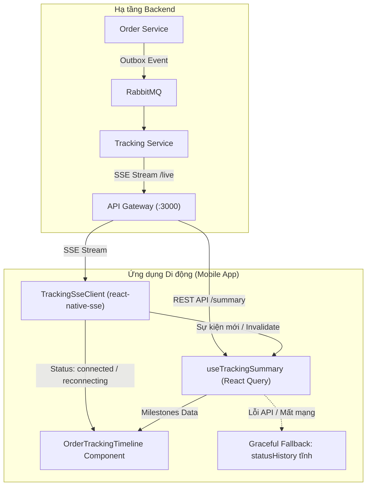

# Hướng dẫn Kiểm thử Chức năng Tích hợp Tracking Service trên Mobile (HG-64)

> **Mã công việc:** HG-64
> **Tính năng:** Tích hợp Tracking Service vào Order Service (Hiển thị Dòng thời gian SSE Thời gian thực & Phục hồi sự cố trên Mobile)
> **Ứng dụng:** Mobile App (`handy-go-mobile` - React Native / Expo)
> **Ngày cập nhật:** 13/11/2026
> **Trạng thái:** Sẵn sàng kiểm thử (Ready for QA & Verification)

---

## 1. Tổng quan tính năng & Cơ chế hoạt động trên Mobile

Tính năng tích hợp Tracking vào Order Service (HG-64) trên ứng dụng di động cho phép **Khách hàng (Customer)** và **Thợ (Worker)** theo dõi sát sao toàn bộ vòng đời từ lúc gửi Yêu cầu dịch vụ (Service Request) đến khi Đơn hàng (Order) hoàn tất qua Server-Sent Events (SSE).



### Các thành phần chính trên Mobile:
1. **`TrackingSseClient` (`src/services/sse/tracking-sse-client.ts`):** Quản lý kết nối SSE thời gian thực tới `/api/v1/tracking/requests/:id/live`, tích hợp Bearer JWT, tự động tái kết nối với Exponential Backoff (tối đa 30s), bù đắp sự kiện rớt mạng bằng header `Last-Event-ID` và giám sát Heartbeat Watchdog (45s).
2. **`useTrackingSummary` & `useTrackingEvents` (`src/features/tracking/hooks/`):** React Query hooks tự động đồng bộ và lắng nghe sự kiện đẩy để làm mới cache dữ liệu tức thời.
3. **`OrderTrackingTimeline` (`src/features/tracking/components/order-tracking-timeline.tsx`):** Trực quan hóa 7 cột mốc chính và huy hiệu trạng thái kết nối trực tiếp (`Trực tiếp 🟢`, `Đang kết nối lại... 🟡`, `Ngoại tuyến ⚪`).
4. **`CustomerOrderDetailScreen` & `WorkerJobDetailScreen`:** Đấu nối timeline trực tiếp vào chi tiết đơn hàng của Khách và Thợ; đồng thời xử lý Alert thông báo khi có yêu cầu sửa lại (`rework`) hoặc nghiệm thu (`completed`).
5. **`Graceful Fallback`:** Khi Tracking Service không khả dụng, màn hình tự động rơi về hiển thị bảng `statusHistory` tĩnh có sẵn trong Order, đảm bảo không bao giờ bị trắng màn hình (blank screen) hoặc crash app.

---

## 2. Chuẩn bị môi trường kiểm thử

### 2.1. Yêu cầu môi trường
- **Node.js:** v20.x hoặc v24.x
- **Package Manager:** `pnpm` (khuyến nghị v10.x hoặc tương thích)
- **Thiết bị kiểm thử:**
  - *Kiểm thử tự động:* Máy tính dev (Windows/macOS/Linux) chạy Jest.
  - *Kiểm thử thủ công:* 02 thiết bị di động thật (hoặc 1 máy thật + 1 máy ảo Android Simulator / iOS Simulator).
- **Hạ tầng Backend:** Đã khởi chạy API Gateway, Order Service, Tracking Service, PostgreSQL, RabbitMQ và Redis (hoặc stack test Compose `docker-compose.hg64-test.yml`).

### 2.2. Cấu hình Mobile App trỏ về Backend
Trong file cấu hình môi trường của mobile (`mobile/.env` hoặc biến môi trường `EXPO_PUBLIC_API_URL`):
```ini
# Trỏ về địa chỉ IP mạng nội bộ (LAN) của máy tính chạy API Gateway (không dùng localhost trên máy thật)
EXPO_PUBLIC_API_URL=http://192.168.1.x:3000/api/v1
```

---

## 3. Phần 1: Kiểm thử Tự động (Automated Unit & Component Tests)

Trước khi tiến hành kiểm thử thủ công trên thiết bị, toàn bộ các bài test tự động liên quan đến Tracking và SSE trên mobile phải được xác nhận đạt 100% PASS.

### 3.1. Lệnh kiểm tra Type-check
Mở terminal tại thư mục `mobile/`:
```bash
cd mobile
pnpm run type-check
```
*Tiêu chuẩn đạt:* Mã thoát `code 0`, không có bất kỳ lỗi TypeScript nào (`tsc --noemit` pass).

### 3.2. Lệnh chạy toàn bộ Test Suites của HG-64 Mobile
Chạy trọn bộ 6 test suites kiểm thử tích hợp Tracking và Order màn hình:

```bash
cd mobile
pnpm exec jest --runInBand --forceExit \
  src/features/tracking/__tests__/ \
  src/services/sse/__tests__/tracking-sse-client.test.ts \
  src/features/orders/customer/__tests__/customer-order-detail-tracking.test.tsx \
  src/features/orders/worker/__tests__/worker-job-detail-screen.test.tsx
```

### 3.3. Bảng phân tích ý nghĩa các Test Suites

| STT | File Test | Mục tiêu kiểm chứng |
| :---: | :--- | :--- |
| **1** | `tracking.test.ts` | Kiểm tra DTO, hàm API `getSummary`, `getTimeline`, định dạng milestone và tính toán trạng thái giai đoạn `BIDDING_CLOSED`. |
| **2** | `tracking-sse-client.test.ts` | Kiểm tra vòng đời SSE: mở kết nối, parse message, heartbeat watchdog timeout, tự động tái kết nối theo lũy thừa, truyền `Last-Event-ID` và tự động refresh token JWT. |
| **3** | `order-tracking-timeline.test.tsx` | Kiểm tra hiển thị giao diện: Loading indicator, trạng thái Live dot (`connected`, `reconnecting`, `disconnected`), danh sách mốc và nhãn thời gian. |
| **4** | `customer-order-detail-tracking.test.tsx` | Kiểm tra màn hình Khách hàng: Render `OrderTrackingTimeline`, tự động cập nhật khi có SSE event, fallback về `statusHistory` khi API tracking trả về lỗi. |
| **5** | `worker-job-detail-screen.test.tsx` | Kiểm tra màn hình Thợ: Render timeline theo role thợ, bắt sự kiện `rework` bật popup cảnh báo, bắt sự kiện `order.completed` bật popup chúc mừng, mở lại nút chụp ảnh nghiệm thu. |
| **6** | `tracking-e2e-resilience.test.tsx` | Kiểm tra khả năng chịu lỗi toàn trình: Giả lập rớt mạng, mất kết nối SSE, khôi phục luồng với `Last-Event-ID` và không gián đoạn giao diện người dùng. |

*Kết quả đã chạy ngày 13/11/2026:* **6/6 test suites PASS, 49/49 tests PASS**.

---

## 4. Phần 2: Kịch bản Kiểm thử Thủ công trên Thiết bị (Manual E2E Testing)

Kịch bản kiểm thử trực quan trên 2 thiết bị di động độc lập kết nối thời gian thực:
- **Thiết bị A (Máy Khách hàng):** Cài app, đăng nhập tài khoản Khách hàng (Customer).
- **Thiết bị B (Máy Thợ):** Cài app, đăng nhập tài khoản Thợ (Worker) đã xác thực KYC.

### Kịch bản Toàn trình 8 Bước (Happy Path + Rework)

```
[Máy A - Khách] Gửi Yêu cầu  ──>  [Máy B - Thợ] Báo giá  ──>  [Máy A] Chấp nhận đề xuất
                                                                       │
[Máy A] Đơn hàng hiển thị    <──  Tự động nhảy sang Đơn hàng <────────┘
        │
        ▼ (Thợ bấm Bắt đầu làm)
[Máy A] Cột mốc "Thợ đang làm việc" cập nhật qua SSE
        │
        ▼ (Thợ chụp ảnh & báo hoàn tất)
[Máy A] Hiện thông báo "Thợ đã hoàn tất việc, vui lòng nghiệm thu"
        │
        ├─► [Trường hợp Sửa lại]: Khách bấm "Yêu cầu làm lại"
        │                         └──> [Máy B] Lập tức nhảy Alert lý do sửa, mở lại nút nộp minh chứng
        │
        └─► [Nghiệm thu]: Khách bấm "Nghiệm thu & Thanh toán"
                          └──> [Máy B] Bật Alert chúc mừng thành công 🎉
```

### Bảng Kịch bản Chi tiết từng Bước:

| Bước | Người thao tác | Hành động cụ thể | Quan sát trên Thiết bị A (Khách hàng) | Quan sát trên Thiết bị B (Thợ) | Tiêu chí Đạt (Pass Criteria) |
| :---: | :---: | :--- | :--- | :--- | :--- |
| **1** | Khách (Máy A) | 1. Tạo yêu cầu sửa chữa mới.<br>2. Bấm "Xuất bản yêu cầu". | - Cột mốc 1 "Đã tạo yêu cầu" sáng xanh.<br>- Huy hiệu góc phải hiện `Trực tiếp 🟢`. | Nhận được thông báo có việc mới trong bán kính nhận việc. | Mốc hiển thị ngay không cần kéo vuốt tải lại. |
| **2** | Thợ (Máy B) | Mở thông báo việc mới $\to$ Nhập giá $\to$ Bấm "Gửi báo giá". | Số lượng báo giá trên màn hình yêu cầu tự nhảy lên `1 báo giá`. | Báo giá hiển thị trạng thái "Đang chờ khách phản hồi". | Đồng bộ trạng thái tức thời qua SSE. |
| **3** | Khách (Máy A) | Chọn báo giá của Thợ (Máy B) $\to$ Bấm "Chấp thuận đề xuất". | Màn hình hiển thị trạng thái "Chờ thợ xác nhận đơn". | Máy thợ rung/chuông và hiện popup Đề xuất đặt việc từ Khách. | Sự kiện `booking_proposal` gửi thành công. |
| **4** | Thợ (Máy B) | Bấm "Chấp nhận đề xuất nhận việc". | Màn hình **tự động điều hướng** từ Yêu cầu sang màn hình **Chi tiết đơn hàng** mới. Mốc "Đơn hàng đã được xác nhận" sáng xanh. | Chuyển sang màn hình "Chi tiết công việc". Hiển thị nút "Bắt đầu làm việc". | Cả 2 máy cập nhật cùng lúc mà không bị kẹt ở màn hình cũ. |
| **5** | Thợ (Máy B) | Khi tới nơi, bấm nút **"Bắt đầu làm việc"**. | Mốc **"Thợ đang làm việc" chuyển sang màu xanh lá** (In-progress). | Nút hành động chuyển sang "Chụp ảnh minh chứng & Báo xong việc". | Máy khách tự cập nhật qua SSE; ghi lại độ trễ thực tế khi kiểm thử. |
| **6** | Thợ (Máy B) | Bấm "Chụp ảnh minh chứng" $\to$ Chọn/Chụp ảnh $\to$ Bấm "Báo hoàn tất". | - Mốc "Hoàn thành thi công" sáng.<br>- Hiện nút "Nghiệm thu & Thanh toán" và "Yêu cầu sửa lại". | Màn hình hiển thị: "Đang chờ khách hàng nghiệm thu công việc". | Ảnh minh chứng hiển thị đầy đủ trên màn hình khách. |
| **7** | Khách (Máy A) | Giả lập chưa đạt yêu cầu: Bấm **"Yêu Cầu Sửa Lại"**. Giao diện hiện tại gửi lý do cố định trong mã, chưa có ô nhập lý do. | Đơn chuyển về `in_progress`; timeline cập nhật mốc sửa lại. | Máy thợ nhận cảnh báo có lý do sửa và nút nộp minh chứng được mở lại. | Cả hai máy cập nhật cùng một đơn; thợ có thể nộp bằng chứng mới. |
| **8** | Khách (Máy A) | Sau khi thợ xử lý xong và nộp bằng chứng lần nữa: Bấm **"🎉 Nghiệm Thu & Thanh Toán"**. | Mốc "Hoàn thành đơn hàng" sáng xanh; màn hình hiện nút đánh giá thợ (hiện là thông báo chờ phát triển). | Máy thợ nhận Alert nghiệm thu thành công. | Trạng thái Order là `completed` trên cả hai máy; kiểm tra thanh toán trong luồng Payment riêng. |

---

## 5. Phần 3: Kiểm thử Khả năng Phục hồi & Các Trường hợp Biên (Resilience & Edge Cases)

Các bài kiểm thử bắt buộc nhằm đảm bảo ứng dụng không bao giờ bị treo, đơ hoặc crash khi mạng chập chờn:

### 5.1. Kịch bản Rớt mạng & Bù đắp sự kiện bằng `Last-Event-ID`
1. **Chuẩn bị:** Mở màn hình Chi tiết đơn hàng trên Thiết bị A (Khách hàng). Kiểm tra trạng thái hiện `Trực tiếp 🟢`.
2. **Hành động 1:** Bật **Chế độ máy bay (Airplane Mode)** trên Thiết bị A.
3. **Quan sát 1:** Sau khoảng 3–5 giây, huy hiệu kết nối phải chuyển sang **`Đang kết nối lại... 🟡`** hoặc **`Ngoại tuyến ⚪`**.
4. **Hành động 2:** Trong lúc Thiết bị A đang tắt mạng, dùng Thiết bị B chuyển trạng thái đơn hàng (bấm "Bắt đầu làm việc").
5. **Hành động 3:** Tắt Chế độ máy bay trên Thiết bị A (kết nối lại Wi-Fi/4G).
6. **Tiêu chuẩn đạt (PASS):**
   - Trạng thái kết nối tự chuyển lại thành **`Trực tiếp 🟢`**.
   - `TrackingSseClient` tự động gửi header `Last-Event-ID: <id_trước_khi_rớt_mạng>` lên API Gateway.
   - Cột mốc "Thợ đang làm việc" **tự động nhảy sang màu xanh lá** mà người dùng **KHÔNG** cần phải thao tác vuốt làm mới (Pull-to-refresh).

### 5.2. Kịch bản Tracking Service ngừng hoạt động (Graceful Fallback)
1. **Hành động:** Tắt container hoặc service của Tracking Service trên server:
   ```bash
   docker stop <container_tracking_service>
   ```
2. **Quan sát trên Mobile:**
   - Mở màn hình Chi tiết đơn hàng.
   - Ứng dụng **tuyệt đối không bị văng (crash)**, không hiện thông báo lỗi Exception màu đỏ hay màn hình trắng.
   - Khối Timeline tự động chuyển sang khối giao diện dự phòng: **"Lịch sử trạng thái đơn hàng (Dự phòng)"** lấy dữ liệu từ `order.statusHistory`.
3. **Tiêu chuẩn đạt (PASS):** Khách hàng và Thợ vẫn xem được lịch sử trạng thái cơ bản của đơn hàng bình thường.

### 5.3. Kịch bản Tranh chấp / Khiếu nại (Dispute Resolution)
1. Khách hàng bấm "Mở khiếu nại" (`disputeOrder`).
2. **Quan sát:**
   - Mốc trên timeline đổi sang màu cam/đỏ cảnh báo "Đang xử lý tranh chấp".
   - Màn hình Thợ nhận được thông báo Alert: *"🚨 Đơn hàng đang được khiếu nại - Đang trong trạng thái xem xét tranh chấp bởi Quản trị viên"*.

### 5.4. Kịch bản Phân quyền & Bảo mật (Bid Shielding)
1. Dùng tài khoản Thợ C (không phải thợ được chọn trong đơn hàng).
2. Gọi hoặc mở màn hình tracking của đơn hàng này.
3. **Tiêu chuẩn đạt (PASS):** Server trả về `403 Forbidden`. Mobile App hiển thị thông báo lỗi quyền truy cập, không làm lộ bất kỳ thông tin báo giá hoặc tiến trình nào của đơn hàng.

---

## 6. Bảng Checklist Nghiệm thu Chức năng Mobile (QA Acceptance Checklist)

Đánh dấu tích `[x]` vào các mục khi đã kiểm thử thành công:

- [ ] **1. Type Safety & Unit Tests:** `pnpm run type-check` và 6 test suites của mobile đều pass 100%.
- [ ] **2. Live SSE Status Indicator:** Hiển thị chính xác 3 trạng thái: `Trực tiếp 🟢`, `Đang kết nối lại... 🟡`, `Ngoại tuyến ⚪`.
- [ ] **3. Real-time Latency:** Thay đổi trạng thái từ Thợ phản ánh lên máy Khách trong thời gian dưới 2 giây.
- [ ] **4. Rework Alert & Flow:** Khi Khách bấm yêu cầu sửa lại, Thợ nhận Alert kèm đúng lý do, nút hoàn tất được mở lại.
- [ ] **5. Completion Alert:** Khi Khách duyệt nghiệm thu, Thợ nhận Alert chúc mừng tức thời.
- [ ] **6. Airplane Mode Recovery:** Mất mạng 15 giây rồi bật lại, app tự kết nối và bù đắp mốc sự kiện đầy đủ qua `Last-Event-ID`.
- [ ] **7. Graceful Fallback:** Khi server Tracking gặp sự cố, màn hình fallback êm dịu về `statusHistory` tĩnh, không crash.
- [ ] **8. Clean Memory & No Leaks:** Khi rời khỏi màn hình chi tiết đơn hàng (Back ra ngoài), kết nối SSE được đóng hoàn toàn (`client.disconnect()`), không rò rỉ listener hoặc timer ngầm.

---

## 7. Hướng dẫn Bắt lỗi & Troubleshooting khi Kiểm thử

| Hiện tượng | Nguyên nhân có thể | Hướng xử lý |
| :--- | :--- | :--- |
| Trạng thái SSE luôn báo `Ngoại tuyến ⚪` | Mobile không kết nối được tới IP backend | 1. Kiểm tra máy di động và máy server có chung mạng Wi-Fi không.<br>2. Kiểm tra tường lửa (Firewall) trên máy server có chặn cổng 3000 không.<br>3. Kiểm tra biến `EXPO_PUBLIC_API_URL` đã trỏ đúng IP LAN chưa. |
| Mốc không tự động nhảy sau khi Thợ bấm | RabbitMQ hoặc Outbox Publisher chưa chạy | 1. Kiểm tra hàng đợi RabbitMQ xem event `order.status.changed` có vào exchange không.<br>2. Kiểm tra container `order-service` xem Outbox Scheduler (chu kỳ 3s) có đang chạy không. |
| Bị lỗi `401 Unauthorized` trên stream SSE | Token JWT hết hạn hoặc chưa đính kèm | Kiểm tra `TrackingSseClient` đã lấy đúng Bearer Token từ SecureStore; kiểm tra hàm `refreshTokens()` có hoạt động khi token hết hạn. |
| Màn hình bị giật hoặc re-render liên tục | Cache React Query bị invalidate lặp vô tận | Kiểm tra trong `useTrackingEvents`: chỉ gọi `invalidateQueries` khi có `event.eventId` mới hợp lệ, không gọi trong heartbeat ping. |
| Máy thật không load được GPS khi ở trong nhà | Sóng vệ tinh GPS bị cản trở bởi mái/tường nhà; máy chưa bật dịch vụ định vị mạng Google | 1. Vào Cài đặt điện thoại -> Vị trí -> Bật **"Độ chính xác vị trí của Google" (Google Location Accuracy)** để dùng trạm Wi-Fi/4G.<br>2. App đã hỗ trợ cache vị trí gần nhất `getLastKnownPositionAsync` và tìm kiếm địa chỉ tự do trên thanh tìm kiếm hoặc ghim trực tiếp trên bản đồ. |
