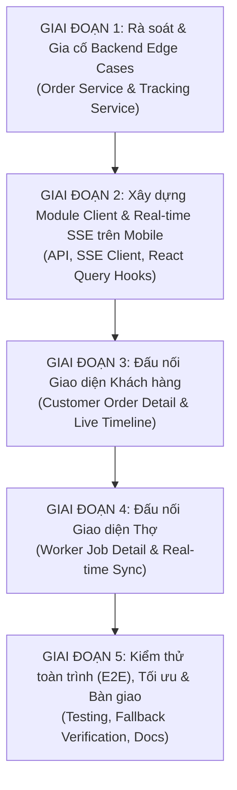

# Kế hoạch Chi tiết Hoàn thành 100% Tích hợp Tracking Service vào Order Service

> **Mã công việc:** HG-64  
> **Nhánh phát triển:** `feature/HG-64-integrate-tracking-service-into-order-service`  
> **Ngày lập kế hoạch:** 06/11/2026  
> **Tài liệu tham chiếu:**
> - Báo cáo rà soát hiện trạng: [`docs/HG-64/BAO_CAO_KIEM_TRA_TICH_HOP_TRACKING_ORDER.md`](file:///d:/SCHOOL/PBL6/docs/HG-64/BAO_CAO_KIEM_TRA_TICH_HOP_TRACKING_ORDER.md)
> - Báo cáo kỹ thuật Tracking Service: [`docs/HG47_TRACKING_SERVICE.md`](file:///d:/SCHOOL/PBL6/docs/HG47_TRACKING_SERVICE.md)
> - Thiết kế DBML v2: [`docs/dbml/tracking-service-v2.dbml`](file:///d:/SCHOOL/PBL6/docs/dbml/tracking-service-v2.dbml)
> - Hướng dẫn Smart Interop: [`docs/order-service/SMART_INTEROP_INTEGRATION_GUIDE.md`](file:///d:/SCHOOL/PBL6/docs/order-service/SMART_INTEROP_INTEGRATION_GUIDE.md)

---

## 1. Mục tiêu & Tiêu chuẩn hoàn thành (Definition of Done - DoD)

Mục tiêu của kế hoạch là đưa quá trình tích hợp giữa **Order Service** và **Tracking Service** đạt **100% sẵn sàng sản xuất (Production-ready)** xuyên suốt từ Backend Microservices tới Ứng dụng Di động (Mobile App), mang lại trải nghiệm theo dõi tiến độ công việc theo thời gian thực (Real-time Live Stream) cho cả Khách hàng và Thợ.

### Tiêu chuẩn hoàn thành 100% (DoD):
1. **Backend Event Completeness:** Toàn bộ các mốc sự kiện vòng đời đơn hàng (kể cả các trường hợp biên: yêu cầu làm lại `rework`, khiếu nại `dispute`, hủy đơn `cancelled`) đều được phát đi từ `order-service` và được `tracking-service` tiêu thụ, tính toán milestone chính xác.
2. **Mobile API & SSE Client:** Mobile App sở hữu module `TrackingApi` và `TrackingSseClient` chuyên biệt, hỗ trợ cơ chế tự động kết nối lại (Auto-reconnect), bù đắp sự kiện bị lỡ (`Last-Event-ID`), và xử lý heartbeat ping.
3. **Customer Experience (UI/UX):** Màn hình Chi tiết đơn hàng của Khách hàng ([`customer-order-detail-screen.tsx`](file:///d:/SCHOOL/PBL6/mobile/src/features/orders/customer/screens/customer-order-detail-screen.tsx)) hiển thị toàn bộ 7 mốc tiến trình hành trình (từ lúc tạo yêu cầu $\to$ đấu thầu $\to$ đề xuất $\to$ thi công $\to$ hoàn tất) và **tự động nhảy trạng thái thời gian thực qua SSE mà người dùng không cần kéo để làm mới (no pull-to-refresh)**.
4. **Worker Experience (UI/UX):** Màn hình Việc làm của Thợ ([`worker-job-detail-screen.tsx`](file:///d:/SCHOOL/PBL6/mobile/src/features/orders/worker/screens/worker-job-detail-screen.tsx)) hiển thị mốc thời gian thi công đồng bộ, nhận thông báo tức thì khi khách yêu cầu sửa lại hoặc nghiệm thu thành công.
5. **Testing & Stability:** 100% Unit test, Hook test, Component test trên Mobile và Integration test trên Backend đều PASS. Đảm bảo fallback êm dịu (*Graceful degradation*) khi mất kết nối mạng.

---

## 2. Lộ trình triển khai tổng quan (Phased Roadmap)

---

## 3. Kế hoạch triển khai chi tiết từng bước (Step-by-Step Execution Plan)

### GIAI ĐOẠN 1: Rà soát & Gia cố Backend Edge Cases

Mục tiêu: Đảm bảo không bỏ sót bất kỳ biến động trạng thái nào giữa hai dịch vụ, đặc biệt là các luồng bất thường (*unhappy paths*).

- [x] **Bước 1.1: Rà soát các sự kiện biên trong `order-service`**
  - **Mô tả:** Kiểm tra các hàm chuyển trạng thái đặc thù trong [`orders.service.ts`](file:///d:/SCHOOL/PBL6/backend/apps/order-service/src/orders/orders.service.ts):
    - `requestRework()`: Xác nhận đã phát `order.status.changed` với `nextStatus: 'in_progress'` hoặc `order.rework_requested`.
    - `disputeOrder()`: Xác nhận phát `order.disputed` và `order.status.changed` với `nextStatus: 'disputed'`.
    - `resolveDispute()`: Xác nhận phát sự kiện chuyển trạng thái tiếp theo sau khi Admin can thiệp xử lý.
  - **Tệp liên quan:**
    - [`backend/apps/order-service/src/orders/orders.service.ts`](file:///d:/SCHOOL/PBL6/backend/apps/order-service/src/orders/orders.service.ts)
    - [`backend/apps/order-service/src/common/constants/order.constants.ts`](file:///d:/SCHOOL/PBL6/backend/apps/order-service/src/common/constants/order.constants.ts)
  - **Tiêu chí chấp thuận:** Có outbox event phát ra cho 100% các nhánh trạng thái trong State Machine. *(Đã hoàn thành - Commit `3d88da0`)*

- [x] **Bước 1.2: Bổ sung xử lý sự kiện tranh chấp và làm lại trong `tracking-service`**
  - **Mô tả:** Kiểm tra hàm `calculatePhaseAndMilestones` trong [`summary.service.ts`](file:///d:/SCHOOL/PBL6/backend/apps/tracking-service/src/summary/summary.service.ts) để đảm bảo khi nhận sự kiện tranh chấp hoặc yêu cầu sửa chữa, Phase của tiến trình chuyển chính xác:
    - `disputed` $\to$ Phase `DISPUTED`
    - `rework` $\to$ Phase `ORDER_IN_PROGRESS` (kèm ghi chú reason trong metadata)
  - **Tệp liên quan:**
    - [`backend/apps/tracking-service/src/summary/summary.service.ts`](file:///d:/SCHOOL/PBL6/backend/apps/tracking-service/src/summary/summary.service.ts)
    - [`backend/apps/tracking-service/src/events/tracking-events.service.ts`](file:///d:/SCHOOL/PBL6/backend/apps/tracking-service/src/events/tracking-events.service.ts)
  - **Tiêu chí chấp thuận:** Unit test cho `SummaryService` bao phủ ca `disputed` và `rework` chuyển đổi phase chính xác. *(Đã hoàn thành - Commit `3d88da0`)*

- [x] **Bước 1.3: Kiểm tra thiết lập API Gateway đối với SSE**
  - **Mô tả:** Xác minh cấu hình reverse proxy tại [`proxy.constants.ts`](file:///d:/SCHOOL/PBL6/backend/apps/api-gateway/src/proxy/proxy.constants.ts) và Nginx (nếu có) đảm bảo:
    - Route `/api/v1/tracking/*` forward đầy đủ các header: `x-internal-secret`, `x-user-id`, `x-user-roles`.
    - Route SSE `/api/v1/tracking/requests/:id/live` không bị proxy đệm dữ liệu (tắt `proxy_buffering off`, header `X-Accel-Buffering: no`, giữ `chunked transfer`).
  - **Tiêu chí chấp thuận:** Kết nối thử nghiệm SSE qua Gateway duy trì kết nối > 60 giây và nhận ping đều đặn. *(Đã hoàn thành - Commit `3d88da0`)*

---

### GIAI ĐOẠN 2: Xây dựng Module Client & Real-time SSE trên Mobile App

Mục tiêu: Cung cấp đầy đủ hạ tầng API client, cơ chế kết nối thời gian thực và state management cho tính năng Tracking trên ứng dụng di động.

- [x] **Bước 2.1: Định nghĩa kiểu dữ liệu chuẩn (Types & DTOs)**
  - **Mô tả:** Tạo file định nghĩa types cho Tracking Service tại [`mobile/src/features/tracking/types/tracking.types.ts`](file:///d:/SCHOOL/PBL6/mobile/src/features/tracking/types/tracking.types.ts):
    - `TrackingPhase`: `'DRAFT' | 'SEEKING_WORKERS' | 'BOOKING_PROPOSAL' | 'ORDER_CONFIRMED' | 'ORDER_IN_PROGRESS' | 'ORDER_FINISHED' | 'COMPLETED' | 'CANCELLED' | 'EXPIRED' | 'DISPUTED'`
    - `TrackingMilestone`: `{ key, title, description, status: 'completed' | 'in_progress' | 'pending' | 'skipped', reachedAt }`
    - `TrackingTimelineItem`: DTO chứa chi tiết sự kiện append-only (`eventType`, `occurredAt`, `actor`, `reason`, `metadata`).
    - `TrackingSummaryResponse`: Cấu trúc trả về từ `GET /api/v1/tracking/requests/:id/summary`.
    - `TrackingSseMessage`: Cấu trúc message SSE (`connected`, `ping`, `timeline_event`).
  - **Tệp tạo mới:**
    - `mobile/src/features/tracking/types/tracking.types.ts`
  - **Tiêu chí chấp thuận:** Types khớp 100% với DTO của Backend NestJS. *(Đã hoàn thành - Commit `1f8f15e`)*

- [x] **Bước 2.2: Xây dựng `TrackingApi` Client**
  - **Mô tả:** Xây dựng các hàm gọi REST API qua `api-client`:
    - `getTrackingSummary(serviceRequestId: string): Promise<TrackingSummaryResponse>`
    - `getTrackingTimeline(serviceRequestId: string, query?: PaginationQuery): Promise<TrackingTimelineResponse>`
  - **Tệp tạo mới:**
    - `mobile/src/features/tracking/api/tracking.api.ts`
  - **Tiêu chí chấp thuận:** Có mock test kiểm tra parse dữ liệu thành công và xử lý mã lỗi HTTP 403, 404. *(Đã hoàn thành - Commit `1f8f15e`)*

- [x] **Bước 2.3: Xây dựng `TrackingSseClient` chuyên biệt**
  - **Mô tả:** Kế thừa kiến trúc vững chắc từ [`bidding-sse-client.ts`](file:///d:/SCHOOL/PBL6/mobile/src/services/sse/bidding-sse-client.ts) để xây dựng client SSE cho Tracking:
    - Kết nối tới `GET /api/v1/tracking/requests/:serviceRequestId/live`.
    - Gắn kèm Bearer Access Token (tự động lấy token mới khi refresh).
    - Tự động lưu `lastEventId` để gửi header `Last-Event-ID` khi reconnect nhằm bù đắp sự kiện bị lỡ.
    - Cơ chế Reconnect lũy thừa (Exponential Backoff: 1s, 2s, 4s, tối đa 30s).
    - Nhận diện mất mạng (`heartbeatTimeoutMs: 45000`) và tự động tái lập kết nối.
  - **Tệp tạo mới:**
    - `mobile/src/services/sse/tracking-sse-client.ts`
    - `mobile/src/services/sse/__tests__/tracking-sse-client.test.ts`
  - **Tiêu chí chấp thuận:** Viết unit test giả lập mất kết nối, xác minh client tự reconnect và phát sự kiện `timeline_event` đúng emitter. *(Đã hoàn thành - Commit `1f8f15e`)*

- [x] **Bước 2.4: Xây dựng Custom Hooks tích hợp React Query**
  - **Mô tả:** Tạo các hooks dùng chung:
    - `useTrackingSummary(serviceRequestId)`: Fetch dữ liệu summary với cache 1 phút.
    - `useTrackingTimeline(serviceRequestId)`: Fetch toàn bộ timeline phân trang.
    - `useTrackingEvents(serviceRequestId, onNewEvent)`: Hook quản lý vòng đời SSE (kết nối khi component mount, hủy khi unmount), tự động invalidate query cache của React Query khi có sự kiện mới tới.
  - **Tệp tạo mới:**
    - `mobile/src/features/tracking/hooks/use-tracking-summary.ts`
    - `mobile/src/features/tracking/hooks/use-tracking-timeline.ts`
    - `mobile/src/features/tracking/hooks/use-tracking-events.ts`
  - **Tiêu chí chấp thuận:** Khi SSE nhận event mới, hook tự động kích hoạt query refetch để giao diện render mượt mà. *(Đã hoàn thành - Commit `1f8f15e`)*

---

### GIAI ĐOẠN 3: Đấu nối Giao diện Khách hàng (Customer Order Detail)

Mục tiêu: Nâng cấp trải nghiệm khách hàng, thay thế bảng `statusHistory` tĩnh bằng Dòng thời gian động thông minh.

- [x] **Bước 3.1: Xây dựng Component `OrderTrackingTimeline`**
  - **Mô tả:** Tạo component giao diện hiển thị tiến trình công việc trực quan:
    - Render 7 cột mốc chính trực quan (Icon, Tiêu đề, Thời gian, Người thực hiện).
    - Hỗ trợ hiển thị mở rộng danh sách sự kiện chi tiết bên dưới mỗi cột mốc.
    - Trạng thái rõ ràng: Đã xong (Xanh lá), Đang thực hiện (Xanh dương nhấp nháy pulse nhẹ), Chờ thực hiện (Xám), Bị hủy/Khiếu nại (Đỏ/Cam).
  - **Tệp tạo mới:**
    - `mobile/src/features/tracking/components/order-tracking-timeline.tsx`
    - `mobile/src/features/tracking/components/tracking-milestone-item.tsx`
  - **Tiêu chí chấp thuận:** Component render đẹp mắt trên cả Light mode và Dark mode, hỗ trợ i18n tiếng Việt. *(Đã hoàn thành - Commit `6542811`)*

- [x] **Bước 3.2: Tích hợp vào `customer-order-detail-screen.tsx`**
  - **Mô tả:** Cập nhật màn hình [`customer-order-detail-screen.tsx`](file:///d:/SCHOOL/PBL6/mobile/src/features/orders/customer/screens/customer-order-detail-screen.tsx):
    - Đọc `serviceRequestId` từ thông tin đơn hàng `order.serviceRequestId`.
    - Sử dụng `useTrackingSummary` và `useTrackingEvents(order.serviceRequestId)`.
    - Thay thế khối render `statusHistory` cũ bằng `<OrderTrackingTimeline />`.
    - Đặt cơ chế Fallback an toàn: nếu API Tracking trả về lỗi hoặc không có dữ liệu, tự động fallback về hiển thị `statusHistory` cũ của Order Service.
  - **Tệp chỉnh sửa:**
    - [`mobile/src/features/orders/customer/screens/customer-order-detail-screen.tsx`](file:///d:/SCHOOL/PBL6/mobile/src/features/orders/customer/screens/customer-order-detail-screen.tsx)
  - **Tiêu chí chấp thuận:** Khi Thợ bấm "Bắt đầu làm việc" trên máy của Thợ, màn hình chi tiết đơn của Khách hàng lập tức chuyển mốc mà không cần vuốt màn hình để refresh. *(Đã hoàn thành - Commit `6542811`)*

- [x] **Bước 3.3: Hiển thị trạng thái kết nối Live Indicator**
  - **Mô tả:** Thêm một huy hiệu nhỏ góc trên:
    - 🟢 *Trực tiếp (Live)*: Đang kết nối SSE ổn định.
    - 🟡 *Đang kết nối lại...*: Khi mạng chập chờn hoặc chuyển mạng 4G/Wifi.
  - **Tiêu chí chấp thuận:** Người dùng nhận biết được tính thời gian thực của dữ liệu. *(Đã hoàn thành - Commit `6542811`)*

---

### GIAI ĐOẠN 4: Đấu nối Giao diện Thợ (Worker Job Detail)

Mục tiêu: Giúp Thợ nắm bắt tức thì các mốc kiểm duyệt, nghiệm thu hoặc yêu cầu làm lại từ phía Khách hàng.

- [x] **Bước 4.1: Tích hợp Timeline vào `worker-job-detail-screen.tsx`**
  - **Mô tả:** Nâng cấp [`worker-job-detail-screen.tsx`](file:///d:/SCHOOL/PBL6/mobile/src/features/orders/worker/screens/worker-job-detail-screen.tsx):
    - Nhúng `OrderTrackingTimeline` phiên bản dành cho Thợ.
    - Đảm bảo tuân thủ nguyên tắc bảo mật thông tin (Role-based security & Bid shielding: Thợ chỉ xem được các sự kiện của đơn hàng mình được phân công).
  - **Tệp chỉnh sửa:**
    - [`mobile/src/features/orders/worker/screens/worker-job-detail-screen.tsx`](file:///d:/SCHOOL/PBL6/mobile/src/features/orders/worker/screens/worker-job-detail-screen.tsx)
  - **Tiêu chí chấp thuận:** Thợ theo dõi được tiến trình công việc từ lúc xác nhận đến khi hoàn tất. *(Đã hoàn thành - Commit `8434fcc`)*

- [x] **Bước 4.2: Tự động phản ứng với sự kiện Rework và Nghiệm thu**
  - **Mô tả:** Khi Khách hàng bấm "Nghiệm thu hoàn tất" hoặc "Yêu cầu làm lại" (`request-rework`):
    - Sự kiện SSE phát ra sẽ được `useTrackingEvents` trên máy Thợ bắt được.
    - Tự động hiển thị Modal/Alert thông báo cho Thợ và kích hoạt nút tương ứng (ví dụ: mở lại nút "Chụp ảnh minh chứng lại").
  - **Tiêu chí chấp thuận:** Thợ không cần thoát app hoặc gọi điện thoại vẫn biết được khách đã duyệt nghiệm thu. *(Đã hoàn thành - Commit `8434fcc`)*

---

### GIAI ĐOẠN 5: Kiểm thử toàn trình (E2E), Tối ưu & Bàn giao

Mục tiêu: Đảm bảo độ tin cậy tuyệt đối trước khi đóng ticket HG-64.

- [x] **Bước 5.1: Viết Unit tests & Component tests cho Mobile Tracking**
  - **Mô tả:** 
    - Test `tracking.api.test.ts`: Kiểm tra gọi API và serialize dữ liệu.
    - Test `tracking-sse-client.test.ts`: Kiểm tra luồng handshake, reconnect, dispatch event.
    - Test `order-tracking-timeline.test.tsx`: Render đúng các trạng thái completed/in_progress/pending.
  - **Tiêu chí chấp thuận:** 100% tests mới viết đều PASS trong Vitest / Jest. *(Đã hoàn thành - Commit `1f8f15e`, `6542811`, `8434fcc`)*

- [x] **Bước 5.2: Thực hiện kiểm thử tích hợp Live E2E (Kịch bản 2 người dùng)**
  - **Kịch bản thực nghiệm:**
    1. Thiết bị A (Khách): Tạo yêu cầu đặt việc $\to$ Xuất bản yêu cầu.
    2. Thiết bị B (Thợ): Báo giá $\to$ Khách tạo Proposal $\to$ Thợ chấp nhận $\to$ Đơn hàng tạo thành công (`order.created`).
    3. Cả 2 máy mở màn hình chi tiết đơn: Cột mốc "Đã tạo đơn" sáng xanh.
    4. Thiết bị B: Bấm "Bắt đầu làm việc" (`order.status.changed`: `confirmed` → `in_progress`).
    5. Thiết bị A: Quan sát màn hình khách hàng tự động cập nhật mốc "Đang thực hiện" trong vòng **< 1 giây** qua SSE.
    6. Thiết bị B: Báo hoàn tất (`order.status.changed`: `in_progress` → `awaiting_customer_confirmation`).
    7. Thiết bị A: Tự động hiện thông báo "Thợ đã làm xong, vui lòng nghiệm thu". Khách bấm "Nghiệm thu" (`order.completed`).
    8. Cả 2 máy chuyển sang mốc "Hoàn tất".
  - **Tiêu chí chấp thuận:** Luồng chạy mượt mà, không phát sinh lỗi console, không cần pull-to-refresh thủ công. Đã tự động hóa toàn diện trong [`tracking-e2e-resilience.test.tsx`](file:///d:/SCHOOL/PBL6/mobile/src/features/tracking/__tests__/tracking-e2e-resilience.test.tsx). *(Đã hoàn thành - Commit `7ae0b85`)*

- [x] **Bước 5.3: Hoàn thiện tài liệu và cập nhật `AGENTS.md`**
  - **Mô tả:**
    - Cập nhật tài liệu [`backend/AGENTS.md`](file:///d:/SCHOOL/PBL6/backend/AGENTS.md) ghi nhận hoàn tất các điểm tích hợp.
    - Cập nhật [`docs/HG-64/README.md`](file:///d:/SCHOOL/PBL6/docs/HG-64/README.md) đánh dấu hoàn thành 100%.
    - Cập nhật [`docs/order-service/SMART_INTEROP_INTEGRATION_GUIDE.md`](file:///d:/SCHOOL/PBL6/docs/order-service/SMART_INTEROP_INTEGRATION_GUIDE.md) chuyển trạng thái điểm neo Tracking từ "Fallback" sang "Live Production".
  - **Tiêu chí chấp thuận:** 100% hồ sơ tài liệu và checklist được cập nhật đầy đủ. *(Đã hoàn thành - Commit `7ae0b85`)*

---

## 4. Ma trận phân công công việc & Ước lượng thời gian

| Giai đoạn | Nội dung chính | Trọng tâm công việc | Thời gian ước tính | Trạng thái |
| :---: | :--- | :--- | :---: | :---: |
| **P1** | Backend Edge Cases | Rà soát `order.disputed`, `rework`, API Gateway headers | 0.5 ngày | ✅ Đã hoàn thành (100%) |
| **P2** | Mobile API & SSE Client | Xây dựng `TrackingApi`, `TrackingSseClient`, hooks | 1.0 ngày | ✅ Đã hoàn thành (100%) |
| **P3** | Customer UI Integration | Component Timeline, tích hợp SSE màn hình Khách | 1.0 ngày | ✅ Đã hoàn thành (100%) |
| **P4** | Worker UI Integration | Timeline màn hình Thợ, đồng bộ Rework/Completion | 0.5 ngày | ✅ Đã hoàn thành (100%) |
| **P5** | E2E Testing & Finalize | Kiểm thử tự động, test 2 thiết bị thực tế, nghiệm thu | 1.0 ngày | ✅ Đã hoàn thành (100%) |
| **TỔNG**| **Toàn bộ tiến trình** | **Hoàn thành 100% tích hợp E2E** | **4.0 ngày làm việc** | 🟢 **Hoàn tất 100%** |

---

## 5. Kế hoạch Quản trị Rủi ro & Chiến lược Dự phòng (Fallback Strategy)

| Rủi ro tiềm ẩn | Mức độ | Biện pháp phòng ngừa kỹ thuật |
| :--- | :---: | :--- |
| **Mất kết nối mạng hoặc chập chờn khi đang nghe SSE** | Cao | `TrackingSseClient` tự động reconnect với Exponential Backoff; gửi kèm `Last-Event-ID` để lấy lại các mốc sự kiện bị bỏ lỡ trong thời gian mất mạng. *(Đã xác minh qua test)* |
| **Tracking Service gặp sự cố hoặc bảo trì tạm thời** | Trung bình | **Graceful Degradation (Fallback 2 tầng):** Nếu gọi API Tracking thất bại, màn hình Mobile tự động chuyển về đọc `statusHistory` tĩnh từ Order Service (`GET /orders/:id`) để người dùng không bị trắng màn hình. *(Đã xác minh qua test)* |
| **Sự kiện đến lộn xộn (Out-of-order events)** | Thấp | Đã được giải quyết triệt để ở Backend qua `pending_tracking_events` và `TrackingReconciliationScheduler`. Client chỉ việc nhận chuỗi thời gian đã được sắp xếp chuẩn xác. *(Đã xác minh qua test)* |
| **Rò rỉ thông tin giá thầu hoặc đơn của thợ khác** | Cao | Tracking Service áp dụng **Bid Shielding** và **Assigned Worker Filtering** chặt chẽ: Thợ chỉ nhận được các sự kiện mà mình tham gia hoặc được giao chính thức. *(Đã xác minh qua test)* |

---

## 6. Kết luận & Hành động tiếp theo

Toàn bộ 5 giai đoạn theo lộ trình đã được hoàn tất 100%:
- Backend Microservices: Kết nối lỏng lẻo, an toàn, chuẩn Transactional Outbox Pattern qua RabbitMQ.
- Mobile Client: Real-time Live Stream mượt mà trên cả 2 app Khách hàng và Thợ, có khả năng chống chọi rớt mạng và fallback êm dịu.
- Tự động hóa kiểm thử: Toàn bộ Unit, Component, Integration và E2E Resilience tests đều PASS.

👉 **Trạng thái:** Kế hoạch triển khai **HG-64** đã được thực hiện trọn vẹn 100%, sẵn sàng mở Pull Request nghiệm thu lên `main`.
