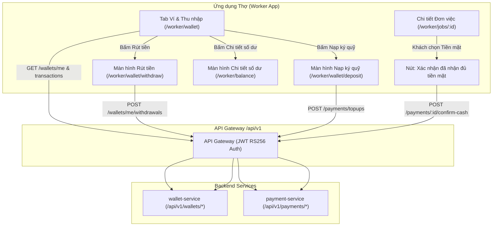

# KẾ HOẠCH TRIỂN KHAI PHẦN THỢ (WORKER): MOBILE APP PAYMENT & WALLET

> **Mục tiêu:** Xây dựng trọn vẹn trải nghiệm Ví & Thu nhập (Worker Wallet), Nạp tiền ký quỹ (Deposit), Rút tiền về ngân hàng (Withdrawal), và Xác nhận thu tiền mặt đơn việc (Confirm Cash) cho Thợ (Worker) trên Mobile App. Tích hợp trực tiếp với các API Backend hiện có (`wallet-service` và `payment-service` qua Gateway `/api/v1`), **không sửa backend**.

---

## 1. Khung Nghiệp Vụ Cốt Lõi Phía Thợ (Worker Business Context)

1. **Cơ chế Thu nhập & Hoa hồng (Earning & Commission)**:
   * Khi khách trả bằng **Điểm ví**:
     * Dùng `workerEarning` và `platformFee` từ BE; không hardcode tỷ lệ 90/10. Tiền công được quyết toán vào ví theo trạng thái BE.
   * Khi khách trả bằng **Tiền mặt (Cash)**:
     * Khách trả 100% tiền mặt trực tiếp cho Thợ. Thợ bấm nút **"Xác nhận đã nhận tiền mặt"** (`POST /payments/:id/confirm-cash`).
     * Hệ thống **không cộng điểm vào ví thợ**. BE ghi nhận hoa hồng theo `platformFee` và thực hiện thu hoa hồng từ ví; thiếu số dư có thể còn khoản phải thu dù thanh toán đã thành công.
2. **Ví ký quỹ & Duy trì nhận việc (Security Deposit)**:
   * Thợ nạp vào ví qua VNPAY để cấn trừ hoa hồng. API ví hiện có số dư tổng, khả dụng và tạm giữ; chưa công bố một trường tiền cọc riêng hay hạn mức nhận việc. UI chỉ trình bày dữ liệu được BE trả về.
3. **Rút tiền về tài khoản ngân hàng (Withdrawal Flow)**:
   * Thợ chọn tài khoản ngân hàng lưu qua User & Trust Service. BE kiểm tra quyền sở hữu khi tạo lệnh; việc lưu tài khoản không đồng nghĩa đã xác minh KYC tại ngân hàng.
   * Lệnh rút tiền tạo một khoản tạm giữ (`reservedBalance`), chỉ trừ số dư khi ngân hàng chi trả thành công hoặc hoàn trả số dư nếu lệnh rút bị hủy.

---

## 2. Bản Đồ Điều Hướng & Màn Hình Phía Thợ (Screen Mapping)



---

## 3. Lộ Trình Chia Nhỏ 7 Phần Triển Khai (Phased Roadmap)

### 🔹 Phần W1: Mở Rộng API Contracts & Types Cho Thợ
* **Mục tiêu**: Bổ sung đầy đủ interface và API client cho luồng Rút tiền và Xác nhận tiền mặt.
* **Các file tạo/sửa**:
  * `mobile/src/features/wallet/types/wallet.types.ts`:
    * Dùng trạng thái thật: `'requested' | 'processing' | 'succeeded' | 'failed' | 'cancelled' | 'needs_review'`.
    * `WithdrawalRecord` theo response thật: `id`, `userId`, `walletId`, `bankAccountId`, `amount`, `status`, `idempotencyKey`, thông tin payout/review và timestamps. Số tiền là chuỗi số nguyên.
    * `CreateWithdrawalPayload`: `{ amount: string, bankAccountId: string, idempotencyKey: string }`.
  * `mobile/src/features/wallet/api/wallet.api.ts`:
    * `createWithdrawal(payload)`: Gọi `POST /wallets/me/withdrawals`.
    * `getMyWithdrawals(params)`: Gọi `GET /wallets/me/withdrawals`.
    * Response danh sách rút tiền là `data: WithdrawalRecord[]`; phân trang bằng `page`/`limit`, không giả định có `totalPages`.
    * Bổ sung `getWithdrawal(id)` và GET/POST `/users/me/bank-accounts` để chọn/thêm tài khoản nhận tiền thật.
    * `cancelWithdrawal(id)`: Gọi `POST /wallets/me/withdrawals/:id/cancel`.
  * `mobile/src/features/wallet/api/payment.api.ts`:
    * `confirmCash(paymentId)`: Gọi `POST /payments/:id/confirm-cash` khi thợ cầm tiền mặt.
* **Nghiệm thu**: Unit tests tầng API và `pnpm run type-check` pass 100%.

---

### 🔹 Phần W2: Custom Hooks Dành Riêng Cho Thợ
* **Mục tiêu**: Quản lý state rút tiền và xác nhận tiền mặt bằng TanStack React Query.
* **Các file tạo mới**:
  * `mobile/src/features/wallet/hooks/use-withdrawal.ts`:
    * Query lấy danh sách lệnh rút tiền `useWithdrawalsQuery()`.
    * Mutation tạo lệnh rút tiền `useCreateWithdrawalMutation()` kèm UUID được lưu theo user và payload. Timeout/mất mạng/remount phải thử lại cùng key; không tạo lệnh thứ hai khi chưa rõ kết quả lệnh trước.
    * Mutation hủy lệnh rút tiền `useCancelWithdrawalMutation()`.
    * Tự động invalidate `walletQueryKeys.all` để cập nhật số dư khả dụng và số dư tạm giữ.
  * `mobile/src/features/wallet/hooks/use-worker-confirm-cash.ts`:
    * Mutation xác nhận tiền mặt cho đơn hàng, tự động làm mới trạng thái đơn việc và ví.
* **Nghiệm thu**: Unit test cho các hooks với mock API responses pass 100%.

---

### 🔹 Phần W3: Màn Hình Ví & Thu Nhập Của Thợ (`/worker/wallet`)
* **Mục tiêu**: Hoàn thiện màn hình chính tại tab "Ví & Thu nhập" của Thợ.
* **Các file tạo/sửa**:
  * `mobile/src/features/wallet/worker/components/worker-balance-card.tsx`:
    * Thẻ hiển thị số dư thu nhập:
      * **Số dư khả dụng** (rút về ngân hàng được ngay).
      * **Số dư tạm giữ** theo `reservedBalance`; không đồng nhất khoản này với tiền cọc riêng.
      * Nút con mắt ẩn/hiện số dư.
      * 2 nút hành động lớn: **"Rút tiền"** (màu xanh lá) và **"Nạp ký quỹ"** (màu cam).
  * `mobile/src/features/wallet/worker/components/worker-earnings-summary.tsx`:
    * Khối thống kê: Thu nhập tuần này, số đơn đã hoàn thành, tổng hoa hồng đã nộp sàn.
  * Sửa `mobile/src/features/wallet/worker/screens/worker-wallet-screen.tsx`:
    * Tích hợp `WorkerBalanceCard`, `WorkerEarningsSummary`.
    * Danh sách 5 giao dịch thu nhập mới nhất kèm nút "Xem tất cả lịch sử".
    * Giữ nguyên `testID="worker-wallet-screen"` và tiêu đề `"Ví & Thu nhập"`.
* **Nghiệm thu**: Render số dư thật của thợ, điều hướng sang nạp/rút trơn tru, test cũ `worker-flow-screens.test.tsx` vẫn xanh.

---

### 🔹 Phần W4: Màn Hình Rút Tiền Về Ngân Hàng (`/worker/wallet/withdraw`)
* **Mục tiêu**: Xây dựng màn hình rút tiền về tài khoản ngân hàng chính chủ của thợ.
* **Các file tạo/sửa**:
  * `mobile/src/features/wallet/worker/components/bank-account-card.tsx`:
    * Hiển thị tên/mã ngân hàng, số tài khoản che bớt (`****1234`), tên chủ tài khoản in hoa, tài khoản mặc định và lựa chọn nhận tiền. Chỉ dùng logo có asset thật; không gắn nhãn “đã xác minh KYC” khi API không cung cấp bằng chứng.
  * Sửa `mobile/src/features/wallet/worker/screens/worker-withdraw-screen.tsx`:
    * Form nhập số tiền muốn rút:
      * Gợi ý nhanh: 100.000đ, 200.000đ, 500.000đ, "Rút tất cả số dư".
      * Kiểm tra điều kiện: Số tiền rút phải $\le$ `availableBalance` và $\ge$ 50.000đ.
    * Nút **"Xác nhận rút tiền"**: gọi mutation `createWithdrawal`.
    * Danh sách các lệnh rút gần đây kèm trạng thái (Huy hiệu vàng `Chờ xử lý`, Huy hiệu xanh `Đã chi trả`, Huy hiệu đỏ `Đã từ chối/Hủy`).
    * Nút "Hủy yêu cầu" chỉ cho `requested`. Nếu payout đã claim và BE trả 409, tải lại trạng thái; không tự hoàn số dư ở client. `needs_review` hiển thị cần đối soát, không coi là thất bại đã hoàn tiền.
    * Giữ nguyên `testID="worker-wallet-withdraw-screen"`.
* **Nghiệm thu**: Tạo lệnh rút thành công, số dư khả dụng giảm tương ứng và chuyển sang số dư tạm giữ (`reservedBalance`).

---

### 🔹 Phần W5: Nạp Tiền Ký Quỹ & Chi Tiết Số Dư (`deposit` & `balance`)
* **Mục tiêu**: Hoàn thiện màn hình nạp tiền ký quỹ `/worker/wallet/deposit` và màn hình chi tiết số dư `/worker/balance`.
* **Các file tạo/sửa**:
  * Sửa `mobile/src/features/wallet/worker/screens/worker-deposit-screen.tsx`:
    * Màn hình nạp tiền chuyên dụng cho Thợ:
      * Tái sử dụng logic `useTopup` (cổng VNPAY / Dev Sandbox simulate).
      * Gợi ý các gói ký quỹ: 200.000đ, 500.000đ, 1.000.000đ, 2.000.000đ...
      * Giải thích rõ: *"Tiền nạp vào ví ký quỹ dùng để cấn trừ hoa hồng sàn khi nhận việc thanh toán tiền mặt."*
    * Giữ nguyên `testID="wallet-deposit-screen"`.
  * Sửa `mobile/src/features/wallet/worker/screens/worker-balance-screen.tsx`:
    * Phân tích minh bạch: số dư tổng/khả dụng/tạm giữ, lịch sử và hoa hồng đối chiếu từ các thanh toán + bút toán thực tế. Ghi rõ chưa có trường tiền cọc riêng và chưa có endpoint công nợ chính thức; không hiển thị số đối chiếu như số công nợ do BE xác nhận.
    * Giữ nguyên `testID="worker-balance-screen"`.
* **Nghiệm thu**: Nạp tiền thành công và số dư ví thợ tăng đúng số tiền nạp.

---

### 🔹 Phần W6: Tích Hợp Xác Nhận Tiền Mặt Trên Đơn Việc (`confirm-cash`)
* **Mục tiêu**: Cho phép thợ xác nhận đã nhận tiền mặt từ khách hàng ngay trên màn hình chi tiết đơn việc `worker-job-detail-screen.tsx`.
* **Các file sửa**:
  * `mobile/src/features/orders/worker/screens/worker-job-detail-screen.tsx`:
    * Khi đơn hàng ở trạng thái hoàn thành và khách hàng chọn phương thức Tiền mặt (`payment.method === 'cash'`):
      * Hiển thị Card thông báo nổi bật màu hổ phách:
        > 💵 **Khách hàng thanh toán tiền mặt: [Số tiền] đ**
        > *Vui lòng kiểm tra đã nhận đủ tiền mặt từ khách hàng trước khi bấm xác nhận.*
      * Nút hành động chính:
        ```tsx
        <Button
          testID="worker-confirm-cash-btn"
          label={isConfirmingCash ? "Đang xác nhận..." : "💵 Xác Nhận Đã Nhận Đủ Tiền Mặt"}
          className="bg-emerald-600 active:bg-emerald-700"
          onPress={handleConfirmCash}
        />
        ```
    * Mở hộp thoại xác nhận trước khi gọi `PaymentApi.confirmCash(payment.id)`. Chỉ cập nhật thanh toán theo response BE, dùng `platformFee` thật; làm mới ví, thanh toán và đơn việc. Không tự ép trạng thái đơn việc sang `paid`, không tự trừ tiền ở client.
* **Nghiệm thu**: Thợ bấm xác nhận thành công, đơn hàng chốt thanh toán, sổ cái ví thợ ghi nhận bút toán hoa hồng sàn.

---

### 🔹 Phần W7: Kiểm Thử Toàn Diện & Quality Gates (Worker)
* **Mục tiêu**: Kiểm tra không phát sinh lỗi hồi quy, chạy 100% test suites và rà soát chuẩn Vercel Mobile Rules.
* **Các công việc**:
  * Viết bài test hành trình xuyên màn hình phía Thợ:
    `mobile/src/features/wallet/worker/__tests__/worker-wallet-journey.test.tsx`:
    * Nạp ký quỹ → Kiểm tra số dư → Xem danh sách giao dịch → Tạo lệnh rút tiền → Kiểm tra số dư tạm giữ → Hủy lệnh rút → Xác nhận tiền mặt đơn hàng.
  * Chạy toàn bộ test suites:
    ```powershell
    cd mobile
    pnpm test src/features/wallet
    pnpm test src/app/worker/__tests__/worker-flow-screens.test.tsx
    pnpm run type-check
    pnpm run lint
    ```
* **Nghiệm thu**: 100% tests pass, lint sạch, types an toàn.

---

## 4. Bảng So Sánh Hai Phía (Customer vs Worker)

| Tiêu chí nghiệp vụ | Phía Khách hàng (Customer) | Phía Thợ (Worker) |
|---|---|---|
| **Thẻ ví chính** | `/customer/payment` | `/worker/wallet` (Tab Ví & Thu nhập) |
| **Nạp tiền (Top-up)** | Nạp điểm để thanh toán đơn việc | Nạp ví ký quỹ để cấn trừ hoa hồng nhận việc |
| **Rút tiền (Withdraw)** | Không hỗ trợ (Chỉ hoàn điểm khi hủy việc) | **Có hỗ trợ**: Rút tiền công về tài khoản ngân hàng chính chủ |
| **Thanh toán đơn việc** | Chọn trả bằng Điểm hoặc Tiền mặt | **Xác nhận đã nhận tiền mặt** từ khách (`confirm-cash`) |
| **Phí sàn / Hoa hồng** | Trả nguyên giá thỏa thuận | Hiển thị `workerEarning` / `platformFee` theo BE |

---

## 5. Kế hoạch chốt 100% theo BE đã deploy — cập nhật 20/11/2026

### 5.1. Mốc kiểm tra hiện tại

Đây là kế hoạch hoàn tất và nghiệm thu, **chưa phải báo cáo hoàn thành**.

| Kiểm tra đã chạy | Kết quả thực tế |
|---|---|
| Swagger Gateway đang deploy | Có routes withdrawal, confirm-cash và payments/me; body rút tiền đúng dạng `bankAccountId`, `amount: string`, `idempotencyKey` |
| `pnpm run type-check` | PASS |
| `pnpm test src/features/wallet --runInBand --silent` | 18/21 suites PASS; 99/105 tests PASS; 3 suites / 6 tests còn lỗi |
| ESLint phần mobile thay đổi, chưa dùng `--fix` ở lần đo này | 46 errors cần xử lý; chưa nghiệm thu lint toàn mobile |
| Maestro trên app Android + BE deploy | Chưa chạy; chưa có flow Maestro trong repository tại lần kiểm tra này |

Các lỗi test đã thấy: journey chưa chờ màn hình ví tải lại sau điều hướng; assertion phân trang chạy trước khi query cập nhật; screen tests có component/mock chưa hợp lệ. Phải xác định nguyên nhân và sửa đúng trước khi đánh dấu W7 hoàn tất.

### 5.2. Thứ tự thực hiện và đầu ra bắt buộc

| Bước | Công việc phải chốt | Điều kiện chuyển bước |
|---|---|---|
| 1 — Chốt W1 | Đối chiếu Swagger deploy với DTO/response; bank accounts, withdrawals, confirm cash, ledger, payments. Ghi nhận contract thật trong mục W1 ở trên. | API tests xanh; không có payload/status tự suy đoán |
| 2 — Chốt W2 | Lưu idempotency theo user; thử lại sau timeout/remount; chống bấm lặp; refresh sau tạo/hủy/xác nhận. Kiểm tra cache khi đổi tài khoản/role và sau conflict. | Hooks tests bao phủ thành công, timeout, conflict và request lặp |
| 3 — Chốt W3 + W5 | Ví thật; ẩn số dư; thống kê đúng thợ, đúng tuần, đủ các trang; 5 giao dịch mới nhất; lịch sử/chi tiết; nạp VNPAY; số dư chi tiết và đối chiếu hoa hồng. | Loading/error/empty/retry đầy đủ; không còn placeholder trong phạm vi ví; không gán số 0 cho dữ liệu tải lỗi |
| 4 — Chốt W4 | Danh sách/thêm/chọn ngân hàng; min 50.000 và không vượt khả dụng; gợi ý/rút hết; toàn bộ trạng thái lệnh; hủy có kiểm tra race với payout. | Tạo lệnh phản ánh số dư BE; hủy hợp lệ giải phóng hold đúng một lần; lệnh processing không hủy được |
| 5 — Chốt W6 | Card xác nhận chỉ cho đúng thợ, đơn đã hoàn thành, payment cash hợp lệ. Có đường tìm lại đơn cash đã hoàn thành từ ví. | Hộp thoại được chấp nhận mới gửi API; xác nhận lặp không thu hoa hồng hai lần; lỗi không hiện đã thanh toán |
| 6 — Chốt W7 ở mức code | Sửa 6 test đang đỏ và lint; bổ sung pagination/error của thống kê, cash status/ownership/confirmation; cập nhật test điều hướng cũ đang kiểm tra placeholder. | Wallet + Worker + toàn bộ mobile tests, lint và type-check đều PASS |
| 7 — Chốt W7 trên app thật | Build/cài HandyGo trên Android Worker; chạy Maestro với BE deploy, VNPAY sandbox và dữ liệu test. Đối chiếu response, số dư và ledger trước/sau. | Có report, ảnh và ID giao dịch cho từng ca; không dùng kết quả mock thay cho bằng chứng deploy |
| 8 — Bàn giao | Cập nhật checklist W1–W7, hướng dẫn chạy lại, báo cáo kiểm thử và commit chi tiết theo phạm vi thay đổi. | Diff được rà soát; không lẫn thay đổi ngoài task; không còn ca bắt buộc chưa chạy/thất bại |

Chốt từng bước theo phụ thuộc; tận dụng code và topup/lịch sử dùng chung hiện có. BE đã deploy là điều kiện để kiểm thử tích hợp trực tiếp, không thay thế bằng giả lập khi nghiệm thu trên app.

### 5.3. Ma trận kiểm thử phải có

| Nhóm | Các ca bắt buộc | Kết quả cần quan sát |
|---|---|---|
| Ví / thống kê | Ví active, frozen, chưa tạo; mạng lỗi; refresh; ẩn/hiện; đổi user; dữ liệu >1 trang; tuần mới; dữ liệu thanh toán của user ở vai trò customer | Số dư BE chính xác; không lộ cache user trước; thống kê chỉ gồm vai trò thợ, không tính thiếu trang |
| Nạp tiền | Gợi ý 200k/500k/1m/2m; VNPAY thành công, hủy, thất bại; quay về app; polling; mở lại app khi pending | Chỉ BE completed mới tăng số dư; tăng đúng một lần; có giao dịch lịch sử |
| Ngân hàng | Chưa có, thêm mới, nhiều tài khoản, mặc định; lỗi quyền sở hữu/validation | Gửi đúng bankAccountId; số tài khoản che bớt; lỗi không gắn nhãn đã xác minh |
| Tạo rút | <50k, =50k, >available, rút hết, bấm lặp; timeout rồi thử lại/mở lại app; dịch vụ lỗi | Không tạo lệnh sai; không nhân đôi; available/reserved theo BE; lỗi không báo thành công |
| Kết quả rút | requested, processing, succeeded, failed, cancelled, needs_review | Nhãn đúng trạng thái; tiền chỉ thay đổi theo BE; review không tự giải phóng tiền |
| Hủy rút | requested hủy thành công; bấm lặp; payout claim trước khi hủy, BE trả conflict | Chỉ hoàn hold một lần; race tải lại trạng thái và không báo hủy thành công sai |
| Cash | Chưa hoàn thành; cash pending/failed hợp lệ; point; sai thợ; đã succeeded; hủy hộp thoại; API lỗi; bấm lặp; ví thiếu hoa hồng | Chỉ ca đủ điều kiện có nút; không gửi API trước đồng ý; cash không cộng vào ví; hoa hồng theo BE và khoản còn thiếu được trình bày rõ |
| Hồi quy | Customer topup/payment/history; Worker tab/profile/order/back; bàn phím, cuộn, safe area | Luồng cũ và điều hướng không hỏng; nút không bị che trên Android |

### 5.4. Kịch bản tích hợp có thể đối chiếu số tiền

Với ví test ban đầu `balance = available = B`, `reserved = 0`, không có giao dịch song song:

1. Nạp VNPAY sandbox số tiền `T`: chờ BE xác nhận completed; kiểm tra balance/available thành `B + T`, ledger có đúng một topup.
2. Chọn ngân hàng đã lưu, tạo rút `W`: khi lệnh còn requested/processing, balance vẫn `B + T`, reserved `W`, available `B + T - W`.
3. Hủy một lệnh còn requested: sau BE cancelled, reserved về 0 và available về `B + T`. Nếu payout đã claim, nghiệm thu nhánh conflict, không ép hủy. Muốn kiểm chứng hủy thành công phải dùng một lệnh/dữ liệu test còn hủy được.
4. Kiểm chứng một payout có kết quả succeeded trên dữ liệu test: balance giảm `W`, hold được giải phóng; ledger ghi nhận chi trả. Kiểm chứng failed/cancelled không chi tiền và giải phóng hold; needs_review được giữ đúng trạng thái BE.
5. Mở đơn đã hoàn thành với cash amount `C`, platformFee `F` do BE trả về; chấp nhận hộp thoại. Payment succeeded; ví không được cộng `C` hoặc `workerEarning`. Nếu thu đủ phí, wallet/ledger giảm đúng `F`; nếu chưa thu đủ thì đối chiếu phần còn lại, không suy ra phí đã thu chỉ từ payment succeeded.
6. Dùng phiên Customer trả point cho một đơn test khác; kiểm tra Worker nhận đúng `workerEarning` và thống kê cập nhật. Không dùng phép tính 90% ở client làm bằng chứng.

Giá trị cuối cùng luôn đối chiếu response thực tế; nếu có giao dịch song song phải đối chiếu theo ID/ledger, không khẳng định sai lệch từ phép trừ số dư tổng.

### 5.5. Bằng chứng native và công cụ cá nhân

- Xác định serial emulator Worker và appId từ build thực tế; đăng nhập đúng tài khoản test hiện có. Không ghi token/mật khẩu vào YAML, log hoặc commit.
- Maestro chỉ dùng trên máy cá nhân; flow nằm ở `mobile/.maestro-local/`, không có trong bản clone chung và không được thêm vào dependency, package scripts hoặc CI. Đồng đội có thể kiểm thử thủ công trên app; không cần cài Maestro.
- Chạy trên APK mới nhất nối Gateway deploy. VNPAY dùng sandbox; ca thao tác tài chính dùng dữ liệu/tài khoản test. Các trạng thái terminal/race dùng dữ liệu test phù hợp, không gọi API nội bộ để sửa trạng thái từ mobile.
- Xuất report của mỗi flow, screenshot ở các mốc số dư/trạng thái và ID liên quan. Nếu cổng thanh toán có bước xác thực cần người thao tác, ghi rõ bước can thiệp; không ghi nhận là tự động toàn bộ.
- Kết quả thực tế, thiết bị, môi trường, expected/actual và giới hạn nằm trong [báo cáo ngày 21/11](./BAO-CAO-TIEN-DO-VA-LOI-CON-LAI-2026-11-21.md). Artifact và hướng dẫn chạy flow cá nhân giữ local; không coi chúng là file đi kèm repository.

### 5.6. Definition of Done — chỉ đánh dấu 100% khi tất cả đạt

- [ ] W1–W6 thực hiện đúng contract deploy; không còn placeholder trong phạm vi Worker wallet/payment.
- [ ] Tất cả ca bắt buộc ở ma trận có kết quả PASS và bằng chứng phù hợp; lỗi nghiệp vụ được xử lý và kiểm thử lại.
- [ ] Wallet tests, Worker navigation tests và toàn bộ mobile regression PASS.
- [ ] `pnpm run type-check` và `pnpm run lint` toàn mobile PASS.
- [ ] Maestro Android trên app mới + BE deploy PASS; đã đối chiếu ít nhất nạp, tạo rút, hủy hợp lệ, payout terminal và cash/point settlement.
- [ ] Không còn nhầm pending/requested với đã chi trả; không cộng cash vào ví; không cố định hoa hồng 10%; không coi saved bank account là KYC bank verified.
- [ ] Tài liệu contract, hướng dẫn chạy lại và báo cáo nghiệm thu cập nhật theo kết quả thật.
- [ ] Commit có mô tả rõ API/hooks, màn hình, cash, kiểm thử và tài liệu; giữ nguyên thay đổi ngoài task của người dùng.

Nếu một ca deploy chưa chạy hoặc bị lỗi môi trường, ghi ca đó chưa đạt và xử lý tiếp; **không đổi tên mock test thành E2E deploy để đánh dấu 100%**.

Nguồn contract đối chiếu: [Swagger wallet-service](https://handygo.duyaivy.id.vn/docs/specs/wallet-service), [Swagger payment-service](https://handygo.duyaivy.id.vn/docs/specs/payment-service), [Swagger user-trust-service](https://handygo.duyaivy.id.vn/docs/specs/user-trust-service). Trạng thái ledger/settlement đối chiếu thêm implementation BE trong repository; kết quả runtime sẽ được ghi ở báo cáo nghiệm thu.
