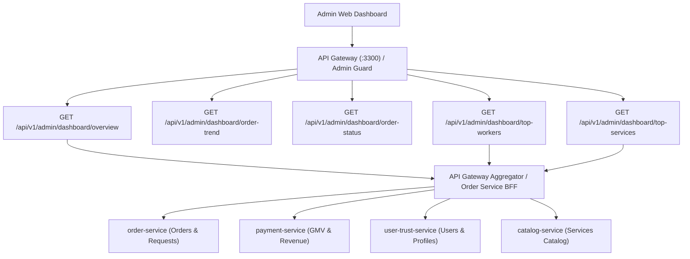

# [HG-74] Đánh Giá & Đề Xuất Điều Chỉnh Đặc Tả API Admin Dashboard

- **Tài liệu tham chiếu:** `API-BE-DASHBOARD.pdf` (Jira Issue `#HG-75 Web Admin dashboard`)
- **Người rà soát:** Huỳnh Đức Thịnh (Backend Lead / Developer)
- **Ngày rà soát:** 14/11/2026
- **Mục tiêu:** Rà soát tính khả thi, phát hiện các điểm mâu thuẫn/chưa hợp lý về mặt nghiệp vụ và kiến trúc Microservices hiện tại của HandyGo, từ đó đưa ra thiết kế API chuẩn hóa.

---

## 1. Bảng Tổng Hợp Các Điểm Bất Hợp Lý & Đề Xuất Điều Chỉnh

| STT | Hạng mục trong Spec | Điểm chưa hợp lý / Thiếu sót | Phân tích tác động kỹ thuật & Nghiệp vụ | Đề xuất điều chỉnh chuẩn hóa |
| :--- | :--- | :--- | :--- | :--- |
| **1** | **Chỉ số Doanh thu (Revenue)** | Định nghĩa là: *"Tổng doanh thu hợp lệ, không tính đơn đã hủy"*. | Hiện tại hệ thống chưa tính tới hoa hồng/chiết khấu sàn. Doanh thu hiển thị trên Dashboard chính là **Tổng giá trị của các đơn hàng đã hoàn thành** trong khoảng thời gian được chọn: $\sum \text{Order.agreedPrice}$ với $\text{status} = \text{'completed'}$. | **Chuẩn hóa công thức:**<br>Lấy tổng `agreedPrice` của các đơn hoàn thành trong kỳ (`completedAt BETWEEN startDate AND endDate`). Trả về 1 con số `total` (ví dụ `125400000` VND tương ứng `125,4 triệu đ` trên mockup). |
| **2** | **Chỉ số Thợ hoạt động (Active Workers)** | Ghi: *"Tổng số thợ hoạt động trong khoảng thời gian"*. Chưa có tiêu chí định lượng thế nào là "hoạt động". | Thợ có tài khoản `verified` nhưng cả tháng không bật app thì có tính là hoạt động không? Database không lưu session heartbeat lịch sử theo ngày. | **Định nghĩa rõ ràng:**<br>- **Ưu tiên (Nghiệp vụ chuẩn):** Số lượng thợ duy nhất có phát sinh giao dịch/báo giá/nhận việc trong khoảng thời gian lọc (`workerUserId` xuất hiện trong `Bids` hoặc `Orders`).<br>- Hoặc trả về cả 2: `activeWorkersInPeriod` (thợ có tương tác trong kỳ) và `totalVerifiedWorkers` (tổng số thợ đã duyệt toàn sàn). |
| **3** | **Chỉ số Khách hàng (Total Customers)** | Mâu thuẫn giữa Mockup và Mô tả text:<br>- Mockup: 2.450 khách (con số lũy kế).<br>- Trang 4: *"tính đến cuối khoảng thời gian"*.<br>- Trang 2: *"trong khoảng thời gian"*. | Nếu chọn "Hôm nay" mà chỉ đếm khách mới đăng ký hôm nay (vd: 5 khách) thì con số hiển thị quá nhỏ, không phản ánh quy mô sàn. Nếu đếm khách có đặt đơn hôm nay thì là "Active Customers". | **Quy chuẩn rõ 2 trường:**<br>1. `totalCustomers`: Tổng số khách hàng lũy kế toàn hệ thống tính đến ngày kết thúc lọc (đúng với mockup 2.450).<br>2. `newCustomers`: Số khách hàng đăng ký mới trong khoảng thời gian được chọn. |
| **4** | **Phân nhóm Trạng thái Đơn hàng** | Chỉ chia 3 nhóm: `Hoàn thành`, `Đang xử lý`, `Đã hủy`. **Bỏ sót trạng thái Tranh chấp/Khiếu nại (`disputed`)**. | Hệ thống `order-service` có trạng thái `OrderStatus.disputed`. Đơn hàng có khiếu nại là đối tượng **cần Admin can thiệp xử lý ngay**. Nếu gộp vào "Đang xử lý" sẽ làm lu mờ rủi ro vận hành. | **Bổ sung nhóm thứ 4:**<br>- `Hoàn thành`: `completed`<br>- `Đang xử lý`: `created`, `confirmed`, `in_progress`, `awaiting_customer_confirmation`<br>- `Đã hủy`: `cancelled`<br>- **`Khiếu nại / Tranh chấp`**: `disputed` (Nổi bật cho Admin). |
| **5** | **Tỷ lệ Hoàn thành & Hủy** | Công thức: `(Số đơn hoàn thành / Tổng đơn) * 100%` dựa trên tập đơn **tạo trong kỳ**. | Nếu lọc "Hôm nay", các đơn vừa tạo hôm nay hầu hết đang làm, chưa thể xong ngay. Dẫn đến Tỷ lệ hoàn thành hôm nay sẽ rơi vào 0% - 10%, gây hoang mang cho người xem báo cáo. | **Chuẩn hóa logic giải thích:**<br>Backend tính theo trạng thái hiện tại của các đơn được tạo trong kỳ. Bổ sung trường hợp mẫu số bằng 0 (trả về 0%).<br>FE cần có tooltip giải thích: *"Tỷ lệ hoàn thành của các đơn hàng được tạo trong khoảng thời gian này"*. |
| **6** | **Mốc thời gian cho Top Thợ & Top Dịch vụ** | Mâu thuẫn giữa Mục 4 (theo `createdAt`) và Mục 6, 7 (*"chỉ tính đơn hàng đã hoàn thành trong khoảng thời gian"*). | Thành tích của thợ và dịch vụ phải ghi nhận tại thời điểm công việc hoàn thành (`Order.completedAt`), không phải lúc khách tạo yêu cầu (`createdAt`). | **Chuẩn hóa nhất quán:**<br>Thống kê Top 5 thợ và Top 5 dịch vụ phải lọc theo `completedAt BETWEEN startDate AND endDate`. |
| **7** | **Đánh giá Thợ (Rating) trong Top 5** | *"Điểm đánh giá trung bình từ các đánh giá hợp lệ"*. | Chưa rõ là Rating trọn đời trong hồ sơ thợ (`WorkerProfile.averageRating`) hay là Rating trung bình của riêng các đơn hàng trong khoảng thời gian đó. | **Đề xuất:** Lấy `WorkerProfile.averageRating` từ `user-trust-service` vì thợ hoạt động tốt dựa trên uy tín tích lũy, vừa tối ưu hiệu năng query không cần aggregate lại bảng review. |
| **8** | **Múi giờ & Xử lý thời gian (Timezone)** | PostgreSQL lưu thời gian chuẩn UTC (`timestamptz`). Chưa đề cập xử lý múi giờ Việt Nam (UTC+7). | Nếu group theo ngày/giờ bằng UTC, các đơn từ 00:00 - 07:00 sáng sẽ bị đẩy sang ngày hôm trước, làm sai lệch toàn bộ biểu đồ xu hướng. | **Quy định bắt buộc:**<br>Tất cả câu truy vấn gom nhóm (`date_trunc`) phải ép timezone: `AT TIME ZONE 'Asia/Ho_Chi_Minh'`. Client truyền ISO UTC hoặc ngày format `YYYY-MM-DD`. |
| **9** | **Độ chi tiết biểu đồ (Granularity) & Chống tràn dữ liệu** | Cho phép tùy chỉnh khoảng thời gian nhưng chưa có giới hạn chặn trên (Max range). | Nếu Admin chọn khoảng thời gian 5 năm với độ chi tiết theo ngày/tuần, query sẽ quét toàn bộ database gây timeout và nghẽn memory. | **Bổ sung ràng buộc:**<br>- Khoảng thời gian tối đa: **365 ngày** (1 năm).<br>- Backend tự động fallback granularity hợp lý (1 ngày -> giờ, 2-31 ngày -> ngày, 32-90 ngày -> tuần, >90 ngày -> tháng). |

---

## 2. Kiến Trúc Microservices & Luồng Dữ Liệu Tích Hợp

Dữ liệu của Admin Dashboard phân tán trên **4 Microservices**:
1. **`order-service`** (Chủ trì 75% dữ liệu): Tổng đơn hàng, xu hướng theo thời gian, tỷ lệ trạng thái, danh sách `workerUserId` và `serviceId` của các đơn hoàn thành.
2. **`payment-service`**: Doanh thu GMV, phí hoa hồng sàn (`platformFee`) qua bảng `payments`.
3. **`user-trust-service`**: Tổng số khách hàng (`CustomerProfile`), tổng số thợ, thông tin cá nhân thợ (`fullName`, `avatarUrl`, `averageRating`).
4. **`catalog-service`**: Thông tin danh mục dịch vụ (`name`, `iconUrl`).



> [!TIP]
> **Khuyến nghị kiến trúc Endpoints:**
> Thay vì gom toàn bộ vào 1 API duy nhất (dễ bị nghẽn nếu 1 downstream service chậm), nên tách thành **5 API chức năng (Modular Endpoints)** theo từng widget. Frontend Dashboard có thể tải song song và hiển thị loading skeleton riêng biệt, trải nghiệm người dùng mượt mà hơn rất nhiều.

---

## 3. Đặc Tả Chi Tiết Bộ API Đề Xuất (HG-74)

### 3.1. Common Query Parameters
Áp dụng chung cho tất cả các API thống kê:
- `period`: `today` | `7days` | `30days` | `custom` (Mặc định: `30days`)
- `startDate`: string (Format `YYYY-MM-DD` hoặc ISO8601, bắt buộc khi `period=custom`)
- `endDate`: string (Format `YYYY-MM-DD` hoặc ISO8601, bắt buộc khi `period=custom`)
- `timeZone`: string (Tùy chọn, mặc định `Asia/Ho_Chi_Minh`)

---

### 3.2. Endpoint 1: Thống Kê Tổng Quan (Overview Metrics)
- **Method:** `GET`
- **Path:** `/api/v1/admin/dashboard/overview`
- **Quyền:** `ADMIN`
- **Mục đích:** Cung cấp 4 thẻ metric chính ở đầu trang.
- **Response Schema:**
```json
{
  "success": true,
  "data": {
    "revenue": {
      "total": 125400000,
      "currency": "VND"
    },
    "orders": {
      "total": 1284,
      "growthRate": 12.5
    },
    "workers": {
      "activeInPeriod": 328,
      "totalVerified": 512
    },
    "customers": {
      "totalCumulative": 2450,
      "newInPeriod": 185
    }
  }
}
```

---

### 3.3. Endpoint 2: Xu Hướng Đơn Hàng (Order Trend)
- **Method:** `GET`
- **Path:** `/api/v1/admin/dashboard/order-trend`
- **Query bổ sung:** `granularity` (`hour` | `day` | `week` | `month` - Tùy chọn, mặc định backend tự tính theo quy tắc khoảng thời gian).
- **Quy tắc:** Backend tự động điền giá trị 0 (`zero-filling`) cho các mốc thời gian không có đơn hàng.
- **Response Schema:**
```json
{
  "success": true,
  "data": {
    "granularity": "day",
    "timeline": [
      { "bucket": "2026-10-06", "orderCount": 45 },
      { "bucket": "2026-10-07", "orderCount": 52 },
      { "bucket": "2026-11-05", "orderCount": 72 }
    ]
  }
}
```

---

### 3.4. Endpoint 3: Cơ Cấu Trạng Thái & Hiệu Suất Đơn Hàng (Order Status & Performance)
- **Method:** `GET`
- **Path:** `/api/v1/admin/dashboard/order-status`
- **Response Schema:**
```json
{
  "success": true,
  "data": {
    "totalOrders": 1284,
    "groups": {
      "completed": { "count": 892, "percentage": 69.5 },
      "processing": { "count": 248, "percentage": 19.3 },
      "cancelled": { "count": 144, "percentage": 11.2 },
      "disputed": { "count": 0, "percentage": 0.0 }
    },
    "statusBreakdown": {
      "created": 40,
      "confirmed": 58,
      "in_progress": 120,
      "awaiting_customer_confirmation": 30,
      "completed": 892,
      "cancelled": 144,
      "disputed": 0
    },
    "performance": {
      "completionRate": 69.5,
      "cancellationRate": 11.2
    }
  }
}
```

---

### 3.5. Endpoint 4: Top 5 Thợ Hoạt Động Tốt Nhất (Top Workers)
- **Method:** `GET`
- **Path:** `/api/v1/admin/dashboard/top-workers?limit=5`
- **Tiêu chuẩn tính:** Đơn hàng có `completedAt` trong khoảng thời gian lọc; sắp xếp giảm dần theo số đơn hoàn thành, trường hợp bằng nhau ưu tiên điểm đánh giá cao hơn.
- **Response Schema:**
```json
{
  "success": true,
  "data": [
    {
      "workerUserId": "3fa85f64-5717-4562-b3fc-2c963f66afa6",
      "fullName": "Nguyễn Văn An",
      "avatarUrl": "https://storage.handygo.vn/avatars/an.jpg",
      "completedOrderCount": 58,
      "averageRating": 4.9
    },
    {
      "workerUserId": "e7b1a2c3-8899-4d5e-a1b2-c3d4e5f60718",
      "fullName": "Trần Văn Bình",
      "avatarUrl": "https://storage.handygo.vn/avatars/binh.jpg",
      "completedOrderCount": 45,
      "averageRating": 4.8
    }
  ]
}
```

---

### 3.6. Endpoint 5: Top 5 Dịch Vụ Phổ Biến Nhất (Top Services)
- **Method:** `GET`
- **Path:** `/api/v1/admin/dashboard/top-services?limit=5`
- **Tiêu chuẩn tính:** Đơn hàng hoàn thành trong kỳ; đếm theo `serviceId`.
- **Response Schema:**
```json
{
  "success": true,
  "data": [
    {
      "serviceId": "a1b2c3d4-e5f6-7a8b-9c0d-1e2f3a4b5c6d",
      "serviceName": "Sửa điện",
      "iconUrl": "https://storage.handygo.vn/icons/electricity.png",
      "completedOrderCount": 356
    },
    {
      "serviceId": "b2c3d4e5-f6a7-8b9c-0d1e-2f3a4b5c6d7e",
      "serviceName": "Vệ sinh nhà cửa",
      "iconUrl": "https://storage.handygo.vn/icons/cleaning.png",
      "completedOrderCount": 298
    }
  ]
}
```

---

## 4. Tối Ưu Chỉ Mục Database (Indexes)

Để các truy vấn thống kê chạy dưới 150ms mà không gây nghẽn database, cần bổ sung các index tổng hợp sau:

1. **`order_service`:**
   ```sql
   -- Thống kê tổng quan và xu hướng theo thời gian tạo đơn
   CREATE INDEX IF NOT EXISTS idx_orders_created_at_status 
   ON order_service.orders (created_at, status);

   -- Thống kê Top thợ và Top dịch vụ theo ngày hoàn thành
   CREATE INDEX IF NOT EXISTS idx_orders_completed_worker 
   ON order_service.orders (completed_at, worker_user_id) 
   WHERE status = 'completed';

   CREATE INDEX IF NOT EXISTS idx_orders_completed_service 
   ON order_service.orders (completed_at, service_id) 
   WHERE status = 'completed';
   ```

   -- Thống kê doanh thu theo ngày hoàn thành đơn hàng
   CREATE INDEX IF NOT EXISTS idx_orders_completed_revenue 
   ON order_service.orders (completed_at, agreed_price) 
   WHERE status = 'completed';
   ```

---

## 5. Kết Luận & Hành Động Tiếp Theo
1. Gửi lại đề xuất điều chỉnh này cho bạn Trần Tâm Như (chủ ticket `#HG-75`) để chốt các trường hiển thị trên UI.
2. Tiến hành cài đặt bộ endpoint trên nhánh phát triển của `HG-74` (tại `api-gateway` / `order-service`).
