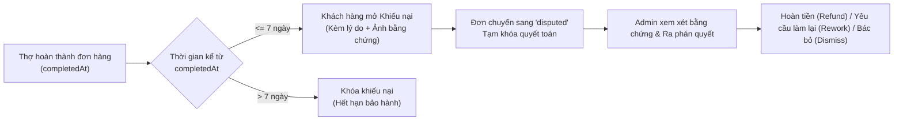
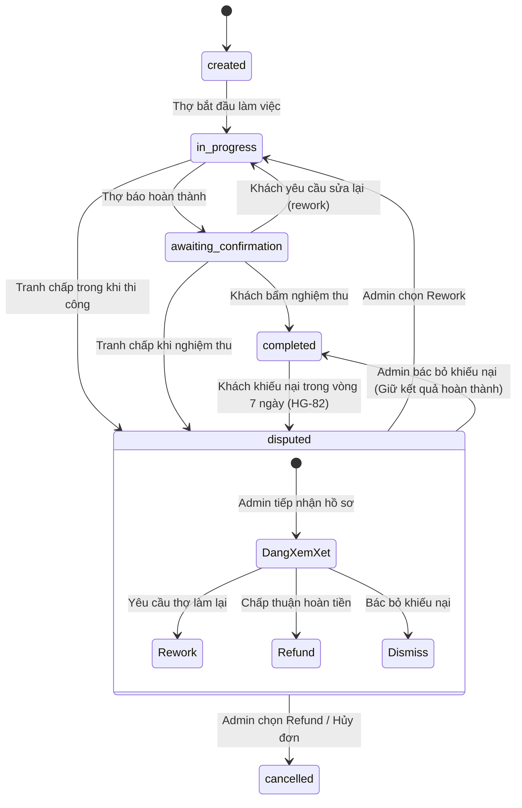
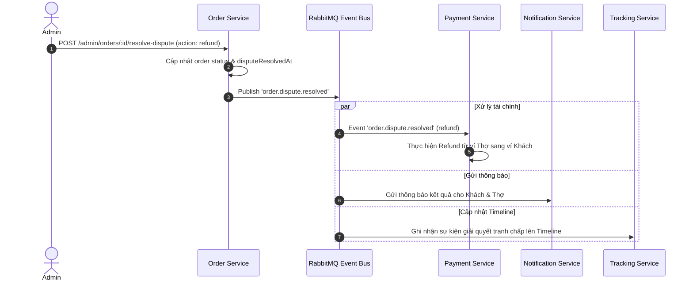

# [HG-82] Đặc Tả Kỹ Thuật: Khiếu Nại Đơn Hàng Trong Vòng 7 Ngày & Admin Xử Lý Khiếu Nại

- **Mã công việc:** HG-82
- **Tiêu đề:** `[BE] Khiếu nại đơn hàng trong vòng 7 ngày + admin xử lý đơn khiếu nại`
- **Nhánh phát triển:** `feature/HG-82-order-dispute-7-days-admin-resolution`
- **Base Branch:** `main` (`origin/main`)
- **Dịch vụ liên quan:** `order-service`, `user-trust-service`, `payment-service`, `notification-service`, `api-gateway`
- **Tài liệu tham chiếu:** `docs/order-service/PLAN_ORDER_SERVICE.md`

---

## 1. Ý Nghĩa & Bối Cảnh Nghiệp Vụ (Business Meaning)

Tính năng này là cơ chế **bảo vệ quyền lợi người dùng và chính sách bảo hành sau dịch vụ (Post-service Dispute / Warranty Policy)** của nền tảng HandyGo:



### 1.1. "Khiếu nại đơn hàng trong vòng 7 ngày" là gì?
- **Đối tượng:** Khách hàng (`Customer`) đã nghiệm thu hoàn tất đơn hàng (`order.status = 'completed'`).
- **Thời hạn bảo hành / khiếu nại (Dispute Window):** Trong vòng **7 ngày** tính từ mốc `completedAt`.
  - *Ví dụ:* Đơn hoàn tất lúc `10:00 ngày 01/11`, khách có quyền khiếu nại đến hết `10:00 ngày 08/11`.
  - *Trong 7 ngày:* Khách phát hiện sự cố (thợ làm ẩu, hư hỏng trở lại, thiết bị bị phá hỏng, gian lận chi phí...) $\rightarrow$ Khách có nút **"Khiếu nại"** để gửi yêu cầu lên hệ thống kèm ảnh/video minh chứng.
  - *Quá 7 ngày:* Nút khiếu nại tự động bị khóa/ẩn trên Mobile App. Nếu gọi API, Backend sẽ chặn lại với lỗi `COMPLAINT_WINDOW_EXPIRED`.
- **Hành động của Backend khi nhận khiếu nại hợp lệ:**
  1. Kiểm tra quyền sở hữu (`customerUserId === currentUser.id`).
  2. Kiểm tra mốc thời gian: `(now() - order.completedAt) <= 7 * 24 * 60 * 60 * 1000`.
  3. Cập nhật trạng thái đơn hàng sang `disputed`.
  4. Lưu thông tin khiếu nại: lý do, mô tả, danh sách file bằng chứng.
  5. Tạm giữ (Hold) tiền quyết toán của thợ (chưa giải ngân dứt điểm vào ví khả dụng nếu có chính sách giữ tiền bảo hành).
  6. Phát sự kiện `order.disputed` qua RabbitMQ để gửi thông báo tức thì cho Thợ và Quản trị viên (Admin).

---

### 1.2. "Admin xử lý đơn khiếu nại" là gì?
Khi phát sinh khiếu nại, đây là tranh chấp giữa 2 bên mà họ không tự giải quyết được. **Admin đóng vai trò trọng tài** độc lập của sàn:

1. **Tiếp nhận & Điều tra:**
   - Admin vào trang quản trị xem danh sách các đơn đang bị khiếu nại (`status = 'disputed'`).
   - Admin kiểm tra: lịch sử làm việc của thợ, nội dung khiếu nại của khách, ảnh/video bằng chứng, giải trình của thợ.
   - Nếu cần, Admin có thể liên hệ trực tiếp hai bên để xác minh.
2. **Ra phán quyết (Resolution Decision):**
   Admin chọn 1 trong các hướng giải quyết chính:
   - **Khách hàng đúng, Thợ sai:**
     - **Hoàn tiền (`refund`):** Hoàn lại 100% hoặc một phần tiền cho khách hàng (gọi `payment-service` hoàn tiền vào ví khách, trừ ví thợ).
     - **Yêu cầu làm lại (`rework`):** Buộc thợ phải tới khắc phục/sửa lại miễn phí. Đơn chuyển về trạng thái `in_progress`.
     - Phạt thợ / trừ điểm uy tín thợ trên `user-trust-service`.
   - **Khách hàng khiếu nại vô lý / gian lận, Thợ làm đúng:**
     - **Bác bỏ khiếu nại (`dismiss` / `reject`):** Đóng khiếu nại, chuyển đơn về lại `completed`, giải phóng tiền thanh toán cho thợ.
   - **Hòa giải thành công:**
     - Hai bên tự thỏa thuận bồi thường một khoản hợp lý, Admin ghi chú kết luận và đóng hồ sơ vụ việc.

---

## 2. Máy Trạng Thái Đơn Hàng (State Machine) Mở Rộng

Hiện tại trong `order-service`, trạng thái `disputed` chỉ hỗ trợ mở khi đơn đang ở `in_progress` hoặc `awaiting_customer_confirmation`. 

**Mở rộng cho HG-82:** Cho phép chuyển từ `completed` $\rightarrow$ `disputed` nếu còn trong thời hạn 7 ngày:



---

## 3. Đặc Tả Chi Tiết API Backend (Endpoints Contract)

### 3.1. API dành cho Khách hàng: Mở khiếu nại đơn hàng
- **Method:** `POST`
- **Path:** `/api/v1/orders/:id/dispute` (hoặc `/api/v1/orders/:id/complaints`)
- **Quyền:** `CUSTOMER` (Phải là chủ sở hữu của đơn hàng)
- **Request Body:**
```json
{
  "reason": "Chất lượng dịch vụ không đúng cam kết, sau 2 ngày ống nước lại bị rò rỉ",
  "category": "service_quality",
  "evidenceUrls": [
    "https://storage.handygo.vn/evidences/dispute_123_1.jpg",
    "https://storage.handygo.vn/evidences/dispute_123_2.jpg"
  ]
}
```
- **Xử lý Backend:**
  ```typescript
  // 1. Kiểm tra chủ đơn
  if (order.customerUserId !== user.userId) throw new ForbiddenException();

  // 2. Kiểm tra trạng thái và mốc 7 ngày
  if (order.status === 'completed') {
    const COMPLAINT_WINDOW_MS = 7 * 24 * 60 * 60 * 1000;
    const elapsed = Date.now() - new Date(order.completedAt).getTime();
    if (elapsed > COMPLAINT_WINDOW_MS) {
      throw new BadRequestException({
        code: 'COMPLAINT_WINDOW_EXPIRED',
        message: 'Đã quá thời hạn 7 ngày kể từ khi hoàn tất đơn hàng, không thể khiếu nại.'
      });
    }
  } else if (order.status !== 'in_progress' && order.status !== 'awaiting_customer_confirmation') {
    throw new ConflictException({
      code: 'INVALID_STATE_FOR_DISPUTE',
      message: 'Chỉ có thể khiếu nại đơn đang thực hiện hoặc vừa hoàn tất trong vòng 7 ngày.'
    });
  }

  // 3. Chuyển trạng thái sang disputed
  // 4. Phát event order.disputed qua RabbitMQ
  ```

---

### 3.2. API dành cho Admin: Quản lý danh sách khiếu nại
- **Method:** `GET`
- **Path:** `/api/v1/admin/orders/disputes`
- **Quyền:** `ADMIN`
- **Query Params:**
  - `page`: number (default: 1)
  - `limit`: number (default: 10)
  - `status`: `disputed`
  - `sortBy`: `disputedAt` (`desc`)
- **Response Schema:**
```json
{
  "success": true,
  "data": {
    "items": [
      {
        "orderId": "651f8a2c-9821-49b8-a773-6311e54911ba",
        "orderCode": "ORD-202611-0042",
        "customer": {
          "id": "c1a2b3c4-...",
          "fullName": "Nguyễn Văn Khách",
          "phone": "0901234567"
        },
        "worker": {
          "id": "w1a2b3c4-...",
          "fullName": "Trần Văn Thợ",
          "phone": "0987654321"
        },
        "agreedPrice": 350000,
        "disputeReason": "Sau 2 ngày ống nước lại bị rò rỉ",
        "disputedAt": "2026-11-14T15:30:00.000Z",
        "completedAt": "2026-11-12T09:00:00.000Z",
        "disputePreviousStatus": "completed",
        "evidences": [
          "https://storage.handygo.vn/evidences/dispute_123_1.jpg"
        ]
      }
    ],
    "pagination": { "page": 1, "limit": 10, "total": 1 }
  }
}
```

---

### 3.3. API dành cho Admin: Ra phán quyết giải quyết khiếu nại
- **Method:** `POST`
- **Path:** `/api/v1/admin/orders/:id/resolve-dispute`
- **Quyền:** `ADMIN`
- **Request Body:**
```json
{
  "action": "refund", 
  "resolutionNote": "Xác nhận thợ hàn ống nước chưa đạt chuẩn kỹ thuật, đồng ý hoàn 100% tiền cho khách hàng",
  "refundAmount": 350000
}
```
*Ghi chú các giá trị `action`:*
- `refund`: Hoàn tiền (toàn bộ hoặc một phần) $\rightarrow$ Đơn chuyển sang `cancelled` (hoặc `refunded`), gọi `payment-service` để hoàn tiền.
- `rework`: Buộc thợ làm lại $\rightarrow$ Đơn quay lại trạng thái `in_progress`.
- `dismiss`: Bác bỏ khiếu nại $\rightarrow$ Đơn quay lại trạng thái trước đó (thường là `completed`), giải tỏa thanh toán.

---

## 4. Tác Động Dữ Liệu & Giao Tiếp Liên Dịch Vụ (Inter-Service Events)



---

## 5. Tiêu Chí Nghiệm Thu (Acceptance Criteria / DoD)

- [ ] **Ràng buộc 7 ngày:**
  - Khách khiếu nại trong vòng $\le 7$ ngày kể từ `completedAt` $\rightarrow$ Thành công (HTTP 200).
  - Khách khiếu nại sau 7 ngày $\rightarrow$ Bị từ chối với mã lỗi `COMPLAINT_WINDOW_EXPIRED` (HTTP 400).
- [ ] **Bảo vệ quyền truy cập:** Chỉ khách hàng của đơn hoặc thợ nhận đơn mới được mở khiếu nại; người ngoài bị chặn `403 Forbidden`.
- [ ] **Admin Resolution:**
  - Admin chọn `dismiss`: Đơn phục hồi lại `completed`, giải ngân bình thường.
  - Admin chọn `rework`: Đơn chuyển sang `in_progress`, thợ nhận được thông báo phải thi công lại.
  - Admin chọn `refund`: Đơn chuyển sang `cancelled`/`refunded`, kích hoạt lệnh hoàn tiền tự động qua `payment-service`.
- [ ] **Test Coverage:**
  - Đầy đủ Unit Test cho hàm mở khiếu nại với case $\le 7$ ngày và $> 7$ ngày.
  - Đầy đủ Integration Test cho API Admin resolve dispute.
