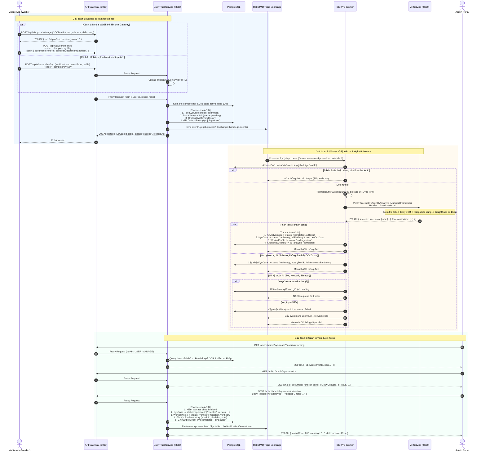
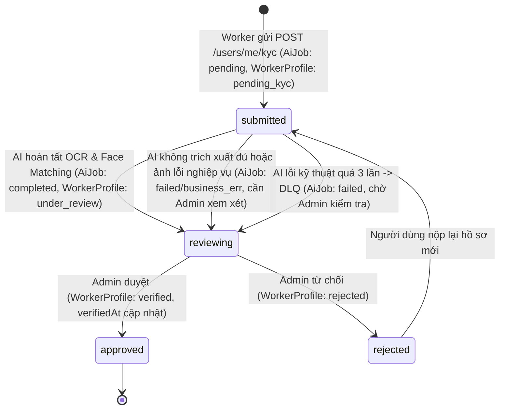

# HG-55: Kiến trúc & Đặc tả Luồng Tái cấu trúc Xác minh Danh tính (eKYC)

Tài liệu này đặc tả chi tiết toàn diện kiến trúc tái cấu trúc luồng xác minh danh tính điện tử (eKYC) trong hệ thống **HandyGo** (Task HG-55).

Hệ thống đã chuyển giao 100% quyền quản lý trạng thái, dữ liệu và toàn bộ nghiệp vụ từ AI Service sang Backend **User Trust Service** (PostgreSQL), đồng thời tinh gọn **AI Service** thành một microservice **Stateless Inference** (OCR CCCD và Face Matching) thuần túy qua HTTP nội bộ, tách biệt hoàn toàn Docker giữa Backend và AI Service, loại bỏ Celery/Redis ngầm giúp tiết kiệm tài nguyên và ngăn ngừa triệt để các rủi ro race condition, mất mát sự kiện hay lỗi đồng bộ dữ liệu.

---

## 1. Bối cảnh & Lý do Tái cấu trúc

Trong kiến trúc ban đầu (HG-45), AI Service đảm nhiệm cả việc tiếp nhận request trực tiếp từ Mobile, lưu trữ kết quả phân tích trong file JSON cục bộ, quản lý hàng đợi Celery/Redis nội bộ, phát sự kiện và cung cấp các API cho Admin phê duyệt.

Mô hình cũ bộc lộ các nhược điểm nghiêm trọng:
1. **Vi phạm nguyên tắc Single Responsibility**: AI Service vừa gánh tính toán thị giác máy tính (Computer Vision/Deep Learning nặng nề), vừa gánh nghiệp vụ CRUD, xác thực quyền Admin và quản lý trạng thái hồ sơ người dùng.
2. **Phụ thuộc tệp & lưu trữ phân tán**: Ảnh và kết quả phân tích lưu trên đĩa cục bộ hoặc thư mục dùng chung (shared volume), gây khó khăn khi scale ngang các container AI Service.
3. **Thiếu cơ chế tin cậy trong giao tiếp**: Gửi domain event trực tiếp (không có Transactional Outbox), dễ dẫn đến mất mát hoặc bất đồng bộ trạng thái giữa PostgreSQL của Backend và file JSON của AI.
4. **Trùng lặp & Rủi ro Race Condition**: Khi mạng chập chờn hoặc người dùng gửi lặp lại, job cũ có thể ghi đè kết quả của job mới hơn.
5. **Lãng phí tài nguyên máy tính & dính líu Docker**: Chạy chung hoặc phụ thuộc lẫn nhau, kèm thêm container `ai-worker` chạy Celery ngầm tiêu tốn gần 2GB RAM nhưng không tận dụng được cơ chế phân phối tải của RabbitMQ backend.

### Bảng so sánh Kiến trúc: HG-45 vs HG-55

| Tiêu chí | HG-45 (Kiến trúc cũ) | HG-55 (Kiến trúc chuẩn hóa) |
| :--- | :--- | :--- |
| **Vai trò của AI Service** | Quản lý state machine, admin review, file store JSON, Celery | **Chỉ Stateless Inference** (OCR CCCD + Face Matching qua HTTP) |
| **Quản lý Hồ sơ & Trạng thái** | Phân mảnh giữa AI JSON Store và User Trust DB | **Tập trung 100% tại User Trust Service (PostgreSQL)** |
| **Luồng gửi từ Mobile** | Mobile $\rightarrow$ Gateway $\rightarrow$ AI Service | **Mobile $\rightarrow$ Gateway $\rightarrow$ User Trust Service** |
| **Quản lý Hàng đợi & Xử lý** | Redis + Celery (`ai-worker`) nội bộ trong AI | **RabbitMQ Topic Exchange + BE KYC Worker (Prefetch: 1)** |
| **Quản lý Tệp Ảnh** | Upload trực tiếp vào AI / Shared Volume | **Upload Cloudinary/BE Storage $\rightarrow$ Worker truyền HTTP Multipart Buffer sang AI** |
| **Phê duyệt Admin** | Gọi qua AI Service (`/api/v1/admin/identity/*`) | **Gọi qua User Trust (`/api/v1/admin/kyc-cases/*`)** |
| **Độ tin cậy Sự kiện** | Gửi trực tiếp qua socket (dễ thất thoát) | **Transactional Outbox Pattern + Idempotency-Key** |
| **Tách biệt Docker** | Gộp chung volume/network, chạy cả `ai-worker` + Redis | **Tách riêng 2 Docker độc lập (`backend/` và `ai/`). Bỏ Celery, Redis, shared volume** |

---

## 2. Tổng quan Kiến trúc Mới

Luồng xử lý mới:
```
Mobile → API Gateway → User Trust → RabbitMQ → BE Worker → AI Service
```

```
+---------------------------------------------------------------------------------------------------------+
|                                        MOBILE CLIENT (React Native)                                     |
|  1. Tải ảnh lên Storage qua Gateway: POST /api/v1/uploads/image (hoặc gửi trực tiếp Multipart)          |
|  2. Nộp hồ sơ KYC: POST /api/v1/users/me/kyc (kèm Idempotency-Key)                                      |
|  3. Nhận ngay 202 Accepted & Polling tiến độ: GET /api/v1/users/me/kyc/jobs/:jobId                      |
+----------------------------------------------------+----------------------------------------------------+
                                                     |
                                                     v
+---------------------------------------------------------------------------------------------------------+
|                                          API GATEWAY (Port 3000)                                        |
|  - Định tuyến /api/v1/users/* và /api/v1/admin/kyc-cases/* -> user-trust-service:3002                   |
|  - Loại bỏ hoàn toàn route /api/v1/identity và /api/identity khỏi AI routing                            |
|  - Xác thực JWT Bearer Token & phân quyền Admin / Worker                                                |
|  - Chèn header ngữ cảnh an toàn: x-request-id, x-user-id, x-user-roles, x-user-permissions              |
+----------------------------------------------------+----------------------------------------------------+
                                                     |
                                                     v
+---------------------------------------------------------------------------------------------------------+
|                                    USER TRUST SERVICE (Port 3002)                                       |
|  - Tiếp nhận hồ sơ, kiểm tra trùng lặp Idempotency-Key, trả ngay HTTP 202 Accepted                      |
|  - Transaction ACID: Tạo KycCase, AiAnalysisJob, KycReviewHistory, OutboxEvent                          |
|  - Cung cấp API Quản trị viên thẩm định hồ sơ: GET/POST /api/v1/admin/kyc-cases                         |
|  - Tích hợp OutboxPublisherService tự động quét và phát sự kiện sang RabbitMQ                           |
+-------------------+--------------------------------+--------------------------------+-------------------+
                    |                                |                                |
                    v                                v                                v
+-----------------------------------+  +----------------------------+  +-----------------------------------+
|       PostgreSQL Database         |  |   RabbitMQ Topic Exchange  |  |           BE KYC WORKER           |
|-----------------------------------|  |      [ handy-go.events ]   |  |-----------------------------------|
| - kyc_cases                       |  |----------------------------|  | - Hàng đợi: user-trust-kyc-worker |
| - ai_analysis_jobs                |  | Queue:                     |  | - prefetchCount: 1 (Tuần tự)      |
| - kyc_review_histories            |  | - user-trust-kyc-worker    |  | - Manual ACK & Retry & DLQ        |
| - outbox_events                   |  | - user-trust-kyc-worker.dlq|  | - Tải ảnh từ URL vào Memory Buffer|
| - worker_profiles                 |  | Routing Key:               |  | - Gọi AI Inference qua HTTP POST  |
| - users                           |  | - kyc.job.process          |  | - Ngăn job cũ bằng activeJobId    |
+-----------------------------------+  +----------------------------+  +-----------------+-----------------+
                                                                                         |
                                                                                         | HTTP POST (Multipart)
                                                                                         | X-Internal-Secret
                                                                                         v
                                                                        +-----------------------------------+
                                                                        |        AI SERVICE (Port 8000)     |
                                                                        |         (Docker Độc Lập)          |
                                                                        |-----------------------------------|
                                                                        | - POST /internal/v1/identity/     |
                                                                        |        analyze                    |
                                                                        | - Nhận cccd_image & selfie_image  |
                                                                        | - Kiểm tra chất lượng ảnh đầu vào |
                                                                        | - Trích xuất OCR thông tin CCCD   |
                                                                        | - InsightFace so khớp khuôn mặt   |
                                                                        | - Dọn sạch tempfile OS sau xử lý  |
                                                                        | - KHÔNG DB, KHÔNG Redis,          |
                                                                        |   KHÔNG Celery, KHÔNG lưu state   |
                                                                        +-----------------------------------+
```

---

## 3. Sơ đồ Tuần tự Chi tiết (Sequence Diagram)



---

## 4. Vòng đời Trạng thái & State Machine

Hệ thống quản lý sự đồng bộ trạng thái chặt chẽ giữa `KycCase`, `AiAnalysisJob` và `WorkerProfile`:



### Bảng Ma trận Chuyển đổi Trạng thái (State Matrix)

| Trạng thái KycCase | Trạng thái AiAnalysisJob | Trạng thái WorkerProfile | Sự kiện kích hoạt | Ý nghĩa nghiệp vụ |
| :--- | :--- | :--- | :--- | :--- |
| `submitted` | `pending` | `pending_kyc` | Mobile nộp hồ sơ | Hồ sơ đã ghi nhận trong DB, job đã đưa vào RabbitMQ queue. |
| `submitted` | `processing` | `pending_kyc` | Worker bắt đầu xử lý | Worker đã lấy job từ queue, đang gọi HTTP sang AI Service. |
| `reviewing` | `completed` | `under_review` | AI Service trả kết quả | Đã có kết quả OCR & điểm so khớp khuôn mặt, chờ Admin duyệt. |
| `approved` | `completed` | `verified` | Admin phê duyệt | Thợ được xác minh danh tính, hoàn tất điều kiện nhận việc. |
| `rejected` | `completed` | `rejected` | Admin từ chối | Hồ sơ bị từ chối (ảnh mờ, thông tin lệch, giả mạo, v.v.). |
| `reviewing` | `failed` | `pending_kyc` | Lỗi kỹ thuật vượt quá 3 lần | Đẩy vào DLQ, case chuyển sang reviewing để Admin xử lý thủ công. |

---

## 5. Đặc tả Chi tiết Bộ API

### 5.1. Mobile Client APIs (User Trust Service qua API Gateway)

#### 1. Nộp hồ sơ xác minh KYC
- **Endpoint:** `POST /api/v1/users/me/kyc`
- **Xác thực:** Bearer Token (JWT của Worker).
- **Header:**
  - `Idempotency-Key` *(tùy chọn)*: Khóa chống gửi trùng request.
- **Request Body (JSON):**
  ```json
  {
    "idDocumentType": "CCCD",
    "idNumber": "012345678901",
    "documentFrontRef": "https://res.cloudinary.com/handygo/image/upload/v1/kyc/front.jpg",
    "selfieRef": "https://res.cloudinary.com/handygo/image/upload/v1/kyc/selfie.jpg",
    "documentBackRef": "https://res.cloudinary.com/handygo/image/upload/v1/kyc/back.jpg",
    "idempotencyKey": "kyc-sub-550e8400-e29b-41d4-a716-446655440000"
  }
  ```
  *(Hỗ trợ cả dạng `multipart/form-data` với các trường file: `documentFront` / `cccd_image`, `selfie` / `selfie_image`, `documentBack`)*.
- **Response `202 Accepted`:**
  ```json
  {
    "statusCode": 202,
    "message": "Hồ sơ KYC đã được tiếp nhận và đưa vào hàng đợi phân tích AI",
    "data": {
      "kycCaseId": "7f30f250-cc4a-4553-9619-930b8f765096",
      "jobId": "2bd56563-01da-4b32-82a9-59944f7c1bbd",
      "status": "queued",
      "createdAt": "2026-10-22T02:26:00.000Z"
    }
  }
  ```

#### 2. Lấy thông tin trạng thái KYC hiện tại của Worker
- **Endpoint:** `GET /api/v1/users/me/kyc`
- **Xác thực:** Bearer Token.
- **Response `200 OK`:**
  ```json
  {
    "statusCode": 200,
    "data": {
      "workerStatus": "under_review",
      "latestKycCase": {
        "id": "7f30f250-cc4a-4553-9619-930b8f765096",
        "status": "reviewing",
        "idDocumentType": "CCCD",
        "idNumberMasked": "012******901",
        "documentFrontRef": "https://res.cloudinary.com/...",
        "selfieRef": "https://res.cloudinary.com/...",
        "aiSimilarityScore": 0.885,
        "submittedAt": "2026-10-22T02:26:00.000Z"
      },
      "activeJob": {
        "id": "2bd56563-01da-4b32-82a9-59944f7c1bbd",
        "status": "completed",
        "retryCount": 0
      }
    }
  }
  ```

#### 3. Kiểm tra tiến độ xử lý Job AI (Polling)
- **Endpoint:** `GET /api/v1/users/me/kyc/jobs/:jobId`
- **Xác thực:** Bearer Token (kiểm tra quyền sở hữu job).
- **Response `200 OK`:**
  ```json
  {
    "statusCode": 200,
    "data": {
      "jobId": "2bd56563-01da-4b32-82a9-59944f7c1bbd",
      "kycCaseId": "7f30f250-cc4a-4553-9619-930b8f765096",
      "status": "completed",
      "retryCount": 0,
      "failureReason": null,
      "startedAt": "2026-10-22T02:26:02.000Z",
      "completedAt": "2026-10-22T02:26:09.000Z",
      "createdAt": "2026-10-22T02:26:00.000Z"
    }
  }
  ```

---

### 5.2. Internal Inference API (AI Service)

Dành riêng cho BE KYC Worker gọi nội bộ qua HTTP, bảo mật bằng header bí mật `x-internal-secret`:

- **Endpoint:** `POST /internal/v1/identity/analyze`
- **Header:**
  - `x-internal-secret`: Giá trị bí mật từ `INTERNAL_SERVICE_SECRET`.
- **Request:** `multipart/form-data`
  - `cccd_image`: Binary file ảnh mặt trước CCCD.
  - `selfie_image`: Binary file ảnh chân dung selfie.
- **Xử lý nội bộ AI Service:**
  - Lưu file tạm bằng `tempfile.TemporaryDirectory()`.
  - Kiểm tra độ sáng, độ mờ của ảnh đầu vào (`check_image_quality`).
  - Chạy `ocr_pipeline_service` bóc tách thông tin thẻ CCCD.
  - Cắt ảnh chân dung trên thẻ CCCD.
  - Chạy `face_verification_pipeline` đối sánh vector đặc trưng khuôn mặt (InsightFace).
  - Tự động xóa sạch thư mục tạm khi kết thúc request.
- **Response `200 OK` (Thành công):**
  ```json
  {
    "success": true,
    "data": {
      "ocr": {
        "id": "042206013116",
        "name": "NGUYEN VAN A",
        "dob": "15/08/1995",
        "gender": "Nam",
        "nationality": "Việt Nam",
        "origin": "Đà Nẵng",
        "residence": "Hải Châu, Đà Nẵng",
        "expiry": "15/08/2035"
      },
      "faceVerification": {
        "isMatch": true,
        "similarity": 0.885,
        "confidence": 0.885,
        "status": "match",
        "needsReview": false,
        "message": "Khuôn mặt trùng khớp với chân dung thẻ CCCD"
      }
    }
  }
  ```
- **Response (Ảnh không đạt chất lượng / Không phải CCCD):**
  ```json
  {
    "success": false,
    "errorCode": "OCR_FAILED",
    "message": "Không thể trích xuất thông tin OCR từ CCCD."
  }
  ```

---

### 5.3. Admin Review APIs (User Trust Service)

Chỉ tài khoản Quản trị viên (`USER_MANAGE`) mới được phép truy cập qua API Gateway (`/api/v1/admin/kyc-cases`):

#### 1. Danh sách hồ sơ KYC
- **Endpoint:** `GET /api/v1/admin/kyc-cases?status=reviewing&page=1&limit=20`
- **Query Params:**
  - `status`: `submitted` | `reviewing` | `approved` | `rejected`
  - `page`: số trang (mặc định: 1)
  - `limit`: số bản ghi/trang (mặc định: 20)
- **Response `200 OK`:**
  ```json
  {
    "statusCode": 200,
    "data": [
      {
        "id": "7f30f250-cc4a-4553-9619-930b8f765096",
        "workerProfileId": "960ef1c9-e074-4bdb-8647-a8dc4d94a168",
        "status": "reviewing",
        "documentFrontRef": "https://res.cloudinary.com/...",
        "selfieRef": "https://res.cloudinary.com/...",
        "idNumberMasked": "042******116",
        "aiSimilarityScore": 0.885,
        "submittedAt": "2026-10-22T02:26:00.000Z",
        "workerProfile": {
          "user": { "fullName": "Nguyen Van A" }
        }
      }
    ],
    "pagination": { "page": 1, "limit": 20, "total": 1, "totalPages": 1 }
  }
  ```

#### 2. Chi tiết hồ sơ KYC thẩm định
- **Endpoint:** `GET /api/v1/admin/kyc-cases/:id`
- **Response `200 OK`:** Trả về toàn bộ chi tiết hồ sơ: ảnh gốc, thông tin Worker, kết quả phân tích AI chi tiết (`rawOcrData`, `aiResult`), danh sách jobs và toàn bộ lịch sử thẩm định `reviewHistories`.

#### 3. Phê duyệt hoặc từ chối hồ sơ
- **Endpoint:** `POST /api/v1/admin/kyc-cases/:id/review`
- **Request Body:**
  ```json
  {
    "decision": "approved",
    "note": "Hồ sơ hợp lệ, thông tin CCCD và khuôn mặt trùng khớp hoàn toàn."
  }
  ```
- **Xử lý Transaction ACID:**
  - Kiểm tra hồ sơ chưa từng bị finalized (`approved` hoặc `rejected`). Ngăn duyệt trùng.
  - Cập nhật `KycCase.status = 'approved'` (hoặc `'rejected'`), `version += 1`, `reviewedByUserId`, `reviewedAt`, `reviewNote`.
  - Đồng bộ `WorkerProfile.status = 'verified'` (hoặc `'rejected'`), cập nhật `verifiedAt` và `approvedAt`.
  - Tạo bản ghi audit trail trong `KycReviewHistory`.
  - Ghi bản ghi `OutboxEvent` (`kyc.completed` hoặc `kyc.failed`) để phát tán sự kiện đáng tin cậy.
- **Response `200 OK`:**
  ```json
  {
    "statusCode": 200,
    "message": "Đã phê duyệt hồ sơ KYC thành công",
    "data": { ... }
  }
  ```

---

## 6. Thiết kế Cơ sở Dữ liệu Thực tế (Prisma Schema)

Mô hình dữ liệu chính xác trong file [`schema.prisma`](file:///d:/ITFaculty/Seme7/PBL6/HANDY_GO/backend/apps/user-trust-service/prisma/schema.prisma):

```prisma
enum WorkerStatus {
  draft
  pending_kyc
  under_review
  verified
  rejected
  suspended

  @@map("worker_status")
}

enum KycStatus {
  draft
  submitted
  reviewing
  approved
  rejected

  @@map("kyc_status")
}

enum AiJobStatus {
  pending
  processing
  completed
  failed

  @@map("ai_job_status")
}

model KycCase {
  id               String              @id @db.Uuid
  workerProfileId  String              @map("worker_profile_id") @db.Uuid
  idDocumentType   String              @map("id_document_type") @db.VarChar(50)
  idNumberMasked   String?             @map("id_number_masked") @db.VarChar(100)
  documentFrontRef String              @map("document_front_ref")
  documentBackRef  String?             @map("document_back_ref")
  selfieRef        String              @map("selfie_ref")
  status           KycStatus           @default(draft)
  version          Int                 @default(1)
  idempotencyKey   String?             @map("idempotency_key") @db.VarChar(128)
  activeJobId      String?             @map("active_job_id") @db.Uuid
  aiSimilarityScore Decimal?           @map("ai_similarity_score") @db.Decimal(5, 4)
  rawOcrData       Json?               @map("raw_ocr_data")
  aiResult         Json?               @map("ai_result")
  reviewedByUserId String?             @map("reviewed_by_user_id") @db.Uuid
  reviewNote       String?             @map("review_note")
  submittedAt      DateTime?           @map("submitted_at") @db.Timestamp(6)
  reviewedAt       DateTime?           @map("reviewed_at") @db.Timestamp(6)
  createdAt        DateTime            @map("created_at") @db.Timestamp(6)
  updatedAt        DateTime            @map("updated_at") @db.Timestamp(6)
  
  workerProfile    WorkerProfile       @relation(fields: [workerProfileId], references: [id], onDelete: NoAction, onUpdate: NoAction)
  reviewer         User?               @relation("KycReviewer", fields: [reviewedByUserId], references: [id], onDelete: NoAction, onUpdate: NoAction)
  jobs             AiAnalysisJob[]
  reviewHistories  KycReviewHistory[]

  @@map("kyc_cases")
}

model AiAnalysisJob {
  id              String       @id @db.Uuid
  kycCaseId       String       @map("kyc_case_id") @db.Uuid
  workerProfileId String       @map("worker_profile_id") @db.Uuid
  status          AiJobStatus  @default(pending)
  retryCount      Int          @default(0) @map("retry_count")
  maxRetries      Int          @default(3) @map("max_retries")
  idempotencyKey  String?      @unique @map("idempotency_key") @db.VarChar(128)
  failureReason   String?      @map("failure_reason")
  aiResult        Json?        @map("ai_result")
  startedAt       DateTime?    @map("started_at") @db.Timestamp(6)
  completedAt     DateTime?    @map("completed_at") @db.Timestamp(6)
  createdAt       DateTime     @default(now()) @map("created_at") @db.Timestamp(6)
  updatedAt       DateTime     @updatedAt @map("updated_at") @db.Timestamp(6)

  kycCase         KycCase      @relation(fields: [kycCaseId], references: [id], onDelete: Cascade)

  @@index([kycCaseId])
  @@index([status])
  @@map("ai_analysis_jobs")
}

model KycReviewHistory {
  id                String    @id @db.Uuid
  kycCaseId         String    @map("kyc_case_id") @db.Uuid
  action            String    @db.VarChar(50)
  fromStatus        String?   @map("from_status") @db.VarChar(50)
  toStatus          String    @map("to_status") @db.VarChar(50)
  performedByUserId String?   @map("performed_by_user_id") @db.Uuid
  note              String?
  metadata          Json?
  createdAt         DateTime  @default(now()) @map("created_at") @db.Timestamp(6)

  kycCase           KycCase   @relation(fields: [kycCaseId], references: [id], onDelete: Cascade)

  @@index([kycCaseId])
  @@map("kyc_review_histories")
}

model OutboxEvent {
  id           String    @id @default(uuid())
  eventType    String
  eventVersion Int       @default(1)
  payload      Json
  status       String    @default("pending")
  retryCount   Int       @default(0)
  lastError    String?
  nextRetryAt  DateTime  @default(now())
  createdAt    DateTime  @default(now())
  publishedAt  DateTime?

  @@index([status, nextRetryAt])
  @@map("outbox_events")
}
```

---

## 7. Cấu hình RabbitMQ Topology & Cơ chế Chịu lỗi

```
Exchange: handy-go.events (Topic Exchange)
   |
   +---[ routing key: kyc.job.process ]---> Queue: user-trust-kyc-worker (prefetch: 1)
                                                 |
                                            (on maxRetries exceeded)
                                                 v
                                            Queue: user-trust-kyc-worker.dlq
```

### Chi tiết Vận hành Hàng đợi:
1. **Tuần tự từng job (`prefetchCount: 1`)**:
   - `apps/user-trust-service/src/main.ts` kết nối dedicated microservice: `createRabbitMQOptions(RABBITMQ_QUEUES.KYC_WORKER, 1)`.
   - Mỗi thời điểm chỉ có 1 job AI chạy trên worker, đảm bảo CPU/RAM không bị nghẽn đột ngột.
2. **Manual Acknowledgment (`noAck: false`)**:
   - Worker chỉ gọi `channel.ack(originalMsg)` sau khi kết quả đã được ghi vào database thành công.
3. **Phân biệt Lỗi Kỹ thuật vs Lỗi Nghiệp vụ**:
   - **Lỗi nghiệp vụ** (ảnh mờ, không tìm thấy mặt, không khớp): AI trả về mã lỗi `400/415/422` hoặc `{ success: false }`. Worker ACK thông điệp, cập nhật case sang `reviewing` để Admin kiểm tra bằng mắt, không retry vô ích.
   - **Lỗi kỹ thuật** (mất mạng, AI container restart, 5xx, timeout): Worker bắt exception, ghi nhận retry. Nếu `retryCount < maxRetries (3)`, gọi `channel.nack(originalMsg, false, true)` để requeue. Khi vượt quá 3 lần, chuyển sang DLQ `user-trust-kyc-worker.dlq` và ACK thông điệp chính để tránh nghẽn luồng.

---

## 8. Tách biệt Docker giữa Backend và AI Service

Để đảm bảo hiệu năng và dễ dàng mở rộng, hai phần Backend và AI được phân tách hoàn toàn thành hai cấu hình Docker độc lập, loại bỏ tất cả các dịch vụ và khối lượng thừa:

### 1. Backend Docker (`backend/docker-compose.yml`)
- Quản lý **11 microservices NestJS** (`api-gateway`, `auth-service`, `user-trust-service`, `catalog-service`, `order-service`, `bidding-service`, `matching-service`, `payment-service`, `notification-service`, `wallet-service`, `tracking-service`).
- `user-trust-service` kết nối trực tiếp đến AI Service qua cấu hình mạng nội bộ:
  ```yaml
  user-trust-service:
    environment:
      AI_SERVICE_URL: ${AI_SERVICE_URL:-http://host.docker.internal:8000}
      INTERNAL_SERVICE_SECRET: ${INTERNAL_SERVICE_SECRET:-handy-go-internal-service-secret-key-12345}
  ```
- Đã loại bỏ hoàn toàn các volumes của AI (`ai-service-face-models`, `ai-service-ocr-models`) khỏi `backend/docker-compose.yml`.

### 2. AI Service Docker (`ai/docker-compose.yml`)
- Cấu hình tinh gọn, chạy độc lập:
  ```yaml
  services:
    ai-service:
      build:
        context: .
        dockerfile: Dockerfile
      container_name: handygo-ai-service
      init: true
      restart: unless-stopped
      mem_limit: 1500m
      mem_reservation: 500m
      environment:
        AI_SERVICE_PORT: ${AI_SERVICE_PORT:-8000}
        INTERNAL_SERVICE_SECRET: ${INTERNAL_SERVICE_SECRET:-handy-go-internal-service-secret-key-12345}
        DEBUG: ${AI_SERVICE_DEBUG:-false}
      ports:
        - "${AI_SERVICE_PORT:-8000}:8000"
      volumes:
        - ./app:/app/app
        # Tái sử dụng cache model để không phải tải lại mỗi lần khởi động
        - ai-face-models:/home/app/.insightface
        - ai-ocr-models:/home/app/.EasyOCR
      healthcheck:
        test:
          - CMD
          - python
          - -c
          - "import os,urllib.request; urllib.request.urlopen('http://127.0.0.1:'+os.getenv('AI_SERVICE_PORT','8000')+'/health',timeout=3)"
        interval: 30s
        timeout: 5s
        retries: 5
        start_period: 120s

  volumes:
    ai-face-models:
      name: handy-go-backend_ai-service-face-models
      external: true
    ai-ocr-models:
      name: handy-go-backend_ai-service-ocr-models
      external: true
  ```
- **Các thành phần đã loại bỏ**:
  - `ai-worker` (Celery worker): Không cần vì BE KYC Worker xử lý qua RabbitMQ.
  - `ai-redis` / `REDIS_URL`: Không cần Redis làm Celery broker.
  - `ai-storage` volume: Không còn dùng shared volume giữa các container.
  - `CLOUDINARY_*`, `RABBITMQ_*`: AI không còn upload Cloudinary hay phát RabbitMQ event.

---

## 9. Cấu trúc Cây Thư mục & Mã Nguồn Trọng tâm

```
HANDY_GO/
├── backend/
│   ├── docker-compose.yml                     # 11 Microservices Backend độc lập
│   ├── apps/
│   │   ├── api-gateway/
│   │   │   └── src/proxy/proxy.constants.ts   # Định tuyến /api/v1/users và /api/v1/admin/kyc-cases về user-trust
│   │   └── user-trust-service/
│   │       ├── prisma/schema.prisma           # Schema KycCase, AiAnalysisJob, KycReviewHistory, OutboxEvent
│   │       └── src/
│   │           ├── main.ts                    # Đăng ký queue user-trust-kyc-worker (prefetch: 1)
│   │           └── kyc/
│   │               ├── kyc.controller.ts      # POST /users/me/kyc, GET /users/me/kyc, GET /jobs/:jobId
│   │               ├── kyc-admin.controller.ts# GET /admin/kyc-cases, POST /admin/kyc-cases/:id/review
│   │               ├── kyc.service.ts         # Nghiệp vụ submit, get status, idempotent check, review
│   │               ├── kyc-worker.service.ts  # Consumer RabbitMQ kyc.job.process, gọi HTTP AI analyze
│   │               ├── kyc.repository.ts      # Transaction ACID, versioning, chống stale job
│   │               ├── kyc.constants.ts       # Hằng số queue, retry limits, maskIdNumber
│   │               ├── dto/                   # SubmitKycDto, ListKycCasesDto, ReviewKycCaseDto
│   │               └── outbox/                # UserTrustOutboxRepository
│   └── libs/
│       ├── cloudinary/                        # Module tải và quản lý ảnh Cloudinary
│       ├── rabbitmq/                          # RabbitMQ Module & Topic Exchange
│       └── common/                            # OutboxPublisherService, AppError, Events
├── ai/
│   ├── docker-compose.yml                     # AI Service container duy nhất (port 8000)
│   ├── Dockerfile                             # Python 3.11 + InsightFace + EasyOCR + FastAPI
│   └── app/
│       ├── main.py                            # FastAPI entrypoint (chỉ mount health, internal, ocr)
│       └── domains/identity/api/
│           ├── internal_identity.py           # POST /internal/v1/identity/analyze
│           ├── ocr.py                         # OCR endpoints độc lập
│           └── health.py                      # Health check
└── mobile/
    └── src/services/identity/identity-api.ts  # Client gọi API KYC mới qua API Gateway
```

---

## 10. Kết quả Kiểm thử & Xác thực Môi trường (Test Verification)

### 10.1. Kết quả chạy Test Suites Tự động

Tất cả các bộ test case đơn vị và tích hợp trong hệ thống đều đạt **100% Passed**:

| Hạng mục kiểm thử | Lệnh thực thi | Kết quả chi tiết | Đánh giá |
| :--- | :--- | :--- | :---: |
| **KYC Unit Test Suite** | `pnpm vitest run apps/user-trust-service/src/kyc` | **25/25 tests passed** (Controller, AdminController, Service, Worker) | **ĐẠT (100%)** |
| **User Trust Service Test Suite** | `pnpm vitest run apps/user-trust-service` | **54/54 tests passed** (7 test suites, 6.1s) | **ĐẠT (100%)** |
| **API Gateway Test Suite** | `pnpm vitest run apps/api-gateway` | **86/86 tests passed** (9 test suites, 4.5s) | **ĐẠT (100%)** |
| **Full Workspace Test Suite** | `pnpm test` | **65/65 test files passed, 367 tests passed** (33.5s) | **ĐẠT (100%)** |
| **Backend TypeScript Typecheck** | `pnpm run typecheck` | **0 errors** (`tsc --noEmit && tsc -p tsconfig.prisma.json`) | **ĐẠT** |
| **Backend Code Linter** | `pnpm run lint` | **0 errors, 0 warnings** (294 files kiểm tra bởi Oxlint) | **ĐẠT** |

#### Chi tiết kịch bản test đã kiểm chứng trong KYC Module:
1. `KycController`:
   - Gửi yêu cầu qua JSON payload URL hoặc Multipart file buffer.
   - Trả về mã HTTP `202 Accepted` kèm `jobId`, `caseId`, `status: pending`.
   - Chặn submit trùng lặp bằng `Idempotency-Key` trả lại dữ liệu job cũ đã tiếp nhận.
   - Chặn submit khi user đang có job xử lý dở dang (`pending` hoặc `processing`).
2. `KycWorkerService`:
   - Lấy job từ RabbitMQ với `prefetch: 1`, điều phối tuần tự.
   - Bỏ qua an toàn khi phát hiện job lỗi thời (`activeJobId` trên case khác `jobId` hiện tại).
   - Gọi HTTP `POST /internal/v1/identity/analyze` thành công: cập nhật Case sang `reviewing`, lưu kết quả AI vào `ai_analysis_jobs`.
   - Phân biệt lỗi nghiệp vụ AI (ảnh mờ, không tìm thấy CCCD -> không retry, chuyển trạng thái `failed`, chuyển case sang `reviewing` để admin kiểm tra thủ công).
   - Phân biệt lỗi kỹ thuật (AI 5xx / timeout -> tự động retry tối đa 3 lần, nếu quá 3 lần tự động đẩy sang DLQ `user-trust-kyc-worker.dlq`).
3. `KycAdminController` & `KycService`:
   - Phân quyền nghiêm ngặt chỉ Admin (`ADMIN` role hoặc quyền `kyc:review`) mới được duyệt.
   - Thẩm định `approved` -> cập nhật atomic `kyc_cases.status = 'approved'`, `users.is_identity_verified = true`, tạo Transactional Outbox event `kyc.case.approved`.
   - Thẩm định `rejected` -> cập nhật `kyc_cases.status = 'rejected'`, ghi nhận lý do từ chối, tạo Outbox event `kyc.case.rejected`.

---

### 10.2. Trạng thái Vận hành Runtime Containers

Tất cả 12 containers đã được build lại và đang chạy ở trạng thái **Healthy**:

| Tên Container | Dịch vụ | Cổng Host:Container | Trạng thái |
| :--- | :--- | :--- | :---: |
| `handygo-ai-service` | AI Service (Python FastAPI) | `8000:8000` | **Up (healthy)** |
| `handy-go-backend-api-gateway-1` | API Gateway (NestJS) | `3000:3000` | **Up (healthy)** |
| `handy-go-backend-user-trust-service-1` | User Trust Service | `3002:3002` | **Up (healthy)** |
| `handy-go-backend-auth-service-1` | Auth Service | `3001:3001` | **Up (healthy)** |
| `handy-go-backend-catalog-service-1` | Catalog Service | `3003:3003` | **Up (healthy)** |
| `handy-go-backend-order-service-1` | Order Service | `3004:3004` | **Up (healthy)** |
| `handy-go-backend-bidding-service-1` | Bidding Service | `3005:3005` | **Up (healthy)** |
| `handy-go-backend-matching-service-1` | Matching Service | `3006:3006` | **Up (healthy)** |
| `handy-go-backend-payment-service-1` | Payment Service | `3007:3007` | **Up (healthy)** |
| `handy-go-backend-notification-service-1` | Notification Service | `3008:3008` | **Up (healthy)** |
| `handy-go-backend-wallet-service-1` | Wallet Service | `3009:3009` | **Up (healthy)** |
| `handy-go-backend-tracking-service-1` | Tracking Service | `3010:3010` | **Up (healthy)** |

---

### 10.3. Hướng dẫn Test Nhanh bằng cURL

#### 1. Kiểm tra Health Check của AI Service độc lập
```bash
curl http://127.0.0.1:8000/health
# Trả về: {"status":"ok","timestamp":"..."}
```

#### 2. Kiểm tra Health Check của API Gateway
```bash
curl http://127.0.0.1:3000/health
# Trả về: {"status":"ok","timestamp":"..."}
```

#### 3. Mobile Nộp Hồ sơ eKYC (Khách hàng / Thợ)
```bash
curl -X POST http://127.0.0.1:3000/api/v1/users/me/kyc \
  -H "Authorization: Bearer <USER_JWT_TOKEN>" \
  -H "Content-Type: application/json" \
  -H "Idempotency-Key: ekyc-submit-user123-001" \
  -d '{
    "idCardNumber": "012345678901",
    "fullName": "NGUYEN VAN A",
    "dateOfBirth": "1995-05-20",
    "idCardFrontUrl": "https://res.cloudinary.com/.../cccd_front.jpg",
    "idCardBackUrl": "https://res.cloudinary.com/.../cccd_back.jpg",
    "selfieUrl": "https://res.cloudinary.com/.../selfie.jpg"
  }'
```
*HTTP Status:* `202 Accepted`  
*Response:*
```json
{
  "success": true,
  "message": "Hồ sơ xác minh đã được tiếp nhận và đang xếp hàng xử lý",
  "data": {
    "caseId": "f7d3d29a-5e3a-44e2-9b2e-f1b2c3d4e5f6",
    "jobId": "a1b2c3d4-e5f6-7890-abcd-ef1234567890",
    "status": "pending"
  }
}
```

#### 4. Polling Tiến độ Phân tích AI
```bash
curl -X GET http://127.0.0.1:3000/api/v1/users/me/kyc/jobs/a1b2c3d4-e5f6-7890-abcd-ef1234567890 \
  -H "Authorization: Bearer <USER_JWT_TOKEN>"
```

#### 5. Admin Xem Chi tiết & Duyệt Hồ sơ
```bash
# Xem chi tiết hồ sơ kèm phân tích OCR và kết quả Face Match
curl -X GET http://127.0.0.1:3000/api/v1/admin/kyc-cases/f7d3d29a-5e3a-44e2-9b2e-f1b2c3d4e5f6 \
  -H "Authorization: Bearer <ADMIN_JWT_TOKEN>"

# Admin duyệt hồ sơ
curl -X POST http://127.0.0.1:3000/api/v1/admin/kyc-cases/f7d3d29a-5e3a-44e2-9b2e-f1b2c3d4e5f6/review \
  -H "Authorization: Bearer <ADMIN_JWT_TOKEN>" \
  -H "Content-Type: application/json" \
  -d '{
    "decision": "approved",
    "note": "Hồ sơ rõ nét, khớp thông tin CCCD và khuôn mặt"
  }'
```

---

## 11. Checklist Nghiệm thu Yêu cầu Kỹ thuật (DoD)

- [x] **Backend quản lý toàn bộ hồ sơ và trạng thái**: Không phụ thuộc vào state của AI Service.
- [x] **Submit KYC phản hồi ngay (202 Accepted)**: Đẩy job vào queue RabbitMQ, hỗ trợ kiểm tra tiến độ qua `jobId`.
- [x] **Xử lý tuần tự (`prefetchCount: 1`)**: Worker xử lý từng job một, không gây quá tải CPU/RAM của hệ thống AI.
- [x] **AI Stateless Inference**: Chỉ thực hiện trích xuất OCR và so khớp khuôn mặt qua `POST /internal/v1/identity/analyze`.
- [x] **Admin phê duyệt qua Backend**: Cung cấp đầy đủ API danh sách, xem chi tiết ảnh/kết quả AI, duyệt hoặc từ chối kèm ghi chú.
- [x] **Chống trùng lặp & Stale Job**: Hỗ trợ `Idempotency-Key`, kiểm tra `activeJobId`, kiểm tra versioning chống ghi đè trạng thái.
- [x] **Tách biệt Docker hoàn toàn**: Backend và AI chạy trên hai Docker độc lập, loại bỏ Celery worker và Redis thừa trong AI.
- [x] **Bộ Test Suite & Typecheck hoàn chỉnh**: 65/65 test files passed (367 unit tests), 0 linting errors, 0 typecheck errors.

