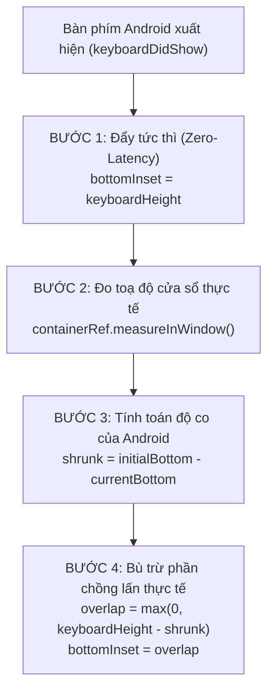

# Hướng dẫn Kỹ thuật Xử lý Bàn phím Android (Adaptive Keyboard Inset cho Android)

> **Phạm vi áp dụng:** Dự án HandyGo Mobile phát triển chuyên biệt cho nền tảng **Android**. Tài liệu này hướng dẫn chi tiết cho Agent và Developer cách xử lý bàn phím ảo trên Android để thanh nhập liệu (Input Bar), các ô nhập form (TextInput) và nút hành động (Bottom Action Button) luôn được đẩy lên mượt mà, chính xác từng pixel, không giật lag và triệt tiêu hoàn toàn lỗi đúp khoảng cách (double padding).

---

## 1. Bản chất cơ chế bàn phím trên Android & Lỗi kinh điển

### 1.1. Cơ chế `windowSoftInputMode` của Android
Trên Android, hệ điều hành điều khiển cách cửa sổ ứng dụng phản ứng với bàn phím thông qua thuộc tính `windowSoftInputMode` (thường là `adjustResize` hoặc `adjustPan`):
* **`adjustResize`:** Android tự động co chiều cao (`height`) của cửa sổ ứng dụng lại khi bàn phím xuất hiện.
* **`adjustPan`:** Android dịch chuyển toàn bộ cửa sổ lên trên để phần tử đang focus không bị che.

### 1.2. Tại sao các giải pháp mặc định thường bị lỗi trên Android?
* **Lỗi đúp khoảng cách (Double Padding / Lơ lửng giữa màn hình):**
  Khi Android đã ở chế độ `adjustResize`, cửa sổ đã tự co lại một khoảng đúng bằng chiều cao bàn phím. Nếu component lại dùng `KeyboardAvoidingView` hoặc cộng thêm `keyboard.height` vào padding đáy, nội dung sẽ bị đẩy lên **gấp đôi** (chiều cao bàn phím $\times$ 2), để lộ một khoảng trống khổng lồ bên dưới.
* **Sự khác biệt giữa 3-Button Navigation và Gesture Navigation:**
  Các thiết bị Android có thể dùng thanh 3 nút ảo (Back, Home, Recents) hoặc cử chỉ vuốt toàn màn hình. Chiều cao bàn phím trả về từ sự kiện `Keyboard` đôi khi tính gộp cả chiều cao thanh điều hướng ảo, dẫn đến việc tính toán cố định bị lệch vài chục pixel.

---

## 2. Giải pháp cốt lõi: Thuật toán đo bù trừ phần chồng lấn thực tế (`overlap`)

Giải pháp chuẩn hoá được trích xuất từ **[use-chat-keyboard.ts](file:///D:/SCHOOL/PBL6/mobile/src/features/chat/use-chat-keyboard.ts)** chuyên biệt cho Android:



### Công thức toán học:
$$\text{shrunk} = \max(0, \text{initialBottom} - \text{currentBottom})$$
$$\text{overlap} = \max(0, \text{keyboardHeight} - \text{shrunk})$$

* **Trường hợp 1 (Android tự co toàn bộ cửa sổ):** $\text{shrunk} \approx \text{keyboardHeight} \implies \text{overlap} = 0$. Không cần thêm padding đáy, tránh bị đúp khoảng cách.
* **Trường hợp 2 (Android không co hoặc chỉ co một phần):** $\text{overlap} > 0$. Hook sẽ bù đúng số pixel còn thiếu để thanh input nằm khít sát trên đỉnh bàn phím.

---

## 3. Mã nguồn Hook chuẩn cho Android (`useAndroidKeyboardInset`)

Đây là phiên bản tinh gọn tối đa dành riêng cho Android, đã loại bỏ toàn bộ các điều kiện rẽ nhánh iOS:

```typescript
import type { KeyboardEvent, View } from 'react-native';
import { useCallback, useEffect, useRef, useState } from 'react';
import { Keyboard } from 'react-native';

/**
 * Hook tự động điều chỉnh padding theo bàn phím chuẩn cho Android.
 * Tương thích tốt với cả Gesture Navigation và 3-Button Navigation.
 */
export function useAndroidKeyboardInset() {
  const containerRef = useRef<View | null>(null);
  const initialBottom = useRef<number | null>(null);
  const keyboardHeight = useRef<number>(0);
  const revision = useRef(0);
  const mounted = useRef(true);
  const [bottomInset, setBottomInset] = useState(0);
  const [keyboardVisible, setKeyboardVisible] = useState(false);

  const measure = useCallback(() => {
    const current = ++revision.current;
    if (keyboardHeight.current === 0) {
      setBottomInset(0);
      return;
    }
    containerRef.current?.measureInWindow((...frame) => {
      const [, y, , height] = frame;
      if (!mounted.current || current !== revision.current || keyboardHeight.current === 0) {
        return;
      }
      const currentBottom = y + height;
      if (initialBottom.current === null) {
        initialBottom.current = currentBottom;
      }
      // Tính xem Android OS đã tự co cửa sổ bao nhiêu
      const shrunk = Math.max(0, initialBottom.current - currentBottom);
      // Chỉ bù đúng phần còn thiếu
      const overlap = Math.max(0, keyboardHeight.current - shrunk);
      setBottomInset(overlap);
    });
  }, []);

  const onLayout = useCallback(() => {
    if (!keyboardVisible) {
      containerRef.current?.measureInWindow((...frame) => {
        const [, y, , height] = frame;
        if (mounted.current && !keyboardVisible) {
          initialBottom.current = y + height;
        }
      });
    } else {
      measure();
    }
  }, [keyboardVisible, measure]);

  useEffect(() => {
    mounted.current = true;

    const handleShow = (event: KeyboardEvent) => {
      const height = event.endCoordinates?.height || 0;
      keyboardHeight.current = height;
      const isVisible = height > 0;
      setKeyboardVisible(isVisible);

      if (isVisible) {
        // Đẩy lên tức thì để không bị che khuất trong khung hình đầu tiên
        setBottomInset(height);
        measure();
      } else {
        setBottomInset(0);
      }
    };

    const handleHide = () => {
      revision.current++;
      keyboardHeight.current = 0;
      setKeyboardVisible(false);
      setBottomInset(0);
    };

    const subscriptions = [
      Keyboard.addListener('keyboardDidShow', handleShow),
      Keyboard.addListener('keyboardDidHide', handleHide),
    ];

    const rev = revision;
    return () => {
      mounted.current = false;
      rev.current++;
      subscriptions.forEach(sub => sub.remove());
    };
  }, [measure]);

  return { containerRef, bottomInset, keyboardVisible, onLayout };
}
```

---

## 4. Hướng dẫn áp dụng cho từng loại màn hình trên Android

### 4.1. Màn hình Chat / Đàm phán giá giữa Thợ và Khách ([chat-screen.tsx](file:///D:/SCHOOL/PBL6/mobile/src/features/chat/chat-screen.tsx))
* **Đặc điểm:** Thanh nhập chat cố định ở đáy, danh sách tin nhắn đẩy lên khi có bàn phím.
* **Code mẫu chuẩn:**
```tsx
import { FlatList, TextInput, View } from 'react-native';
import { useAndroidKeyboardInset } from '@/hooks/use-android-keyboard-inset';

export function ChatScreen() {
  const keyboard = useAndroidKeyboardInset();

  return (
    <View
      ref={keyboard.containerRef}
      onLayout={keyboard.onLayout}
      style={{ flex: 1, paddingBottom: keyboard.bottomInset }}
    >
      {/* Danh sách tin nhắn đảo ngược */}
      <FlatList
        inverted
        data={messages}
        keyboardShouldPersistTaps="handled"
        keyboardDismissMode="on-drag"
        renderItem={({ item }) => <MessageItem message={item} />}
      />

      {/* Thanh gõ tin nhắn */}
      <View style={{ padding: 10, backgroundColor: 'white', flexDirection: 'row', alignItems: 'center' }}>
        <TextInput
          placeholder="Nhắn tin về dịch vụ..."
          multiline
          maxLength={4000}
          style={{ flex: 1, minHeight: 48, maxHeight: 110, backgroundColor: '#F1F5F9', borderRadius: 20, padding: 12 }}
        />
      </View>
    </View>
  );
}
```

---

### 4.2. Màn hình Form có Nút bấm neo ở đáy (Nhập địa chỉ, Mô tả chi tiết đơn hàng, Báo giá)
* **Đặc điểm:** Người dùng cuộn xem và điền thông tin, nhưng nút bấm ("Xác nhận địa chỉ", "Gửi báo giá") luôn cố định ở đáy. Khi bật bàn phím, nút bấm được đẩy nổi lên ngay trên bàn phím để bấm luôn mà không cần tắt phím.
* **Code mẫu chuẩn:**
```tsx
import { ScrollView, TextInput, View } from 'react-native';
import { Button } from '@/components/ui/button';
import { useAndroidKeyboardInset } from '@/hooks/use-android-keyboard-inset';

export function AddressInputScreen() {
  const keyboard = useAndroidKeyboardInset();

  return (
    <View
      ref={keyboard.containerRef}
      onLayout={keyboard.onLayout}
      style={{ flex: 1, paddingBottom: keyboard.bottomInset }}
    >
      <ScrollView
        keyboardShouldPersistTaps="handled"
        keyboardDismissMode="on-drag"
        contentContainerStyle={{ padding: 16 }}
      >
        <TextInput placeholder="Tỉnh / Thành phố" style={{ marginBottom: 12 }} />
        <TextInput placeholder="Quận / Huyện" style={{ marginBottom: 12 }} />
        <TextInput placeholder="Địa chỉ chi tiết (Số nhà, tên đường)..." style={{ marginBottom: 12 }} />
        <TextInput placeholder="Ghi chú thêm cho thợ..." multiline numberOfLines={4} />
      </ScrollView>

      {/* Thanh nút bấm đáy nổi lên trên bàn phím */}
      <View style={{ padding: 16, backgroundColor: 'white', borderTopWidth: 1, borderTopColor: '#E2E8F0' }}>
        <Button label="Xác nhận địa chỉ" onPress={handleSubmit} />
      </View>
    </View>
  );
}
```

---

### 4.3. Màn hình Form đăng nhập, đăng ký, nhập mã OTP ([screen.tsx](file:///D:/SCHOOL/PBL6/mobile/src/components/ui/screen.tsx))
* **Đặc điểm:** Form toàn trang cần cuộn mượt mà để đưa ô input đang focus vào giữa màn hình.
* **Code mẫu chuẩn:** Tận dụng component `Screen` với `keyboardAware`:
```tsx
import { Screen } from '@/components/ui/screen';
import { Input } from '@/components/ui/input';
import { Button } from '@/components/ui/button';

export function LoginScreen() {
  return (
    <Screen
      safeArea
      scrollable
      keyboardAware
      bottomOffset={70}
      keyboardShouldPersistTaps="handled"
      className="bg-neutral-50 dark:bg-neutral-950"
      contentContainerStyle={{ flexGrow: 1, justifyContent: 'center' }}
    >
      <View className="px-6 py-8">
        <Input label="Số điện thoại / Email" keyboardType="email-address" />
        <Input label="Mật khẩu" secureTextEntry />
        <Button label="Đăng nhập" onPress={handleLogin} />
      </View>
    </Screen>
  );
}
```

---

## 5. Quy tắc vàng cho Agent khi lập trình trên Android

Agent khi code giao diện có bàn phím trên Android **bắt buộc tuân thủ 4 quy tắc**:

1. **Luôn bật `keyboardShouldPersistTaps="handled"`:**
   * Không bao giờ để mặc định. Nếu thiếu thuộc tính này, khi bàn phím đang mở, người dùng bấm vào nút Submit sẽ bị Android hiểu là bấm để "tắt bàn phím", bắt người dùng phải bấm lần thứ hai mới nhận nút.
2. **Khai báo `keyboardDismissMode="on-drag"`:**
   * Cho phép người dùng chạm nhẹ vuốt danh sách tin nhắn hoặc form là bàn phím tự động hạ xuống mượt mà như app bản địa.
3. **Luôn gắn `ref={keyboard.containerRef}` và `onLayout={keyboard.onLayout}` ở View bao bọc ngoài cùng:**
   * Đảm bảo hàm `measureInWindow` lấy đúng toạ độ gốc của màn hình để tính toán độ co `shrunk`.
4. **Giới hạn `maxHeight` cho các ô TextInput `multiline`:**
   * Ô nhập nhiều dòng (như ghi chú địa chỉ, chat, mô tả công việc) bắt buộc có `maxHeight: 110` (hoặc ~4-5 dòng) để tránh ô nhập phình to che lấp toàn bộ màn hình khi người dùng gõ văn bản dài.
