# Kế hoạch Áp dụng Kỹ thuật Bàn phím Android vào Màn hình Đăng ký & Đăng nhập

> **Mục tiêu:** Áp dụng kỹ thuật Adaptive Keyboard Inset (đã chứng minh hiệu quả xuất sắc tại màn hình Chat) vào màn hình **Đăng nhập (`LoginScreen`)** và **Đăng ký (`RegisterScreen`)**. Đảm bảo trên Android, khi người dùng chạm vào các ô nhập, bàn phím xuất hiện không làm che khuất trường đang nhập, không bị lỗi đúp khoảng cách (double padding), con trỏ chuyển tiếp mượt mà giữa các ô bằng phím Next, và nút bấm xác nhận luôn hiển thị tiện lợi.

---

## 1. Phân tích hiện trạng & Vấn đề cần khắc phục

### 1.1. Màn hình Đăng nhập ([login-screen.tsx](file:///D:/SCHOOL/PBL6/mobile/src/features/auth/screens/login-screen.tsx))
* **Hiện trạng:**
  * Có 2 ô nhập: Số điện thoại (`login-phone-input`) và Mật khẩu (`login-password-input`).
  * Sử dụng layout `flex-1 justify-between p-6`.
* **Vấn đề khi mở bàn phím trên Android:**
  * Thuộc tính `justify-between` cố ép header ở trên đỉnh và footer ("Chưa có tài khoản? Đăng ký ngay") ở dưới cùng. Khi bàn phím đẩy lên, khoảng không gian bị co hẹp đột ngột, ô nhập mật khẩu và nút "Quên mật khẩu?" bị che khuất hoặc đè sát vào nút Đăng nhập.
  * Chưa có liên kết `returnKeyType="next"`: Gõ xong số điện thoại, người dùng phải tự dùng tay chạm vào ô Mật khẩu thay vì bấm phím Next trên bàn phím.
  * Thiếu `keyboardDismissMode="on-drag"`: Không thể vuốt nhẹ màn hình để ẩn bàn phím.

### 1.2. Màn hình Đăng ký ([register-screen.tsx](file:///D:/SCHOOL/PBL6/mobile/src/features/auth/screens/register-screen.tsx))
* **Hiện trạng:**
  * Form dài gồm 5 ô nhập liên tiếp: Họ và tên $\to$ Số điện thoại $\to$ Email $\to$ Mật khẩu $\to$ Xác nhận mật khẩu, kèm theo nút submit to ở cuối.
  * Cấu hình container: `contentContainerStyle={{ flexGrow: 1, justifyContent: 'center' }}`.
* **Vấn đề khi mở bàn phím trên Android:**
  * `justifyContent: 'center'` là nguyên nhân gây lỗi nhảy giật layout: Khi Android co cửa sổ (`adjustResize`), ScrollView cố gắng căn giữa form vào khoảng không gian hẹp còn lại, làm đẩy các ô phía trên (Họ tên, SĐT) biến mất khỏi màn hình.
  * Hai ô cuối cùng ("Mật khẩu", "Xác nhận mật khẩu") và nút "Đăng ký tài khoản" nằm ở góc khuất phía dưới, người dùng buộc phải cuộn tay mới thấy được.
  * Chưa có chuỗi chuyển tiếp tự động (`onSubmitEditing`): Người dùng phải chạm thủ công 5 lần vào 5 ô khác nhau để điền thông tin.

---

## 2. Giải pháp kỹ thuật áp dụng (Architecture & UX Flow)

```mermaid
flowchart TD
    subgraph S1["1. Tầng Container (Adaptive Inset)"]
        A["useAndroidKeyboardInset Hook"] --> B["Bù trừ chính xác: overlap = max(0, keyboardHeight - shrunk)"]
        B --> C["View bao bọc: paddingBottom = keyboard.bottomInset"]
    end

    subgraph S2["2. Tầng Chuyển tiếp liên hoàn (Next-Key Navigation)"]
        D["Ô 1: Họ và tên (returnKeyType='next')"] -->|Bấm Next| E["Ô 2: Số điện thoại (returnKeyType='next')"]
        E -->|Bấm Next| F["Ô 3: Email (returnKeyType='next')"]
        F -->|Bấm Next| G["Ô 4: Mật khẩu (returnKeyType='next')"]
        G -->|Bấm Next| H["Ô 5: Xác nhận MK (returnKeyType='done')"]
        H -->|Bấm Done| I["Tự động gọi handleRegister()"]
    end

    subgraph S3["3. Tầng Cử chỉ & Chạm (Touch & Dismiss)"]
        J["keyboardShouldPersistTaps='handled'"] --> K["Bấm nút Submit không bị nuốt touch"]
        L["keyboardDismissMode='on-drag'"] --> M["Vuốt nhẹ form là hạ bàn phím mượt mà"]
    end
```



---

## 3. Kế hoạch triển khai chi tiết từng bước

### Giai đoạn 1: Chuẩn bị Universal Hook cho Android
- [ ] Tạo file [mobile/src/hooks/use-android-keyboard-inset.ts](file:///D:/SCHOOL/PBL6/mobile/src/hooks/use-android-keyboard-inset.ts) trích xuất logic chuẩn từ [use-chat-keyboard.ts](file:///D:/SCHOOL/PBL6/mobile/src/features/chat/use-chat-keyboard.ts).
- [ ] Hook trả về: `{ containerRef, bottomInset, keyboardVisible, onLayout }`.

### Giai đoạn 2: Nâng cấp màn hình Đăng nhập ([login-screen.tsx](file:///D:/SCHOOL/PBL6/mobile/src/features/auth/screens/login-screen.tsx))
- [ ] **Tích hợp Adaptive Inset:**
  * Bọc nội dung bằng container có `ref={keyboard.containerRef}`, `onLayout={keyboard.onLayout}`, `paddingBottom: keyboard.bottomInset`.
  * Thay thế kiểu căn `justify-between` cứng nhắc bằng layout cuộn tự nhiên khi bàn phím xuất hiện.
- [ ] **Chuỗi focus chuyển tiếp (2 ô):**
  * Tạo ref: `const passwordInputRef = useRef<TextInput | null>(null)`.
  * Ô Số điện thoại:
    - Thêm `returnKeyType="next"`.
    - Thêm `onSubmitEditing={() => passwordInputRef.current?.focus()}`.
    - `blurOnSubmit={false}` (giữ bàn phím không bị nhấp nháy tắt-mở khi nhảy ô).
  * Ô Mật khẩu:
    - Gán `ref={passwordInputRef}`.
    - Thêm `returnKeyType="go"`.
    - Thêm `onSubmitEditing={handleSubmit}` (người dùng bấm nút Go/Xong trên bàn phím là đăng nhập ngay).
- [ ] **Tối ưu cử chỉ:**
  * Bật `keyboardShouldPersistTaps="handled"`.
  * Bật `keyboardDismissMode="on-drag"`.

### Giai đoạn 3: Nâng cấp màn hình Đăng ký ([register-screen.tsx](file:///D:/SCHOOL/PBL6/mobile/src/features/auth/screens/register-screen.tsx))
- [ ] **Sửa lỗi Layout ScrollView:**
  * Bỏ `justifyContent: 'center'` trong `contentContainerStyle` để tránh tình trạng nhảy giật vị trí khi Android co kích thước viewport.
  * Áp dụng `useAndroidKeyboardInset` để padding đáy tự động mở rộng bằng đúng chiều cao bàn phím chồng lấn.
- [ ] **Chuỗi liên hoàn 5 ô nhập (5-Step Form Navigation):**
  * Khai báo 4 refs:
    ```typescript
    const phoneInputRef = useRef<TextInput | null>(null);
    const emailInputRef = useRef<TextInput | null>(null);
    const passwordInputRef = useRef<TextInput | null>(null);
    const confirmPasswordInputRef = useRef<TextInput | null>(null);
    ```
  * Cấu hình liên hoàn:
    1. **Họ và tên:** `returnKeyType="next"`, `blurOnSubmit={false}`, `onSubmitEditing={() => phoneInputRef.current?.focus()}`.
    2. **Số điện thoại:** `ref={phoneInputRef}`, `returnKeyType="next"`, `blurOnSubmit={false}`, `onSubmitEditing={() => emailInputRef.current?.focus()}`.
    3. **Email:** `ref={emailInputRef}`, `returnKeyType="next"`, `blurOnSubmit={false}`, `onSubmitEditing={() => passwordInputRef.current?.focus()}`.
    4. **Mật khẩu:** `ref={passwordInputRef}`, `returnKeyType="next"`, `blurOnSubmit={false}`, `onSubmitEditing={() => confirmPasswordInputRef.current?.focus()}`.
    5. **Xác nhận mật khẩu:** `ref={confirmPasswordInputRef}`, `returnKeyType="done"`, `onSubmitEditing={handleRegister}`.
- [ ] **Tối ưu cử chỉ:**
  * Bật `keyboardShouldPersistTaps="handled"` trên ScrollView.
  * Bật `keyboardDismissMode="on-drag"`.

---

## 4. Kịch bản Kiểm chứng & Tiêu chuẩn nghiệm thu (Acceptance Criteria)

Sau khi triển khai, việc kiểm tra sẽ được tiến hành theo các tiêu chuẩn sau:

| Tiêu chuẩn kiểm tra | Hành vi mong đợi trên Android |
| :--- | :--- |
| **Không bị đúp khoảng cách** | Khi mở bàn phím, form không bị đẩy bay lơ lửng, không có khoảng đen/trắng thừa thãi dưới đáy. |
| **Không bị che ô nhập cuối** | Khi focus vào ô "Xác nhận mật khẩu", ô này luôn nằm trọn vẹn trong tầm nhìn, không bị bàn phím đè lên. |
| **Chuyển tiếp bằng phím Next** | Gõ xong Họ tên $\to$ bấm Next trên bàn phím $\to$ con trỏ tự động nhảy sang SĐT $\to$ Email $\to$ Mật khẩu mà bàn phím không bị giật hay đóng mở lại. |
| **Submit bằng phím Done/Go** | Ở ô mật khẩu cuối cùng, bấm Done/Go trên bàn phím sẽ tự động kích hoạt tiến trình Submit (Đăng nhập/Đăng ký). |
| **Vuốt để hạ phím** | Chạm tay vuốt nhẹ danh sách/form là bàn phím trượt xuống mượt mà. |
| **Không nuốt click** | Bàn phím đang mở, người dùng bấm trực tiếp vào nút "Đăng nhập" hoặc "Đăng ký" thì sự kiện click được thực thi ngay lập tức trong lần chạm đầu tiên. |
| **Kiểm tra tự động** | TypeScript check 100% pass (`npm --prefix mobile run type-check`) và toàn bộ unit test auth pass (`npm --prefix mobile test -- src/features/auth`). |
