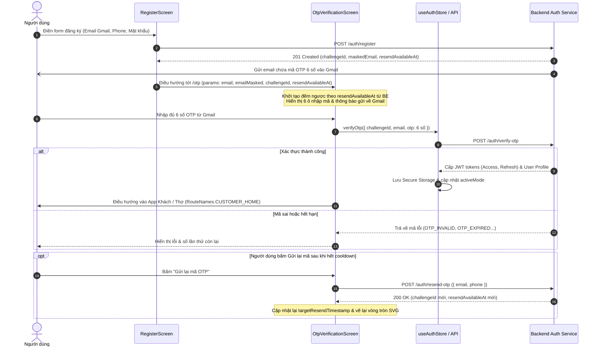

# Kế hoạch cập nhật màn hình xác thực OTP (Gửi Gmail, 6 ô nhập mã & Đồng bộ resendAvailableAt từ Server)

## 1. Mục tiêu & Yêu cầu thay đổi

* **Vấn đề thực tế:**
  * Luồng gửi OTP bằng tin nhắn SMS về số điện thoại hiện tại là mock (hệ thống chưa có cổng SMS Gateway).
  * Backend Auth Service thật ([backend/apps/auth-service/src/otp/](file:///D:/SCHOOL/PBL6/backend/apps/auth-service/src/otp/)) đã tích hợp gửi mã OTP xác thực qua **Gmail** (SMTP), với mã OTP gồm **đúng 6 chữ số**.
  * Đồng hồ đếm ngược hiện đang hardcode 30 giây, không khớp với thời gian server cấu hình và có thể bị đóng băng khi app rơi vào chế độ nền (background).
* **Định hướng giải pháp:**
  * **Giữ nguyên giao diện hiện tại:** AppBar điều hướng, biểu tượng khóa bảo mật, thiết kế các ô vuông nhập mã rời (discrete input boxes), và đồng hồ đếm ngược hình tròn SVG.
  * **Đổi thông tin hiển thị:** Hiển thị rõ mã OTP được gửi về địa chỉ **Gmail** đã đăng ký (`emailMasked` / `email`) thay vì số điện thoại.
  * **Nâng cấp từ 5 ô lên 6 ô nhập mã:** Căn chỉnh kích thước ô vừa vặn trên các kích thước màn hình điện thoại, bắt buộc nhập đủ 6 chữ số để khớp với backend DTO (`@Matches(/^\d{6}$/)`).
  * **Đồng bộ thời gian đếm ngược theo `resendAvailableAt` từ Server:** Sử dụng mốc thời gian ISO chính xác từ backend (mặc định 60 giây), tự động tính toán lại khi app quay lại từ foreground (`AppState`), và cập nhật sau mỗi lần `resendOtp`.
  * **Kết nối logic xác thực thực tế:** Gọi trực tiếp `verifyOtp` từ `useAuthStore` để kích hoạt tài khoản thật, nhận token JWT và điều hướng vào trang chính thay vì chuyển qua màn hình tạo mã PIN giả lập.

---

## 2. Kiến trúc & Luồng hoạt động



---

## 3. Chi tiết các bước thực hiện

### Bước 1: Cập nhật giao diện & Logic tại [otp-verification-screen.tsx](file:///D:/SCHOOL/PBL6/mobile/src/features/auth/screens/otp-verification-screen.tsx)
1. **Cấu hình độ dài mã OTP:**
   * Thay đổi `const OTP_LENGTH = 5;` thành `const OTP_LENGTH = 6;`.
2. **Cập nhật hiển thị gửi về Gmail:**
   * Đổi dòng hướng dẫn: `"Mã xác thực gồm 6 chữ số đã được gửi đến Gmail:"`.
   * Hiển thị địa chỉ Gmail trong badge: Ưu tiên `emailMasked || email || 'Gmail của bạn'`.
   * Cập nhật thông báo lỗi/gửi lại: `"Không thể gửi mã OTP đến email của bạn. Vui lòng bấm 'Gửi lại mã OTP' bên dưới."`.
3. **Căn chỉnh 6 ô nhập mã (`otp-box`):**
   * Đổi mảng render từ 5 ô sang 6 ô: `Array.from({ length: 6 })` với `testID={`otp-box-${index}`}` (từ `otp-box-0` đến `otp-box-5`).
   * Tinh chỉnh CSS width/padding (ví dụ: `w-11` hoặc `w-12`, `h-14`, bo góc `rounded-xl`, `justify-between`) để 6 ô hiển thị thẳng hàng, khoảng cách đều đặn trên màn hình mobile chiều rộng từ 360px trở lên.
4. **Đồng bộ thời gian đếm ngược chính xác theo `resendAvailableAt` từ Server:**
   * **Khởi tạo mốc đích:** Sử dụng `useRef` lưu `targetResendTimestamp`:
     - Nếu có `params.resendAvailableAt`: `new Date(params.resendAvailableAt).getTime()`.
     - Nếu `isDeliveryFailed === true`: `Date.now()` (cho phép gửi lại ngay).
     - Fallback nếu không có: `Date.now() + 60000` (60 giây theo chuẩn backend).
   * **Hàm tính toán thời gian thực (`calculateRemainingSeconds`):**
     - `Math.max(0, Math.ceil((targetResendTimestamp.current - Date.now()) / 1000))`.
   * **Đồng bộ nền qua `AppState`:**
     - Đăng ký `AppState.addEventListener('change', ...)`: khi app chuyển về `active`, tự động gọi `calculateRemainingSeconds()` để bù trừ đúng khoảng thời gian app bị đưa vào background, tránh lệch giây.
   * **Vòng tròn SVG động theo chu kỳ:**
     - Lưu `totalDuration` (ví dụ: 60s hoặc khoảng chênh lệch server ban đầu) để tính `strokeDashoffset = CIRCUMFERENCE * (1 - cooldown / totalDuration)`.
   * **Sau khi gửi lại mã (`handleResend`):**
     - Gọi `AuthApi.resendOtp({ email, phone })`.
     - Lấy `response.data.resendAvailableAt` cập nhật vào `targetResendTimestamp.current`.
     - Cập nhật lại `cooldown` và reset vòng tròn đếm ngược.
5. **Kết nối API xác thực & Điều hướng thực tế:**
   * `handleVerify`: Kiểm tra `cleanOtp.length === 6`, gọi `await verifyOtp({ challengeId, email, phone, otp: cleanOtp })`.
   * Sau khi verify thành công: xác định role qua `getDestinationByRoles` và điều hướng trực tiếp bằng `router.replace(targetPath)` (thay vì push sang `AUTH_CREATE_PIN`).
   * Xử lý trọn vẹn các mã lỗi: `OTP_INVALID` (báo số lần còn lại), `OTP_EXPIRED`, `OTP_ALREADY_USED`, `OTP_ATTEMPTS_EXCEEDED`, `RATE_LIMITED`.

---

### Bước 2: Cập nhật Unit Tests & Test Suites
1. **File [otp-verification-screen.test.tsx](file:///D:/SCHOOL/PBL6/mobile/src/features/auth/__tests__/otp-verification-screen.test.tsx):**
   * Test case render: Kiểm tra có đủ 6 ô `otp-box-0` đến `otp-box-5`, đồng hồ đếm ngược SVG và hiển thị Gmail.
   * Test case validation: Kiểm tra báo lỗi khi nhập chưa đủ 6 chữ số (`"Vui lòng nhập đúng 6 chữ số mã OTP"`).
   * Test case đồng bộ cooldown: Kiểm tra khởi tạo `cooldown` từ `params.resendAvailableAt`.
   * Test case submit: Nhập `123456`, mock `verifyOtp` thành công, kiểm tra gọi đúng API payload và điều hướng tới màn hình chính (`/customer`).
   * Test case error: Kiểm tra hiển thị lỗi khi backend trả về mã OTP sai.
   * Test case resend: Kiểm tra gọi `AuthApi.resendOtp` với email và cập nhật lại countdown theo `resendAvailableAt` trả về.
2. **File [auth-4-step-flow.test.tsx](file:///D:/SCHOOL/PBL6/mobile/src/features/auth/__tests__/auth-4-step-flow.test.tsx):**
   * Cập nhật bước test OTP để nhập đủ 6 chữ số (`123456`).

---

### Bước 3: Kiểm chứng kỹ thuật (Verification)
1. **Kiểm tra kiểu dữ liệu:**
   ```powershell
   npm --prefix mobile run type-check
   ```
2. **Kiểm tra unit test màn hình OTP:**
   ```powershell
   npm --prefix mobile test -- otp-verification-screen.test.tsx
   ```
3. **Kiểm tra các luồng auth liên quan:**
   ```powershell
   npm --prefix mobile test -- auth-4-step-flow.test.tsx
   ```
4. **Rà soát git diff:** Đảm bảo toàn bộ thay đổi đúng trọng tâm, không ảnh hưởng đến các màn hình khác ngoài auth.
