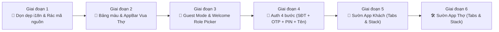
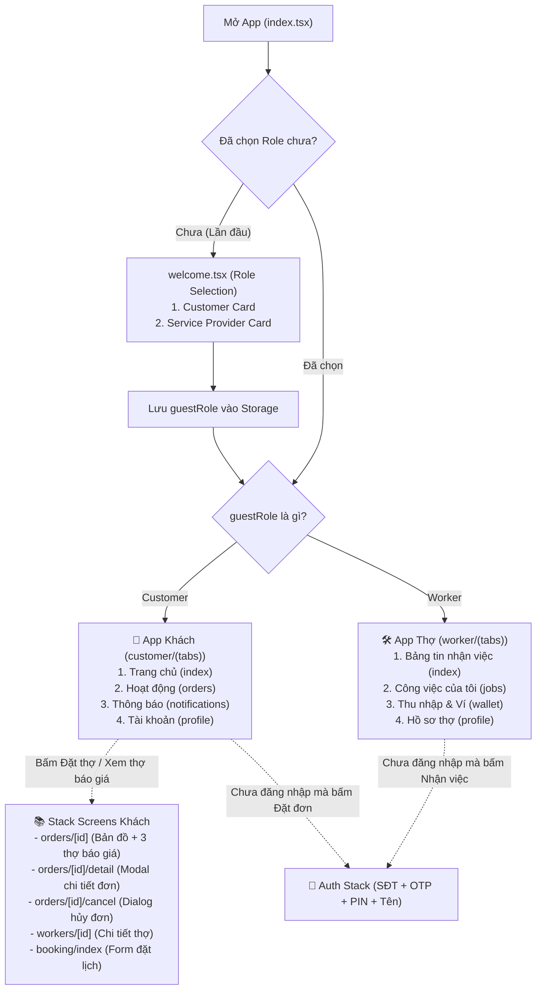

# Kế hoạch Triển khai Phân kỳ: Tái cấu trúc Navigation & Sườn App HandyGo (Mô hình Vua Thợ)

## 1. Mục tiêu Tổng quan
Dựa trên phân tích 13 hình ảnh thực tế từ ứng dụng **Vua Thợ**, kế hoạch này chia nhỏ toàn bộ khối lượng công việc tái cấu trúc ứng dụng di động `mobile` (`handy-go-mobile` - React Native Expo Router) thành **6 giai đoạn độc lập** để dễ dàng thực thi, kiểm tra (verify) và nghiệm thu từng phần một cách an toàn.

---

## 2. Lộ trình Phân kỳ 6 Giai đoạn (Phased Roadmap)



---

## 3. Kiến trúc Điều hướng (Navigation Architecture)



---

## 4. Chi tiết 6 Giai đoạn Triển khai

### GIAI ĐOẠN 1: Dọn dẹp i18n & Tinh gọn Mã nguồn (Cleanup)
> **Mục tiêu:** Xóa bỏ hoàn toàn hệ thống đa ngôn ngữ thừa, làm nhẹ dự án, chuyển 100% sang tiếng Việt trực tiếp.

* [x] **1.1. Xóa các tệp JSON và tiện ích i18n:**
  - `mobile/src/translations/en.json`
  - `mobile/src/translations/vi.json`
  - `mobile/src/lib/i18n/` (toàn bộ thư mục: `index.tsx`, `resources.ts`, `types.ts`, `utils.tsx`, `react-i18next.d.ts`)
  - `mobile/src/core/i18n.ts`
  - `mobile/scripts/i18next-syntax-validation.js`
* [x] **1.2. Cập nhật các điểm export:**
  - Sửa `mobile/src/core/index.ts` (bỏ export `i18n`).
  - Sửa `mobile/package.json` (bỏ script `lint:translations`).
* [x] **Nghiệm thu Giai đoạn 1:**
  - Chạy `pnpm run type-check` không còn lỗi thiếu tệp, source code giảm tải sạch sẽ.


---

### GIAI ĐOẠN 2: Bảng màu Vua Thợ & Component AppBar Dùng chung
> **Mục tiêu:** Chuẩn hóa bảng màu Primary (Vàng Hổ Phách `#F5A524`) và Secondary (Xanh Kỹ Thuật `#2563EB`), tạo thanh Header/AppBar chuẩn Safe Area.

* [x] **2.1. Cập nhật Palette CSS:**
  - Sửa `mobile/src/global.css`: Thêm biến màu `--color-primary` (Vàng nghệ Vua Thợ) và `--color-secondary` (Xanh kỹ thuật).
* [x] **2.2. Tạo file hằng số màu sắc:**
  - Tạo `mobile/src/constants/colors.ts`: Export mã hex chuẩn để các file TS/TSX sử dụng.
* [x] **2.3. Tạo Component AppBar chuẩn (`mobile/src/components/ui/app-bar.tsx`):**
  - Tích hợp `useSafeAreaInsets` chống đè tai thỏ/dynamic island.
  - Hỗ trợ chế độ Trang chủ (Tiêu đề + chip `Customer App ⇄` hoặc Avatar + Tên).
  - Hỗ trợ chế độ Stack (Nút Back tròn `<` + Tiêu đề + Icon CSKH/Hợp đồng).
* [x] **Nghiệm thu Giai đoạn 2:**
  - AppBar hiển thị đúng khoảng cách an toàn, đúng màu sắc nhận diện Vua Thợ.


---

### GIAI ĐOẠN 3: Luồng Khởi động, Guest Mode & Màn hình Welcome
> **Mục tiêu:** Mở app cho chọn Khách / Thợ bằng 2 Card lớn (Ảnh 1), vào thẳng trang chủ xem dịch vụ mà KHÔNG bắt đăng nhập.

* [x] **3.1. Cập nhật Auth Store & Storage Keys:**
  - Sửa `mobile/src/constants/storage-keys.ts`: Thêm `GUEST_SELECTED_ROLE_KEY`.
  - Sửa `mobile/src/stores/use-auth-store.ts`: Thêm state `guestRole`, hàm `setGuestRole`, hàm `switchRole`.
* [x] **3.2. Cập nhật RoleGuard không chặn Khách vãng lai:**
  - Sửa `mobile/src/lib/auth/role-guard.tsx`: Thêm thuộc tính `allowGuest?: boolean`.
* [x] **3.3. Xây dựng Màn hình Welcome (`mobile/src/app/welcome.tsx` - Chuẩn Ảnh 1):**
  - Tiêu đề: *"Are you a Customer or a Service Provider?"*.
  - Thẻ 1: **CUSTOMER** (*Find trusted service providers*).
  - Thẻ 2: **SERVICE PROVIDER** (*Grow your business*).
  - Nút bấm: *"Next $\rightarrow$"* lưu role và chuyển thẳng vào Home.
* [x] **3.4. Sửa luồng điều hướng khởi động (`mobile/src/app/index.tsx`):**
  - Kiểm tra nếu chưa có role $\rightarrow$ `welcome.tsx`. Đã có role $\rightarrow$ Vào thẳng `/customer` hoặc `/worker`.
* [x] **Nghiệm thu Giai đoạn 3:**
  - Mở app lần đầu hiện màn chọn role $\rightarrow$ Bấm chọn Khách $\rightarrow$ Vào thẳng trang chủ xem bình thường mà không bị chuyển hướng ép đăng nhập.


---

### GIAI ĐOẠN 4: Luồng Xác thực SĐT + OTP + Mã PIN 6 số (Auth Flow)
> **Mục tiêu:** Xây dựng quy trình đăng nhập/đăng ký gộp làm 1 cực nhanh gọn chuẩn theo Ảnh 4, 5, 7, 8.

* [x] **4.1. Bước 1 - Nhập SĐT (`mobile/src/app/(auth)/login.tsx` - Ảnh 4):**
  - Chọn mã vùng `+84` + ô nhập SĐT + nút Clear `✕` + Nút *"Next $\rightarrow$"*.
* [x] **4.2. Bước 2 - Nhập OTP (`mobile/src/app/(auth)/otp.tsx` - Ảnh 5):**
  - 5 ô nhập mã OTP + vòng tròn đếm ngược 30s + nút gửi lại mã.
* [x] **4.3. Bước 3 - Tạo mã PIN 6 số (`mobile/src/app/(auth)/create-pin.tsx` - Ảnh 7):**
  - Modal tạo mật khẩu bảo mật 6 số kèm bàn phím số.
* [x] **4.4. Bước 4 - Nhập Họ tên (`mobile/src/app/(auth)/complete-profile.tsx` - Ảnh 8):**
  - Nhập Full Name + Mã giới thiệu (tùy chọn) $\rightarrow$ Nút *"Complete $\rightarrow$"*.
* [x] **Nghiệm thu Giai đoạn 4:**
  - Luồng xác thực 4 bước liên hoàn mượt mà, tự động gán role ngầm theo luồng đang duyệt.

---

### GIAI ĐOẠN 5: Dựng Sườn App Khách (Customer Tabs & Stack Screens)
> **Mục tiêu:** Hoàn thiện toàn bộ các trang Khách đối chiếu từ Ảnh 3, 6, 9, 10, 11, 12, 13.

* [x] **5.1. Tab Navigation (`mobile/src/app/customer/(tabs)/` - 4 Tabs chuẩn Ảnh 9 & 12):**
  - Sửa `_layout.tsx`: 4 tabs đáy (Trang chủ, Hoạt động, Thông báo, Tài khoản).
  - Sửa `index.tsx`: Trang chủ (hiển thị chế độ Guest theo Ảnh 3 hoặc Authenticated theo Ảnh 9).
  - Sửa `orders.tsx`: Tab Hoạt động có bộ lọc *Đang tìm, Đang tiến hành, Đã hủy* (Ảnh 12).
  - Tạo `notifications.tsx`: Tab Thông báo có badge đếm tin.
  - Sửa `profile.tsx`: Tab Tài khoản cá nhân có nút đổi vai trò.
* [x] **5.2. Stack Navigation (`mobile/src/app/customer/`):**
  - Sửa `orders/[id].tsx`: Màn hình Bản đồ trên + Sheet 3 thợ báo giá dưới (Ảnh 6 & 10).
  - Tạo `orders/[id]/detail.tsx`: Modal Chi tiết đơn dịch vụ có địa chỉ Đà Nẵng (Ảnh 13).
  - Tạo `orders/[id]/cancel-dialog.tsx`: Dialog xác nhận hủy đơn (Ảnh 11).
  - Tạo `services/[id].tsx`: Chi tiết dịch vụ.
  - Tạo `booking/index.tsx`: Form đặt lịch thợ.
  - Tạo `workers/[id].tsx`: Chi tiết hồ sơ thợ & sao đánh giá.
* [x] **Nghiệm thu Giai đoạn 5:**
  - App Khách đầy đủ các tab, bấm vào đơn xem được danh sách thợ báo giá và dialog hủy đơn chuẩn như ảnh.

---

### GIAI ĐOẠN 6: Dựng Sườn App Thợ (Worker Tabs & Stack Screens)
> **Mục tiêu:** Hoàn thiện giao diện làm việc của Thợ (Nhận việc, Ví tiền, Hồ sơ tay nghề).

* [x] **6.1. Tab Navigation (`mobile/src/app/worker/(tabs)/` - 4 Tabs):**
  - Sửa `_layout.tsx`: 4 tabs đáy (Bảng tin nhận việc, Công việc của tôi, Thu nhập & Ví, Hồ sơ thợ).
  - Sửa `index.tsx`: Bảng tin thợ có nút gạt Bật/Tắt nhận việc.
  - Sửa `jobs.tsx`: Danh sách đơn việc đang xử lý.
  - Tạo `wallet.tsx`: Quản lý ví tiền, doanh thu thợ.
  - Sửa `profile.tsx`: Hồ sơ tay nghề thợ.
* [x] **6.2. Stack Navigation (`mobile/src/app/worker/`):**
  - Tạo `jobs/[id].tsx`: Chi tiết đơn việc khách gửi (khoảng cách km, ảnh sự cố, nút chào giá).
  - Tạo `jobs/[id]/complete.tsx`: Nghiệm thu công việc và chốt giá.
  - Tạo `wallet/deposit.tsx` & `withdraw.tsx`: Nạp/Rút ví thợ.
  - Tạo `application/status.tsx`: Xem tiến độ duyệt hồ sơ thợ.
* [x] **Nghiệm thu Giai đoạn 6:**
  - Bấm nút `Customer App ⇄` trên App Bar chuyển đổi qua lại giữa App Khách và App Thợ trơn tru.

---

## 5. Quy trình Kiểm thử & Xác thực (Verification)
Sau khi hoàn tất mỗi giai đoạn, chạy các lệnh kiểm tra tự động tại thư mục `mobile`:
```powershell
cd d:\SCHOOL\PBL6\mobile
pnpm run type-check
pnpm run lint
```
Đảm bảo 0 lỗi Typescript và 0 warning linter trước khi chuyển sang giai đoạn tiếp theo.
