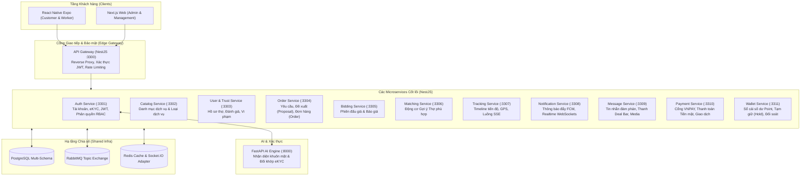
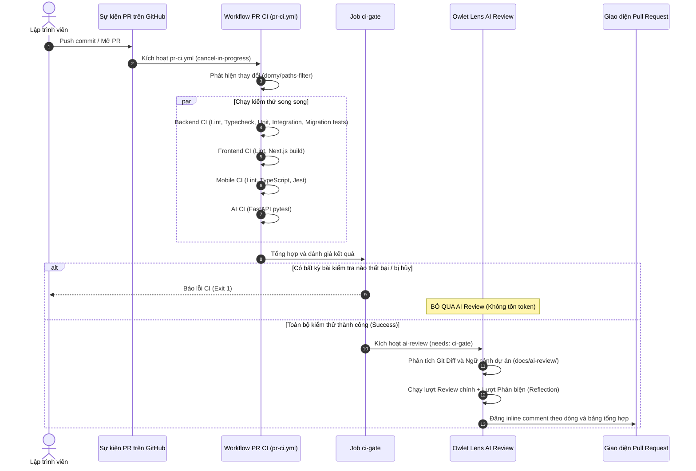

# Kiến trúc Tổng thể Hệ thống HANDY_GO

## 1. Tổng quan Hệ thống

**HANDY_GO** là nền tảng sàn giao dịch dịch vụ sửa chữa, bảo trì gia đình theo yêu cầu, kết nối trực tiếp Khách hàng (Customer) với Thợ kỹ thuật (Worker).
Dự án được tổ chức theo cấu trúc monorepo bao gồm:
- **Backend**: Hệ thống microservices xây dựng bằng NestJS, sử dụng cơ sở dữ liệu PostgreSQL (qua Prisma ORM), RabbitMQ và Redis.
- **Frontend**: Ứng dụng web xây dựng bằng Next.js 14 dành cho trang quản trị (Admin Dashboard) và cổng thông tin người dùng.
- **Mobile**: Ứng dụng di động xây dựng bằng React Native Expo phục vụ cả Khách hàng và Thợ.
- **AI Service**: Dịch vụ xác thực danh tính khuôn mặt eKYC và gợi ý thợ thông minh xây dựng bằng FastAPI và PyTorch.

---

## 2. Mô hình Giao tiếp giữa các Microservices

### 2.1 Giao tiếp Đồng bộ (HTTP / REST)
- **Từ Client ngoài vào Hệ thống**: Mọi luồng truy cập từ ứng dụng di động và web đều bắt buộc đi qua **API Gateway** (`backend/apps/api-gateway`). Gateway thực hiện xác thực chữ ký JWT, kiểm soát tần suất gửi yêu cầu (Rate Limit), gắn kèm các header danh tính tin cậy (`x-user-id`, `x-user-roles`, `x-gateway-secret`) và chuyển tiếp tới service đích.
- **Giữa các Microservice nội bộ**: Các lệnh kiểm tra tính hợp lệ tức thời (eligibility check) được gọi qua REST nội bộ có guard bảo vệ (`InternalServiceGuard`) và mã bí mật chung (`x-gateway-secret`). **Nghiêm cấm truy vấn SQL trực tiếp xuyên cơ sở dữ liệu của service khác.**

### 2.2 Giao tiếp Bất đồng bộ Hướng Sự kiện (RabbitMQ)
- **Kiến trúc Broker**: Sử dụng RabbitMQ với Topic Exchange trung tâm (`handygo.domain.events`).
- **Mô hình Hàng đợi**: Mỗi microservice nhận sự kiện sở hữu một hàng đợi độc lập (ví dụ `tracking.order-events`, `payment.order-events`). Nghiêm cấm các service khác nhau cùng dùng chung một queue.
- **Độ tin cậy và Tính nhất quán**:
  - **Mô hình Transactional Outbox**: Sự kiện nghiệp vụ được ghi vào bảng `outbox` ngay trong cùng transaction PostgreSQL với dữ liệu chính trước khi commit.
  - **Dịch vụ Đẩy Outbox**: Service `OutboxPublisherService` định kỳ quét và phát tán sự kiện lên RabbitMQ kèm cơ chế backoff có jitter khi gặp sự cố mạng.
  - **Bộ tiêu thụ Bất biến (Idempotent Consumer)**: Service nhận sự kiện kiểm tra trường `eventId` trong bảng `inbox` để khử trùng lặp (deduplication) trước khi xử lý nghiệp vụ.

---

## 3. Kiến trúc Lưu trữ Dữ liệu

- **Hệ quản trị CSDL**: PostgreSQL 16+.
- **Cô lập theo Schema**: Mỗi microservice sở hữu một schema riêng biệt (ví dụ: `auth_service`, `order_service`, `payment_service`, `wallet_service`, `message_service`).
- **Truy xuất dữ liệu**: Sử dụng Prisma ORM với file `schema.prisma` riêng biệt tại từng service.
- **Quy tắc Toàn vẹn Dữ liệu**:
  - Không tạo foreign key vật lý xuyên qua các schema khác nhau.
  - Liên kết dữ liệu giữa các service thông qua mã UUID bất biến (`orderId`, `serviceRequestId`, `workerId`, `customerId`).
  - Toàn bộ giá trị tiền tệ và điểm thưởng được lưu dưới dạng số nguyên chính xác (`BigInt` hoặc `Int`, quy đổi 1 Point = 1 VND). Tuyệt đối không dùng kiểu số thực (`Float`, `Double`) trong các phép tính tài chính.

---

## 4. Kiến trúc Pipeline CI/CD và AI Code Review

Quy trình kiểm soát chất lượng mã nguồn trên Pull Request được tự động hóa hoàn toàn:

### Cam kết Kiến trúc Cốt lõi:
1. **Chốt chặn Bắt buộc**: Job `ai-review` có điều kiện `needs: ci-gate` và `if: ${{ needs.ci-gate.result == 'success' }}`. Chỉ khi toàn bộ build, lint, typecheck và unit test vượt qua thì AI mới được phép kích hoạt.
2. **An toàn Xung đột Đồng thời**: Nhóm concurrency `pr-ci-${{ github.event.pull_request.number }}` với `cancel-in-progress: true` tự động hủy các phiên đang chạy nếu có commit mới được đẩy lên, đảm bảo không bao giờ nhận xét trên commit cũ.
3. **Đóng vai trò Cố vấn (Advisory)**: AI Review đưa ra các đề xuất, cảnh báo rủi ro dưới dạng nhận xét để lập trình viên và Tech Lead thảo luận. AI không tự ý can thiệp mã nguồn, không tự duyệt và không tự động merge PR.
