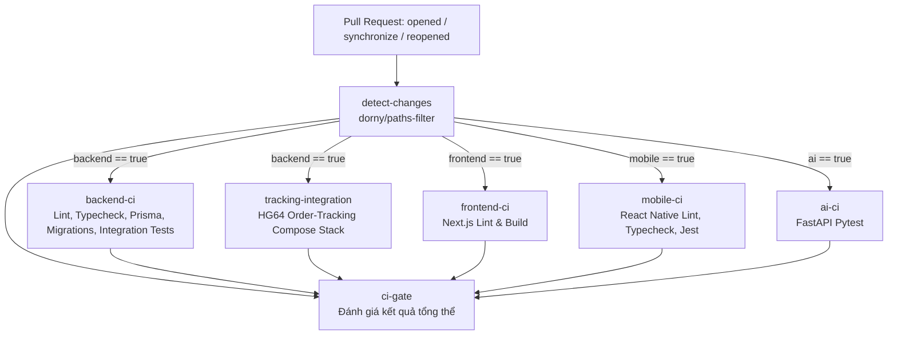

# BÁO CÁO ĐÁNH GIÁ TÍCH HỢP: OWLET LENS AI CODE REVIEW VÀO PR CI CỦA HANDY_GO

## 1. Tóm tắt Tổng quan

Tài liệu này đánh giá toàn diện hạ tầng CI/CD trên GitHub Actions của kho mã nguồn **HANDY_GO** nhằm thiết kế giải pháp tích hợp công cụ đánh giá mã nguồn tự động bằng AI - **Owlet Lens** (`openwt-vn/owlet-lens`).

Ràng buộc kiến trúc bắt buộc:
> **PR CI là điều kiện tiên quyết bắt buộc.** Owlet Lens chỉ được tự động đánh giá Pull Request khi và chỉ khi toàn bộ các bước kiểm tra chất lượng của PR CI vượt qua thành công đối với đúng commit đang xét. Nếu CI thất bại, bị hủy bỏ hoặc bị bỏ qua, AI Review tuyệt đối không được phép chạy nhằm tránh lãng phí tài nguyên và chi phí AI.

---

## 2. Phân tích Quy trình PR CI Hiện tại

Quy trình CI hiện tại được định nghĩa trong file `.github/workflows/pr-ci.yml`:
- **Tên Workflow**: `PR CI`
- **Sự kiện kích hoạt (Triggers)**:
  ```yaml
  on:
    pull_request:
      branches:
        - main
      types:
        - opened
        - synchronize
        - reopened
  ```
- **Kiểm soát đồng thời (Concurrency Control)**:
  ```yaml
  concurrency:
    group: pr-ci-${{ github.event.pull_request.number }}
    cancel-in-progress: true
  ```
- **Quyền hạn mặc định**:
  ```yaml
  permissions:
    contents: read
    pull-requests: read
  ```

### Sơ đồ Cấu trúc và Phụ thuộc giữa các Job



### Đánh giá Chi tiết Job `ci-gate`
Job `ci-gate` sử dụng điều kiện `if: ${{ !cancelled() }}` và phụ thuộc vào tất cả các job CI thành phần:
1. Kiểm tra xác nhận bước phát hiện thay đổi (`detect-changes`) đã chạy thành công.
2. Với mỗi hệ thống con có thay đổi (`backend`, `frontend`, `mobile`, `ai`), xác minh nghiêm ngặt job tương ứng phải đạt trạng thái `success`.
3. Nếu bất kỳ thành phần nào gặp lỗi, `ci-gate` ghi nhận lỗi và thoát với mã lỗi 1 (`CI Gate failed`).
4. Nếu toàn bộ đều vượt qua, `ci-gate` thoát với mã 0 (`CI Gate passed`).

**Kết luận**: Job `ci-gate` đóng vai trò là "chốt chặn duy nhất" (Single Source of Truth) đại diện cho trạng thái thành công của toàn bộ CI trong dự án.

---

## 3. Các Job Bắt buộc phải Vượt qua Trước khi AI Review Chạy

Để Owlet Lens được kích hoạt, toàn bộ các điều kiện sau phải được thỏa mãn đồng thời:
1. Job `ci-gate` phải kết thúc với trạng thái `success`.
2. Mọi hệ thống con có file thay đổi đều phải pass bài test của nó:
   - Nếu `backend` đổi: `backend-ci` và `tracking-integration` phải `success`.
   - Nếu `frontend` đổi: `frontend-ci` phải `success`.
   - If `mobile` đổi: `mobile-ci` phải `success`.
   - If `ai` đổi: `ai-ci` phải `success`.
3. Lần chạy workflow không bị hủy giữa chừng (được đảm bảo bởi `cancel-in-progress: true`).

---

## 4. So sánh Phương án Kiến trúc: Phương án A vs. Phương án B

### Phương án A — Mở rộng Workflow PR CI Hiện tại (Khuyến nghị lựa chọn)

Thêm trực tiếp job `ai-review` vào cuối file `.github/workflows/pr-ci.yml`:
```yaml
  ai-review:
    name: Owlet Lens AI Code Review
    needs: ci-gate
    if: >-
      needs.ci-gate.result == 'success' &&
      vars.AI_REVIEW_ENABLED != 'false' &&
      !contains(github.event.pull_request.body, '[skip-ai-review]')
    permissions:
      contents: read
      pull-requests: write
    steps:
      - name: Checkout repository
        uses: actions/checkout@v5
        with:
          fetch-depth: 0 # Owlet Lens cần toàn bộ lịch sử git để tính diff
      - name: Run Owlet Lens Review
        uses: openwt-vn/owlet-lens@v1
        with:
          ...
```

#### Ưu điểm vượt trội:
1. **Phụ thuộc tường minh, tất định**: Cấu hình `needs: ci-gate` và điều kiện `success` do engine của GitHub Actions quản lý trực tiếp, đảm bảo không bao giờ chạy sai thứ tự.
2. **Kiểm soát đồng thời tự nhiên**: Kế thừa `concurrency` của PR CI (`cancel-in-progress: true`). Khi lập trình viên push commit mới, lần chạy cũ lập tức bị hủy bỏ, tránh việc review nhầm hoặc đăng nhận xét lên commit cũ.
3. **Gắn chặt với commit SHA chính xác**: Biến `github.sha` đại diện cho chính xác commit đã vượt qua các bài kiểm thử CI.
4. **An toàn bảo mật trên Fork PR**: Trong sự kiện `pull_request`, các PR tạo từ fork không thể truy cập vào Secret của kho lưu trữ, ngăn chặn triệt để nguy cơ đánh cắp API Key.
5. **Giao diện tập trung**: Toàn bộ kết quả build, test, gate và nhận xét AI nằm gọn trong một giao diện run duy nhất của GitHub Actions.

---

### Phương án B — Tách Workflow riêng chạy bằng `workflow_run`

Tạo workflow riêng kích hoạt khi `PR CI` hoàn thành:
```yaml
on:
  workflow_run:
    workflows: ["PR CI"]
    types: [completed]
```

#### Nhược điểm và Rủi ro Bảo mật Nghiêm trọng:
1. **Nguy cơ Leo thang Đặc quyền (PwnRequest)**: `workflow_run` luôn chạy trong ngữ cảnh của branch mặc định (`main`) với đầy đủ quyền ghi và quyền đọc Secret. Nếu checkout code chưa kiểm duyệt từ fork PR một cách bất cẩn, hệ thống có thể bị lộ toàn bộ Secret quan trọng.
2. **Xung đột Race Condition**: `workflow_run` kích hoạt bất đồng bộ. Nếu commit A vừa chạy xong CI kích hoạt `workflow_run`, nhưng commit B đã được push ngay sau đó, `workflow_run` phải tự viết thêm mã phức tạp để kiểm tra SHA hiện tại trên GitHub API nhằm tránh review đè commit cũ.
3. **Độ trễ cao và phân mảnh log**: Quá trình xếp hàng thêm một workflow run làm tăng thời gian chờ phản hồi cho lập trình viên.

### Quyết định lựa chọn:
**Áp dụng Phương án A.** Đây là phương án an toàn nhất, đơn giản, dễ bảo trì và đáp ứng trọn vẹn mọi yêu cầu đặt ra.

---

## 5. Đặc tả Kỹ thuật của Owlet Lens (Đã Xác minh với Bản chính thức)

Được đối chiếu trực tiếp từ mã nguồn chính thức của `openwt-vn/owlet-lens@v1`:

### 5.1 Các tham số đầu vào (Inputs)
- `anthropic-api-key`: API key cho provider Anthropic Claude.
- `gemini-api-key`: API key cho provider Google Gemini.
- `deepseek-api-key`: API key cho provider DeepSeek.
- `modelstack-api-key`: API key cho ModelStack proxy.
- `openrouter-api-key`: API key cho OpenRouter.
- `github-token`: Token GitHub dùng để đọc diff và đăng comment (mặc định `${{ github.token }}`).
- `resolve-token`: Token PAT có quyền `repo` để tự động đổi trạng thái Resolved trên GitHub UI (tùy chọn).
- `allowed-hosts`: Danh sách hostname được phép gửi dữ liệu đến (rất quan trọng khi cấu hình gateway VPS tự host sau này để tránh PR độc hại chuyển hướng token).
- `subcommand`: `review` (mặc định), `reply`, hoặc `learn`.
- `config-path`: Đường dẫn tới file cấu hình (mặc định `ai-review.config.yaml`).
- `strict`: Đặt `false` để hoạt động ở chế độ khuyến nghị (advisory), không chặn merge trực tiếp.

### 5.2 File Cấu hình (`ai-review.config.yaml`)
- `review.provider`: Định danh nhà cung cấp LLM (`anthropic`, `openai`, `gemini`, ...).
- `review.model`: Tên mô hình chính.
- `review.apiBaseUrl`: Đường dẫn API tùy chỉnh (dành cho VPS gateway).
- `review.contextPaths`: Danh sách tài liệu kiến trúc, luật nghiệp vụ và bảo mật được nạp vào system prompt của AI.
- `review.codingStandardsPath`: Tài liệu hướng dẫn tiêu chuẩn code.
- `review.severityThreshold`: Ngưỡng mức độ nghiêm trọng tối thiểu để báo cáo (mặc định `medium`).
- `review.skipGeneratedFiles`: Tự động bỏ qua file migrations, build, lockfile, mocks (mặc định `true`).
- `review.skipUnchanged`: Bỏ qua nếu fingerprint của diff không đổi (mặc định `true`).
- `review.reflection`: Chạy lượt phản biện thứ 2 (second-pass reflection) để loại bỏ các cảnh báo sai (false positives).

---

## 6. Quyền hạn và Bảo mật Bí mật (Secrets)

### Quyền hạn Workflow (Permissions)
Job `ai-review` chỉ cần tối thiểu quyền:
```yaml
permissions:
  contents: read          # Để checkout mã nguồn và đọc lịch sử git
  pull-requests: write    # Để đăng inline comment và bảng tổng hợp vào PR
```

### Quản lý Secret
- Không lưu cứng bất kỳ API key nào trong kho mã nguồn.
- Chỉ nạp key qua cơ chế `secrets.<SECRET_NAME>` của GitHub Actions.
- Owlet Lens tích hợp sẵn bộ lọc Regex tự động thay thế chuỗi có dạng secret, token, password thành `[REDACTED]` trước khi gửi lên mô hình ngôn ngữ.

---

## 7. Đánh giá Rủi ro và Biện pháp Giảm thiểu

| Rủi ro | Mức độ ảnh hưởng | Biện pháp Giảm thiểu |
|---|---|---|
| **Lộ Secret qua Fork PR** | Rất cao | Chạy trong sự kiện `pull_request` chuẩn; GitHub tự động cô lập Secret không cấp cho fork PR. |
| **Bị chuyển hướng dữ liệu sang Server lạ** | Cao | Owlet Lens kiểm tra `allowed-hosts`. Host bên ngoài chỉ được phép khai báo tại file workflow cố định, không chấp nhận host lạ khai báo từ file PR. |
| **Cạn kiệt Hạn mức Token (DDoS chi phí)** | Trung bình | Đặt `tokenBudget: 512000`, kích hoạt `cancel-in-progress: true` và chỉ chạy sau khi `ci-gate` pass. |
| **AI tự ý sửa code hoặc merge PR** | Rất cao | Thiết lập quyền hạn chặt chẽ; AI Review đóng vai trò cố vấn (advisory), không cấp quyền push code hay auto-merge. |

---

## 8. Kết luận

Bản audit xác nhận việc tích hợp theo **Phương án A** (thêm job `ai-review` phụ thuộc vào `ci-gate` trong `.github/workflows/pr-ci.yml`) là giải pháp tối ưu nhất về cả hiệu năng, tính ổn định và an toàn thông tin cho HANDY_GO.
