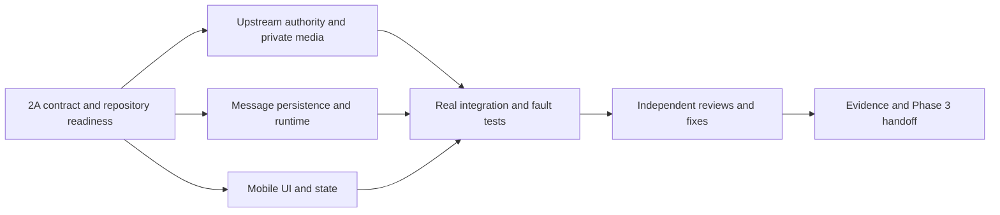

# Message Service Phase 2 implementation plan

> Execute with Superpowers delegated implementation and test-first checks. User authorized automatic continuation, parallel work and reviews. No commit, push, merge or deployment.

**Goal:** implement bid-authorized private messaging across the existing Backend and Mobile.

**Architecture:** retain Phase 1 portable contracts, PostgreSQL `message` schema and isolated migration history. Message runtime stays under `backend/foundations/message-service` so the production inventory is unchanged. Existing Auth, Bidding, Order, Gateway/Cloudinary and Notification supply authority and integrations.

**Tech stack:** NestJS, Prisma/PostgreSQL, Socket.IO, RabbitMQ, Expo Router, TanStack Query and existing token storage.

**Spec:** all Phase 1 files in this directory and the user's full Phase 2 directive.

## Global constraints

- Socket transport `/api/v1/chat/socket.io/`, namespace `/`; REST `/api/v1/conversations`.
- No arbitrary participants, public media fallback, binary socket uploads, reactions, calls, MongoDB or Redis dependency.
- Authoritative committed bid required; selected order preserves pair/history; lifecycle revocation closes writes and preserves participant reads.
- Marketplace `userId` differs from JWT account `sub`; require active session and identity.
- Persist message, attachments and notification outbox before ACK; retries reuse sender/clientMessageId.
- Preserve three pre-existing document deletions reported by initial git status.
- Production orchestration, routing, secrets and registration remain untouched.

## Readiness gate

Phase 1 schema/migration, portable types, validators and policy are present. Prior verification records 47 contract assertions and 27 SQL checks; these are baseline evidence, not Phase 2 results. REST and socket types agree on strings for bigint cursors, bidId-only creation, strict payloads, reply preview and private attachment references. Existing upstream APIs need additive implementations specified by the handoff. Order already has persisted aggregate versions; no version migration is necessary. Private upload ownership and session introspection are implementation dependencies, not reasons to weaken policy.

## Dependencies and ownership

### Task 1: Upstream authority and integrations

Owner: `authority_readiness`. Dependencies: readiness and shared Phase 1 contracts.

Files: Bidding bids controller/service/tests; Order internal controller/service/tests; Auth internal session checks/tests; Gateway upload controller and shared Cloudinary private media/tests; Notification event validation/handler/topology/push/tests. No Message runtime, Mobile or production routing changes.

- [ ] Add failing tests for committed/withdrawn/selected bids, request/order snapshots, service-secret rejection and revoked sessions.
- [ ] Implement the Phase 1 internal authority response types using owner databases, with independent active-session/User Trust checks.
- [ ] Add owner-bound chat upload intent and provider-confirmed authenticated delivery through the existing upload APIs; reject unverified/public references.
- [ ] Extend Notification with validated `message.created` v1, stable deduplication and generic private deep links.
- [ ] Run focused tests, source typecheck and relevant owning-service suites; record exact outcomes.

Acceptance: no client flags or delayed events can authorize chat, internal endpoints reject unauthenticated calls, private media is independently verified, notifications cannot expose message text or produce duplicate records.

### Task 2: Message runtime and persistence

Owner: `backend_runtime`. Dependencies: stable Phase 1 types; Task 1 endpoints for actual integration.

Files: `backend/foundations/message-service/src/`, tests, Prisma additive migrations if necessary; `backend/scripts/test-message-runtime*`; Backend package scripts and socket dependency lock changes.

- [ ] Add failing behavior tests for membership, exact replay/conflicting retry, reply isolation, monotonic reads, pagination and typing expiration.
- [ ] Implement Nest foundation, explicit DB config, health, REST envelopes, authenticated sockets and bounded validation/rates.
- [ ] Implement transactional persistence/sequence/reply/outbox and private attachment metadata resolution.
- [ ] Implement per-event current authority/session checks, multi-device typing, user-room union delivery and expiry cleanup.
- [ ] Implement confirmed outbox publication and lifecycle invalidation/inbox reconciliation without granting permissions from event order.
- [ ] Exercise disposable PostgreSQL and real HTTP/Socket.IO tests, including disconnect/lost ACK and broker failure where available.

Acceptance: all five REST routes and required socket events work locally; no cross-worker access; no duplicate message/outbox; write denial during lifecycle or authority failure; history survives and read cursors never regress.

### Task 3: Mobile

Owner: `mobile`. Dependencies: Phase 1 contracts; Tasks 1/2 for runtime journeys.

Files: Mobile chat services/cache/hooks/components/routes/tests; existing customer bid and worker submitted-bid screens; existing upload/notification integration; Mobile package/lock/config examples only.

- [ ] Test cache merging, string sequence ordering, contiguous recovery and same-key retries before implementing behavior.
- [ ] Implement singleton socket with existing token refresh/logout/app lifecycle and scoped listener cleanup.
- [ ] Implement request-scoped conversations/history, text/reply/media composer, pending/sent/failed retry, typing and reads.
- [ ] Add customer/worker `Nhắn tin` entries after persisted bids using server eligibility, plus Vietnamese lifecycle/error states.
- [ ] Reuse upload flows with chat intent and private URLs, never public fallback; integrate notification routing.
- [ ] Run targeted and full available Jest, TypeScript and lint checks; report device availability accurately.

Acceptance: real REST/socket wire types match Backend; pre-bid action unavailable; stable idempotency key on retries; reconnection fills persisted gaps; view-based read state; private media upload/preview/failure states.

### Task 4: Integration and independent review

Owner: coordinator, then independent reviewer after implementation slots free. Dependencies: Tasks 1–3.

Files: integration verification harnesses as required, this directory's evidence, minimal fixes routed to owners.

- [ ] Run Prisma validate/generate and isolated SQL migration/invariant checks.
- [ ] Run Backend and Mobile checks and real local runtime journeys supported by available infrastructure.
- [ ] Independently review requirements, security, quality and wire consistency; fix critical/high findings and rerun affected tests.
- [ ] Record PASS/FAIL/NOT_RUN/BLOCKED distinctly, including real versus simulated dependencies.

Review focus: session revoked while connected; lifecycle mutation after upstream reads; two devices with overlapping typing/read state; out-of-order lifecycle event and order link; ACK/broadcast/history overlap and media URL expiry.

### Task 5: Reports and Phase 3 handoff

Owner: coordinator. Dependencies: Task 4 evidence.

Files: `PHASE-2-IMPLEMENTATION-REPORT.md`, `PHASE-2-VERIFICATION.md`, `PHASE-3-HANDOFF.md`, targeted existing docs and development examples.

- [ ] Document actual modules/contracts/deviations and unresolved limitations.
- [ ] Record exact check commands/results and manual runtime limitations.
- [ ] Inspect existing multi-VPS transactional deployment/recovery and document four-VPS preflight, migrations, rollback, pending-transaction recovery, networking, proxy and monitoring prerequisites without changing production workflows.
- [ ] Verify final diff, preserve unrelated changes and report COMPLETE only if every required gate actually passes.

## Execution rulings

- User's explicit parallel ownership and no-commit constraints override the skill's serial/commit templates.
- User authorized implementation without repeated approval; proceed after this refinement of approved Phase 1 decisions.
- Runtime remains staged outside production inventory; Phase 3 owns registration and orchestration.

## Ledger

- 2A: repository and contract investigation completed; additive integration prerequisites assigned.
- 2B: three disjoint work packages dispatched; shared contract edits reserved to coordinator.
