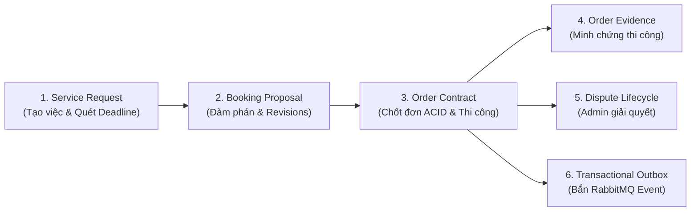

# Báo Cáo Nghiệm Thu Hoàn Thành: Phân Hệ Order Service (HG-32)

> **Dự án:** HANDY GO (PBL6) — Sprint 4  
> **Jira Ticket:** `[HG-32] Order SERVICE` (Epic: `Order`)  
> **Người thực hiện (Assignee):** Huỳnh Đức Thịnh  
> **Người báo cáo (Reporter):** Quốc Duy  
> **Tài liệu nguồn:** [`HG-32-Order_Service.pdf`](file:///d:/SCHOOL/PBL6/docs/order-service/HG-32-Order_Service.pdf)  
> **Kế hoạch kỹ thuật:** [`PLAN_ORDER_SERVICE.md`](file:///d:/SCHOOL/PBL6/docs/order-service/PLAN_ORDER_SERVICE.md)  
> **Thời điểm nghiệm thu:** 23/10/2026  
> **Tình trạng:** **ĐÃ HOÀN THÀNH 100% (READY FOR REVIEW / DONE)**

---

## 1. Tóm Tắt Kết Quả Triển Khai (Executive Summary)

Phân hệ **Order Service** đã được xây dựng hoàn chỉnh theo kiến trúc Microservices & Feature-Based Vertical Slice Architecture, đảm nhận toàn bộ vòng đời từ yêu cầu dịch vụ (Service Request), đàm phán báo giá bất biến (Booking Proposal) đến thực thi hợp đồng thi công (Order), nghiệm thu minh chứng và xử lý tranh chấp.

### Các chỉ số nghiệm thu chính:
- **Tiến độ Jira:** Hoàn thành **10/10 nhiệm vụ** từ `ORD-01` đến `ORD-10`.
- **Chất lượng mã nguồn:**
  - **Unit Tests:** **19/19** test suites, **159/159** tests passed.
  - **Live E2E Integration:** **17/17** kịch bản kiểm thử luồng thực tế passed trên cơ sở dữ liệu thật.
  - **TypeScript Typecheck:** 0 lỗi (`tsc --noEmit`).
  - **Linter (Oxlint):** 0 warnings, 0 errors trên toàn bộ 364 files.
- **Hạ tầng CSDL:** Schema `order_service` gồm 8 bảng đã được migrate thành công trên PostgreSQL (Supabase).

---

## 2. Bảng Đối Chiếu 10/10 Nhiệm Vụ Theo Yêu Cầu Jira HG-32

| Mã Task | Tên Nhiệm Vụ & Phạm Vi Nghiệp Vụ | Trạng Thái | Minh Chứng & File Xử Lý |
| :---: | :--- | :---: | :--- |
| **ORD-01** | **Thiết kế Database & State Machines** - Schema độc lập `order_service` - 8 Models: `service_requests`, `request_media`, `booking_proposals`, `orders`, `order_evidences`, `order_status_history`, `outbox_events`, `consumed_events` - Transactional Outbox & Idempotent Inbox repositories. | **Hoàn thành** | [`schema.prisma`](file:///d:/SCHOOL/PBL6/backend/apps/order-service/prisma/schema.prisma) Migration: `20261023000000_init_order_service` |
| **ORD-02** | **CRUD Service Request** - Tạo, sửa draft, xem danh sách và chi tiết yêu cầu dịch vụ. - Quản lý media qua Cloudinary URL từ API Gateway (không nhận multipart trực tiếp). | **Hoàn thành** | [`service-requests.service.ts`](file:///d:/SCHOOL/PBL6/backend/apps/order-service/src/service-requests/service-requests.service.ts) DTO: `create-service-request.dto.ts` |
| **ORD-03** | **Publish & Quản Lý Thời Hạn Request (Deadlines)** - Validate nghiêm ngặt điều kiện xuất bản (tọa độ, dịch vụ, lịch hẹn). - Tự động kích hoạt hạn nhận Bid (`now + 24h`) và hạn chọn thợ (`now + 48h`). - Background Scheduler Worker quét chuyển trạng thái định kỳ mỗi phút (`order-deadline-scheduler`). | **Hoàn thành** | [`order-deadline-scheduler.service.ts`](file:///d:/SCHOOL/PBL6/backend/apps/order-service/src/service-requests/workers/order-deadline-scheduler.service.ts) |
| **ORD-04** | **Booking Proposal Creation** - Khách chọn Thợ từ Bidding hoặc AI Matching. - Ràng buộc tính hợp lệ nguồn chọn (XOR `sourceBidId` hoặc `sourceMatchResultId`). - Giới hạn thời hạn hiệu lực của Proposal không vượt quá hạn chọn thợ. | **Hoàn thành** | [`booking-proposals.service.ts`](file:///d:/SCHOOL/PBL6/backend/apps/order-service/src/booking-proposals/booking-proposals.service.ts) |
| **ORD-05** | **Đàm Phán Báo Giá Bất Biến (Negotiation & Revisions)** - Thợ yêu cầu sửa điều khoản (`request-changes`) kèm ghi chú. - Khách tạo Revision mới (`supersedes_proposal_id`, `revision_no + 1`). - Duy trì nguyên vẹn lịch sử đàm phán, cấm sửa đè bản ghi cũ. Hỗ trợ reject, withdraw. | **Hoàn thành** | [`booking-proposals.service.ts`](file:///d:/SCHOOL/PBL6/backend/apps/order-service/src/booking-proposals/booking-proposals.service.ts) |
| **ORD-06** | **Chốt Đơn Nguyên Tử (Worker Accept & Atomic Transaction)** - Khóa bi quan (Pessimistic Lock) và giao dịch ACID duy nhất. - Tạo Order chính thức (`ORD-YYYYMMDD-XXXX`), finalize proposal được chọn, tự động chuyển các proposal khác thành `superseded`, chuyển Request sang `converted_to_order`. - **Chống Double Order Creation** bằng ràng buộc UNIQUE trên `orders.service_request_id`. | **Hoàn thành** | [`orders.service.ts`](file:///d:/SCHOOL/PBL6/backend/apps/order-service/src/orders/orders.service.ts#L100-L240) |
| **ORD-07** | **Vòng Đời Thực Thi Đơn Hàng (Execution Lifecycle)** - `created` $\to$ `confirmed` (xác nhận sẵn sàng). - `confirmed` $\to$ `in_progress` (bắt đầu thi công). - `in_progress` $\to$ `awaiting_customer_confirmation` (báo xong, **bắt buộc đã nộp evidence**). - Khách nghiệm thu $\to$ `completed` (sinh outbox `order.completed` để quyết toán tiền). - Hỗ trợ Khách yêu cầu sửa lại (`request-rework` kèm lý do) $\to$ quay lại `in_progress`. | **Hoàn thành** | [`orders.service.ts`](file:///d:/SCHOOL/PBL6/backend/apps/order-service/src/orders/orders.service.ts#L300-L550) |
| **ORD-08** | **Tra Cứu, Lịch Sử Trạng Thái & Tranh Chấp (Dispute)** - Phân quyền truy vấn theo vai trò (Customer/Worker/Admin). - Truy xuất timeline lịch sử chuyển đổi trạng thái (`order_status_history`). - Mở khiếu nại tranh chấp (`disputed`). - Admin can thiệp xử lý với 3 hành động: `resume_previous_state`, `cancel`, hoặc `complete`. | **Hoàn thành** | [`admin-orders.controller.ts`](file:///d:/SCHOOL/PBL6/backend/apps/order-service/src/orders/admin-orders.controller.ts) [`orders.service.ts`](file:///d:/SCHOOL/PBL6/backend/apps/order-service/src/orders/orders.service.ts) |
| **ORD-09** | **Tích Hợp Liên Phân Hệ & Sự Kiện (Contracts & Events)** - Internal APIs bảo mật qua `x-internal-secret` timing-safe check. - `GET /internal/orders/:orderId/payment-eligibility`: Trả về `agreedPrice` chuỗi Decimal chính xác phục vụ quyết toán. - Transactional Outbox Poller quét gửi RabbitMQ exchange `handy-go.events`. - Idempotent Consumer nhận `payment.succeeded` / `payment.failed` qua bảng `consumed_events`. | **Hoàn thành** | [`internal-order.controller.ts`](file:///d:/SCHOOL/PBL6/backend/apps/order-service/src/internal/internal-order.controller.ts) [`order-outbox-publisher.service.ts`](file:///d:/SCHOOL/PBL6/backend/apps/order-service/src/common/outbox/order-outbox-publisher.service.ts) [`payment-events.consumer.ts`](file:///d:/SCHOOL/PBL6/backend/apps/order-service/src/consumers/payment-events.consumer.ts) |
| **ORD-10** | **Quản Lý Bằng Chứng Hoàn Thành (Evidence)** - Thợ lưu link media (ảnh/video) sau upload vào `order_evidences`. - Chặn không cho thợ bấm `finish` nếu chưa có ít nhất 1 evidence. - Khách xem bằng chứng trước khi bấm nghiệm thu hoặc yêu cầu sửa lại. | **Hoàn thành** | [`orders.service.ts`](file:///d:/SCHOOL/PBL6/backend/apps/order-service/src/orders/orders.service.ts#L650-L750) |

---

## 3. Danh Mục API Đã Triển Khai & Được Bảo Vệ

Toàn bộ các API được định tuyến thông suốt qua **API Gateway (Port 3000)** với cơ chế Zero JWT Re-verification (Gateway xác thực RS256 và inject danh tính `x-user-id`, `x-user-roles`):

### A. Service Request APIs (`/api/v1/service-requests`)
- `POST /api/v1/service-requests`: Tạo yêu cầu nháp kèm danh sách media.
- `GET /api/v1/service-requests`: Lấy danh sách yêu cầu của người dùng đang đăng nhập.
- `GET /api/v1/service-requests/:id`: Chi tiết yêu cầu kèm media và proposals.
- `PATCH /api/v1/service-requests/:id`: Chỉnh sửa khi còn ở trạng thái nháp (`draft`).
- `POST /api/v1/service-requests/:id/publish`: Xuất bản yêu cầu, kích hoạt hạn 24h bid + 48h chọn thợ.
- `POST /api/v1/service-requests/:id/cancel`: Hủy yêu cầu khi chưa phát sinh hợp đồng đơn hàng.

### B. Booking Proposal APIs (`/api/v1/booking-proposals`)
- `POST /api/v1/booking-proposals`: Tạo đề xuất báo giá mới hoặc gửi Revision tiếp theo.
- `GET /api/v1/booking-proposals`: Lấy danh sách đề xuất (có phân trang và bộ lọc).
- `GET /api/v1/booking-proposals/:id`: Xem chi tiết đề xuất.
- `GET /api/v1/booking-proposals/me`: Danh sách đề xuất gửi đến Thợ đang đăng nhập.
- `POST /api/v1/booking-proposals/:id/request-changes`: Thợ yêu cầu sửa đổi điều khoản kèm ghi chú.
- `POST /api/v1/booking-proposals/:id/reject`: Thợ từ chối nhận việc.
- `POST /api/v1/booking-proposals/:id/withdraw`: Khách rút lại đề xuất khi thợ chưa phản hồi.
- `POST /api/v1/booking-proposals/:id/accept`: **Thợ chấp nhận đề xuất $\to$ Kích hoạt chốt đơn nguyên tử (ORD-06)**.

### C. Order APIs (`/api/v1/orders`)
- `GET /api/v1/orders`: Danh sách đơn hàng của người dùng (tự động nhận diện Khách/Thợ).
- `GET /api/v1/orders/:id`: Chi tiết đơn hàng đầy đủ (Hợp đồng, request gốc, proposals, bằng chứng).
- `GET /api/v1/orders/:id/status-history`: Dòng thời gian lịch sử trạng thái thi công.
- `POST /api/v1/orders/:id/confirm-readiness`: Thợ xác nhận sẵn sàng (`confirmed`).
- `POST /api/v1/orders/:id/start`: Thợ bắt đầu thi công (`in_progress`).
- `POST /api/v1/orders/:id/evidence`: Thợ đính kèm ảnh/video minh chứng.
- `GET /api/v1/orders/:id/evidence`: Xem danh sách minh chứng của đơn hàng.
- `DELETE /api/v1/orders/:id/evidence/:evidenceId`: Thợ xóa minh chứng trước khi nghiệm thu.
- `POST /api/v1/orders/:id/finish`: Thợ báo hoàn thành (Bắt buộc kiểm tra có evidence).
- `POST /api/v1/orders/:id/confirm-completion`: Khách nghiệm thu (`completed` $\to$ bắn sự kiện quyết toán).
- `POST /api/v1/orders/:id/request-rework`: Khách yêu cầu làm lại kèm lý do.
- `POST /api/v1/orders/:id/cancel`: Hủy đơn (chỉ cho phép khi ở `created` hoặc `confirmed`).
- `POST /api/v1/orders/:id/dispute`: Khách hoặc Thợ mở khiếu nại tranh chấp khi đang thi công.

### D. Admin APIs (`/api/v1/admin/orders`)
- `GET /api/v1/admin/orders`: Quản trị viên tra cứu toàn bộ đơn hàng hệ thống.
- `POST /api/v1/admin/orders/:id/resolve-dispute`: Admin xử lý tranh chấp (`resume_previous_state` / `cancel` / `complete`).

### E. Internal APIs (`/api/v1/internal/...`)
- `GET /api/v1/internal/service-requests/:id/bidding-eligibility`: Bidding Service kiểm tra tính hợp lệ của Request.
- `GET /api/v1/internal/orders/:orderId/payment-eligibility`: Payment Service kiểm tra điều kiện quyết toán tiền (trả về `agreedPrice` dạng chuỗi Decimal).

---

## 4. Báo Cáo Kiểm Thử (Verification & Testing Proof)

### 4.1. Unit Tests (Kiểm thử đơn vị tự động)
- **Lệnh chạy:** `pnpm test apps/order-service`
- **Kết quả:** **19 test files passed (100%)**, **159 tests passed (100%)**, thời gian thực thi: 8.39s.
- **Phạm vi bao phủ:**
  - `service-requests.controller.spec.ts` & `service-requests.service.spec.ts`
  - `order-deadline-scheduler.service.spec.ts` (quét cron deadline)
  - `booking-proposals.controller.spec.ts` & `booking-proposals.service.spec.ts`
  - `orders.controller.spec.ts` & `orders.service.spec.ts` (35 test cases chi tiết)
  - `admin-orders.controller.spec.ts`
  - `internal-order.controller.spec.ts` & `internal-order.service.spec.ts`
  - `internal-secret.guard.spec.ts`
  - `order-outbox.repository.spec.ts` & `order-outbox-publisher.service.spec.ts`
  - `consumed-event.repository.spec.ts` & `payment-events.consumer.spec.ts`
  - `code-generator.util.spec.ts` & `prisma.service.spec.ts`

### 4.2. Live E2E Integration Test (Kiểm thử thực tế trên CSDL)
- **Lệnh chạy:** `pnpm run test:order:e2e` (qua script [`test-order-service-e2e.mjs`](file:///d:/SCHOOL/PBL6/backend/scripts/test-order-service-e2e.mjs))
- **Kết quả:** **17/17 bước kịch bản thành công 100% (0 lỗi)** trực tiếp trên PostgreSQL Supabase.
- **Các ca biên quan trọng đã xác minh thành công:**
  1. *Chống tạo trùng đơn (Double Order Creation):* Thử accept lại $\to$ bị chặn với HTTP 409 Conflict.
  2. *Chặn báo xong khi thiếu bằng chứng:* Thử finish khi chưa nộp evidence $\to$ bị chặn với HTTP 400 Bad Request (`MISSING_EVIDENCE`).
  3. *Bất biến đàm phán:* Revision 2 tạo mới độc lập, revision cũ giữ nguyên lịch sử không bị ghi đè.
  4. *Tính toán tiền tệ kế toán:* `agreedPrice` duy trì chuỗi Decimal chính xác `"300000"`, không bị sai lệch số thực.
  5. *Bảo mật Internal API:* Chặn request thiếu `x-internal-secret` với HTTP 401.

---

## 5. Kết Luận & Kế Hoạch Tiếp Theo (Next Steps)

1. **Về phía Backend Order Service (HG-32):**
   - Đã đáp ứng toàn diện tiêu chí nghiệm thu (Acceptance Criteria) của Jira Sprint 4.
   - Sẵn sàng chuyển trạng thái ticket sang **Done**.
2. **Về phía Mobile Integration (Giai đoạn tiếp theo):**
   - Với mô hình phân chia theo Module trọn gói (Vertical Slice), công việc tiếp theo là xây dựng tầng Frontend Mobile (`mobile/src/features/orders/`):
     - Xây dựng `orders.api.ts` & `orders.types.ts`.
     - Tạo React Query hooks (`useCustomerOrders`, `useOrderDetail`, `useBookingActions`).
     - Thay thế các `PlaceholderScreen` trên Mobile bằng form đặt lịch thật và màn hình danh sách đơn hàng thật kết nối trực tiếp với backend vừa hoàn thành.
