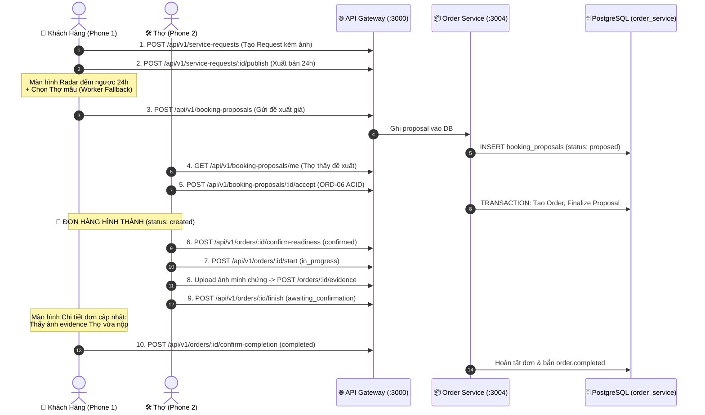

# Kế Hoạch Triển Khai: Mobile Frontend — Module Order (Hướng 2: Smart Interop)

## Goal Description
Hiện tại, phân hệ **Order Service (Backend)** đã hoàn tất 100% (18 API, CSDL Supabase PostgreSQL, 159 unit tests passed, 17/17 live E2E test passed).

Kế hoạch này triển khai trọn vẹn tầng **Mobile Frontend (React Native / Expo Router)** cho toàn bộ phân hệ Order theo **Hướng 2 (Cầu Nối Thông Minh — Smart Interop Fallback)**:
- **Đảm bảo luồng chạy thông suốt 100% từ A đến Z:** Người dùng có thể cầm 2 chiếc điện thoại (1 máy Khách hàng, 1 máy Thợ) để thực hiện trọn vẹn kịch bản: *Đặt việc $\to$ Chọn thợ $\to$ Thợ nhận việc $\to$ Xác nhận sẵn sàng $\to$ Bắt đầu làm $\to$ Chụp ảnh minh chứng $\to$ Báo xong việc $\to$ Khách nghiệm thu hoàn tất*.
- **Ranh giới chuẩn xác:** Không code thừa backend của các service khác (Matching AI, Bidding, VNPAY, Tracking GPS); tại các điểm giao thoa, áp dụng cơ chế cầu nối thông minh để chuyển tiếp thẳng vào API thật của Order Service.



---

## User Review Required

> [!IMPORTANT]
> **Cơ chế Cầu Nối Thông Minh (Smart Interop Fallback):**
> 1. **Tại Radar (`/customer/booking/radar`):** Hiển thị đếm ngược 24h thật từ Order Service + 2 Thợ mẫu (trong đó có 1 Thợ trỏ đến tài khoản Worker thật bạn dùng để test trên máy 2) $\to$ Khách bấm chọn sẽ gọi thẳng API thật `POST /api/v1/booking-proposals`.
> 2. **Phương thức thanh toán:** Mặc định chọn **"Tiền mặt (Cash)"** (Order Service đã hỗ trợ native), không cần chờ cổng VNPAY/MoMo để tránh nghẽn luồng.
> 3. **Theo dõi tiến độ thi công:** Hiển thị **Dòng thời gian các mốc trạng thái (Status History Timeline)** từ API của bạn thay vì bản đồ GPS realtime của Tracking Service.

---

## Open Questions
*Không còn câu hỏi nghẽn. Kế hoạch đã cô lập đúng 100% phạm vi của Order Service.*

---

## Proposed Changes

---

### Component 1: Tầng Dữ Liệu & API Client (`mobile/src/features/orders/`)

#### [NEW] `mobile/src/features/orders/types/order.types.ts`
Khai báo đầy đủ các Interface và Enum khớp 100% với backend:
```typescript
export type RequestStatus = 'draft' | 'open_for_bidding' | 'bidding_closed' | 'converted_to_order' | 'cancelled' | 'expired';
export type BookingProposalStatus = 'proposed' | 'changes_requested' | 'worker_rejected' | 'withdrawn' | 'expired' | 'finalized' | 'superseded';
export type OrderStatus = 'created' | 'confirmed' | 'in_progress' | 'awaiting_customer_confirmation' | 'completed' | 'cancelled' | 'disputed';
export type PaymentState = 'unpaid' | 'pending' | 'paid' | 'refunded' | 'failed';

export interface ServiceRequestMedia {
  id?: string;
  mediaUrl: string;
  mediaType: string;
}

export interface ServiceRequest {
  id: string;
  requestCode: string;
  customerUserId: string;
  serviceId?: string;
  description?: string;
  scheduledAt?: string;
  addressText?: string;
  latitude?: number;
  longitude?: number;
  status: RequestStatus;
  publishedAt?: string;
  biddingClosesAt?: string;
  selectionExpiresAt?: string;
  media?: ServiceRequestMedia[];
  createdAt: string;
}

export interface BookingProposal {
  id: string;
  serviceRequestId: string;
  supersedesProposalId?: string;
  revisionNo: number;
  customerUserId: string;
  workerUserId: string;
  selectionSource: 'bid' | 'recommendation';
  agreedPrice: number | string;
  agreedScope: string;
  scheduledAt?: string;
  status: BookingProposalStatus;
  expiresAt: string;
  responseNote?: string;
  createdAt: string;
}

export interface OrderEvidence {
  id: string;
  orderId: string;
  mediaType: string;
  mediaUrl: string;
  description?: string;
  createdAt: string;
}

export interface OrderStatusHistoryItem {
  id: string;
  orderId: string;
  fromStatus: OrderStatus | null;
  toStatus: OrderStatus;
  changedByUserId?: string;
  reason?: string;
  createdAt: string;
}

export interface Order {
  id: string;
  orderCode: string;
  serviceRequestId: string;
  bookingProposalId: string;
  customerUserId: string;
  workerUserId: string;
  serviceId: string;
  agreedPrice: string;
  agreedScope: string;
  addressText: string;
  latitude: number;
  longitude: number;
  status: OrderStatus;
  paymentState: PaymentState;
  confirmedAt?: string;
  startedAt?: string;
  workerFinishedAt?: string;
  completedAt?: string;
  cancelledAt?: string;
  cancelReason?: string;
  disputedAt?: string;
  disputeReason?: string;
  evidences?: OrderEvidence[];
  statusHistory?: OrderStatusHistoryItem[];
  createdAt: string;
}
```

#### [NEW] `mobile/src/features/orders/api/orders.api.ts`
Định nghĩa các hàm gọi HTTP thông qua `ApiClient` của Mobile:
```typescript
import { ApiClient } from '@/services/api/api-client';
import type { ServiceRequest, BookingProposal, Order, OrderEvidence, OrderStatusHistoryItem } from '../types/order.types';

export const OrdersApi = {
  // Service Requests
  createRequest: (payload: any) => ApiClient.post<{ data: ServiceRequest }>('/service-requests', payload),
  publishRequest: (id: string) => ApiClient.post<{ data: ServiceRequest }>(`/service-requests/${id}/publish`),
  cancelRequest: (id: string) => ApiClient.post<{ data: ServiceRequest }>(`/service-requests/${id}/cancel`),
  getMyRequests: () => ApiClient.get<{ data: ServiceRequest[] }>('/service-requests'),
  getRequestDetail: (id: string) => ApiClient.get<{ data: ServiceRequest }>(`/service-requests/${id}`),

  // Booking Proposals
  createProposal: (payload: any) => ApiClient.post<{ data: BookingProposal }>('/booking-proposals', payload),
  getMyWorkerProposals: () => ApiClient.get<{ data: BookingProposal[] }>('/booking-proposals/me'),
  getProposalsForRequest: (requestId: string) => ApiClient.get<{ data: BookingProposal[] }>(`/service-requests/${requestId}/booking-proposals`),
  requestChanges: (id: string, responseNote: string) => ApiClient.post<{ data: BookingProposal }>(`/booking-proposals/${id}/request-changes`, { responseNote }),
  acceptProposal: (id: string) => ApiClient.post<{ data: Order }>(`/booking-proposals/${id}/accept`),

  // Orders
  getMyOrders: (params?: any) => ApiClient.get<{ data: Order[] }>('/orders', { params }),
  getOrderDetail: (id: string) => ApiClient.get<{ data: Order }>(`/orders/${id}`),
  getStatusHistory: (id: string) => ApiClient.get<{ data: OrderStatusHistoryItem[] }>(`/orders/${id}/status-history`),
  confirmReadiness: (id: string) => ApiClient.post<{ data: Order }>(`/orders/${id}/confirm-readiness`),
  startOrder: (id: string) => ApiClient.post<{ data: Order }>(`/orders/${id}/start`),
  uploadEvidence: (id: string, payload: { mediaUrl: string; mediaType: string; description?: string }) =>
    ApiClient.post<{ data: OrderEvidence }>(`/orders/${id}/evidence`, payload),
  finishOrder: (id: string) => ApiClient.post<{ data: Order }>(`/orders/${id}/finish`),
  confirmCompletion: (id: string) => ApiClient.post<{ data: Order }>(`/orders/${id}/confirm-completion`),
  requestRework: (id: string, reason: string) => ApiClient.post<{ data: Order }>(`/orders/${id}/request-rework`, { reason }),
  cancelOrder: (id: string, reason?: string) => ApiClient.post<{ data: Order }>(`/orders/${id}/cancel`, { cancelReason: reason }),
  openDispute: (id: string, reason: string) => ApiClient.post<{ data: Order }>(`/orders/${id}/dispute`, { reason }),
};
```

---

### Component 2: Tầng Hooks & React Query (`mobile/src/features/orders/hooks/`)

#### [NEW] `mobile/src/features/orders/hooks/orders-query-keys.ts`
Quản lý cache keys cho React Query.

#### [NEW] `mobile/src/features/orders/hooks/use-customer-orders.ts`
- Hook `useCustomerOrders(tab)`: Lấy danh sách đơn của khách phân loại theo tab:
  - `Searching`: Lấy Service Requests có `status = open_for_bidding`.
  - `In process`: Lấy Orders có `status` thuộc `[created, confirmed, in_progress, awaiting_customer_confirmation]`.
  - `Finished`: Lấy Orders có `status = completed`.
  - `Cancelled`: Lấy Orders/Requests có `status = cancelled | expired`.
- Hook `useOrderDetail(id)`: Lấy chi tiết đơn hàng, kèm polling 5s khi đơn đang ở trạng thái `in_progress` hoặc `awaiting_customer_confirmation` để tự động cập nhật khi thợ thao tác!

#### [NEW] `mobile/src/features/orders/hooks/use-worker-jobs.ts`
- Hook `useWorkerJobs()`:
  - Tab "Đề xuất mới": Gọi `getMyWorkerProposals()` $\to$ lọc proposal đang `proposed`.
  - Tab "Đang thi công": Gọi `getMyOrders()` $\to$ lọc order chưa hoàn thành.
- Mutation `useAcceptJob()`: Gọi `acceptProposal` $\to$ chuyển ngay thành Order và tự động cập nhật UI.
- Mutation `useJobExecutionActions()`: Thực hiện `confirmReadiness`, `startOrder`, `uploadEvidence`, `finishOrder`.

---

### Component 3: Giao Diện Khách Hàng (Customer UI)

#### [MODIFY] `mobile/src/features/orders/customer/screens/customer-booking-screen.tsx`
- Form nhập:
  - Mô tả hỏng hóc (TextInput đa dòng).
  - Chọn ảnh hiện trường: Bấm nút "Thêm ảnh" $\to$ mở thư viện ảnh $\to$ gọi API Gateway `POST /api/v1/uploads/image` $\to$ nhận CDN URL $\to$ hiển thị preview và lưu mảng link.
  - Chọn địa chỉ: Mặc định lấy địa chỉ mẫu ("123 Nguyễn Lương Bằng, Đà Nẵng") hoặc địa chỉ người dùng chọn.
  - Lịch hẹn: Mặc định ngày mai hoặc chọn giờ.
  - Nút bấm **"Tiếp Tục $\to$"** chuyển sang màn hình Summary.

#### [MODIFY] `mobile/src/app/customer/booking/summary.tsx`
- Tóm tắt thông tin vừa nhập.
- Nút **"Xác Nhận & Đăng Yêu Cầu"**:
  1. Gọi `OrdersApi.createRequest(payload)` $\to$ có `requestId`.
  2. Gọi `OrdersApi.publishRequest(requestId)` $\to$ Request chuyển sang `open_for_bidding`.
  3. Chuyển sang màn hình Radar: `/customer/booking/radar?requestId=${requestId}`.

#### [MODIFY] `mobile/src/app/customer/booking/radar.tsx` *(Cầu nối thông minh)*
- Hiển thị thông tin Request thật lấy từ `OrdersApi.getRequestDetail(requestId)`.
- Hiệu ứng đếm ngược thời gian nhận báo giá (24h).
- **Danh Sách Thợ Khả Dụng (Fallback Interop):**
  - Hiển thị 2 Thợ mẫu (có 1 Thợ tương ứng với tài khoản Worker test trên máy 2: tên thợ, đánh giá 5★, giá đề xuất 300.000đ).
  - Nút **"Chọn Thợ & Gửi Báo Giá"**:
    - Gọi API thật: `OrdersApi.createProposal({ serviceRequestId, workerUserId, selectionSource: 'bid', agreedPrice: 300000, agreedScope: 'Sửa đường ống' })`.
    - Thông báo thành công: *"Đã gửi đề xuất báo giá cho Thợ! Đang chờ Thợ xác nhận."* $\to$ Điều hướng về màn hình Hoạt động (`CUSTOMER_ORDERS`).

#### [MODIFY] `mobile/src/features/orders/customer/screens/customer-orders-screen.tsx`
- Bỏ card giả `#224466`.
- Hiển thị danh sách thẻ thật theo 4 tab:
  - Thẻ hiển thị: Mã `orderCode` / `requestCode`, dịch vụ, thợ thi công, giá tiền, badge trạng thái màu tương ứng (*Chờ thợ, Đang làm, Chờ nghiệm thu, Hoàn thành*).
  - Pull-to-refresh cập nhật danh sách.

#### [MODIFY] `mobile/src/features/orders/customer/screens/customer-order-detail-screen.tsx`
- Hiển thị chi tiết toàn diện:
  - Thông tin Thợ, giá chốt, địa chỉ, lịch hẹn.
  - Timeline dòng thời gian trạng thái từ `statusHistory`.
  - Hiển thị **ảnh minh chứng nghiệm thu (Evidence)** do Thợ gửi lên.
  - **Khối hành động tương tác:**
    - Khi Thợ báo xong (`awaiting_customer_confirmation`):
      - Nút nổi bật: **"Nghiệm Thu Hoàn Tất Đơn Hàng"** $\to$ Gọi `confirmCompletion()` $\to$ Đơn chuyển `completed`, thông báo thành công!
      - Nút phụ: **"Yêu Cầu Sửa Lại"** $\to$ Mở modal nhập lý do $\to$ Gọi `requestRework()`.
    - Khi đơn đang làm (`in_progress`): Nút **"Khiếu Nại / Mở Tranh Chấp"** $\to$ Gọi `openDispute()`.

---

### Component 4: Giao Diện Thợ (Worker UI)

#### [MODIFY] `mobile/src/features/orders/worker/screens/worker-jobs-screen.tsx`
- Tab 1: **"Lời Mời Nhận Việc (Proposals)"**:
  - Đọc từ `OrdersApi.getMyWorkerProposals()`.
  - Hiển thị đề xuất Khách vừa gửi: Giá 300.000đ, mô tả công việc.
  - Nút **"Nhận Việc Ngay"**:
    - Gọi `OrdersApi.acceptProposal(proposalId)` $\to$ **Giao dịch chốt đơn nguyên tử ORD-06 chạy ngay lập tức!**
    - Thông báo: *"Đã chốt hợp đồng thành công!"* $\to$ Đơn chuyển sang Tab "Đang thi công".
- Tab 2: **"Công Việc Đang Làm (Active Orders)"**:
  - Danh sách đơn hàng thợ đang phụ trách $\to$ Bấm vào để vào chi tiết thi công.

#### [MODIFY] `mobile/src/features/orders/worker/screens/worker-job-detail-screen.tsx`
- Màn hình thi công công việc của Thợ:
  - Hiển thị địa chỉ khách hàng và mô tả.
  - **Nút hành động theo trạng thái:**
    - Ở `created`: Nút **"Xác Nhận Sẵn Sàng"** (`confirmReadiness`).
    - Ở `confirmed`: Nút **"Bắt Đầu Thi Công"** (`startOrder`).
    - Ở `in_progress`:
      - Nút **"Chụp Ảnh Bằng Chứng Nghiệm Thu"** $\to$ Mở camera/thư viện ảnh $\to$ Upload lên Cloudinary $\to$ Lưu vào `order_evidences`.
      - Nút **"Báo Hoàn Thành Công Việc"** (`finishOrder` - Tự động báo lỗi nếu chưa nộp ảnh).

---

## Verification Plan

### Automated Tests
1. **Kiểm tra kiểu dữ liệu:**
   ```bash
   cd mobile && pnpm run type-check
   ```
2. **Kiểm tra linter:**
   ```bash
   cd mobile && pnpm run lint
   ```
3. **Chạy Unit Tests:**
   ```bash
   cd mobile && pnpm run test
   ```

### Manual Verification (Kịch Bản Demo 2 Điện Thoại / 2 Tài Khoản)
1. **Bước 1 (Máy Khách):** Đăng nhập Customer $\to$ Bấm đặt lịch sửa ống nước $\to$ Chọn ảnh hiện trường $\to$ Xác nhận tạo yêu cầu.
2. **Bước 2 (Máy Khách):** Tại màn hình Radar $\to$ Bấm *"Gửi đề xuất cho Thợ A"* với giá 300.000đ.
3. **Bước 3 (Máy Thợ):** Đăng nhập Thợ A $\to$ Mở tab Jobs $\to$ Thấy đề xuất 300.000đ $\to$ Bấm *"Nhận việc ngay"*.
4. **Bước 4 (Máy Thợ):** Bấm *"Xác nhận sẵn sàng"* $\to$ Bấm *"Bắt đầu làm"*.
5. **Bước 5 (Máy Thợ):** Thử bấm *"Báo hoàn thành"* khi chưa chụp ảnh $\to$ Hệ thống chặn yêu cầu nộp bằng chứng $\to$ Chụp 1 ảnh nộp evidence $\to$ Bấm *"Báo hoàn thành"*.
6. **Bước 6 (Máy Khách):** Màn hình chi tiết đơn tự động cập nhật sang *"Chờ nghiệm thu"* và hiển thị ảnh Thợ vừa chụp $\to$ Khách bấm *"Nghiệm thu hoàn tất"* $\to$ Đơn chuyển sang `completed`!
7. **Kiểm tra cơ sở dữ liệu:** Chạy `pnpm run prisma:studio:order` $\to$ Xác nhận dòng dữ liệu đơn hàng và lịch sử chuyển đổi trạng thái đã được lưu vĩnh viễn trên Supabase PostgreSQL.
