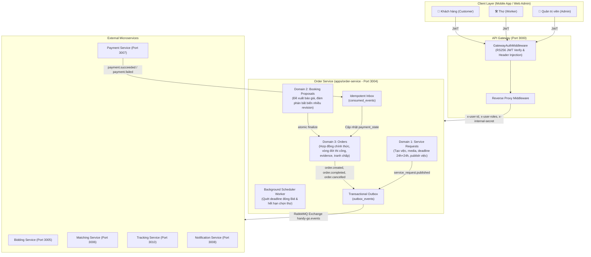
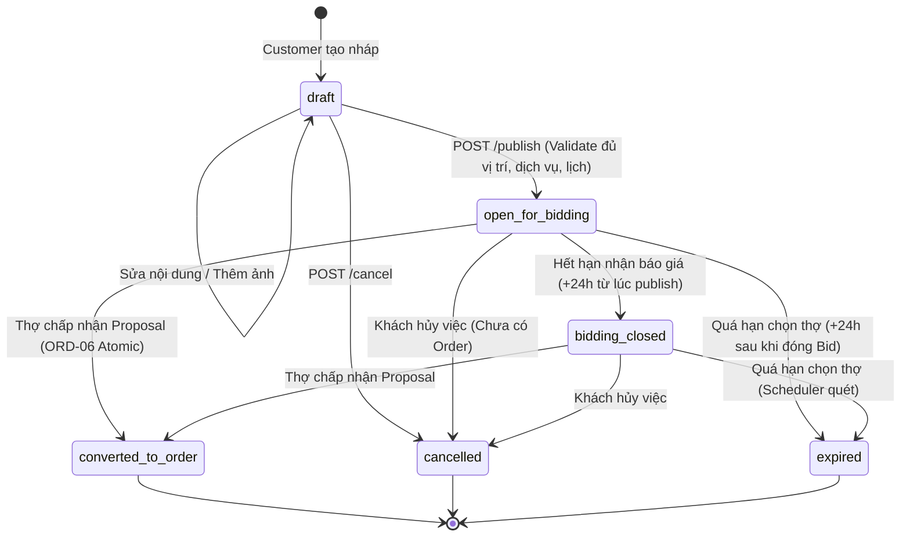
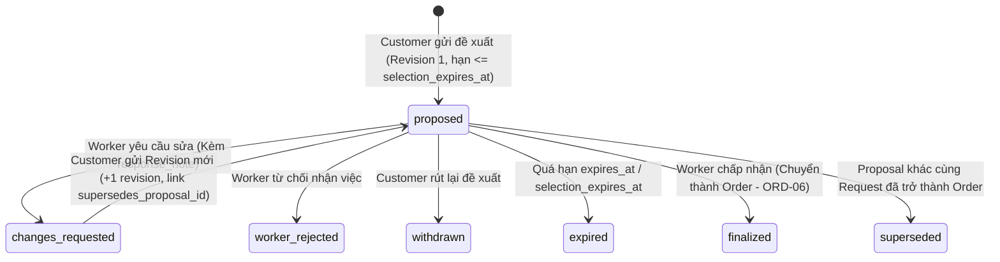
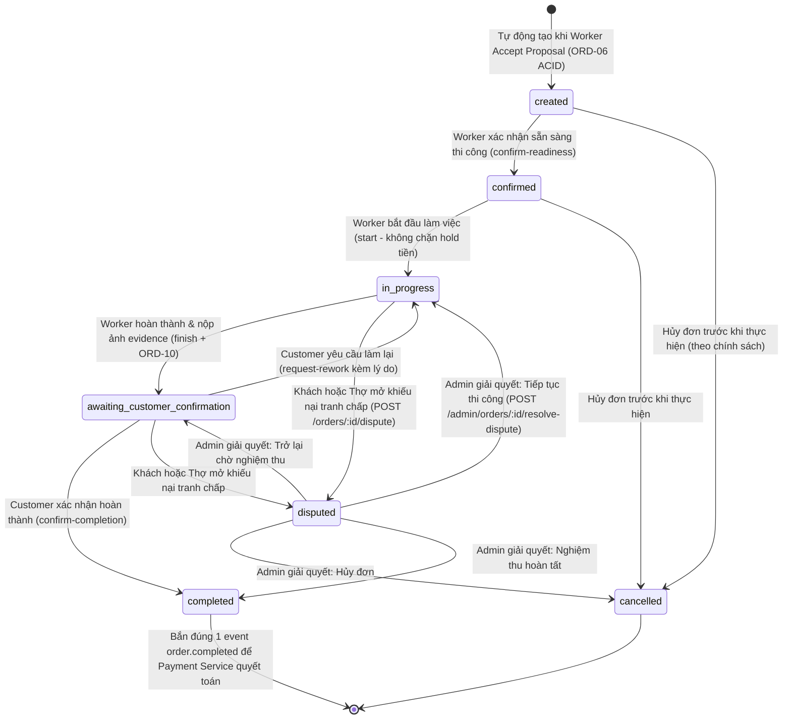
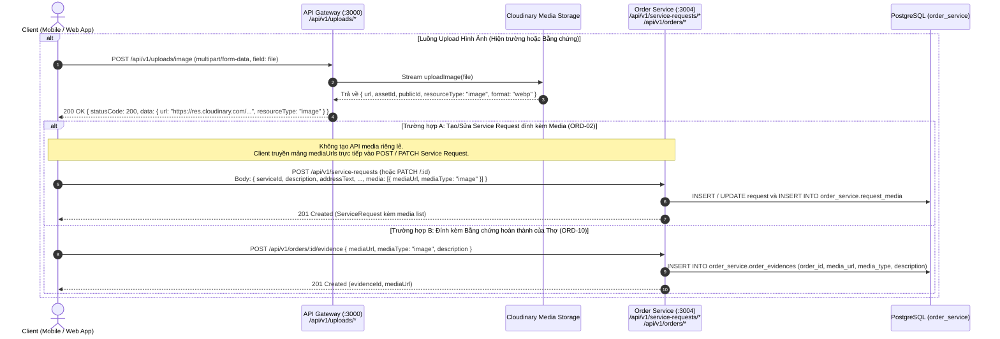

# Kế Hoạch & Đặc Tả Kỹ Thuật Toàn Diện: Order Service (HG-32)

> **Dự án:** HANDY GO (PBL6) — Sprint 4  
> **Jira Ticket:** `[HG-32] Order SERVICE` (Epic: `Order`)  
> **Người thực hiện:** Huỳnh Đức Thịnh | **Người báo cáo:** Quốc Duy  
> **Tài liệu nguồn:** [`HG-32-Order_Service.pdf`](file:///d:/SCHOOL/PBL6/docs/order-service/HG-32-Order_Service.pdf)  
> **Database Schema:** PostgreSQL Schema `order_service` (DBML: [`order-service-v2.dbml`](file:///d:/SCHOOL/PBL6/docs/dbml/order-service-v2.dbml))  
> **Kiến trúc:** Feature-Based Vertical Slice Architecture theo chuẩn [`backend/AGENTS.md`](file:///d:/SCHOOL/PBL6/backend/AGENTS.md)  
> **Tình trạng:** **FILE DUY NHẤT HỢP NHẤT TOÀN BỘ ĐẶC TẢ KỸ THUẬT & CHECKLIST THỰC THI 7 BƯỚC**

---

## 📑 Mục Lục
1. [Nguyên Tắc & Giả Định Cốt Lõi Đã Chốt](#1-nguyên-tắc--giả-định-cốt-lõi-đã-chốt)
2. [Kiến Trúc Hệ Thống & Máy Trạng Thái (State Machines)](#2-kiến-trúc-hệ-thống--máy-trạng-thái-state-machines)
3. [Thiết Kế Cơ Sở Dữ Liệu (Prisma Schema Đầy Đủ)](#3-thiết-kế-cơ-sở-dữ-liệu-prisma-schema-đầy-đủ)
4. [Lộ Trình Triển Khai Chi Tiết 7 Bước (Master Action Checklist)](#4-lộ-trình-triển-khai-chi-tiết-7-bước-master-action-checklist)
   - [🟢 Bước 1: Nền tảng Database, Prisma Schema & Outbox (ORD-01)](#-bước-1-nền-tảng-database-prisma-schema--outbox-infrastructure-ord-01)
   - [🟢 Bước 2: Domain Service Request & Deadline 24h+24h (ORD-02, ORD-03)](#-bước-2-domain-service-request--quản-lý-deadline-24h24h-ord-02-ord-03)
   - [🟢 Bước 3: Domain Booking Proposal & Đàm Phán Bất Biến (ORD-04, ORD-05)](#-bước-3-domain-booking-proposal--đàm-phán-báo-giá-bất-biến-ord-04-ord-05)
   - [🟢 Bước 4: Worker Accept & Giao Dịch Chốt Đơn Nguyên Tử (ORD-06)](#-bước-4-worker-accept--giao-dịch-chốt-đơn-nguyên-tử-ord-06)
   - [🟢 Bước 5: Vòng Đời Thi Công, Evidence & Tranh Chấp (ORD-07, ORD-08, ORD-10)](#-bước-5-vòng-đời-thi-công-evidence-minh-chứng--tranh-chấp-ord-07-ord-08-ord-10)
   - [🟢 Bước 6: Tích Hợp RabbitMQ, Internal APIs & API Gateway (ORD-09)](#-bước-6-tích-hợp-liên-service-rabbitmq--api-gateway-ord-09)
   - [🟢 Bước 7: Kiểm Thử Toàn Diện, Lint & Quality Gate (Verification)](#-bước-7-kiểm-thử-toàn-diện-lint--quality-gate-verification)
5. [Ma Trận Tích Hợp 13 Điểm Liên Phân Hệ (Inter-Service Contracts Matrix)](#5-ma-trận-tích-hợp-13-điểm-liên-phân-hệ-inter-service-contracts-matrix)
6. [Danh Mục Tra Cứu Toàn Bộ API & Mã Lỗi Hệ Thống](#6-danh-mục-tra-cứu-toàn-bộ-api--mã-lỗi-hệ-thống)
7. [Phân Tích Rủi Ro Kỹ Thuật & Tiêu Chuẩn Nghiệm Thu Cuối Cùng](#7-phân-tích-rủi-ro-kỹ-thuật--tiêu-chuẩn-nghiệm-thu-cuối-cùng)

---

## 1. Nguyên Tắc & Giả Định Cốt Lõi Đã Chốt

### 1.1. Ranh Giới Quyết Toán (Settlement Boundary)
- **Ý nghĩa sự kiện `order.completed`:** Sự kiện này là **yêu cầu Payment Service quyết toán khoản tiền đã tạm giữ trước đó (Settlement)**, KHÔNG phải lệnh Order Service tự thu tiền hay cộng số dư cho Thợ.
- **Phân công trách nhiệm:** Order Service sở hữu vòng đời hợp đồng, tiến độ thi công, ảnh nghiệm thu và hồ sơ tranh chấp. Payment Service sở hữu phương thức thanh toán, phí sàn (`platform_fee`), tạm giữ tiền (Hold/Escrow) và lịch sử thanh toán (`payment_settlements`).
- **Endpoint xác minh điều kiện thanh toán:** `GET /internal/orders/:orderId/payment-eligibility` cung cấp cho Payment Service thông tin khách, thợ, trạng thái hoàn tất và giá chốt hợp đồng. **Giá `agreedPrice` bắt buộc định dạng chuỗi Decimal chính xác** (ví dụ: `"1500000.00"`), tuyệt đối không dùng số thực dấu phẩy động (`number` float IEEE-754) để tránh sai lệch kế toán.
- **Phân biệt hai hình thức thanh toán:**
  - **Thanh toán bằng Điểm (Point):** Payment/Wallet chịu trách nhiệm tạm giữ Point của Khách trước khi thợ thi công. Khi nhận `order.completed`, Payment Service giải ngân từ số Point đã giữ chuyển vào ví Thợ (sau khi trừ phí sàn).
  - **Thanh toán bằng Tiền mặt (Cash):** Khách trả trực tiếp cho Thợ tại hiện trường; Payment Service chỉ ghi nhận khoản nợ hoa hồng sàn của Thợ (`commission_receivables`), không chuyển thêm tiền.

### 1.2. Quy Tắc Escrow & Guard Lúc Bắt Đầu Thi Công (`start`)
- Do hệ thống hiện tại chưa đồng bộ hold escrow giữa Payment và Wallet cho đơn hàng dịch vụ, Order Service **KHÔNG chặn bước `start`** để chờ tín hiệu đã giữ tiền.
- Việc đảm bảo tiền/point đã được giữ thuộc trách nhiệm của luồng Checkout/Payment bên ngoài Order Service.

### 1.3. Chuẩn Hóa Event Contract
- Sự kiện thanh toán thành công chuẩn của hệ thống là `payment.succeeded` (thay vì `payment.completed`), được khai báo trong [`@libs/common/src/events/event-patterns.ts`](file:///d:/SCHOOL/PBL6/backend/libs/common/src/events/event-patterns.ts) (đồng thời giữ alias `PAYMENT_COMPLETED` để đảm bảo tương thích ngược).
- Order Service tiêu thụ idempotent qua bảng `consumed_events` và chỉ cập nhật projection `payment_state` (`paid` / `failed`). Order Service **tuyệt đối không gọi Wallet Service** và **không tính toán `platform_fee`**.

### 1.4. Quản Lý Thời Hạn (Deadlines) & Background Scheduler
- Mặc định đóng nhận báo giá: `bidding_closes_at = published_at + 24 hours`.
- Hạn chót Khách chọn Thợ: `selection_expires_at = bidding_closes_at + 24 hours` (tổng cộng 48 giờ kể từ lúc publish).
- Thời hạn hiệu lực của Proposal (`expires_at`): Tối đa không vượt quá `selection_expires_at`.
- Background Scheduler Worker quét định kỳ mỗi phút:
  - Tự động chuyển Request sang `bidding_closed` khi quá 24h.
  - Tự động chuyển Request sang `expired` và hủy toàn bộ Proposal mở khi quá 48h.

### 1.5. Quy Trình Xử Lý Khiếu Nại Tranh Chấp (Dispute Lifecycle)
- Khách hoặc Thợ được quyền mở khiếu nại (`POST /orders/:id/dispute`) khi đơn hàng ở trạng thái `in_progress` hoặc `awaiting_customer_confirmation`.
- Quản trị viên can thiệp xử lý (`POST /api/v1/admin/orders/:id/resolve-dispute`) với lý do bắt buộc và chọn 1 trong 3 hành động:
  1. `resume_previous_state`: Tiếp tục trạng thái trước khi tranh chấp xảy ra.
  2. `cancel`: Hủy đơn hàng (`cancelled`).
  3. `complete`: Hoàn tất nghiệm thu (`completed`). Nếu chọn hành động này, hệ thống **bắn đúng duy nhất một sự kiện `order.completed`** vào outbox để kích hoạt quyết toán tiền.

### 1.6. Quy Tắc Tích Hợp Upload Media Qua API Gateway (ORD-02 & ORD-10)
- **API Gateway** trực tiếp sở hữu endpoints upload trung tâm (`POST /api/v1/uploads/image` và `POST /api/v1/uploads/video/init`).
- **Order Service HOÀN TOÀN KHÔNG NHẬN MULTIPART/FORM-DATA TRỰC TIẾP**. Order Service chỉ nhận payload JSON chứa đường dẫn `mediaUrl` (trả về từ Gateway / Cloudinary) để lưu vào database:
  - Với **Service Request (ORD-02)**: Đính kèm mảng `media: [{ mediaUrl, mediaType }]` trực tiếp trong body `POST` hoặc `PATCH /api/v1/service-requests` (không tạo API media riêng lẻ).
  - Với **Order Evidence (ORD-10)**: Gọi `POST /api/v1/orders/:id/evidence` với body `{ mediaUrl, mediaType, description }`.

---

## 2. Kiến Trúc Hệ Thống & Máy Trạng Thái (State Machines)

### 2.1. Sơ Đồ Kiến Trúc Tổng Thể



---

### 2.2. Service Request State Machine (Yêu Cầu Dịch Vụ)



| Bước chuyển | Điều kiện kích hoạt | Actor cho phép | Event phát ra Outbox |
| :--- | :--- | :--- | :--- |
| `draft` $\to$ `open_for_bidding` | Đủ `service_id`, `address_text`, `latitude`, `longitude`, `scheduled_at`, `description`. Gán `bidding_closes_at = now() + 24h`, `selection_expires_at = now() + 48h` | Customer sở hữu | `service_request.published` |
| `open_for_bidding` $\to$ `bidding_closed` | `now() >= bidding_closes_at` | Scheduler Worker | `service_request.bidding_closed` |
| `open_for_bidding` / `bidding_closed` $\to$ `converted_to_order` | Thợ chấp nhận Proposal hợp lệ trong giao dịch ACID | Worker được chọn | `order.created` |
| `draft` / `open_for_bidding` / `bidding_closed` $\to$ `cancelled` | Khách chủ động hủy khi chưa có Order phát sinh | Customer sở hữu | `service_request.cancelled` |
| `open_for_bidding` / `bidding_closed` $\to$ `expired` | `now() >= selection_expires_at` mà chưa có Order | Scheduler Worker | `service_request.expired` |

---

### 2.3. Booking Proposal State Machine (Đàm Phán Báo Giá Bất Biến)



| Trạng thái | Ý nghĩa nghiệp vụ & Quy tắc bất biến |
| :--- | :--- |
| `proposed` | Đề xuất đang mở chờ Thợ phản hồi. **Không thể sửa đè giá/lịch/phạm vi**. Hạn `expires_at <= selection_expires_at`. |
| `changes_requested` | Thợ từ chối điều khoản hiện tại, trả về ghi chú phản hồi (`response_note`). Trạng thái này là Terminal đối với bản ghi hiện tại. |
| `proposed` (Revision mới) | Khách phản hồi bằng cách tạo bản ghi Proposal MỚI với `supersedes_proposal_id` trỏ về bản ghi cũ, `revision_no = old.revision_no + 1`. Bản ghi cũ giữ nguyên lịch sử đàm phán. |
| `finalized` | Thợ đồng ý. Khóa và chuyển hóa thành Order ngay lập tức trong 1 transaction ACID. |
| `superseded` | Một Proposal khác cùng Request đã được Thợ đồng ý trước, các proposal còn lại tự động chuyển sang `superseded`. |
| `worker_rejected`, `withdrawn`, `expired` | Các trạng thái kết thúc đàm phán không thành công. |

---

### 2.4. Order Execution & Dispute State Machine (Vòng Đời Thi Công & Tranh Chấp)



| Bước chuyển trạng thái | Endpoint kích hoạt | Actor | Hành động hệ thống |
| :--- | :--- | :--- | :--- |
| `[*] -> created` | `POST /booking-proposals/:id/accept` | Worker | Tạo Order, snapshot địa chỉ GPS, ghi history, phát `order.created` |
| `created -> confirmed` | `POST /orders/:id/confirm-readiness` | Worker | Cập nhật `confirmed_at`, ghi `order_status_history` |
| `confirmed -> in_progress` | `POST /orders/:id/start` | Worker | Cập nhật `started_at`, ghi history (Không chặn chờ hold tiền) |
| `in_progress -> awaiting_customer_confirmation` | `POST /orders/:id/finish` | Worker | Kiểm tra **bắt buộc đã có evidence ảnh/video (ORD-10)**, cập nhật `worker_finished_at` |
| `awaiting_customer_confirmation -> completed` | `POST /orders/:id/confirm-completion` | Customer | Cập nhật `completed_at`, phát **`order.completed`** vào outbox để quyết toán tiền |
| `awaiting_customer_confirmation -> in_progress` | `POST /orders/:id/request-rework` | Customer | Ghi nhận lý do yêu cầu sửa, chuyển trạng thái quay lại `in_progress` |
| `created / confirmed -> cancelled` | `POST /orders/:id/cancel` | Customer / Worker | Cập nhật `cancelled_at`, `cancel_reason`, phát `order.cancelled` |
| `in_progress / awaiting -> disputed` | `POST /orders/:id/dispute` | Customer / Worker | Lưu `dispute_reason`, `dispute_previous_status`, chuyển sang `disputed` |
| `disputed -> in_progress / awaiting / cancelled / completed` | `POST /admin/orders/:id/resolve-dispute` | Admin | Kiểm tra quyền Admin, yêu cầu bắt buộc `resolutionReason`. Nếu chọn `complete`: cập nhật `completed_at` và bắn **đúng 1 event `order.completed`** |

---

### 2.5. Sequence Diagram: Tích Hợp Upload Media Qua API Gateway



---

## 3. Thiết Kế Cơ Sở Dữ Liệu (Prisma Schema Đầy Đủ)

File đích: `backend/apps/order-service/prisma/schema.prisma`

```prisma
datasource db {
  provider = "postgresql"
  schemas  = ["order_service"]
}

generator client {
  provider = "prisma-client-js"
}

enum RequestStatus {
  draft
  open_for_bidding
  bidding_closed
  converted_to_order
  cancelled
  expired

  @@schema("order_service")
}

enum BookingProposalStatus {
  proposed
  changes_requested
  worker_rejected
  withdrawn
  expired
  finalized
  superseded

  @@schema("order_service")
}

enum WorkerSelectionSource {
  bid
  recommendation

  @@schema("order_service")
}

enum OrderStatus {
  created
  confirmed
  in_progress
  awaiting_customer_confirmation
  completed
  cancelled
  disputed

  @@schema("order_service")
}

enum PaymentState {
  unpaid
  pending
  paid
  refunded
  failed

  @@schema("order_service")
}

model ServiceRequest {
  id                 String        @id @default(uuid()) @db.Uuid
  requestCode        String        @unique @map("request_code") @db.VarChar(30)
  customerUserId     String        @map("customer_user_id") @db.Uuid
  serviceId          String?       @map("service_id") @db.Uuid
  description        String?       @db.Text
  scheduledAt        DateTime?     @map("scheduled_at") @db.Timestamptz(6)
  aiRefPriceMin      Decimal?      @map("ai_reference_price_min") @db.Decimal(12, 2)
  aiRefPriceMax      Decimal?      @map("ai_reference_price_max") @db.Decimal(12, 2)
  addressText        String?       @map("address_text") @db.VarChar(500)
  latitude           Decimal?      @db.Decimal(9, 6)
  longitude          Decimal?      @db.Decimal(9, 6)
  status             RequestStatus @default(draft)
  publishedAt        DateTime?     @map("published_at") @db.Timestamptz(6)
  biddingClosesAt    DateTime?     @map("bidding_closes_at") @db.Timestamptz(6)
  selectionExpiresAt DateTime?     @map("selection_expires_at") @db.Timestamptz(6)
  version            Int           @default(0)
  matchingRevision   Int           @default(0) @map("matching_revision")
  createdAt          DateTime      @default(now()) @map("created_at") @db.Timestamptz(6)
  updatedAt          DateTime      @updatedAt @map("updated_at") @db.Timestamptz(6)

  media             RequestMedia[]
  bookingProposals  BookingProposal[]
  order             Order?

  @@index([customerUserId, status, createdAt])
  @@index([serviceId, status])
  @@map("service_requests")
  @@schema("order_service")
}

model RequestMedia {
  id               String         @id @default(uuid()) @db.Uuid
  serviceRequestId String         @map("service_request_id") @db.Uuid
  mediaType        String         @map("media_type") @db.VarChar(30)
  mediaUrl         String         @map("media_url") @db.Text
  createdAt        DateTime       @default(now()) @map("created_at") @db.Timestamptz(6)

  serviceRequest   ServiceRequest @relation(fields: [serviceRequestId], references: [id], onDelete: Cascade)

  @@index([serviceRequestId])
  @@map("request_media")
  @@schema("order_service")
}

model BookingProposal {
  id                   String                @id @default(uuid()) @db.Uuid
  serviceRequestId     String                @map("service_request_id") @db.Uuid
  supersedesProposalId String?               @unique @map("supersedes_proposal_id") @db.Uuid
  revisionNo           Int                   @default(1) @map("revision_no")
  customerUserId       String                @map("customer_user_id") @db.Uuid
  workerUserId         String                @map("worker_user_id") @db.Uuid
  selectionSource      WorkerSelectionSource @map("selection_source")
  sourceBidId          String?               @map("source_bid_id") @db.Uuid
  sourceMatchResultId  String?               @map("source_match_result_id") @db.Uuid
  agreedPrice          Decimal               @map("agreed_price") @db.Decimal(12, 2)
  agreedScope          String                @map("agreed_scope") @db.Text
  scheduledAt          DateTime?             @map("scheduled_at") @db.Timestamptz(6)
  status               BookingProposalStatus @default(proposed)
  expiresAt            DateTime              @map("expires_at") @db.Timestamptz(6)
  workerRespondedAt    DateTime?             @map("worker_responded_at") @db.Timestamptz(6)
  finalizedAt          DateTime?             @map("finalized_at") @db.Timestamptz(6)
  responseNote         String?               @map("response_note") @db.Text
  createdAt            DateTime              @default(now()) @map("created_at") @db.Timestamptz(6)
  updatedAt            DateTime              @updatedAt @map("updated_at") @db.Timestamptz(6)

  serviceRequest     ServiceRequest   @relation(fields: [serviceRequestId], references: [id], onDelete: Restrict)
  supersedesProposal BookingProposal? @relation("ProposalRevisions", fields: [supersedesProposalId], references: [id])
  supersededBy       BookingProposal? @relation("ProposalRevisions")
  order              Order?

  @@index([serviceRequestId, status])
  @@index([workerUserId, status])
  @@map("booking_proposals")
  @@schema("order_service")
}

model Order {
  id                    String                @id @default(uuid()) @db.Uuid
  orderCode             String                @unique @map("order_code") @db.VarChar(30)
  serviceRequestId      String                @unique @map("service_request_id") @db.Uuid
  bookingProposalId     String                @unique @map("booking_proposal_id") @db.Uuid
  customerUserId        String                @map("customer_user_id") @db.Uuid
  workerUserId          String                @map("worker_user_id") @db.Uuid
  serviceId             String                @map("service_id") @db.Uuid
  selectionSource       WorkerSelectionSource @map("selection_source")
  selectedBidId         String?               @map("selected_bid_id") @db.Uuid
  selectedMatchResultId String?               @map("selected_match_result_id") @db.Uuid
  agreedPrice           Decimal               @map("agreed_price") @db.Decimal(12, 2)
  agreedScope           String                @map("agreed_scope") @db.Text
  scheduledAt           DateTime?             @map("scheduled_at") @db.Timestamptz(6)
  addressText           String                @map("address_text") @db.VarChar(500)
  latitude              Decimal               @db.Decimal(9, 6)
  longitude             Decimal               @db.Decimal(9, 6)
  status                OrderStatus           @default(created)
  paymentState          PaymentState          @default(unpaid) @map("payment_state")
  confirmedAt           DateTime?             @map("confirmed_at") @db.Timestamptz(6)
  startedAt             DateTime?             @map("started_at") @db.Timestamptz(6)
  workerFinishedAt      DateTime?             @map("worker_finished_at") @db.Timestamptz(6)
  completedAt           DateTime?             @map("completed_at") @db.Timestamptz(6)
  cancelledAt           DateTime?             @map("cancelled_at") @db.Timestamptz(6)
  cancelReason          String?               @map("cancel_reason") @db.Text
  disputedAt            DateTime?             @map("disputed_at") @db.Timestamptz(6)
  disputeReason         String?               @map("dispute_reason") @db.Text
  disputePreviousStatus OrderStatus?          @map("dispute_previous_status")
  disputeResolvedAt     DateTime?             @map("dispute_resolved_at") @db.Timestamptz(6)
  disputeResolutionNote String?               @map("dispute_resolution_note") @db.Text
  version               Int                   @default(0)
  createdAt             DateTime              @default(now()) @map("created_at") @db.Timestamptz(6)
  updatedAt             DateTime              @updatedAt @map("updated_at") @db.Timestamptz(6)

  serviceRequest   ServiceRequest       @relation(fields: [serviceRequestId], references: [id], onDelete: Restrict)
  bookingProposal  BookingProposal      @relation(fields: [bookingProposalId], references: [id], onDelete: Restrict)
  statusHistory    OrderStatusHistory[]
  evidences        OrderEvidence[]

  @@index([customerUserId, status, createdAt])
  @@index([workerUserId, status, createdAt])
  @@map("orders")
  @@schema("order_service")
}

model OrderEvidence {
  id          String   @id @default(uuid()) @db.Uuid
  orderId     String   @map("order_id") @db.Uuid
  mediaType   String   @map("media_type") @db.VarChar(30)
  mediaUrl    String   @map("media_url") @db.Text
  description String?  @db.Text
  createdAt   DateTime @default(now()) @map("created_at") @db.Timestamptz(6)

  order       Order    @relation(fields: [orderId], references: [id], onDelete: Cascade)

  @@index([orderId])
  @@map("order_evidences")
  @@schema("order_service")
}

model OrderStatusHistory {
  id              String       @id @default(uuid()) @db.Uuid
  orderId         String       @map("order_id") @db.Uuid
  fromStatus      OrderStatus? @map("from_status")
  toStatus        OrderStatus  @map("to_status")
  changedByUserId String?      @map("changed_by_user_id") @db.Uuid
  reason          String?      @db.Text
  createdAt       DateTime     @default(now()) @map("created_at") @db.Timestamptz(6)

  order           Order        @relation(fields: [orderId], references: [id], onDelete: Cascade)

  @@index([orderId, createdAt])
  @@map("order_status_history")
  @@schema("order_service")
}

model OutboxEvent {
  id              String    @id @default(uuid()) @db.Uuid
  aggregateType   String    @map("aggregate_type") @db.VarChar(50)
  aggregateId     String    @map("aggregate_id") @db.Uuid
  eventType       String    @map("event_type") @db.VarChar(100)
  eventVersion    Int       @default(1) @map("event_version")
  payload         Json
  status          String    @default("pending") @db.VarChar(30)
  retryCount      Int       @default(0) @map("retry_count")
  lastError       String?   @map("last_error") @db.Text
  nextRetryAt     DateTime  @default(now()) @map("next_retry_at") @db.Timestamptz(6)
  createdAt       DateTime  @default(now()) @map("created_at") @db.Timestamptz(6)
  publishedAt     DateTime? @map("published_at") @db.Timestamptz(6)

  @@index([status, nextRetryAt])
  @@index([aggregateType, aggregateId])
  @@map("outbox_events")
  @@schema("order_service")
}

model ConsumedEvent {
  eventId    String   @id @map("event_id") @db.VarChar(100)
  eventType  String   @map("event_type") @db.VarChar(100)
  consumedAt DateTime @default(now()) @map("consumed_at") @db.Timestamptz(6)

  @@map("consumed_events")
  @@schema("order_service")
}
```

---

## 4. Lộ Trình Triển Khai Chi Tiết 7 Bước (Master Action Checklist)

### 🟢 Bước 1: Nền tảng Database, Prisma Schema & Outbox Infrastructure (ORD-01)
> **Mục tiêu:** Tạo Prisma schema, sinh migration trong schema `order_service`, cấu hình `OrderPrismaService`, Outbox Repository và các helper cốt lõi.

#### Danh sách công việc:
- [x] **1.1. Cấu hình Prisma & Scripts:**
  - Tạo file `apps/order-service/prisma/schema.prisma` với 8 models: `service_requests`, `request_media`, `booking_proposals`, `orders`, `order_evidences`, `order_status_history`, `outbox_events`, `consumed_events`.
  - Tạo file `apps/order-service/prisma.config.ts`.
  - Cập nhật [`backend/package.json`](file:///d:/SCHOOL/PBL6/backend/package.json) bổ sung scripts:
    - `"prisma:generate:order": "prisma generate --schema=apps/order-service/prisma/schema.prisma"`
    - `"prisma:migrate:order": "prisma migrate deploy --schema=apps/order-service/prisma/schema.prisma"`
    - Gộp vào scripts tổng `"prisma:generate"` và `"prisma:migrate"`.
- [x] **1.2. Tạo Service Database Module:**
  - `apps/order-service/src/prisma/prisma.service.ts`: Kế thừa `PrismaClient` với PostgreSQL pool adapter `@prisma/adapter-pg`.
  - `apps/order-service/src/prisma/prisma.module.ts`.
- [x] **1.3. Cài đặt Transactional Outbox & Inbound Inbox Repositories:**
  - `apps/order-service/src/common/outbox/order-outbox.repository.ts`: Thao tác lưu sự kiện outbox trong cùng transaction ACID.
  - `apps/order-service/src/common/inbox/consumed-event.repository.ts`: Kiểm tra và ghi nhận event đã tiêu thụ để chống trùng lặp (Idempotency).
- [x] **1.4. Thiết lập Common Module & Helpers:**
  - Hàm tự sinh mã nghiệp vụ: `REQ-YYYYMMDD-XXXX` và `ORD-YYYYMMDD-XXXX`.
  - Constant và error mapping cho Order Service.

#### Lệnh nghiệm thu Bước 1:
```bash
pnpm run prisma:generate:order
pnpm run typecheck
```

---

### 🟢 Bước 2: Domain Service Request & Quản lý Deadline 24h+24h (ORD-02, ORD-03)
> **Mục tiêu:** Xây dựng tính năng tạo/sửa draft yêu cầu dịch vụ, đính kèm media link từ Gateway, kiểm tra điều kiện xuất bản và worker quét deadline.

#### Danh sách công việc:
- [x] **2.1. Cấu trúc Module `apps/order-service/src/service-requests/`:**
  - DTO: `create-service-request.dto.ts`, `update-service-request.dto.ts`, `query-service-request.dto.ts`.
  - Controller, Service, Module.
- [x] **2.2. Triển khai API CRUD & Tích hợp Media (ORD-02):**
  - **Quy tắc quan trọng:** Không tạo API media riêng lẻ; khách upload qua API Gateway `POST /api/v1/uploads/image` $\to$ nhận URL $\to$ truyền danh sách link vào trường `media: [{ mediaUrl, mediaType }]`.
  - `POST /api/v1/service-requests`: Tạo draft mới với status `draft`. Nếu có `media`, lưu vào `request_media` trong cùng transaction.
  - `GET /api/v1/service-requests`: Danh sách request của Customer đang đăng nhập (`x-user-id`), hỗ trợ filter status, pagination.
  - `GET /api/v1/service-requests/:id`: Chi tiết request kèm danh sách media và proposals. Guard: Chỉ Customer sở hữu hoặc Worker liên quan mới được xem.
  - `PATCH /api/v1/service-requests/:id`: Sửa draft (chỉ cho phép khi status = `draft`).
- [x] **2.3. Triển khai Xuất bản & Hủy yêu cầu (ORD-03):**
  - `POST /api/v1/service-requests/:id/publish`:
    - Validate nghiêm ngặt: Bắt buộc có `service_id`, `address_text`, `latitude`, `longitude`, `description`, `scheduled_at > now()`.
    - Cập nhật `status = open_for_bidding`, `published_at = now()`.
    - **Thiết lập thời hạn đã chốt:**
      - `bidding_closes_at = now() + 24 hours` (Mặc định đóng nhận bid sau 24h).
      - `selection_expires_at = bidding_closes_at + 24 hours` (Thêm 24h để Khách chọn Thợ từ Bids / Matching).
    - Lưu sự kiện `service_request.published` vào bảng `outbox_events` trong cùng transaction.
  - `POST /api/v1/service-requests/:id/cancel`: Cho phép Khách hủy request khi chưa có Order (`draft`, `open_for_bidding`, `bidding_closed`). Bắn outbox `service_request.cancelled`.
- [x] **2.4. Worker Nền Quét Deadline (Scheduler Worker):**
  - `apps/order-service/src/service-requests/workers/order-deadline-scheduler.service.ts`:
    - Cron `@Cron('*/1 * * * *')` (mỗi phút):
      - Quét request `open_for_bidding` có `bidding_closes_at <= now()` $\to$ chuyển `bidding_closed`.
      - Quét request có `selection_expires_at <= now()` chưa thành Order $\to$ chuyển `expired`, đồng thời chuyển các proposal đang ở `proposed` sang `expired`.

#### Lệnh nghiệm thu Bước 2:
```bash
pnpm test apps/order-service/src/service-requests
```

---

### 🟢 Bước 3: Domain Booking Proposal & Đàm Phán Báo Giá Bất Biến (ORD-04, ORD-05)
> **Mục tiêu:** Khách chọn Thợ từ Bidding hoặc AI Matching để gửi đề xuất, Thợ yêu cầu chỉnh sửa và cơ chế revision bất biến.

#### Danh sách công việc:
- [x] **3.1. Cấu trúc Module `apps/order-service/src/booking-proposals/`:**
  - DTO: `create-booking-proposal.dto.ts`, `request-changes-proposal.dto.ts`, `reject-proposal.dto.ts`, `query-booking-proposal.dto.ts`.
  - Controller, Service, Module.
- [x] **3.2. Triển khai Tạo & Tra Cứu Proposal (ORD-04):**
  - `POST /api/v1/booking-proposals`:
    - Caller phải là Customer sở hữu `service_request_id`.
    - Request phải ở trạng thái `open_for_bidding` hoặc `bidding_closed`, chưa quá `selection_expires_at`.
    - Ràng buộc XOR: `selection_source = bid` bắt buộc có `source_bid_id`; `selection_source = recommendation` bắt buộc có `source_match_result_id`.
    - Hạn `expires_at` của proposal không được vượt quá `request.selection_expires_at`.
  - `GET /api/v1/booking-proposals`: Danh sách proposal có phân trang và bộ lọc.
  - `GET /api/v1/booking-proposals/:id`: Chi tiết proposal.
  - `GET /api/v1/booking-proposals/me`: Danh sách proposal gửi đến Worker đang đăng nhập.
  - `GET /api/v1/service-requests/:id/booking-proposals`: Toàn bộ proposal của một request.
- [x] **3.3. Cơ Chế Đàm Phán & Revision Bất Biến (ORD-05):**
  - `POST /api/v1/booking-proposals/:id/request-changes`:
    - Actor: Thợ (`workerUserId === currentUserId`). Trạng thái hiện tại: `proposed` và chưa hết hạn.
    - Chuyển sang `changes_requested`, lưu lý do vào `response_note`, cập nhật `worker_responded_at`.
  - Tạo Revision mới từ Khách:
    - Khách gửi `POST /api/v1/booking-proposals` kèm `supersedes_proposal_id`.
    - Bản ghi cũ phải là `changes_requested`. Gán `revision_no = old.revision_no + 1`. Bản ghi cũ giữ nguyên không bị ghi đè.
  - `POST /api/v1/booking-proposals/:id/reject`: Thợ từ chối nhận việc $\to$ chuyển `worker_rejected`.
  - `POST /api/v1/booking-proposals/:id/withdraw`: Khách rút đề xuất khi thợ chưa phản hồi $\to$ chuyển `withdrawn`.

#### Lệnh nghiệm thu Bước 3:
```bash
pnpm test apps/order-service/src/booking-proposals
```

---

### 🟢 Bước 4: Worker Accept & Giao Dịch Chốt Đơn Nguyên Tử (ORD-06)
> **Mục tiêu:** Thợ đồng ý Proposal, hệ thống thực hiện 1 transaction ACID duy nhất để chốt hợp đồng, tạo Order chính thức, vô hiệu hóa các Proposal khác và cập nhật Request. Chống tạo trùng đơn hàng (Double Order Protection).

#### Danh sách công việc:
- [x] **4.1. Cấu trúc Module `apps/order-service/src/orders/`:**
  - Controller, Service, Module, DTOs.
- [x] **4.2. Giao Dịch Chốt Đơn Nguyên Tử (Accept Transaction):**
  - Endpoint: `POST /api/v1/booking-proposals/:id/accept` (Worker gọi).
  - Triển khai trong `this.prisma.$transaction(async (tx) => { ... })`:
    1. **Khóa bản ghi (Pessimistic Lock / Concurrency Guard):**
       - Query request và proposal với `SELECT ... FOR UPDATE`.
    2. **Xác minh Invariants:**
       - Proposal status phải là `proposed` và chưa hết hạn (`expiresAt > now()`).
       - Caller phải là `proposal.workerUserId`.
       - Request status thuộc `[open_for_bidding, bidding_closed]` và `selectionExpiresAt > now()`.
       - Đảm bảo chưa có Order nào được tạo cho `service_request_id` này (bảo vệ bởi `UNIQUE` constraint trên `orders.service_request_id`).
    3. **Tạo bản ghi Order chính thức:**
       - Sinh mã `order_code` duy nhất (`ORD-YYYYMMDD-XXXX`).
       - Snapshot bất biến địa chỉ, kinh độ, vĩ độ từ Service Request.
       - Sao chép `agreed_price`, `agreed_scope`, `scheduled_at`, `selection_source`, `worker_user_id`, `customer_user_id`, `service_id`.
       - Đặt trạng thái ban đầu: `status = created`, `payment_state = unpaid`.
    4. **Cập nhật các thực thể liên quan:**
       - Proposal được chọn: `status = finalized`, `finalized_at = now()`.
       - TẤT CẢ proposal khác cùng thuộc `service_request_id`: `status = superseded`.
       - Request: `status = converted_to_order`.
    5. **Ghi lịch sử & Sự kiện Outbox:**
       - Ghi `order_status_history`: `from_status = null`, `to_status = created`, `changed_by_user_id = worker_user_id`.
       - Ghi `outbox_events`: event `order.created` (chứa orderId, orderCode, customerUserId, workerUserId, agreedPrice, serviceId).

#### Lệnh nghiệm thu Bước 4:
```bash
pnpm test apps/order-service/src/orders -t "accept"
```

---

### 🟢 Bước 5: Vòng Đời Thi Công, Evidence Minh Chứng & Tranh Chấp (ORD-07, ORD-08, ORD-10)
> **Mục tiêu:** Hoàn thiện máy trạng thái thi công đơn hàng, upload ảnh/video minh chứng hoàn thành, nghiệm thu, yêu cầu sửa lại, khiếu nại tranh chấp và giải quyết tranh chấp của Admin.

#### Danh sách công việc:
- [x] **5.1. Vòng Đời Thực Thi Đơn Hàng (ORD-07):**
  - `POST /api/v1/orders/:id/confirm-readiness`: Worker xác nhận sẵn sàng $\to$ `confirmed`.
  - `POST /api/v1/orders/:id/start`: Worker bắt đầu làm việc $\to$ `in_progress` (Không chặn chờ hold tiền).
  - `POST /api/v1/orders/:id/finish`: Worker báo hoàn thành $\to$ `awaiting_customer_confirmation`. **Kiểm tra bắt buộc Worker đã đính kèm ít nhất 1 evidence (ORD-10)**.
  - `POST /api/v1/orders/:id/confirm-completion`: Customer xác nhận hoàn tất $\to$ `completed`. Bắn outbox event **`order.completed`** sang Payment Service để quyết toán tiền.
  - `POST /api/v1/orders/:id/request-rework`: Customer yêu cầu làm lại kèm lý do $\to$ quay lại `in_progress`.
- [x] **5.2. Quản Lý Evidence Minh Chứng Hoàn Thành (ORD-10):**
  - `POST /api/v1/orders/:id/evidence`: Lưu link media sau khi đã upload qua API Gateway vào bảng `order_evidences`. Chỉ Worker của Order mới được upload khi Order ở `in_progress`.
  - `GET /api/v1/orders/:id/evidence`: Xem danh sách bằng chứng hoàn thành.
  - `DELETE /api/v1/orders/:id/evidence/:evidenceId`: Thợ xóa bằng chứng trước khi bấm hoàn thành đơn.
- [x] **5.3. Tra Cứu Đơn Hàng & Lịch Sử (ORD-08):**
  - `GET /api/v1/orders`: Danh sách đơn của tôi (tự động lọc theo `x-user-id` và `x-user-roles`), hỗ trợ lọc `status`, `payment_state`, phân trang.
  - `GET /api/v1/orders/:id`: Chi tiết đơn kèm Request gốc, Proposal, evidences và trạng thái thanh toán.
  - `GET /api/v1/orders/:id/status-history`: Dòng thời gian lịch sử trạng thái của đơn hàng.
  - `POST /api/v1/orders/:id/cancel`: Hủy đơn (chỉ khi `created` hoặc `confirmed`).
- [x] **5.4. Quản Trị Viên & Xử Lý Khiếu Nại Tranh Chấp:**
  - `GET /api/v1/admin/orders`: Admin tra cứu toàn bộ đơn hệ thống.
  - `POST /api/v1/orders/:id/dispute`: Khách hoặc Thợ mở khiếu nại khi đơn ở `in_progress` hoặc `awaiting_customer_confirmation` $\to$ chuyển `disputed`.
  - `POST /api/v1/admin/orders/:id/resolve-dispute`: Admin giải quyết với lý do bắt buộc và chọn hành động:
    * `resume_previous_state`: Trở về trạng thái trước tranh chấp.
    * `cancel`: Hủy đơn (`cancelled`), phát `order.cancelled`.
    * `complete`: Nghiệm thu (`completed`), phát **đúng 1 event `order.completed`** vào outbox để quyết toán tiền.

#### Lệnh nghiệm thu Bước 5:
```bash
pnpm test apps/order-service/src/orders
```

---

### 🟢 Bước 6: Tích Hợp Liên Service, RabbitMQ & API Gateway (ORD-09)
> **Mục tiêu:** Cung cấp các internal API cho Bidding/Payment, tích hợp Outbox Poller gửi event lên RabbitMQ, consume Payment events và cấu hình định tuyến API Gateway.

#### Danh sách công việc:
- [x] **6.1. Triển Khai Internal REST APIs:**
  - `apps/order-service/src/internal/internal-order.controller.ts`:
  - `GET /internal/service-requests/:id/bidding-eligibility`: Cung cấp cho Bidding Service kiểm tra Request còn nhận báo giá không.
  - `GET /internal/orders/:orderId/payment-eligibility`: Cung cấp cho Payment Service xác minh đơn hoàn tất và lấy giá chốt **`agreedPrice` dạng chuỗi decimal chính xác**.
  - Bảo mật bằng timing-safe comparison header `x-internal-secret`.
- [x] **6.2. Outbox Poller & RabbitMQ Publisher:**
  - Tạo `apps/order-service/src/common/outbox/order-outbox-publisher.service.ts`:
    - Quét định kỳ event `pending` trong `outbox_events`.
    - Publish vào RabbitMQ exchange `handy-go.events` với routing key tương ứng:
      - `service_request.published`
      - `service_request.cancelled`
      - `order.created`
      - `order.completed`
      - `order.cancelled`
- [x] **6.3. Payment Consumer (Idempotent Inbox):**
  - Lắng nghe sự kiện `payment.succeeded` và `payment.failed`.
  - Sử dụng bảng `consumed_events` chống trùng lặp.
  - Cập nhật projection `orders.payment_state` (`paid` / `failed`).
- [x] **6.4. Cấu Hình Proxy Tại API Gateway:**
  - Cập nhật [`apps/api-gateway/src/proxy/proxy.constants.ts`](file:///d:/SCHOOL/PBL6/backend/apps/api-gateway/src/proxy/proxy.constants.ts):
    ```typescript
    {
      upstreamName: 'order-service',
      envKey: 'ORDER_SERVICE_URL',
      prefixes: [
        '/api/v1/orders',
        '/api/v1/service-requests',
        '/api/v1/booking-proposals',
        '/api/v1/admin/orders',
      ],
    }
    ```

#### Lệnh nghiệm thu Bước 6:
```bash
pnpm test apps/order-service/src/internal
```

---

### 🟢 Bước 7: Kiểm Thử Toàn Diện, Lint & Quality Gate (Verification)
> **Mục tiêu:** Chạy toàn bộ các bài kiểm thử đơn vị, kiểm tra kiểu tĩnh (TypeScript), linter và hoàn thiện tài liệu đăng ký tài nguyên dùng chung.

#### Danh sách công việc:
- [x] **7.1. Chạy Quality Gates toàn bộ:**
  - Chạy toàn bộ unit test của Order Service:
    ```bash
    pnpm test apps/order-service
    ```
  - Kiểm tra kiểu tĩnh TypeScript:
    ```bash
    pnpm run typecheck
    ```
  - Kiểm tra linter với Oxlint:
    ```bash
    pnpm run lint
    ```
- [x] **7.2. Cập Nhật Tài Liệu Dùng Chung [`backend/AGENTS.md`](file:///d:/SCHOOL/PBL6/backend/AGENTS.md):**
  - Đăng ký `OrderPrismaService`, `OrderOutboxRepository` và các DTO dùng chung.

---

## 5. Ma Trận Tích Hợp 13 Điểm Liên Phân Hệ (Inter-Service Contracts Matrix)

| STT | Bên Gọi / Phát | Bên Nhận | Phương thức | Routing Key / Contract Endpoint | Nội dung / Mục đích |
| :---: | :--- | :--- | :---: | :--- | :--- |
| **1** | **Order** | Bidding | RabbitMQ | `service_request.published` | Báo có Request mới mở để Bidding cho phép Thợ nộp báo giá (hạn 24h). |
| **2** | **Order** | Matching | RabbitMQ | `service_request.published` | Báo Matching kích hoạt gợi ý Top 3 Thợ phù hợp. |
| **3** | **Order** | Tracking | RabbitMQ | `*.status_changed`, `order.*` | Tracking thu thập timeline hợp nhất cho khách và thợ. |
| **4** | Bidding | **Order** | REST (Internal) | `GET /internal/service-requests/:id/bidding-eligibility` | Bidding kiểm tra Request còn mở và trong thời hạn nhận Bid hay không. |
| **5** | **Order** | Bidding | REST (Internal) | `GET /internal/bids/:id/eligibility` | Order kiểm tra Bid có hợp lệ trước khi Khách tạo Proposal từ Bid. |
| **6** | **Order** | Matching | REST (Internal) | `GET /internal/matching/results/:id/eligibility` | Order kiểm tra kết quả gợi ý AI có hợp lệ trước khi tạo Proposal từ AI. |
| **7** | Matching | AI Service | REST (Internal) | `POST /internal/ai/matching/rank` | Matching gọi mô hình AI để xếp hạng thợ. |
| **8** | **Order** | Bidding | RabbitMQ | `order.created` | Báo cho Bidding biết Request đã chốt đơn để đóng toàn bộ các Bid khác. |
| **9** | **Order** | Payment | RabbitMQ | `order.completed` | Báo Order đã nghiệm thu xong, yêu cầu Payment quyết toán khoản tiền đã tạm giữ cho Thợ (Settlement). |
| **10** | Payment | **Order** | REST (Internal) | `GET /internal/orders/:orderId/payment-eligibility` | Payment kiểm tra Order đã `completed`, lấy `agreed_price` (decimal string), `customerUserId`, `workerUserId`. |
| **11** | Payment | Wallet | REST (Internal) | Internal debit/refund/hold APIs | Quyết toán trừ khoản hold / ghi nhận nợ hoa hồng vào ví người dùng. |
| **12** | Payment | **Order**, Tracking | RabbitMQ | `payment.succeeded`, `payment.failed` | Order đồng bộ projection `payment_state`, Tracking ghi nhận mốc thanh toán. |
| **13** | Wallet | Payment | REST / Event | Response giao dịch Wallet + Event audit | Xác nhận kết quả ghi nợ/ghi có ví. |

---

## 6. Danh Mục Tra Cứu Toàn Bộ API & Mã Lỗi Hệ Thống

### 6.1. Danh Mục Endpoints

#### A. Service Request APIs (`/api/v1/service-requests`)
- `POST /api/v1/service-requests`: Tạo draft (Customer). Hỗ trợ kèm mảng `media: [{ mediaUrl, mediaType }]`.
- `GET /api/v1/service-requests`: Danh sách request của tôi (Customer).
- `GET /api/v1/service-requests/:id`: Chi tiết request (Customer / Worker).
- `PATCH /api/v1/service-requests/:id`: Sửa draft khi còn `draft` (Customer).
- `POST /api/v1/service-requests/:id/publish`: Xuất bản request, kích hoạt hạn 24h bid + 48h chọn thợ (Customer).
- `POST /api/v1/service-requests/:id/cancel`: Hủy request khi chưa có Order (Customer).

#### B. Booking Proposal APIs (`/api/v1/booking-proposals`)
- `POST /api/v1/booking-proposals`: Tạo đề xuất hoặc revision mới (Customer).
- `GET /api/v1/booking-proposals`: Danh sách proposal (Customer / Worker).
- `GET /api/v1/booking-proposals/:id`: Chi tiết proposal.
- `GET /api/v1/booking-proposals/me`: Danh sách proposal gửi đến Thợ đang đăng nhập.
- `POST /api/v1/booking-proposals/:id/request-changes`: Thợ yêu cầu sửa điều khoản kèm ghi chú.
- `POST /api/v1/booking-proposals/:id/reject`: Thợ từ chối nhận việc.
- `POST /api/v1/booking-proposals/:id/withdraw`: Khách rút lại đề xuất.
- `POST /api/v1/booking-proposals/:id/accept`: **Thợ chấp nhận đề xuất $\to$ Tạo Order nguyên tử (ORD-06)**.

#### C. Order APIs (`/api/v1/orders`)
- `GET /api/v1/orders`: Danh sách đơn của tôi (Customer / Worker).
- `GET /api/v1/orders/:id`: Chi tiết đơn hàng.
- `GET /api/v1/orders/:id/status-history`: Dòng thời gian lịch sử trạng thái.
- `POST /api/v1/orders/:id/confirm-readiness`: Thợ xác nhận sẵn sàng (`confirmed`).
- `POST /api/v1/orders/:id/start`: Thợ bắt đầu làm việc (`in_progress`).
- `POST /api/v1/orders/:id/finish`: Thợ báo hoàn thành (Bắt buộc đã nộp evidence).
- `POST /api/v1/orders/:id/confirm-completion`: Khách nghiệm thu (`completed` $\to$ Bắn `order.completed`).
- `POST /api/v1/orders/:id/request-rework`: Khách yêu cầu sửa lại kèm lý do.
- `POST /api/v1/orders/:id/cancel`: Hủy đơn khi ở `created` hoặc `confirmed`.
- `POST /api/v1/orders/:id/dispute`: Mở tranh chấp khi đơn `in_progress` hoặc `awaiting_confirmation`.
- `POST /api/v1/orders/:id/evidence`: Thợ đính kèm ảnh/video minh chứng.
- `GET /api/v1/orders/:id/evidence`: Xem danh sách minh chứng.
- `DELETE /api/v1/orders/:id/evidence/:evidenceId`: Thợ xóa minh chứng.

#### D. Admin APIs (`/api/v1/admin/orders`)
- `GET /api/v1/admin/orders`: Admin tra cứu toàn bộ đơn hệ thống.
- `POST /api/v1/admin/orders/:id/resolve-dispute`: Admin giải quyết tranh chấp (`resume_previous_state` / `cancel` / `complete`).

#### E. Internal APIs (`/internal/...`)
- `GET /internal/service-requests/:id/bidding-eligibility`: Cung cấp cho Bidding Service.
- `GET /internal/orders/:orderId/payment-eligibility`: Cung cấp cho Payment Service (`agreedPrice` decimal string).

---

### 6.2. Mã Lỗi Nghiệp Vụ Chuẩn (HTTP Error Codes)
- `400 Bad Request`:
  - `INVALID_STATE_TRANSITION`: Chuyển trạng thái không hợp lệ theo state machine.
  - `DEADLINE_EXPIRED`: Thao tác trên request hoặc proposal đã quá hạn.
  - `MISSING_EVIDENCE`: Thợ bấm `finish` nhưng chưa upload ít nhất 1 ảnh/video evidence.
  - `DISPUTE_REASON_REQUIRED`: Mở tranh chấp hoặc giải quyết tranh chấp thiếu lý do bắt buộc.
- `403 Forbidden`:
  - `NOT_ORDER_OWNER`: Thao tác trên đơn hàng không thuộc quyền sở hữu của mình.
  - `FORBIDDEN_ROLE`: Thao tác đòi hỏi quyền Admin hoặc Worker cụ thể.
- `404 Not Found`:
  - `SERVICE_REQUEST_NOT_FOUND`, `PROPOSAL_NOT_FOUND`, `ORDER_NOT_FOUND`.
- `409 Conflict`:
  - `ORDER_ALREADY_EXISTS`: Request đã được chuyển thành Order bởi thợ khác (Double Order Protection).
  - `PROPOSAL_REVISION_CONFLICT`: Đang phản hồi trên một proposal revision đã cũ.
- `422 Unprocessable Entity`:
  - `INCOMPLETE_PUBLISH_PAYLOAD`: Thiếu tọa độ, dịch vụ hoặc lịch hẹn khi publish request.

---

## 7. Phân Tích Rủi Ro Kỹ Thuật & Tiêu Chuẩn Nghiệm Thu Cuối Cùng

### 7.1. Phân Tích Rủi Ro & Giải Pháp Kỹ Thuật
1. **Rủi ro Race Condition / Double Order Creation (2 Thợ accept proposal cùng lúc):**
   - *Giải pháp:* Khóa dòng `SELECT ... FOR UPDATE` trên Service Request và đặt ràng buộc `UNIQUE` trên cột `orders.service_request_id` ở tầng PostgreSQL.
2. **Rủi ro Mất Event khi RabbitMQ Down:**
   - *Giải pháp:* Tuyệt đối không publish trực tiếp RabbitMQ trong request HTTP. Lưu event vào bảng `outbox_events` cùng transaction tạo dữ liệu; Outbox Poller quét gửi nền độc lập kèm retry/DLQ.
3. **Rủi ro Xử Lý Trùng Event Thanh Toán (Duplicate Payment Event):**
   - *Giải pháp:* Bảng `consumed_events` với khóa chính `event_id` đảm bảo Idempotent Consumer.
4. **Rủi ro Sai Số Tiền Tệ (Floating-Point):**
   - *Giải pháp:* Lưu `agreed_price` dạng `Decimal(12, 2)` và trả về dạng chuỗi Decimal string khi Payment Service gọi `payment-eligibility`.
5. **Rủi ro Bắn Trùng Event Quyết Toán Khi Admin Giải Quyết Tranh Chấp:**
   - *Giải pháp:* Chỉ ghi đúng duy nhất 1 bản ghi `order.completed` vào outbox nếu trước đó đơn hàng chưa từng hoàn tất.

### 7.2. Tiêu Chuẩn Nghiệm Thu Toàn Diện (Acceptance Checklist)
- [x] Mọi endpoint tuân thủ Zero JWT Re-verification (xác thực qua header trusted từ API Gateway).
- [x] Database phân vùng độc lập trong schema `order_service`.
- [x] Background Scheduler quét deadline 24h và 48h hoạt động tự động và chính xác.
- [x] Đàm phán báo giá duy trì tính bất biến qua revision history.
- [x] Chốt đơn nguyên tử (ORD-06) đảm bảo không bao giờ sinh 2 Order cho cùng 1 Request.
- [x] Bắt buộc có bằng chứng evidence trước khi hoàn thành đơn.
- [x] Tranh chấp xử lý thông suốt với đầy đủ lịch sử trạng thái.
- [x] 100% unit tests pass, typecheck không lỗi, lint không có cảnh báo.

---
🎯 **HƯỚNG DẪN BẮT ĐẦU:** Khi bắt tay vào thực hiện, bạn chỉ cần bám theo từng mục trong **[Phần 4: Lộ Trình Triển Khai Chi Tiết 7 Bước](#4-lộ-trình-triển-khai-chi-tiết-7-bước-master-action-checklist)** bắt đầu từ **Bước 1 (ORD-01)**.
