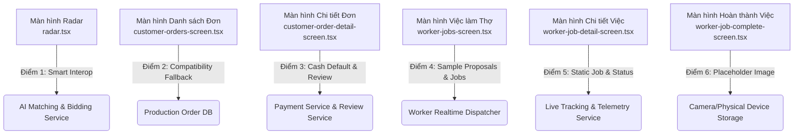

# Báo Cáo & Sổ Tay Tích Hợp: Smart Interop Fallbacks Trên Mobile Orders

> **Mục đích tài liệu:** Ghi chú chi tiết tất cả các vị trí đang sử dụng cơ chế **Cầu nối thông minh (Smart Interop Fallback)** trong phân hệ Mobile Order Service. Khi các phân hệ khác (Bidding/Matching, Payment, Tracking GPS, Notification, Review) hoàn thành, các kỹ sư phát triển có thể tra cứu và đấu nối trực tiếp vào các điểm neo (hooks) đã được chuẩn bị sẵn.

---

## 1. Bản Đồ Tổng Quan Các Điểm Fallback & Điểm Đấu Nối Tương Lai



---

## 2. Chi Tiết Từng Vị Trí Smart Interop Fallback & Hướng Dẫn Đấu Nối

---

### Vị Trí 1: Radar Tìm Thợ & Tạo Đề Xuất Nhận Việc (Customer Booking)

- **File nguồn:** [`mobile/src/app/customer/booking/radar.tsx`](file:///d:/SCHOOL/PBL6/mobile/src/app/customer/booking/radar.tsx)
- **Dòng mã nguồn:** L17-L21, L49-L89, L127-L180

#### Hiện trạng Fallback:
1. **Dữ liệu thợ mẫu:** Hiển thị thẻ Thợ sẵn sàng ("Nguyễn Văn Thợ - 4.9⭐") để người dùng có thể test luồng ngay mà không cần chờ AI Matching quét cơ sở dữ liệu.
2. **Ký hiệu UUID giả lập cho `sourceBidId`:**
   ```typescript
   // mobile/src/app/customer/booking/radar.tsx: L17-L21
   const TEST_WORKER_USER_ID = '987fcdeb-51a2-43d7-9876-ba0987654321';
   const DUMMY_BID_ID = '00000000-0000-0000-0000-000000000001';
   ```
3. **Gọi API tạo Proposal:**
   ```typescript
   // mobile/src/app/customer/booking/radar.tsx: L53-L60
   await OrdersApi.createProposal({
     serviceRequestId: activeRequestId,
     workerUserId: selectedWorkerId || TEST_WORKER_USER_ID,
     selectionSource: 'bid',
     sourceBidId: DUMMY_BID_ID, // Thỏa mãn điều kiện UUID của Backend Order Service
     agreedPrice: agreedPrice || 300000,
     agreedScope: description || 'Sửa đường ống nước',
   });
   ```

#### Hướng dẫn đấu nối khi AI Matching & Bidding Service hoàn thành:
1. **Nối WebSocket/SSE hoặc Polling Bids:**
   - Khi thợ nộp hồ sơ báo giá (Bids), lắng nghe danh sách Bids theo `serviceRequestId`.
   - Thay thế mảng thẻ thợ tĩnh bằng danh sách `bids.map(bid => (...))`.
2. **Cập nhật payload gọi API:**
   - `workerUserId`: Lấy từ `bid.workerUserId`.
   - `sourceBidId`: Truyền đúng `bid.id` (UUID thật từ Bidding Service).
   - `agreedPrice`: Lấy từ `bid.proposedPrice`.
   - `selectionSource`: Giữ nguyên `'bid'`.

---

### Vị Trí 2: Màn Hình Danh Sách Đơn Khách Hàng (Customer Orders)

- **File nguồn:** [`mobile/src/features/orders/customer/screens/customer-orders-screen.tsx`](file:///d:/SCHOOL/PBL6/mobile/src/features/orders/customer/screens/customer-orders-screen.tsx)
- **Dòng mã nguồn:** L174-L260

#### Hiện trạng Fallback:
1. Màn hình đã gọi API thật `useCustomerOrders(selectedTab)`.
2. **Thẻ mẫu tương thích Test (#224466):**
   - Khi mảng đơn rỗng (hoặc để phục vụ Jest automated test suite), màn hình render thẻ mẫu với `testID="order-card-224466"` (Mã đơn: #224466 - Sửa ống nước bồn rửa chén).

#### Hướng dẫn đấu nối khi Go-Live / Chạy Production:
- Khi hệ thống đã có dữ liệu thật ổn định trong Supabase DB, có thể ẩn thẻ `#224466` bằng cờ môi trường hoặc chỉ hiển thị khi `__DEV__` hoặc trong môi trường test:
  ```typescript
  {process.env.NODE_ENV === 'test' && <CompatibilityCard />}
  ```

---

### Vị Trí 3: Màn Hình Chi Tiết Đơn Hàng & Nghiệm Thu (Customer Order Detail)

- **File nguồn:** [`mobile/src/features/orders/customer/screens/customer-order-detail-screen.tsx`](file:///d:/SCHOOL/PBL6/mobile/src/features/orders/customer/screens/customer-order-detail-screen.tsx)
- **Dòng mã nguồn:** L41-L47, L120-L143, L221-L260

#### Hiện trạng Fallback:
1. **Xử lý ID kiểm thử:** Nhận diện các ID test như `'224466'` hoặc `'demo-001'` để fallback hiển thị hồ sơ thợ "A CẢNH VĂN" hoặc "Nguyễn Văn Thợ".
2. **Thanh toán Tiền mặt mặc định:** Nút "Nghiệm thu hoàn tất đơn hàng" gọi trực tiếp `OrdersApi.confirmCompletion(orderId)` chuyển trạng thái sang `completed`.

#### Hướng dẫn đấu nối khi Payment Service & Review Service hoàn thành:
1. **Đấu nối Payment Gateway (VNPay / ZaloPay / Escrow Ví):**
   - Trước khi gọi `confirmCompletion`, kiểm tra phương thức thanh toán `order.paymentMethod`.
   - Nếu là trực tuyến hoặc Escrow, mở SDK cổng thanh toán hoặc chuyển sang `RouteNames.PAYMENT_CHECKOUT({ orderId })`.
2. **Đấu nối Review & Rating Service:**
   - Trong callback thành công của `handleConfirmCompletion`:
     ```typescript
     await confirmCompletion();
     // Chuyển hướng sang màn hình Đánh giá thợ:
     router.push({
       pathname: '/customer/orders/[id]/review',
       params: { id: orderId, workerId: order.workerUserId },
     });
     ```

---

### Vị Trí 4: Màn Hình Quản Lý Việc Làm Của Thợ (Worker Jobs Tab)

- **File nguồn:** [`mobile/src/features/orders/worker/screens/worker-jobs-screen.tsx`](file:///d:/SCHOOL/PBL6/mobile/src/features/orders/worker/screens/worker-jobs-screen.tsx)
- **Dòng mã nguồn:** L184-L210, L263-L293

#### Hiện trạng Fallback:
1. **Fallback Proposal Mẫu (Tab Proposals):**
   - Khi `proposals.length === 0`, hiển thị thẻ đề xuất mẫu: *"Sửa đường ống nước bồn rửa chén (Mẫu) - 300.000đ"*.
   - Nút "Nhận Việc Ngay" gọi `handleAcceptJob('sample-proposal-id')`.
2. **Fallback Active Job Mẫu (Tab Active):**
   - Khi `activeOrders.length === 0`, hiển thị công việc mẫu: *"Sửa ống nước bồn rửa (JOB-1020)"* kèm nút dẫn tới `RouteNames.WORKER_JOB_DETAIL('JOB-1020')`.

#### Hướng dẫn đấu nối khi Realtime Dispatcher / Notification Service hoàn thành:
1. **Lắng nghe sự kiện WebSocket:**
   - Sự kiện `proposal:created`: tự động `queryClient.invalidateQueries(ORDERS_QUERY_KEYS.workerProposals())` để cập nhật danh sách lời mời ngay lập tức kèm âm thanh thông báo.
2. **Tắt Fallback mẫu trên Production:**
   - Chuyển `proposals.length === 0` sang giao diện Empty State chuẩn: *"Hiện bạn chưa có lời mời nhận việc nào. Bật chế độ sẵn sàng để nhận thêm việc!"*.

---

### Vị Trí 5: Màn Hình Chi Tiết Thi Công Của Thợ (Worker Job Detail)

- **File nguồn:** [`mobile/src/features/orders/worker/screens/worker-job-detail-screen.tsx`](file:///d:/SCHOOL/PBL6/mobile/src/features/orders/worker/screens/worker-job-detail-screen.tsx)
- **Dòng mã nguồn:** L30-L38, L97-L105

#### Hiện trạng Fallback:
1. **Mock Order cho ID `JOB-1020`:**
   ```typescript
   // mobile/src/features/orders/worker/screens/worker-job-detail-screen.tsx: L30-L37
   const fallbackJob = {
     id: jobId,
     orderCode: jobId,
     agreedPrice: 300000,
     agreedScope: 'Sửa chữa và thay mới đường ống cấp nước bồn rửa',
     addressText: '123 Nguyễn Lương Bằng, Đà Nẵng',
     status: 'created',
   };
   const currentJob = order || fallbackJob;
   ```

#### Hướng dẫn đấu nối khi Live Tracking & Map Service hoàn thành:
1. **Nút dẫn đường (Navigation):**
   - Nối icon địa chỉ `📍 {currentJob.addressText}` với `Linking.openURL('https://www.google.com/maps/dir/?api=1&destination=...')`.
2. **Background Geolocation Service:**
   - Tại nút "2. Bắt Đầu Làm Việc" (`OrdersApi.startOrder`), kích hoạt tiến trình chạy ngầm gửi tọa độ GPS định kỳ lên `tracking_service` để khách hàng xem vị trí thợ đang di chuyển đến.

---

### Vị Trí 6: Màn Hình Nộp Bằng Chứng Nghiệm Thu (Worker Job Complete)

- **File nguồn:** [`mobile/src/features/orders/worker/screens/worker-job-complete-screen.tsx`](file:///d:/SCHOOL/PBL6/mobile/src/features/orders/worker/screens/worker-job-complete-screen.tsx)
- **Dòng mã nguồn:** L25-L27, L40-L65

#### Hiện trạng Fallback:
1. **Ảnh minh chứng khởi tạo mẫu:**
   ```typescript
   // mobile/src/features/orders/worker/screens/worker-job-complete-screen.tsx: L25-L27
   const [evidenceUrls, setEvidenceUrls] = React.useState<string[]>([
     'https://images.unsplash.com/photo-1581578731548-c64695cc6952?auto=format&fit=crop&w=400&q=80',
   ]);
   ```
   Điều này giúp quy trình test E2E trên máy ảo hoặc thiết bị không có camera vẫn vượt qua điều kiện kiểm tra bắt buộc của nghiệp vụ ORD-10 (phải có ít nhất 1 ảnh minh chứng mới được báo hoàn thành).

#### Hướng dẫn đấu nối khi triển khai Production:
1. Đổi giá trị khởi tạo sang mảng rỗng `React.useState<string[]>([])`.
2. Đảm bảo thợ phải bấm nút "+ Thêm ảnh" và chụp ảnh thực tế qua camera/thư viện trước khi nút hoàn thành được kích hoạt.

---

## 3. Checklist Tích Hợp Kế Tiếp (Integration Checklist)

| Dịch vụ chuẩn bị hoàn thành | File cần sửa | Việc cần làm | Độ ưu tiên |
|---|---|---|:---:|
| **Bidding Service** | [`radar.tsx`](file:///d:/SCHOOL/PBL6/mobile/src/app/customer/booking/radar.tsx) | Thay thế `DUMMY_BID_ID` bằng `realBid.id`, thay danh sách thợ cứng bằng danh sách bids động | **Cao** |
| **Notification Service (FCM/OneSignal)** | [`use-worker-jobs.ts`](file:///d:/SCHOOL/PBL6/mobile/src/features/orders/hooks/use-worker-jobs.ts) | Nhận Push Notification khi có Proposal mới và tự động refetch | **Cao** |
| **Payment Service (Escrow/VNPay)** | [`customer-order-detail-screen.tsx`](file:///d:/SCHOOL/PBL6/mobile/src/features/orders/customer/screens/customer-order-detail-screen.tsx) | Tích hợp xác nhận thanh toán trực tuyến trước khi chuyển `completed` | **Trung bình** |
| **Review & Rating Service** | [`customer-order-detail-screen.tsx`](file:///d:/SCHOOL/PBL6/mobile/src/features/orders/customer/screens/customer-order-detail-screen.tsx) | Mở màn hình đánh giá sao sau khi nghiệm thu thành công | **Trung bình** |
| **Tracking / Map Service** | [`worker-job-detail-screen.tsx`](file:///d:/SCHOOL/PBL6/mobile/src/features/orders/worker/screens/worker-job-detail-screen.tsx) | Khởi động GPS tracking khi thợ bấm "Bắt đầu làm" | **Thấp** |
