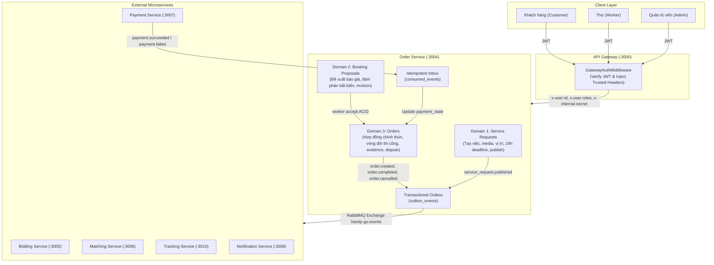
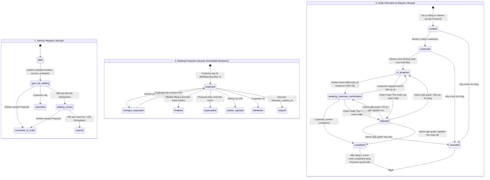
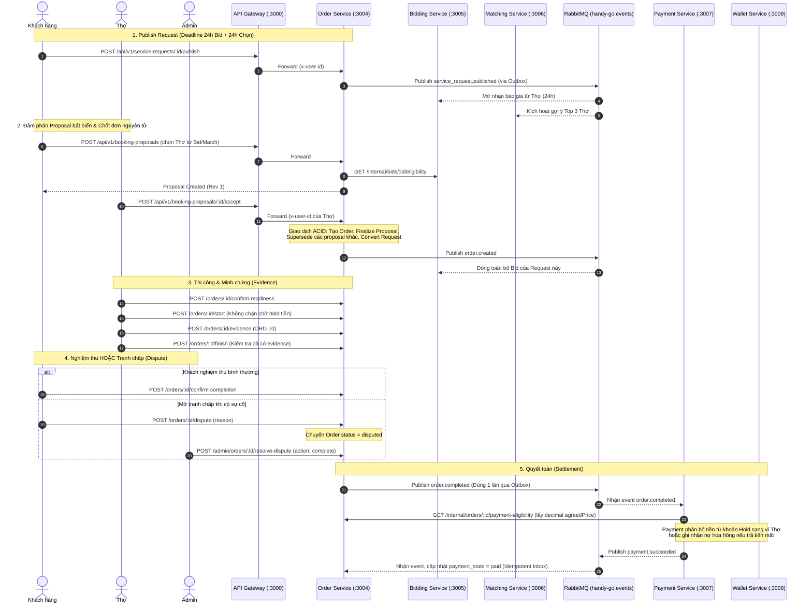

# Kế Hoạch Triển Khai Chi Tiết: Order Service (HG-32)

> **Dự án:** HANDY GO (PBL6) — Sprint 4  
> **Jira Ticket:** `[HG-32] Order SERVICE` (Ticket HG-32, Epic: `Order`)  
> **Tài liệu nguồn:** [`HG-32-Order_Service.pdf`](file:///d:/SCHOOL/PBL6/docs/order-service/HG-32-Order_Service.pdf)  
> **Database DBML:** [`order-service-v2.dbml`](file:///d:/SCHOOL/PBL6/docs/dbml/order-service-v2.dbml)  
> **Tài liệu đặc tả kỹ thuật chi tiết:** [`PLAN_ORDER_SERVICE.md`](file:///d:/SCHOOL/PBL6/docs/order-service/PLAN_ORDER_SERVICE.md)

---

## 1. Tóm Tắt & Nguyên Tắc Chốt (Key Principles & Assumptions)

1. **Ranh giới Settlement (Quyết toán) rõ ràng:** 
   - Event `order.completed` là **yêu cầu Payment Service quyết toán khoản tiền đã tạm giữ**, KHÔNG phải lệnh Order Service tự thu tiền hay chuyển tiền cho Thợ.
   - Order Service sở hữu vòng đời hợp đồng, thi công và biên bản nghiệm thu; Payment Service sở hữu phương thức thanh toán, phí sàn (`platform_fee`), tạm giữ tiền (Hold/Escrow) và quyết toán (`payment_settlements`).
   - `GET /internal/orders/:orderId/payment-eligibility` trả về điều kiện hoàn tất, giá chốt (`agreedPrice` dưới dạng chuỗi decimal chính xác, không dùng floating-point), `customerUserId`, `workerUserId`.
2. **Quy tắc Escrow và Guard lúc bắt đầu thi công (`start`):**
   - Với hình thức **Point**: Payment/Wallet có trách nhiệm tạm giữ tiền của Khách trước khi thi công. Khi nhận `order.completed`, Payment giải ngân từ khoản đã giữ sang ví Thợ (trừ phí sàn).
   - Với hình thức **Tiền mặt (Cash)**: Khách trả trực tiếp cho Thợ; Payment chỉ ghi nhận khoản phải thu hoa hồng sàn (`commission_receivables`), không chuyển thêm tiền cho Thợ.
   - **Giả định đã chốt:** Order Service **KHÔNG chặn bước `start`** để chờ tín hiệu đã tạm giữ; việc đảm bảo Point được giữ thuộc trách nhiệm của luồng Payment/Checkout bên ngoài Order.
3. **Chuẩn hóa Hợp đồng Sự kiện (Event Contract):**
   - Sự kiện thanh toán thành công chuẩn là `payment.succeeded` (thay vì `payment.completed`), đồng bộ trong `@libs/common/src/events/event-patterns.ts` (giữ alias tương thích ngược). Order Service tiêu thụ idempotent (Inbox pattern) và chỉ cập nhật projection `payment_state`.
4. **Hạn định thời gian (Deadlines) & Background Scheduler:**
   - Mặc định đóng nhận báo giá: `bidding_closes_at = published_at + 24 hours`.
   - Hạn chót Khách chọn Thợ: `selection_expires_at = bidding_closes_at + 24 hours` (tổng 48 giờ).
   - Hạn hiệu lực của Proposal (`expires_at`): Tối đa không được vượt quá `selection_expires_at`.
   - Worker nền định kỳ quét đóng nhận Bid và hết hạn Request/Proposal quá hạn.
5. **Quy trình Quản lý Tranh chấp (Dispute Resolution):**
   - Khách hoặc Thợ được quyền mở tranh chấp (`POST /orders/:id/dispute`) khi đơn ở trạng thái `in_progress` hoặc `awaiting_customer_confirmation`.
   - Admin can thiệp giải quyết (`POST /admin/orders/:id/resolve-dispute`) với lý do bắt buộc và chọn 1 trong 3 hành động: tiếp tục trạng thái trước tranh chấp, hủy đơn (`cancelled`), hoặc hoàn tất nghiệm thu (`completed`). Nếu hoàn tất, phát đúng một event `order.completed`.

---

## 2. Kiến Trúc & Phân Vùng Domain

Order Service là trung tâm điều phối giao dịch cốt lõi của HANDY GO, sở hữu và quản lý **3 Business Domains**:



---

## 3. Máy Trạng Thái Cốt Lõi (Finite State Machines)



---

## 4. Quy Trình Tích Hợp Uploads & Media Qua API Gateway (ORD-02 & ORD-10)

Hệ thống tận dụng 2 endpoint upload có sẵn tại **API Gateway** (`apps/api-gateway/src/uploads`):
1. `POST /api/v1/uploads/image`: Upload file hình ảnh (JPEG, PNG, WebP) stream lên Cloudinary $\to$ trả về metadata và URL ảnh.
2. `POST /api/v1/uploads/video/init`: Khởi tạo chữ ký xác thực Direct Chunked Upload cho video dung lượng lớn $\to$ Client upload từng chunk trực tiếp lên Cloudinary.

> **Nguyên tắc cốt lõi:** **Order Service HOÀN TOÀN KHÔNG NHẬN MULTIPART/FORM-DATA TRỰC TIẾP**. Order Service chỉ nhận payload JSON chứa `mediaUrl` (trả về từ Gateway / Cloudinary) để lưu vào database liên kết với `service_request_id` (`request_media` - ORD-02) hoặc `order_id` (`order_evidences` - ORD-10).

---

## 5. Lộ Trình 7 Giai Đoạn Triển Khai (Phased Roadmap)

| Giai đoạn | Nhiệm vụ Ticket | Mô tả & Sản phẩm bàn giao |
| :--- | :--- | :--- |
| **Giai đoạn 1** | **ORD-01** | **Database, Migration & Outbox Infrastructure**: Prisma schema trong schema `order_service`, kết nối PostgreSQL qua `@prisma/adapter-pg`, Outbox & Consumed Events repositories, scripts `prisma:generate:order`. Bổ sung các trường lưu vết tranh chấp (`disputed_at`, `dispute_reason`, `dispute_previous_status`, `dispute_resolved_at`). |
| **Giai đoạn 2** | **ORD-02, ORD-03** | **Service Request Domain, Deadline & Lifecycle**: CRUD draft yêu cầu, lưu media upload từ Gateway, validate xuất bản (tọa độ GPS, dịch vụ catalog, lịch hẹn). Thiết lập hạn mặc định: `bidding_closes_at` (+24h), `selection_expires_at` (+24h). Background Scheduler quét chuyển trạng thái `bidding_closed` và `expired`. Phát event `service_request.published` qua Outbox. |
| **Giai đoạn 3** | **ORD-04, ORD-05** | **Booking Proposal & Negotiation**: Tạo đề xuất từ Bid hoặc Matching đã verify; kiểm tra hạn không vượt quá `selection_expires_at`. Đàm phán bất biến qua các revision (`supersedes_proposal_id`), hỗ trợ `request-changes`, `reject`, `withdraw`, `expire`. |
| **Giai đoạn 4** | **ORD-06** | **Worker Accept & Atomic Order Creation**: Giao dịch ACID nguyên tử chốt hợp đồng, khóa dòng chống double-order, tạo bản ghi Order, snapshot vị trí GPS, finalize proposal, supersede các proposal còn lại, bắn event `order.created`. |
| **Giai đoạn 5** | **ORD-07, ORD-08, ORD-10** | **Order Lifecycle, Evidence, Dispute & Queries**: Máy trạng thái thi công (`confirmed` $\to$ `in_progress` $\to$ `awaiting` $\to$ `completed` / `rework`). Tải lên bằng chứng hoàn thành (ORD-10). Luồng tranh chấp (`POST /orders/:id/dispute`) và Admin giải quyết tranh chấp (`POST /admin/orders/:id/resolve-dispute`). Mọi chuyển trạng thái ghi history; giải quyết thành `completed` phát đúng 1 `order.completed`. |
| **Giai đoạn 6** | **ORD-09** | **Inter-Service Contracts, RabbitMQ & Gateway**: Cung cấp internal APIs: `GET /internal/service-requests/:id/bidding-eligibility`, `GET /internal/orders/:orderId/payment-eligibility` (trả giá dạng chuỗi decimal chính xác). Outbox Publisher nền. Consumer tiêu thụ `payment.succeeded`, `payment.failed` idempotent, cập nhật `payment_state`. Cấu hình route Gateway proxy. |
| **Giai đoạn 7** | **Quality Gate** | **Toàn diện chất lượng mã nguồn**: Chạy bộ unit tests với Vitest, kiểm tra kiểu tĩnh `pnpm run typecheck`, kiểm tra linter `pnpm run lint`, cập nhật `backend/AGENTS.md`. |

---

## 6. Sơ Đồ Tương Tác Giữa Các Microservices (Sequence Diagram)



---

## 7. Danh Mục Điểm Cuối HTTP API (API Endpoints Summary)

### Service Requests (`/api/v1/service-requests`)
- `POST /` — Tạo draft yêu cầu mới (Customer)
- `GET /` — Danh sách yêu cầu của tôi (Customer)
- `GET /:id` — Chi tiết yêu cầu + media + proposals (Customer / Worker)
- `PATCH /:id` — Cập nhật nháp khi còn `draft` (Customer)
- `POST /:id/publish` — Xuất bản yêu cầu (Khởi tạo hạn 24h bid, 24h chọn) (Customer)
- `POST /:id/cancel` — Hủy yêu cầu (Customer)
*(Media được gửi trực tiếp trong mảng `media` của `POST /` và `PATCH /:id`, không tạo API media riêng lẻ)*

### Booking Proposals (`/api/v1/booking-proposals`)
- `POST /` — Tạo đề xuất hợp đồng (Customer)
- `GET /` — Danh sách đề xuất (Customer / Worker)
- `GET /:id` — Chi tiết đề xuất
- `GET /me` — Đề xuất gửi đến Thợ hiện tại (Worker)
- `POST /:id/request-changes` — Thợ yêu cầu sửa điều khoản kèm ghi chú (Worker)
- `POST /:id/reject` — Thợ từ chối đề xuất (Worker)
- `POST /:id/withdraw` — Khách rút lại đề xuất (Customer)
- `POST /:id/accept` — **Thợ đồng ý đề xuất $\to$ Tạo Order nguyên tử (Worker)**

### Orders & Evidences (`/api/v1/orders`)
- `GET /` — Danh sách đơn của tôi (Customer / Worker)
- `GET /:id` — Chi tiết đơn hàng + snapshot địa chỉ + trạng thái thanh toán
- `GET /:id/status-history` — Lịch sử thay đổi trạng thái đơn
- `POST /:id/confirm-readiness` — Thợ xác nhận sẵn sàng thi công (Worker)
- `POST /:id/start` — Thợ bắt đầu làm việc (Worker)
- `POST /:id/finish` — Thợ báo hoàn thành (Worker)
- `POST /:id/confirm-completion` — Khách xác nhận hoàn tất $\to$ Kích hoạt thanh toán (Customer)
- `POST /:id/request-rework` — Khách yêu cầu làm lại kèm lý do (Customer)
- `POST /:id/cancel` — Hủy đơn theo chính sách (Customer / Worker)
- `POST /:id/dispute` — Mở khiếu nại tranh chấp khi đơn `in_progress` hoặc `awaiting_confirmation` (Customer / Worker)
- `POST /:id/evidence` — Thợ đính kèm ảnh/video minh chứng hoàn thành (Worker - ORD-10)
- `GET /:id/evidence` — Xem danh sách minh chứng hoàn thành
- `DELETE /:id/evidence/:evidenceId` — Xóa minh chứng hoàn thành (Worker)

### Admin Operations (`/api/v1/admin/orders`)
- `GET /api/v1/admin/orders` — Tra cứu toàn diện đơn hàng (Admin)
- `POST /api/v1/admin/orders/:id/resolve-dispute` — Giải quyết tranh chấp với lý do bắt buộc và hành động (`resume_previous_state` / `cancel` / `complete`) (Admin)

### Internal APIs (`/internal/...`)
- `GET /internal/service-requests/:id/bidding-eligibility` — Cung cấp cho Bidding kiểm tra thời hạn
- `GET /internal/orders/:orderId/payment-eligibility` — Cung cấp cho Payment lấy thông tin quyết toán (giá dạng decimal string)

---

## 8. Lệnh Kiểm Tra Chất Lượng (Quality Gate Verification)

```bash
# 1. Chạy unit tests cho Order Service
pnpm test apps/order-service

# 2. Kiểm tra typecheck toàn bộ monorepo và Prisma
pnpm run typecheck

# 3. Kiểm tra Lint với Oxlint
pnpm run lint
```
