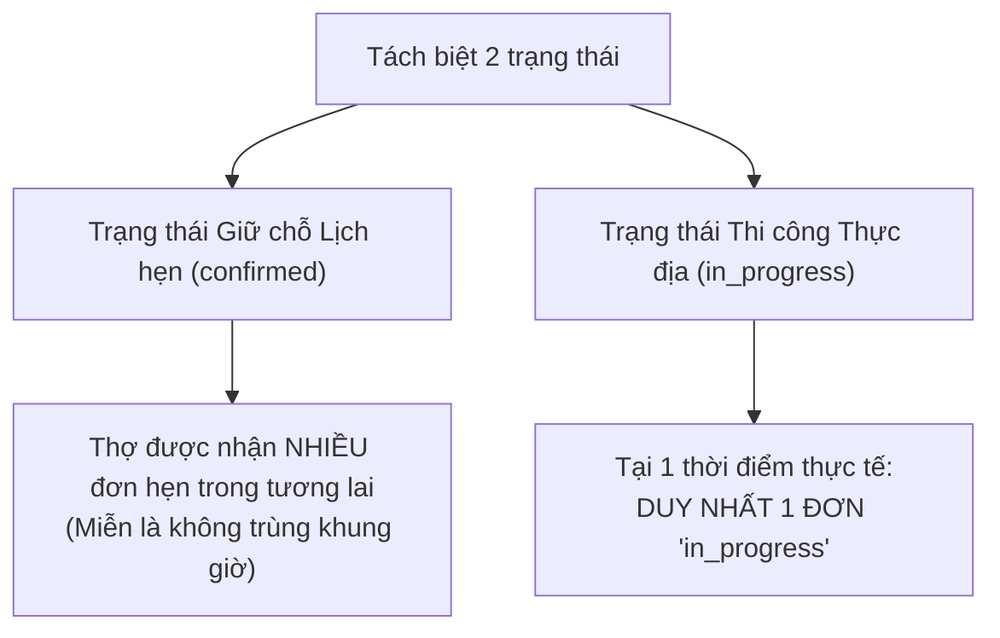

# ĐẶC TẢ PHƯƠNG ÁN B: ĐIỀU PHỐI LỊCH HẸN VÀ THI CÔNG "1 THỢ 1 ĐƠN" THEO 4 NHÓM DỊCH VỤ

> **Trạng thái:** Đề xuất kỹ thuật & kế hoạch triển khai (RFC).  
> **Phạm vi tác động:** Backend (`order-service`, `matching-service`) & Mobile App (`Customer`, `Worker`).  
> **Nguyên tắc kỹ thuật then chốt:** **Không thay đổi DB Schema (Zero DB Migration)**, tận dụng 100% các trường dữ liệu sẵn có (`scheduledAt`, `status`, `workerUserId`).

---

## 1. Bối cảnh & Vấn đề cần giải quyết

### 1.1. Hiện trạng trong hệ thống
* Trong mã nguồn hiện tại ([`orders.service.ts`](file:///D:/SCHOOL/PBL6/backend/apps/order-service/src/orders/orders.service.ts)), hàm `start()` chỉ kiểm tra thợ có phải chủ đơn hay không và trạng thái đơn có phải `confirmed` hay không.
* **Hậu quả:** Hệ thống cho phép 1 thợ bấm bắt đầu (`in_progress`) nhiều đơn cùng lúc. Thực tế cơ sở dữ liệu đã ghi nhận ca thợ (`1377...`) cùng lúc có 2 đơn `in_progress` (`ORD-20261031-J5AR` và `ORD-20261031-D98T`). Việc này là bất hợp lý trên thực địa đối với các dịch vụ sửa chữa tại chỗ.

### 1.2. Nghịch lý nếu khóa cứng "1 thợ 1 đơn"
* Nếu hệ thống khóa tài khoản thợ ngay từ khi đơn được tạo/chấp nhận (`confirmed`): Khi thợ nhận một đơn hẹn vào **chiều mai**, thợ sẽ bị **"đóng băng" tài khoản từ hôm nay đến chiều mai**, không thể nhận thêm bất kỳ đơn gấp nào để làm kiếm thêm thu nhập.
* Nếu cào bằng mọi dịch vụ giữ chỗ cách nhau 2 tiếng: Dịch vụ sửa khóa (mất 20 phút) bị giữ chỗ quá dài gây lãng phí; dịch vụ dọn nhà (mất 4-5 tiếng) bị giữ chỗ quá ngắn gây vỡ lịch hẹn đơn tiếp theo.

---

## 2. Nguyên tắc cốt lõi của Phương án B



1. **Tách biệt "Lịch hẹn" và "Thi công":**
   * **Đơn hẹn (`confirmed`):** Thợ có quyền nhận nhiều đơn trong tương lai. Hệ thống chỉ kiểm tra chống trùng khung giờ (Time-slot Overlap).
   * **Đang làm (`in_progress`):** Khóa cứng quy tắc **1 thợ 1 đơn duy nhất** tại hàm `start()`.
2. **Giữ chỗ linh hoạt theo 4 nhóm dịch vụ (Dynamic Time-slot):**
   * Thời gian giữ chỗ được tính toán tự động dựa trên đặc thù của 84 dịch vụ trong hệ thống, chia theo 4 nhóm thời lượng chuẩn.
3. **Không sửa đổi cơ sở dữ liệu:**
   * Không thêm cột, không sửa enum Prisma, không chạy DB migration. Toàn bộ logic được giải quyết thông qua hằng số cấu hình code TypeScript và các hàm tiện ích backend.

---

## 3. Phân loại 4 Nhóm dịch vụ & Khung giờ giữ chỗ

Dựa trên kết quả khảo sát 84 dịch vụ thuộc 22 danh mục trong cơ sở dữ liệu `catalog_service`:

| Nhóm | Đặc thù dịch vụ | Thời lượng thi công ($\Delta t$) | Đệm di chuyển ($Buffer$) | Tổng thời gian giữ chỗ | Danh mục tiêu biểu áp dụng |
| :---: | :--- | :---: | :---: | :---: | :--- |
| **Nhóm 1** | Siêu ngắn, khẩn cấp, cứu hộ | **30 – 45 phút** | 15 phút | **~ 1.0 giờ** | `Sửa khoá`, `Đặt xe`, `Hỗ trợ tìm kiếm và cứu trợ` (vá xe, cứu hộ bình, kéo xe). |
| **Nhóm 2** | Sửa chữa, bảo dưỡng tiêu chuẩn | **60 – 90 phút** | 30 phút | **~ 2.0 giờ** | `Điện`, `Điện Nước`, `Điện lạnh`, `Điện gia dụng`, `Sửa máy tính`, `Sửa xe`, `Makeup`, `Nails`, `Làm vườn`. |
| **Nhóm 3** | Theo ca, nửa ngày hoặc 1 ngày | **3 – 5 giờ** | 30 phút | **~ 4.0 – 5.0 giờ** *(Khóa trọn 1 ca)* | `Dịch vụ vệ sinh`, `Vận chuyển`, `Lắp đặt camera`, `Nấu ăn`, `Diệt côn trùng`. |
| **Nhóm 4** | Công trình, thi công đa ngày | **Từ 2 ngày trở lên** | Theo ngày | **Khóa theo Ngày bắt đầu** *(Không khóa theo phút)* | `Xây dựng`, `Nhôm kính`, `Cơ khí`, `Cửa cuốn`, `Chăm sóc y tế` (theo tuần/tháng). |

### Công thức tính khung giờ giữ chỗ (Reserved Window)
Đối với một đơn hẹn tại thời điểm $T_{\text{scheduled}}$ (`scheduledAt`):

$$[\text{SlotStart}, \; \text{SlotEnd}] = [T_{\text{scheduled}} - Buffer, \; T_{\text{scheduled}} + \Delta t + Buffer]$$

* **Điều kiện trùng lịch giữa đơn mới $A$ và đơn hiện có $B$:**
  $$\max(A_{\text{start}}, B_{\text{start}}) < \min(A_{\text{end}}, B_{\text{end}})$$
  *(Nếu giao thoa thời gian $> 0 \implies$ Báo lỗi `409 Conflict: SCHEDULE_CONFLICT`).*

---

## 4. Giải pháp triển khai Backend (Zero DB Migration)

### 4.1. Cấu hình bảng ánh xạ danh mục trong Code
Tạo file cấu hình tại [`backend/apps/order-service/src/common/constants/service-tier.config.ts`](file:///D:/SCHOOL/PBL6/backend/apps/order-service/src/common/constants/service-tier.config.ts):

```typescript
export enum ServiceTier {
  TIER_1_INSTANT = 'TIER_1_INSTANT',     // 1h
  TIER_2_STANDARD = 'TIER_2_STANDARD',   // 2h
  TIER_3_HALF_DAY = 'TIER_3_HALF_DAY',   // 4.5h
  TIER_4_PROJECT = 'TIER_4_PROJECT',     // Đa ngày
}

export const TIER_CONFIG: Record<ServiceTier, { durationMin: number; bufferMin: number; isMultiDay?: boolean }> = {
  [ServiceTier.TIER_1_INSTANT]: { durationMin: 45, bufferMin: 15 },
  [ServiceTier.TIER_2_STANDARD]: { durationMin: 90, bufferMin: 30 },
  [ServiceTier.TIER_3_HALF_DAY]: { durationMin: 240, bufferMin: 30 },
  [ServiceTier.TIER_4_PROJECT]: { durationMin: 0, bufferMin: 0, isMultiDay: true },
};

export const CATEGORY_TIER_MAP: Record<string, ServiceTier> = {
  // Nhóm 1
  'Sửa khoá': ServiceTier.TIER_1_INSTANT,
  'Đặt xe': ServiceTier.TIER_1_INSTANT,
  'Hỗ trợ tìm kiếm và cứu trợ': ServiceTier.TIER_1_INSTANT,

  // Nhóm 2 (Mặc định cho các việc dân dụng phổ thông)
  'Điện lạnh': ServiceTier.TIER_2_STANDARD,
  'Điện': ServiceTier.TIER_2_STANDARD,
  'Điện Nước': ServiceTier.TIER_2_STANDARD,
  'Điện gia dụng': ServiceTier.TIER_2_STANDARD,
  'Sửa máy tính': ServiceTier.TIER_2_STANDARD,
  'Sửa xe': ServiceTier.TIER_2_STANDARD,
  'Makeup': ServiceTier.TIER_2_STANDARD,
  'Nails': ServiceTier.TIER_2_STANDARD,
  'Làm vườn': ServiceTier.TIER_2_STANDARD,

  // Nhóm 3
  'Dịch vụ vệ sinh': ServiceTier.TIER_3_HALF_DAY,
  'Vận chuyển': ServiceTier.TIER_3_HALF_DAY,
  'Lắp đặt camera': ServiceTier.TIER_3_HALF_DAY,
  'Nấu ăn': ServiceTier.TIER_3_HALF_DAY,
  'Diệt côn trùng': ServiceTier.TIER_3_HALF_DAY,

  // Nhóm 4
  'Xây dựng': ServiceTier.TIER_4_PROJECT,
  'Nhôm kính': ServiceTier.TIER_4_PROJECT,
  'Cơ khí': ServiceTier.TIER_4_PROJECT,
  'Cửa cuốn': ServiceTier.TIER_4_PROJECT,
  'Chăm sóc y tế': ServiceTier.TIER_4_PROJECT,
};
```

### 4.2. Chốt chặn 1: Khóa 1 đơn thi công duy nhất tại `start()`
Trong [`orders.service.ts`](file:///D:/SCHOOL/PBL6/backend/apps/order-service/src/orders/orders.service.ts):
```typescript
// Kiểm tra không cho phép thợ chạy 2 đơn in_progress đồng thời
const activeWorkingOrder = await tx.order.findFirst({
  where: {
    workerUserId,
    status: 'in_progress',
    id: { not: orderId },
  },
  select: { id: true, orderCode: true },
});

if (activeWorkingOrder) {
  throw new ConflictException({
    code: 'WORKER_ALREADY_BUSY',
    message: `Bạn đang thi công đơn #${activeWorkingOrder.orderCode}. Vui lòng hoàn thành hoặc nghiệm thu đơn hiện tại trước khi bắt đầu đơn mới!`,
  });
}
```

### 4.3. Chốt chặn 2: Chặn bấm `start()` quá sớm so với giờ hẹn
Cũng trong hàm `start()`, ngăn thợ vô tình kích hoạt đơn hẹn ngày mai:
```typescript
if (order.scheduledAt) {
  const diffMinutes = (new Date(order.scheduledAt).getTime() - now.getTime()) / (60 * 1000);
  // Nếu còn cách giờ hẹn hơn 45 phút -> Chưa cho phép bấm start
  if (diffMinutes > 45) {
    throw new BadRequestException({
      code: 'TOO_EARLY_TO_START',
      message: 'Chưa tới giờ hẹn! Bạn chỉ có thể bấm bắt đầu trước giờ hẹn tối đa 45 phút để chuẩn bị di chuyển.',
    });
  }
}
```

### 4.4. Chốt chặn 3: Kiểm tra xung đột khung giờ khi nhận Proposal
Trong [`booking-proposals.service.ts`](file:///D:/SCHOOL/PBL6/backend/apps/order-service/src/booking-proposals/booking-proposals.service.ts):
* Khi thợ chấp nhận một Booking Proposal có `scheduledAt`, hệ thống dùng hàm `checkScheduleConflict()` để đối chiếu với danh sách các đơn đã `confirmed` của thợ trong vòng $\pm 8\text{h}$.
* Nếu khung giờ bị chồng lấn $\to$ Chặn với mã lỗi `409 Conflict: SCHEDULE_CONFLICT`.

---

## 5. Trải nghiệm trên Mobile App (UI/UX)

### 5.1. Phía Khách hàng (Customer Booking Flow)
* Màn hình chọn thời gian ([`summary.tsx`](file:///D:/SCHOOL/PBL6/mobile/src/app/customer/booking/summary.tsx)):
  * **⚡ Cần thợ ngay:** Tự động set `scheduledAt = now + 30 phút`.
  * **📅 Đặt lịch hẹn trước:** Hiển thị bộ chọn ngày/giờ.

### 5.2. Phía Thợ (Worker Jobs Screen)
* Màn hình [`worker-jobs-screen.tsx`](file:///D:/SCHOOL/PBL6/mobile/src/features/orders/worker/screens/worker-jobs-screen.tsx):
  * **Khu vực 1 - Đơn đang làm (Pinned Top):** Hiển thị duy nhất đơn đang có trạng thái `in_progress` hoặc đơn khẩn cấp cần đi ngay. Có nút chụp ảnh bằng chứng nghiệm thu và nút báo hoàn thành.
  * **Khu vực 2 - Lịch hẹn sắp tới (Upcoming Timeline):** Hiển thị danh sách các đơn `confirmed` theo thứ tự thời gian. Đính kèm tag đếm ngược: *"Còn 2 giờ nữa"*, *"Ngày mai lúc 09:00"*.
* Màn hình [`worker-job-detail-screen.tsx`](file:///D:/SCHOOL/PBL6/mobile/src/features/orders/worker/screens/worker-job-detail-screen.tsx):
  * Nếu là đơn đặt trước và cách giờ hẹn $> 45$ phút: Nút **"Bắt đầu làm"** bị vô hiệu hóa (disabled), hiển thị nhãn phụ: *"Mở trước giờ hẹn 45 phút"*.
  * Nếu thợ đang vướng một đơn `in_progress` khác: Nút **"Bắt đầu làm"** hiện tooltip nhắc nhở: *"Hoàn thành đơn hiện tại trước"*.

---

## 6. Kế hoạch Kiểm thử & Dọn dẹp dữ liệu (Testing & Cleanup)

### 6.1. Ma trận kiểm thử (Test Matrix)
1. **TC-01 (Chặn thi công song song):** Thợ có đơn 1 `in_progress`, gọi `POST /orders/order-2/start` $\implies$ Mong đợi: `409 Conflict (WORKER_ALREADY_BUSY)`.
2. **TC-02 (Giải phóng thợ):** Thợ bấm hoàn thành đơn 1 (chuyển sang `awaiting_customer_confirmation`), gọi `POST /orders/order-2/start` $\implies$ Mong đợi: `200 OK`.
3. **TC-03 (Chặn trùng lịch Nhóm 2):** Thợ có đơn sửa máy lạnh lúc 09:00 (chiếm đến 11:00). Khách gửi đơn sửa ống nước lúc 10:00 $\implies$ Mong đợi: `409 Conflict (SCHEDULE_CONFLICT)`.
4. **TC-04 (Hợp lệ giữa Nhóm 1 và Nhóm 2):** Thợ có đơn sửa khóa lúc 08:00 (chiếm đến 09:00), nhận thêm đơn máy lạnh lúc 09:30 $\implies$ Mong đợi: `200 OK` (vì khoảng trống 30 phút vừa đủ buffer).
5. **TC-05 (Chặn bấm start quá sớm):** Đơn hẹn 15:00 chiều nay. Lúc 10:00 sáng thợ bấm `start` $\implies$ Mong đợi: `400 Bad Request (TOO_EARLY_TO_START)`.

### 6.2. Dọn dẹp dữ liệu rác (Data Cleanup)
* Trong quá trình rà soát phát hiện bản ghi thử nghiệm trong DB production/staging:
  * Tên: `"Dịch vụ test"` (ID: `b6fe4130-cf22-48a5-8278-cae499d82121`, thuộc danh mục `Điện Nước`).
  * Cần chạy script xóa bản ghi này trước khi nghiệm thu tính năng.
