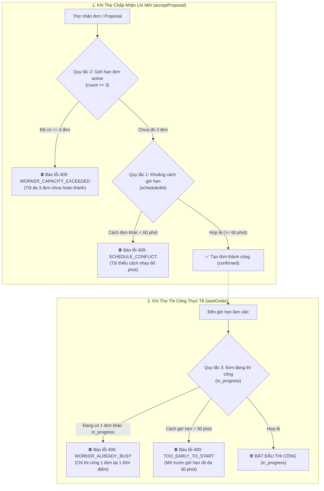

# ĐẶC TẢ PHƯƠNG ÁN C: ĐIỀU PHỐI TINH GỌN THỰC CHIẾN (DUNG HÒA THỊNH & DUY)

> **Mã đặc tả:** `RFC-DISPATCH-LEAN-2026`  
> **Trạng thái:** Đã triển khai & Kiểm thử hoàn tất (Implemented & Verified)  
> **Phạm vi tác động:** Backend (`order-service`) & Mobile App (`Worker`).  
> **Cam kết kỹ thuật:** **Zero DB Migration** (100% tái sử dụng trường `status`, `scheduledAt`, `workerUserId` sẵn có).

---

## 1. Bối cảnh & Lý do tinh gọn

Sau khi đối thoại kỹ thuật và đánh giá thực địa nghề sửa chữa lưu động:
* **Hạn chế của Phương án B (chia 4 nhóm dịch vụ 30p - 90p - 240p):** Trong thực tế, sửa chữa tại chỗ (sửa xe máy, điện nước) có tính bất định cao (rất hay phát sinh hỏng hóc thêm ngoài dự kiến). Việc gò ép thời lượng estimate chi li tới từng phút gây over-engineering và dễ vỡ lịch trình.
* **Góc nhìn thực tế từ thợ (Insight của Duy):** Thợ lưu động thường gom 2–3 việc cùng khu vực/tuyến đường để chạy 1 chuyến kiếm thêm thu nhập.
* **Giải pháp Phương án C:** Bỏ toàn bộ hệ thống 4 nhóm thời lượng phức tạp, thay thế bằng **3 Quy tắc Vàng cốt lõi** vừa đảm bảo tính linh hoạt cho thợ, vừa có chốt chặn kỹ thuật ngăn ngừa tranh chấp và bùng đơn.

---

## 2. Ba Quy Tắc Vàng (Core Lean Rules)

### 2.1. Quy tắc 1: Khoảng cách giờ hẹn tối thiểu 60 phút (Minimum Gap Buffer = 60 mins)
* **Mục đích:** Cào bằng một buffer an toàn: Mỗi lịch hẹn cách nhau tối thiểu **60 phút** (đáp ứng 35-40 phút sửa chữa cơ bản + 20 phút chạy xe sang nhà khách khác trong khu vực nội thành).
* **Vị trí áp dụng:** Hàm `acceptProposal()` trong [`orders.service.ts`](file:///D:/SCHOOL/PBL6/backend/apps/order-service/src/orders/orders.service.ts).
* **Mã lỗi trả về:** `409 Conflict (SCHEDULE_CONFLICT)`.

### 2.2. Quy tắc 2: Giới hạn dung lượng đơn đang chờ (In-flight Capacity Cap = 3 đơn)
* **Mục đích:** Cho phép thợ gom tối đa 3 đơn cùng tuyến đường để đi làm. Khi thợ đang giữ 3 đơn chưa giải quyết xong (`created`, `confirmed`, `in_progress`), hệ thống khóa không cho nhận thêm để tránh "ôm show" rồi trễ hẹn với khách.
* **Vị trí áp dụng:** Hàm `acceptProposal()` trong [`orders.service.ts`](file:///D:/SCHOOL/PBL6/backend/apps/order-service/src/orders/orders.service.ts).
* **Mã lỗi trả về:** `409 Conflict (WORKER_CAPACITY_EXCEEDED)`.
* **Cơ chế nhả quota:** Khi đơn chuyển sang `awaiting_customer_confirmation` (thợ nộp ảnh nghiệm thu), `completed`, hoặc `cancelled`, quota sẽ tự động được giải phóng.

### 2.3. Quy tắc 3: Khóa thi công thực tế (Strict Single In-Progress & 30-min Early Guard)
* **Mục đích:** 1 thợ chỉ có 2 tay, trên thực địa chỉ có thể có mặt sửa 1 chiếc xe tại 1 thời điểm. Đồng thời nút bắt đầu chỉ mở trước giờ hẹn tối đa 30 phút để thợ chuẩn bị di chuyển, tránh vô tình kích hoạt đơn của ngày mai.
* **Vị trí áp dụng:** Hàm `start()` trong [`orders.service.ts`](file:///D:/SCHOOL/PBL6/backend/apps/order-service/src/orders/orders.service.ts).
* **Mã lỗi trả về:** 
  * `409 Conflict (WORKER_ALREADY_BUSY)`: Nếu đang có đơn khác `in_progress`.
  * `400 Bad Request (TOO_EARLY_TO_START)`: Nếu bấm start trước giờ hẹn $> 30$ phút.

---

## 3. Trải nghiệm trên Mobile App (Worker UX)

1. **Thanh hiển thị Dung lượng (Capacity Indicator):**
   * Màn hình [`worker-jobs-screen.tsx`](file:///D:/SCHOOL/PBL6/mobile/src/features/orders/worker/screens/worker-jobs-screen.tsx) hiển thị trực quan số đơn in-flight:
     * $\le 1$ đơn: Badge xanh lá `⚡ Đang nhận: 1/3 đơn`.
     * 2 đơn: Badge vàng `⚡ Đang nhận: 2/3 đơn`.
     * 3 đơn: Badge đỏ `⚠️ Đã đạt giới hạn 3/3 đơn thi công (Hoàn thành bớt để nhận thêm việc)`. Nút "Chấp nhận việc" ở tab Lời mời tự động bị vô hiệu hóa.
2. **Ưu tiên hiển thị đơn đang làm:**
   * Tự động ghim đơn có trạng thái `in_progress` lên vị trí đầu tiên của tab Active với viền xanh dương đậm nổi bật và icon `⚡`.
3. **Chặn thao tác sớm tại Chi tiết Đơn việc:**
   * Màn hình [`worker-job-detail-screen.tsx`](file:///D:/SCHOOL/PBL6/mobile/src/features/orders/worker/screens/worker-job-detail-screen.tsx) tự động disable nút "Bắt Đầu Thi Công" nếu cách giờ hẹn $> 30$ phút kèm ghi chú hướng dẫn thân thiện.

---

## 4. Kết quả Kiểm thử (Test Verification)

* **Backend Unit Tests:** `27/27` test files passed, `279/279` tests passed (bao gồm 43 test trong `orders.service.spec.ts`).
* **Mobile Unit Tests:** `1/1` test suites passed, `5/5` tests passed trong `worker-jobs-screen.test.tsx`.
* **Zero DB Migration:** Không sửa Prisma Schema, không chạy migration, tương thích 100% với dữ liệu hiện tại.

